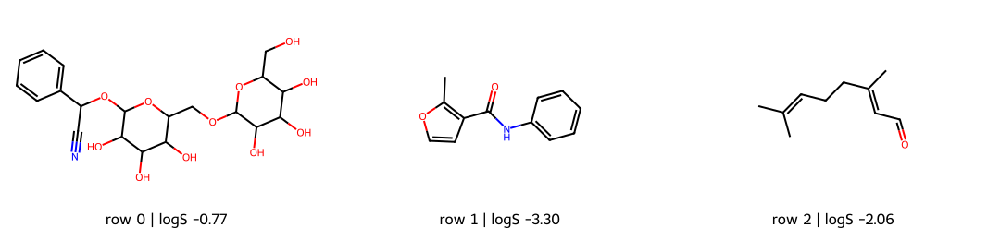

# 什麼是化學資訊學 {#sec-what-is-cheminformatics}

## 手上有一份分子清單，化學資訊學能幫我們做什麼？ {#開場問題}

**化學資訊學**（cheminformatics）結合了化學知識與資訊處理，把分子結構、量測結果和文獻紀錄整理成可以搜尋、計算和分析的資料。這個詞由 chemistry（化學）和 informatics（資訊學）組合而成。它的用途可以很具體：確認兩筆紀錄是不是同一個分子、算出整份清單的分子量，或是在有限的實驗名額中，挑出最值得先測的候選分子。

## 核心概念

要讓電腦處理分子，得先說清楚一列資料代表什麼。名稱方便人閱讀，但同一個物質常有好幾個名稱；分子式記下了元素的數量，卻分不出結構異構物，例如乙醇和二甲醚的分子式都是 C₂H₆O。所以資料表通常還要保存原子如何相連的資訊。本書最常用的結構表示法是 **SMILES**，它把結構寫成一行文字，第 1 章會詳細介紹它的讀法；現在只要把它當成「程式可以用來重建分子結構的字串」就好。

另一個要分清楚的，是「從結構算出來的數值」和「實驗量到的數值」。知道結構以後，我們可以計算分子量、環的數目或氫鍵供體數，這些數值稱為**分子描述符**（molecular descriptor）。水溶解度、酵素抑制活性這些性質，則是在特定條件下量測得到的。兩者放在同一列，就能研究它們之間的關係；但在建立模型之前，要先確認每個性質的定義、單位和來源。

化學資訊學不是一定要用到深度學習才算數，資料整理、結構搜尋和性質預測都是它的一部分。Brown 在 1998 年以藥物探索為背景提出這個詞，強調的是把各種資訊資源整合起來，幫助研究者做出更好的決定。[@brown1998cheminformatics] 本書也沿著這個方向：先把資料整理成可以比較的形式，再問這些比較能幫我們做什麼決定。模型可以替還沒量過的分子估計性質，但估得準不準，要另外留一部分資料來評估，最後還是要靠實驗確認。

## 動手做

[下載本節 notebook](../../notebooks/ch00/00-01-what-is-cheminformatics.ipynb){.btn .btn-sm .btn-outline-primary}　[在 Colab 開啟](ch00/00-01-what-is-cheminformatics.ipynb)

我們先用 ESOL 水溶解度資料來看看一筆紀錄長什麼樣子。ESOL 是 Delaney 整理的水溶解度資料，後來收進 MoleculeNet 資料集，本書會反覆用到它，這裡透過 DeepChem 載入。[@delaney2004esol; @wu2018moleculenet] 這一節不訓練模型，所以不需要把資料分成訓練集和測試集；載入時也關閉了數值轉換，讓 logS 保持原始的實測值。

表格中的幾個欄位，各自代表不同的資訊：

| 欄位 | 含義 | 不能據此認定的事 |
|---|---|---|
| `row_id` | 本次載入後的列編號，從 0 起算 | 不是全球通用的化合物識別碼 |
| `smiles` | 來源提供的分子結構字串 | 不包含所有量測條件 |
| `logS` | 以 mol/L 表示水溶解度後取常用對數 | 不是分子量，也不是模型預測值 |
| `MW` | RDKit 由結構計算的分子量，單位 g/mol | 不是重新做過一次實驗 |

下面這行程式替每個分子計算分子量。`mols` 是已經讀入的分子清單，`table` 是 notebook 準備好的資料表。現在看不懂語法也沒關係，先看輸入和輸出就好，這些函式的用法會在第 2、4 章說明。

```python
table["MW"] = [Descriptors.MolWt(m) if m is not None else np.nan for m in mols]
print(table[["row_id", "smiles", "logS", "MW"]].head(3))
```

{#fig-intro-records fig-alt="三個由 ESOL 前三列 SMILES 繪製的分子，各附列編號及實測 logS；沒有模型預測。"}

讀圖時，先用列編號找到表格中的同一列，再對照結構和 logS。logS 是溶解度（mol/L）取常用對數後的值：logS 為 −2，代表溶解度是 $10^{-2}$ mol/L；logS 為 −3，則是 $10^{-3}$ mol/L，比前者低十倍。也就是說，logS 是負的，只表示溶解度小於 1 mol/L，不是濃度小於零，也不代表「完全不溶」。

這個小例子其實已經包含一套完整的分析習慣：記下資料來源、辨認分子、說明每個欄位的意思，再檢查輸出是否對得回原始紀錄。只看三列時，這些事情好像理所當然；但處理幾千列資料時就很重要了，因為程式一旦用錯欄位，同樣的錯誤會重複幾千次。

如果接下來想預測新分子的溶解度，還要決定用哪些描述符、怎麼分開建模和評估用的資料，以及哪些分子已經超出模型的經驗。這些步驟分別在第 4、9、10 章介紹。這一節先記住一件事：電腦讀的是結構，表格存的是紀錄，而模型要回答的，是我們事先定義好的化學問題。

## 重點整理

- 化學資訊學從整理、搜尋和比較資料開始，也包含性質預測和候選分子的設計。
- 分子結構、計算出的描述符和實測性質來源不同，放在同一列時要分清楚。
- 分析結果要能對回原始紀錄，也要說清楚它能幫我們做什麼決定。

## 小練習

同事把本節的 `MW` 欄稱為「實驗量到的分子量」，又把 `logS` 稱為「程式預測的溶解度」。請依 notebook 的資料來源與計算步驟，改寫這兩個欄位說明。

提示：找出哪個欄位由 `load_delaney()` 帶入，哪個欄位由 `Descriptors.MolWt()` 產生。

## 延伸閱讀

[Brown 1998：化學資訊學與藥物探索](https://doi.org/10.1016/S0065-7743(08)61100-8) · [ESOL 原始研究](https://doi.org/10.1021/ci034243x) · [RDKit 入門文件](https://www.rdkit.org/docs/GettingStartedInPython.html)
