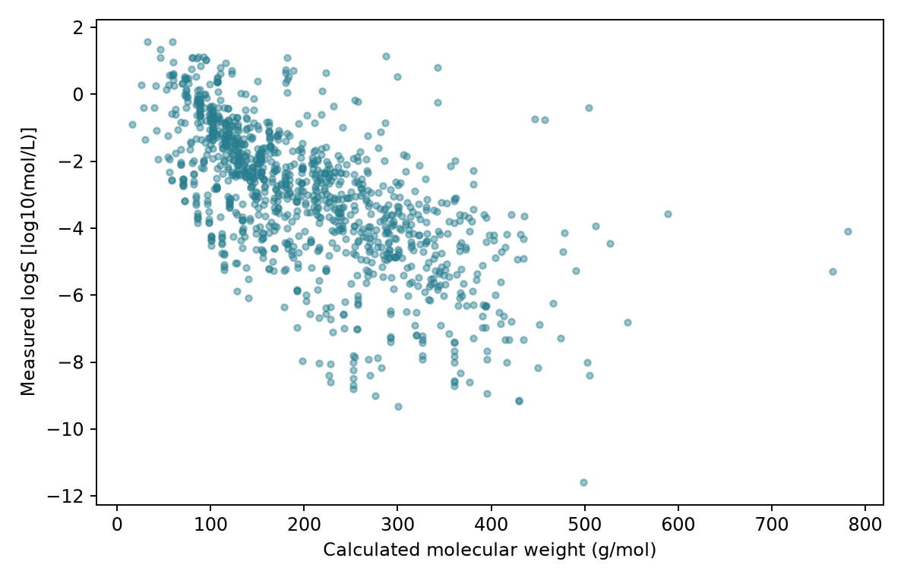

# 它能解決哪些問題（藥物、材料、製程） {#sec-applications}

## 都是預測性質，藥物、材料與反應條件可以用同一張資料表嗎？ {#開場問題}

不一定。分析方法可能很像，但表格裡每一列代表的對象、要記錄的條件和要預測的結果，往往不一樣。藥物研究比較的可能是一批分子的酵素活性；材料研究比較的可能是不同組成和加工方式做出的試片；反應研究則可能固定底物，只改變配體、鹼或溶劑。所以要先把研究問題寫清楚，才知道表格需要哪些欄位。

## 核心概念

在**藥物探索**中，結構搜尋可以幫我們找到相似的分子，性質預測模型可以幫忙安排測試的順序。不過，「能抑制某個酵素」和「對細胞有效」是兩種不同的測試結果；水溶解度好，也不代表吸收、代謝或毒性沒有問題。因此第 14 章的 EGFR 專題，會先確認每筆活性資料用的是什麼測試，再排出候選分子。排出來的是「先測哪些分子」的優先順序，不是判定哪個分子能成為藥物。

**材料資訊學**（materials informatics）同樣把結構、組成、計算和量測連在一起，但材料的性質常常和製程有關。例如要比較高分子試片的機械性質，只記下單體名稱是不夠的，分子量分布、加工條件和試驗方法都會影響結果。本書以分子資料為主，材料資料的處理方式會在另一本《材料資訊學入門》中詳細介紹。

在**反應條件的選擇**上，要把「做了什麼」和「得到什麼」分開記錄。第 13、14 章會用真實的 Suzuki–Miyaura 反應紀錄示範：投入的底物、配體、鹼和溶劑是條件，分析產率是結果。如果所有反應都在同一個溫度下進行，這份資料就沒辦法告訴我們升溫有沒有幫助。同樣地，小規模篩選得到的高產率，也不保證放大製程時一樣成功。

## 動手做

[下載本節 notebook](../../notebooks/ch00/00-02-applications.ipynb){.btn .btn-sm .btn-outline-primary}　[在 Colab 開啟](ch00/00-02-applications.ipynb)

我們先從一個簡單的問題開始：知道分子量，就能知道水溶解度嗎？Notebook 用 DeepChem 載入完整的 ESOL 資料，保留原始的實測 logS，再從結構計算分子量，這裡沒有訓練任何模型。下面的 `usable` 是篩選後的資料表，只保留結構能被正確讀取、而且有實測值的紀錄。

```python
ax.scatter(usable.MW, usable.logS, s=12, alpha=.45)
ax.set(xlabel="Calculated molecular weight (g/mol)",
       ylabel="Measured logS [log10(mol/L)]")
```

{#fig-intro-properties fig-alt="ESOL 分子量與 logS 散點圖；相近分子量區域仍可見不同高度的溶解度紀錄，圖中未擬合預測線。"}

讀這張圖時，可以挑一小段分子量範圍，看看那一段的點在縱向散得多開。從結果來看，分子量相近的分子，溶解度可以差上好幾個數量級。原因不難理解：分子量接近，不表示氫鍵能力、疏水片段或解離狀態也相近。換句話說，光靠分子量預測溶解度是不夠的，這也是後面幾章要引入更多描述符和模型的原因。

同樣的思考方式也可以用在其他領域。下表整理了三種研究問題各需要哪些資料：

| 研究問題 | 一列代表什麼 | 需要的輸入 | 要核對的結果 |
|---|---|---|---|
| 哪些分子值得先做 EGFR 測試？ | 一筆可追溯的分子測試紀錄 | 結構、測試類型與條件 | 相同定義下的活性 |
| 哪種材料處理方式值得比較？ | 一件具有製備紀錄的試片 | 組成、處理歷程與測試條件 | 指定試驗下的材料性質 |
| 固定底物後，下一組反應條件怎麼選？ | 一次反應與分析紀錄 | 試劑、溶劑、用量與操作條件 | 指定分析方法的產率 |

如果目標是改善溶解度，表格只收集活性就不夠；如果目標是比較製程條件，只有分子結構也不夠。先寫下分析完打算做什麼決定，可以幫我們縮小範圍。例如「挑十個分子進入下一輪測試」和「證明某個官能基造成毒性」，需要的資料和證據完全不同，即使用的是同一種模型。

本書會先介紹分子表示、資料清理和描述符，再進入模型、評估、解釋和實驗選點。這些方法前後相連，但不是每個問題都要用到全部章節。手上已經有一份反應紀錄時，先把條件和結果整理對齊，往往比急著換一個更複雜的模型更有幫助。

## 重點整理

- 不同領域可以共用分析方法，但每一列代表什麼、要記哪些條件、要預測什麼，都要重新定義。
- 圖上看得出兩個欄位有關係，不等於已經能預測，也不等於證明了因果。
- 先想清楚分析完要做什麼決定，再選資料、特徵和驗證方式。

## 小練習

某團隊拿到一份只有 SMILES 與水溶解度的表格，想用它決定 Suzuki–Miyaura 反應的最佳溶劑。請指出目前缺少哪兩類關鍵資訊，並說明水溶解度為何不能直接當成反應產率。

提示：分別想想「反應做了什麼」與「如何判定結果」。

## 延伸閱讀

[ESOL 原始研究](https://doi.org/10.1021/ci034243x) · [反應條件篩選原始研究](https://doi.org/10.1126/science.aap9112) · [ORD 反應資料庫](https://doi.org/10.1021/jacs.1c09820)
