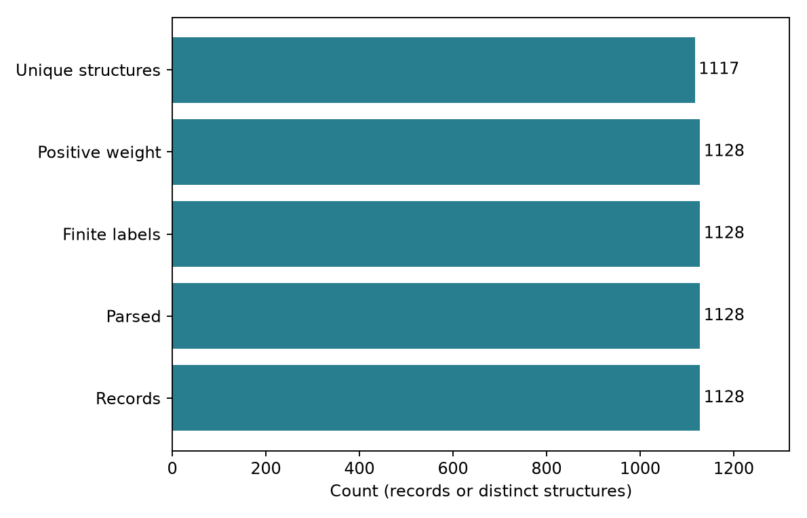

# 化學與材料研發的現場痛點 {#sec-research-pain-points}

## 明明有一整份實驗表格，為什麼還不能直接建立模型？ {#開場問題}

因為表格裡有數字，不表示每個數字都在回答同一個問題。不同的測試可能用了不同的單位；一格空白，可能是沒測，也可能是測了但分析失敗；同一個分子出現兩次，可能是重複匯入，也可能是很有價值的重複量測。先把這些差別弄清楚，才知道哪些紀錄可以放在一起分析。

## 核心概念

研發資料「少」，常常不只是筆數少。同一系列的相近分子有很多，換一種骨架就完全沒有資料；高產率的條件留下完整紀錄，低產率或做到一半的反應卻沒人記。這兩種情況都會限制模型能學到的範圍，而且多收集同一來源的資料，也不一定補得回原本缺少的部分。所以看資料時，除了筆數，也要看它涵蓋了哪些結構和條件、是怎麼收集來的。

另一類困難是紀錄接不起來。結構畫在簡報裡、結果存在試算表裡、分析方法寫在個人的實驗筆記裡，合併之後可能只剩一個化合物名稱和一個數字。做實驗的人知道哪幾批不能直接比較，負責分析的人卻不一定看得出來。要讓這些經驗能傳承下去，就要把判斷的依據寫成欄位、備註或明確的篩選規則，並且留下回到原始紀錄的線索。

就算資料整理好了，研究目標也可能超出資料能回答的範圍。例如想找全新的骨架、想同時改善活性和溶解度，或想把模擬結果直接用在實驗上，都需要另外評估。模型給出的高分，也不保證這個候選分子真的合成得出來、量得到，或在設備上可行。

## 動手做

[下載本節 notebook](../../notebooks/ch00/00-03-research-pain-points.ipynb){.btn .btn-sm .btn-outline-primary}　[在 Colab 開啟](ch00/00-03-research-pain-points.ipynb)

我們先替 ESOL 做一份簡單的資料盤點。Notebook 會檢查每個結構能不能讀入、logS 是不是有效的數值、標籤權重是否大於零，再計算有幾種不同的結構。這裡用 **canonical SMILES**（正規 SMILES）判斷結構是否相同：同一個分子不管原本怎麼寫，RDKit 都會轉成同一個字串，第 1 章會再詳細說明。

```python
counts = {"Records": len(table),
          "Parsed": int(table.parse_ok.sum()),
          "Finite labels": int(np.isfinite(table.logS).sum()),
          "Positive weight": int((table.weight > 0).sum()),
          "Unique structures": int(table.canonical_smiles.nunique())}
```

{#fig-intro-audit fig-alt="長條圖分別列出總紀錄、可解析結構、有限標籤、正權重紀錄及不同 canonical SMILES 的數量。"}

從結果來看，ESOL 共有 1,128 筆紀錄，每個結構都能讀入、每筆都有有效的 logS；但不同的結構只有 1,117 個，也就是說有幾個分子重複出現。這時候不要急著把多出來的列刪掉或取平均。Notebook 另外列出了這些重複的結構，我們可以先回頭比較它們的 logS 差多少，再決定怎麼處理。另外也要記得，結構讀得進來，只代表程式能建立分子，不代表原始資料的標註一定正確；logS 有值，也不代表每筆量測的條件都一樣。

資料品質沒辦法用一個分數來代表。舉例來說，如果把沒測的活性填成零，程式就不會再報缺值，但資料的意思已經變成「測過了，結果是零」。又例如為了讓模型分數好看，把低產率的紀錄刪掉，模型就再也學不到哪些條件行不通。該怎麼處理，要回到原始紀錄的意義來判斷，而不是看刪完之後的圖整不整齊。

下表整理了研發現場常見的資料困難，以及本書對應的章節。不是每個專案都會遇到全部的問題，可以挑自己有感的部分先讀。

| 遇到的困難 | 先釐清什麼 | 本書閱讀位置 |
|---|---|---|
| 資料太少 | 缺的是紀錄數，還是某些結構或條件？ | 第 12 章的小數據與實驗設計 |
| 只留下成功結果 | 低值、零值與未完成實驗如何記錄？ | 第 3、13 章 |
| 單位與方法不一致 | 哪些紀錄可以直接比較？ | 第 3 章資料清理、第 13 章後設資料 |
| 檔案散落各處 | 哪個識別碼能連回原始實驗？ | 第 13 章 |
| 結構以外的條件沒記 | 用量、溶劑與操作條件是否影響結果？ | 第 13、14 章反應案例 |
| 經驗只留在個人記憶 | 能否把判斷依據寫成可查欄位？ | 第 13 章 |
| 想找資料外的新分子 | 候選離已知資料有多遠？ | 第 10 章適用範圍、第 12 章探索 |
| 多個目標互相牽制 | 改善一項時，另一項付出什麼代價？ | 第 12 章多目標最適化 |
| 不知道為何得到預測 | 解釋指出的是關聯，還是有實驗支持的機制？ | 第 10、11 章 |
| 計算與量測對不上 | 比較的是不是相同狀態、條件與定義？ | 第 5 章、第 12 章 Sim2Real |
| 實驗與分析難以交接 | 雙方是否同意欄位含義與判讀規則？ | 第 14 章專題、第 15 章雙能力研究者 |

開始分析時，不必一次解決表中所有的問題。可以先挑一個最可能影響結論的，例如「哪些資料屬於同一種測試」，查清楚來源、記下處理規則，再進行下一步。這樣一步一步累積下來的資料，才不會只有最熟悉專案的那個人看得懂。

## 重點整理

- 資料夠不夠，要一起看筆數、涵蓋的結構與條件，以及收集方式。
- 結構讀得進來、沒有缺值、沒有重複列，都還不足以說明資料可靠。
- 把實驗上的判斷依據記錄下來，分析結果才能被別人檢查和重複使用。

## 小練習

Notebook 會印出重複出現的結構和它們的 logS（前八列）。挑其中一組看看兩筆 logS 差多少，再想一想：如果要把這兩筆合併成一筆，還需要回到原始文獻確認哪兩件事？

提示：這題不需要改程式。想想「這兩次量測是不是獨立的實驗」和「量測條件是否相同」。

## 延伸閱讀

[ESOL 原始研究](https://doi.org/10.1021/ci034243x) · [FAIR 資料原則](https://doi.org/10.1038/sdata.2016.18) · [RDKit 分子處理文件](https://www.rdkit.org/docs/GettingStartedInPython.html)
