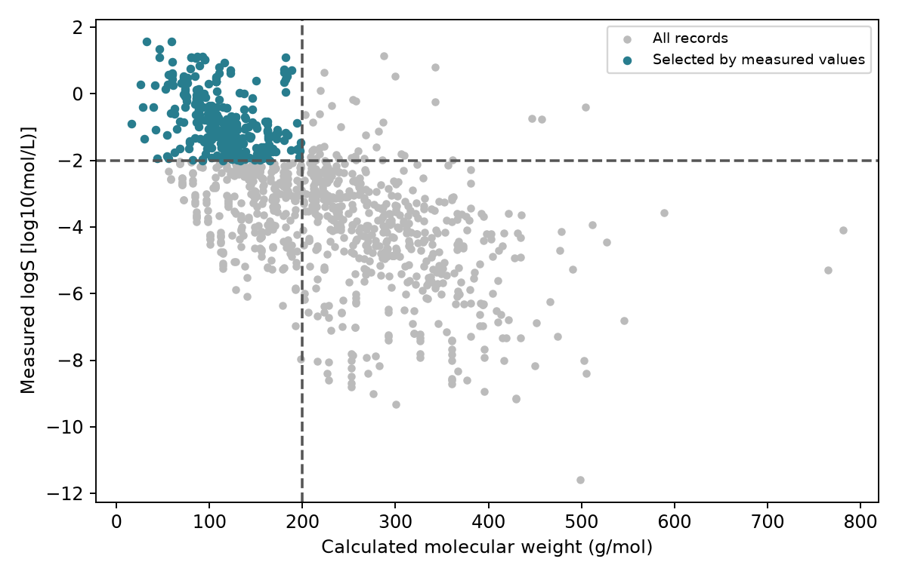

# 這本書怎麼用 {#sec-reading-guide}

## 想把自己的化學資料拿來分析，應該從哪一章開始？ {#開場問題}

先看看資料目前卡在哪一步。如果還不知道怎麼把分子結構存進電腦，從第 1、2 章開始；如果已經有一張結構和性質的表，可以從第 3、4 章讀起，再進入模型與評估；如果想整理反應紀錄、安排下一次實驗，可以先看第 13 章，再接第 12、14 章。讀到不熟悉的工具時，再回到前面的章節補讀就好。

## 核心概念

這本書寫給有普通化學基礎、想用 Python 處理化學資料的讀者，特別是化學、材料背景，對程式還不太熟悉的人。我們會假設你看得懂變數、串列（list）、函式呼叫和簡單的迴圈，也會用 pandas 選欄位、篩選資料和讀取 CSV 檔。不需要先懂每個模型背後的數學，但要知道程式正在讀哪個欄位、輸出的數字是什麼單位。如果語法已經讓你讀不下去，可以先花一點時間看文末的 Python 和 pandas 入門教學，回來會順很多。

每一節的結構都差不多：先提出一個化學或資料上的問題，接著說明需要的概念，再用一小段程式和一張輸出圖帶大家看結果。正文只放關鍵的幾行程式，安裝、資料載入和完整的分析都放在 notebook 裡。建議閱讀時先看圖表的座標軸和欄位，再回頭找程式是怎麼畫出來的，這比一行一行抄程式更容易抓到重點。每節最後的小練習通常是改一個條件或重新解讀結果，章末的綜合練習則會把幾個步驟串起來。

有兩章比較特別：第 15 章是較短的案例導讀，沒有 notebook 和練習，目的是介紹之後可以深入的方向；第 5 章量子化學需要專用的計算環境，部分小節還要用到 GPU，安裝方式和其他章不同。另外，每一節都會交代資料來源、計算設定和限制，讀到模型分數或速度比較時，記得把這些條件一起看。

## 動手做

[下載本節 notebook](../../notebooks/ch00/00-04-reading-guide.ipynb){.btn .btn-sm .btn-outline-primary}　[在 Colab 開啟](ch00/00-04-reading-guide.ipynb)

我們用一個簡單的篩選來練習讀程式：從 ESOL 找出分子量不超過 200 g/mol、而且實測 logS 不低於 −2 的分子。這兩個門檻是為了練習隨意訂的，沒有特別的化學意義。要注意的是，這裡篩選用的是**已經量到**的 logS，所以這是「查詢已知結果」，不是「預測新分子」。

```python
mask = (table.MW <= 200) & (table.logS >= -2) & table.parse_ok & (table.weight > 0)
selected = table.loc[mask].copy()
```

逐一看這兩行程式：`<=` 表示「小於或等於」，`&` 表示前後兩個條件都要成立，`table.loc[mask]` 則只保留符合條件的資料列。後面兩個條件 `parse_ok` 和 `weight > 0`，是確認結構讀得進來、而且有實測值。結果共保留 331 筆紀錄。Notebook 會印出入選的數量和前三筆紀錄，可以挑一筆把 MW 和 logS 代回條件，確認它為什麼被選中，再看下面這張圖。

{#fig-intro-reading fig-alt="分子量與實測 logS 散點圖，左上區域的入選紀錄以綠藍色標示；門檻使用已知量測值，沒有預測線。"}

這段小程式剛好可以帶出本書的幾個主題。不懂 SMILES 怎麼變成分子，可以讀第 1、2 章；想知道 MW 和 logS 從哪裡來，可以讀第 3、4 章；想替沒有 logS 的新分子做預測，則要讀第 9、10 章。建議把建立模型（第 9 章）和評估模型（第 10 章）一起讀，只會建模型，還不知道它的預測什麼時候值得相信。

| 目前想做的事 | 建議順序 | 讀完後先留下什麼 |
|---|---|---|
| 整理一批分子 | 第 1、2、3 章 | 可辨認結構、可追溯來源的資料表 |
| 比較分子性質與結構 | 第 4、6、7、8 章；需要電子性質再讀第 5 章 | 描述符、相似度與圖表的化學解讀 |
| 建立性質預測模型 | 第 3、4 章，再讀第 9、10、11 章 | 與任務一致的評估、適用範圍與限制 |
| 決定下一個實驗 | 第 13 章整理紀錄，第 12 章選點，第 14 章實戰 | 候選條件、選擇理由與後續量測方式 |
| 認識進階方向 | 先掌握資料與評估，再選讀第 15 章 | 一個需要進一步查證的研究問題 |

每次實作完，建議留下三樣東西：執行過的 notebook、輸出的資料或圖，以及一句話說明這次做了什麼。以本節為例，可以寫「從 ESOL 既有紀錄中篩選符合門檻的分子」，而不是「找到最好的藥物」。能準確說出程式完成了什麼，才容易判斷下一步還缺什麼資料。

閱讀順序不用照本宣科。如果執行時遇到套件問題，先看下一節的環境設定；如果輸出和書中不一樣，先比較資料、套件版本和參數。比較不同的方法時，要用同樣的資料切分和評估方式，這會在第 10 章詳細說明。

## 重點整理

- 依手上的資料和問題選擇從哪一章讀起，需要時再回頭補基礎。
- 正文幫助理解，notebook 提供完整步驟，兩者對照著讀。
- 分清楚「查詢已知結果」和「預測未知結果」，每次分析都留下能重做的紀錄。

## 小練習

把本節分子量門檻改為 150 g/mol，其餘條件不變。重新執行後記下入選列數，並用一句話說明為什麼這仍是對既有紀錄的篩選，而不是溶解度預測。

提示：改完產生 `mask` 的那一格後，後面的格子也要重新執行一次，圖和數量才會跟著更新。

## 延伸閱讀

[Python 官方教學](https://docs.python.org/3/tutorial/) · [pandas 入門教學](https://pandas.pydata.org/docs/getting_started/intro_tutorials/index.html) · [DeepChem 的 MoleculeNet 資料說明](https://deepchem.readthedocs.io/en/latest/api_reference/moleculenet.html)
