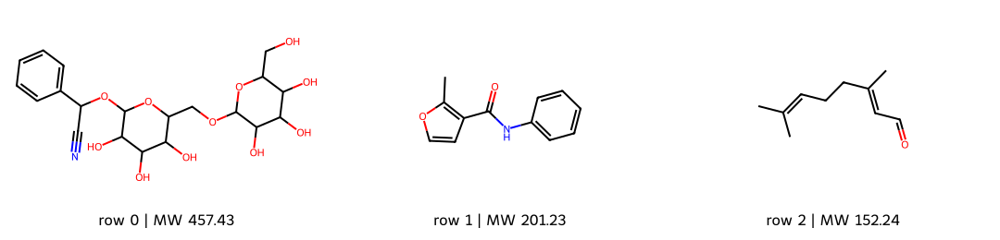

# 用 Colab 免安裝開始 {#sec-getting-started-with-colab}

## 電腦沒有裝 Python，也能跟著本書處理分子嗎？ {#開場問題}

可以。**Google Colab** 是 Google 提供的免費線上 Python 環境，只要有瀏覽器和 Google 帳號就能使用，程式在 Google 的遠端電腦上執行，不必在自己的電腦安裝 Python 或 RDKit。這裡的「免安裝」指的是自己的電腦不用安裝；需要的套件，notebook 還是會在遠端環境裡自動安裝。這一節我們會讀入三筆真實的分子紀錄、畫出結構、存成 CSV 檔，把整個流程從頭到尾跑一次。

## 核心概念

**Notebook** 是一種把說明文字、程式和執行結果放在同一份文件裡的格式，每一個方塊叫做一個「格」（cell）。執行一個程式格之後，裡面定義的變數會留在記憶體裡，給後面的格子使用。所以如果跳過前面的格子、直接執行後面的格子，就可能出現「變數還沒定義」的錯誤。第一次操作時，請從上到下依序執行；改了某一格的內容後，後面用到它的格子也要重新執行。

本書使用的是 Colab 2026.07 版的執行環境（Python 3.12.13）。Google 會保留舊版環境一段時間，但不是永久提供，如果之後選不到這個版本，請參考書籍的更新說明。大部分章節用 CPU 就夠了，只有特別註明需要 GPU 的實作才要切換。套件的版本則由每份 notebook 的第一格固定下來，確保大家跑出來的結果一樣。

有一件事要特別注意：儲存 notebook 和保存執行環境是兩回事。Colab 的遠端電腦閒置一段時間就會被回收，裡面的變數、暫存檔和安裝好的套件都會消失，但 notebook 頁面上可能還留著上次的輸出圖。所以做完練習後，記得把需要的檔案下載下來；重新連線時如果分到新的環境，就從第一格開始重新執行。

## 動手做

[下載本節 notebook](../../notebooks/ch00/00-05-getting-started-with-colab.ipynb){.btn .btn-sm .btn-outline-primary}　[在 Colab 開啟](ch00/00-05-getting-started-with-colab.ipynb)

可以直接點上面的「在 Colab 開啟」；也可以先下載 `.ipynb` 檔，登入 Colab 後，從「檔案 → 上傳筆記本」開啟。不需要連接自己的 Google Drive，也不需要任何 API 金鑰。這一節使用公開的 ESOL 資料，第一次執行時要下載資料和套件，會花一點時間。

1. 開啟 notebook，在「執行階段 → 變更執行階段類型」選擇 CPU，執行階段版本選 2026.07。如果選單裡沒有這個版本，請先看書籍的更新說明，不要直接刪掉程式裡的版本檢查。
2. 執行第一格（安裝套件）。這一格會建立一個獨立的套件環境，避免動到 Colab 原本裝好的套件，可能要等幾分鐘，完成後再往下。
3. 執行第二個程式格。這一格只是把分析程式寫成一個檔案，看到寫檔成功的訊息，還不代表已經算完了。
4. 執行最後一格。它會用剛才裝好的環境執行分析，印出套件版本、資料欄位和前三筆結果，並畫出結構圖。
5. 從左側的檔案區下載 `outputs/first-molecules.csv` 和 `figures/00-05-first-molecules.png`，也另存一份自己的 notebook。如果想確認流程能重現，可以重新啟動執行階段，從頭再跑一次。

分析程式最主要的部分如下。`table` 是已經整理好的資料表，裡面有 ESOL 的結構、實測 logS，以及 RDKit 算出的分子量，這裡只取前三列當作範例。

```python
sample = table.head(3).copy()
sample[["row_id", "smiles", "MW", "logS"]].to_csv(
    outputs / "first-molecules.csv", index=False)
reloaded = pd.read_csv(outputs / "first-molecules.csv")
```

{#fig-intro-first-colab fig-alt="ESOL 前三筆分子的結構圖，附 row 編號與 MW；同一批紀錄亦輸出為含 SMILES 與 logS 的 CSV。"}

`to_csv()` 把表格寫成 CSV 檔，`read_csv()` 再把它讀回來，確認檔案真的存好了，結構字串也沒有遺失。圖中的 MW 是計算值，CSV 裡的 logS 則是資料集提供的實測值，兩者都可以用 `row_id` 對回同一筆紀錄。不過 `row_id` 只是這次載入時的列編號，不能拿去當成其他資料庫的化合物編號。

如果執行失敗，先看看是停在哪一步。出現「找不到套件」，通常是安裝格還沒跑完；下載失敗，則要檢查網路連線；遇到 `NameError`（名稱未定義），多半是前面的格子還沒執行。錯誤訊息很長時，先看第一個錯誤，後面一連串的錯誤常常只是被第一個錯誤連帶影響。

你可能會好奇，為什麼這一章要先把分析程式寫成檔案，再另外執行？這是為了使用第一格建立的獨立環境，一般的 notebook 格子並不會自動使用這個環境。所以如果想修改條件，要改「寫檔」那一格裡的程式，再執行最後一格；如果直接在旁邊新增一格寫 `import deepchem`，用到的可能是另一個環境。現在先照著順序做就好，環境管理之後有需要再學。

Colab 免費版能用多久、分到哪一種 GPU，Google 會不定期調整，本書沒辦法保證。入門時最實用的習慣，是保留程式、套件版本和資料來源，就算中途斷線也能重新跑出結果。第 5 章需要專門的量子化學套件時，再照該章的說明安裝。

## 重點整理

- Colab 讓我們不用在自己的電腦安裝環境，需要的套件由 notebook 在遠端安裝。
- 程式格要從上到下執行；改了某一格，後面用到它的格子也要重新執行。
- Notebook 檔案會保存，但執行環境會被回收，離開前記得下載需要的輸出。

## 小練習

把輸出的分子紀錄由前三筆改成前五筆，將 CSV 存成 `first-five-molecules.csv`，再讀回並核對列數與 SMILES。請同時寫下重新連到全新執行階段時，要重跑哪些步驟才能得到這份檔案。

提示：這題只改表格輸出，結構圖可維持前三筆；修改 `sample` 與輸出檔名，然後重新執行寫檔格和最後一格。

## 延伸閱讀

[Colab 常見問題](https://research.google.com/colaboratory/faq.html) · [Colab 過去版本與選擇方式](https://research.google.com/colaboratory/runtime-version-faq.html) · [pandas 表格讀寫入門](https://pandas.pydata.org/docs/getting_started/intro_tutorials/02_read_write.html)
