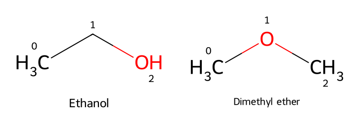

# 分子就是一張圖 {#sec-molecular-graphs}

## 乙醇和二甲醚的分子式相同，電腦怎麼分得出來？ {#開場問題}

電腦要分辨它們，靠的是記下「原子怎麼相連」。把乙醇寫成 $\mathrm{CH_3CH_2OH}$、二甲醚寫成 $\mathrm{CH_3OCH_3}$，差別就清楚了：乙醇帶有**羥基**（hydroxyl group），二甲醚的氧則連著兩個甲基，形成醚的結構。兩者的分子式都是 $\mathrm{C_2H_6O}$，卻是不同的物質。分子式只記下有哪些元素、各有幾個原子，結構式還多告訴我們原子如何成鍵，電腦要辨認這兩種物質，也得保留這一層資訊。

## 核心概念

我們讀有機化學的結構式時，常會先找**官能基**（functional group），再看它接在哪一段碳骨架上。以這兩個分子為例，沿著乙醇的碳骨架讀過去，末端是 $\mathrm{-OH}$；二甲醚則是 $\mathrm{C-O-C}$，氧上沒有氫。這種分子式相同、原子連接方式不同的關係，稱為**結構異構**（constitutional isomerism）。也就是說，要分辨醇與醚，得看氧周圍一小段的成鍵環境，光知道分子裡有氧還不夠。資料表如果只保留碳、氫、氧的數量，這個差異就消失了。

結構式裡省略的氫，也是化學結構的一部分。乙醇的兩個碳分別帶三個和兩個氫，氧還帶一個氫；二甲醚的兩個碳各帶三個氫，氧不帶氫。兩邊加總都是六個氫，只是氫所在的位置不同。

像這兩個中性的分子，可以依「碳通常形成四個鍵、氧形成兩個鍵」把氫補齊，雙鍵要算成兩個鍵級。程式採用**隱含氫**（implicit hydrogen）時，也是根據元素、成鍵情形與電荷來推算氫數。這只是一種省略寫法，氫一樣重要；遇到帶電原子或自由基時，補氫的規則還要另外考慮。

電腦把上述資訊存成**分子圖**（molecular graph）：原子是**節點**（node），化學鍵是**邊**（edge）。每個原子記下元素等屬性，每條鍵記下它連著哪兩個原子、是哪一種鍵。其中**鍵級**（bond order）特別重要。舉例來說，乙醇有碳氧單鍵，乙醛的**羰基**（carbonyl group）則是碳氧雙鍵；兩者的氧都只連著一個碳，光數碳鄰居分不出來，還要看是單鍵還是雙鍵、氧上有沒有氫。把結構存成圖，就是為了讓程式也能一項一項查到這些資訊。

## 動手做

[下載本節 notebook](../../notebooks/ch01/01-01-molecular-graphs.ipynb){.btn .btn-sm .btn-outline-primary}　[在 Colab 開啟](ch01/01-01-molecular-graphs.ipynb)

在 notebook 中，RDKit 讀入 `CCO` 和 `COC` 兩個字串，分別建立乙醇和二甲醚的分子物件。這種寫法稱為 SMILES，下一節會詳細介紹，這裡先把它當成指定分子的方式。接著我們找出元素符號為 O 的原子，從它出發查一次鄰居。下面這個函式是為只有一個氧的分子寫的，它會回傳三樣東西：氧的編號、直接相連的原子是什麼元素，以及氧上帶幾個氫。

```python
def oxygen_neighbors(mol):
    oxygen = next(atom for atom in mol.GetAtoms() if atom.GetSymbol() == "O")
    neighbors = [atom.GetSymbol() for atom in oxygen.GetNeighbors()]
    return oxygen.GetIdx(), neighbors, oxygen.GetTotalNumHs()
```

用白話說，第一行在所有原子裡找出第一個氧，第二行把這個氧的每個鄰居的元素符號收進一個清單。因為是清單，即使兩個鄰居都是 C，也會留下兩筆。

{#fig-molecular-graph-neighbors fig-alt="乙醇的氧標成 OH，編號 2，接到中央編號 1 的碳。二甲醚的氧編號 1，兩側分別是編號 0 和 2 的甲基。"}

乙醇印出 `(2, ['C'], 1)`。把手指放在 @fig-molecular-graph-neighbors 左圖的 OH，沿線走一步，會停在沒有寫元素符號的轉折處，那是骨架式裡省略的碳。左端的甲基要再走一步才到得了，所以它不在鄰居清單裡；最後的 1 則是氧上的氫數。

再看右圖，二甲醚印出 `(1, ['C', 'C'], 0)`。氧的兩側各有一個甲基，這次可以從氧往兩個方向走。兩張圖都只有三個重原子，要判斷是醇還是醚，只需要讀氧附近的一小塊。

讀這兩行輸出的順序，和我們看結構式時一樣：先找氧，再看它連著幾個碳，接著確認鍵的種類與氧上的氫。乙醇是碳氧單鍵加上氧氫鍵，二甲醚是兩個碳氧單鍵。notebook 也列出每條鍵兩端的編號和種類，方便回到圖上逐一對照。對這兩個簡單分子，這些資訊已經足以區分醇與醚；遇到更複雜的分子，就要再往外看相鄰碳的成鍵情形。例如羧酸也有 O–H，但它的羥基接在羰基碳上，所以看到 O–H 時，還要確認旁邊的碳才能判斷是不是醇。

換句話說，「分子裡有幾個氧」和「分子裡有什麼官能基」是兩個不同的問題。前者只要數元素，後者得看氧周圍的結構。整理化合物資料時，想挑出醇類、醚類或含羰基的分子，就要保留這些成鍵關係。後面介紹分子描述符與子結構搜尋時，會把這種讀結構的方法寫成可以重複執行的規則；這一節先練習把程式查到的原子和鍵，還原成自己熟悉的結構式。

圖中的小編號是程式用來定位原子的**索引**（index），從 0 開始，和化學命名裡的位置編號無關。如果從氧那端重新輸入乙醇，氧的編號可能從 2 變成 0，分子仍然是乙醇。所以比較兩份結構時，要看的是元素和成鍵關係對不對得起來。把乙醇換個方向畫、或把圖旋轉，它也不會變成二甲醚；只有原子之間的連接真的改變了，才會出現這對結構異構物的差別。

另一個容易混淆的地方是形狀。結構圖上的折線是為了方便我們看碳骨架，鍵畫多長、夾角多大都由排版決定，和實際的鍵長、鍵角無關。要研究分子的空間形狀，需要另外取得標明來源和長度單位的三維座標。立體異構物也是類似的情況：原子連接方式相同，立體配置卻可能不同，儲存時要另外保留對應的標記。這些資訊會在後面幾節逐步補上。

最後把同一個函式用在一份真正的資料上。notebook 後半段用 DeepChem 載入 ESOL 水溶解度資料集，逐列從結構算出分子式，只對分子式是 $\mathrm{C_2H_6O}$ 的資料列查氧的鄰居。結果篩出一列，結構是 `CCO`；它的氧只有一個碳鄰居、帶一個氫，和左圖的乙醇相符。如果表格只留下分子式、沒有結構，就沒辦法用這個方法排除二甲醚。ESOL 裡只找到乙醇，也只說明這份資料沒有收錄另一種接法，$\mathrm{C_2H_6O}$ 本身仍有兩種結構。[@delaney2004esol; @wu2018moleculenet]

回到最初的問題：資料裡的一列究竟是乙醇還是二甲醚？我們先用分子式找出候選，再用氧的成鍵環境確認結構。這也是使用化學資料的基本習慣。分子式、分子量或某個元素的數量相同，都不足以說明兩筆紀錄是同一個化合物；要保留足夠的結構資訊，才能判斷哪些紀錄可以放在一起比較。

## 重點整理

- 分子式相同仍可能是不同物質，乙醇與二甲醚的差別就在氧怎麼成鍵。
- 判讀官能基要一起看元素、相鄰原子、鍵級和氫，例如要靠鍵級才分得出乙醇的羥基和乙醛的羰基。
- 分子圖保存的是原子與鍵的連接關係；原子編號和畫圖的位置可以改變，分子本身不會變。

## 小練習

把乙醛的 `CC=O` 讀成分子，查出氧的鄰居、碳氧鍵的種類和氧上的氫數，用這三項結果說明「氧有兩條線，所以有兩個碳鄰居」這句話錯在哪裡。

提示：把輸入的字串改成 `CC=O`，再用本節的函式取得氧的資訊。鍵的種類可以用該氧的 `GetBonds()` 取出鍵，再對每條鍵呼叫 `GetBondType()`。

## 延伸閱讀

[RDKit 入門文件的分子讀取、原子與化學鍵](https://www.rdkit.org/docs/GettingStartedInPython.html) · [RDKit 的 Atom、Bond 與 Mol 方法](https://www.rdkit.org/docs/source/rdkit.Chem.rdchem.html) · [DeepChem 的 MoleculeNet 資料說明](https://deepchem.readthedocs.io/en/latest/api_reference/moleculenet.html)
