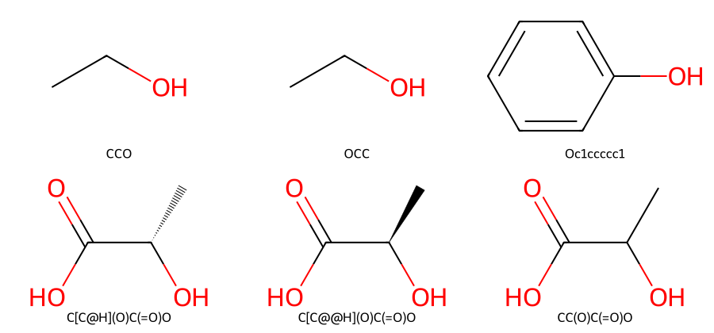

# SMILES {#sec-smiles}

## 表格裡一列寫 CCO，另一列寫 OCC，兩列都是乙醇嗎？ {#開場問題}

兩列都是乙醇。`CCO` 從碳端寫到氧端，`OCC` 則從氧端寫回去，兩者描述的都是一條碳連碳、碳再連氧的鏈。**SMILES**（Simplified Molecular Input Line Entry System）是一套把分子結構寫成一行文字的規則：它記下我們沿著化學鍵走過哪些原子，也用符號交代途中在哪裡岔開、哪兩處要接回去。因為同一個分子可以從不同的起點寫，直接在試算表裡比對原始字串，就會把這兩列乙醇分到不同組。[@weininger1988smiles]

## 核心概念

先看原子和氫。在乙醇的縮寫 CH₃CH₂OH 上，沿著碳、碳、氧依序落筆，就寫成 `CCO`。氫大多不用一個個寫，程式會依元素常見的成鍵數自動補上。舉例來說，單獨寫一個大寫 `O`，沒有其他鍵占去氧的價數，讀出來就是水；把它接在 `CC` 後面，氧便只帶一個氫。像 `Cl` 這樣由兩個字母組成的元素符號，要合起來讀成一個氯原子。

遇到帶電原子或要指明同位素時，就用方括號，例如銨離子寫成 `[NH4+]`，四個氫和正電荷都跟著氮寫在括號裡。方括號裡的原子不會自動補氫，有幾個氫就要寫幾個。

再看鍵和分支。兩個碳之間寫 `CC` 或 `C-C` 都是單鍵；把中間的鍵換成 `=` 或 `#`，就分別得到乙烯 `C=C` 和乙炔 `C#C`。鍵的種類一換，碳上能補的氫數也跟著改變。

現在試著從結構圖寫出乳酸 CH₃–CH(OH)–COOH。在紙上沿三個碳畫一條路，從甲基端先寫 `CC`。第二個碳還接著一個羥基，把它當成岔路寫成 `(O)`；右括號一合上，筆尖就回到第二個碳。繼續走到羧基碳，寫下 `C(=O)O`，合起來就是 `CC(O)C(=O)O`。最後兩個氧都接在羧基碳上，可以用手指沿兩條鍵各走一次，確認沒有寫成氧接氧。

最後是環與芳香性。要寫苯酚，可以從羥基的氧出發，進入苯環時寫 `Oc1`，沿環再寫五個小寫 `c`，在最後一個碳補上第二個 `1`，就得到 `Oc1ccccc1`。成對的數字表示這兩個原子之間還有一條鍵，兩端一起改成 `2` 結構也不變。換句話說，數字管環怎麼接回去，大小寫管原子是不是芳香的。

把同一個苯酚照單、雙鍵交替的結構式寫成 `OC1=CC=CC=C1`，RDKit 也認得出它的芳香環。但如果只把六個 `c` 改成大寫 `C`、又沒寫雙鍵，就變成環己醇了。兩個相鄰的芳香碳之間，可以用冒號 `:` 明寫芳香鍵，一般都省略不寫。

## 動手做

[下載本節 notebook](../../notebooks/ch01/01-02-smiles.ipynb){.btn .btn-sm .btn-outline-primary}　[在 Colab 開啟](ch01/01-02-smiles.ipynb)

執行之前，先在紙上各畫一次 `Oc1ccccc1`、`OC1=CC=CC=C1` 和 `OC1CCCCC1`，猜猜哪兩個是同一種醇，再執行 notebook。第一張表列出原子的寫法、氫數與鍵型；第二張表把三種環的寫法並排，印出正規 SMILES 和芳香原子數。從結果來看，前兩種寫法各有六個芳香碳，第三種雖然也有六個環碳，卻沒有芳香原子。拿這個例子對照，就知道自己畫的六角形代表哪一種環。

要讓 RDKit 判斷兩種寫法是不是同一個分子，做法是先讀入結構、再寫回文字。`Chem.MolFromSmiles` 把字串讀成包含原子與鍵的分子物件，`Chem.MolToSmiles` 再把物件寫回文字。下面讀了兩次乙醇和一次苯酚。我們特別指定 `canonical=True`，讓程式依同一套規則決定起點與走訪順序，寫出**正規 SMILES**（canonical SMILES）。執行後，把左邊的輸入和右邊的輸出逐列比較。

```python
from rdkit import Chem

for text in ["CCO", "OCC", "Oc1ccccc1"]:
    mol = Chem.MolFromSmiles(text)
    if mol is None:
        raise ValueError(f"無法讀取 {text}")
    print(text, "→", Chem.MolToSmiles(mol, canonical=True))
```

這段迴圈會把三個字串一個一個讀進來；如果讀不成分子，就停下來並印出是哪一個字串出錯。

前兩列的右邊都印出 `CCO`，第三列印出 `Oc1ccccc1`。@fig-smiles-reading 上排左邊兩格來自不同的輸入，但不管把圖轉向哪邊，都只會看到一個碳接著另一個碳、再接一個末端的氧。

上排右格可以從羥基往內讀，在紙上沿六個環碳逐一打勾，最後補上的那條鍵已經畫在六角形裡。圖上看不到環號，因為數字的任務就是指定接點，接好之後就不需要了。這張圖把環內的鍵畫成單雙鍵交替；要對照字串裡的六個小寫碳，可以先找到接著氧的頂點，再沿同一個方向數一圈，每一步對應字串裡的一個碳。

如果輸入少了最後一個環號，RDKit 讀不成分子，會回傳 `None`。上面的程式在這一步把出錯的原始字串印出來，之後才找得到是哪一筆紀錄要回頭查。

{#fig-smiles-reading fig-alt="六格結構圖。上排兩個乙醇各有一個末端氧，苯酚的氧接在六角環上。下排乳酸的中央碳依序以虛楔、實楔標出相反配置，最後一格只畫一般單鍵。"}

下排的三張乳酸圖，原子個數、接法和鍵的種類都一樣，差別在於中央碳上四個不同的基團在空間中怎麼排。SMILES 用方括號把這個碳的資訊寫在一起：`[C@H]` 的 `H` 表示這個碳上有一個氫，`@` 記錄的是照字串裡鄰居出現的順序看過去的立體排列。

也就是說，原子的書寫順序不變、只把 `@` 換成 `@@`，就得到另一個鏡像異構物；但如果前後基團的書寫順序也換了，標記可能要跟著反轉，才能維持原來的配置。所以 `@` 和 R、S 之間沒有固定的對應。比較這一對乳酸時，可以先在兩行文字中對齊甲基、羥基和羧基，再看中央碳的標記。

下排右格的乳酸沒有標出立體配置。從這筆 SMILES，我們知道羥基接在哪裡，但瓶子裡裝的是哪一種鏡像異構物、或兩種各占多少，就無從得知了。如果分子有會產生幾何異構物的雙鍵，可以在雙鍵兩側的單鍵上用斜線 `/`、`\` 交代取代基的相對方向，讀的時候要把兩端的斜線一起看。這些標記記錄的都是相對排列；鍵長、鍵角和繞單鍵旋轉的角度，還要另外的三維資料。

整理表格時，可以把原始字串留在原本的欄位，再新增一欄存放算出來的 canonical SMILES。以乙醇那兩列來說，用新的欄位分組，就能找出需要比較的樣品；原本的欄位則保留供應商或資料庫當初給的寫法。如果把程式改成 `isomericSmiles=False`，輸出會略去立體標記和同位素標記，圖中兩個指定配置的乳酸就會被分到同一組。要研究其中一種的活性，兩筆紀錄就要各自保留配置和量測資料。

軟體版本和設定也要固定。不同工具可能採用不同的標準寫法，同一個工具改版時也可能調整排序規則。要比較不同來源的資料，可以取回兩邊的原始結構，用相同的版本與選項重算一次再比。

要記得，正規化只是把交給程式的結構換成統一的寫法。酸和失去一個質子的陰離子帶有不同電荷，寫回文字後仍然是兩個不同的字串；原本就少寫的立體資訊，重新排序也補不回來。如果手上只有化合物名稱，可以先在資料庫找到候選結構，確認羥基、電荷與立體標示和來源一致，再把 SMILES 抄進實驗表。

## 重點整理

- 讀 SMILES 時，括號是分支、相同的環號要接起來；起點換了，分子還是同一個。
- 立體標記要和鄰居出現的順序一起讀，沒有標記的紀錄分不出鏡像異構物。
- 比較正規 SMILES 時，兩邊要用相同的工具、版本與選項，並保留原始字串方便回查。

## 小練習

請替**間羥基苯甲腈**（3-hydroxybenzonitrile）手寫兩種 SMILES，一種從羥基的氧起筆，另一種從腈基的氮起筆，再用 RDKit 確認兩者的 canonical SMILES 相同。這個分子是一個苯環接著羥基和腈基（–C≡N），兩個取代位置之間隔著一個環碳。畫回結構時，也看看取代位置和腈基的三鍵是否正確。

提示：先在紙上把接羥基的環碳標為第 1 位，再找到第 3 位。這些是你在紙上用的位置編號；寫入 SMILES 的環號只負責指定閉環的兩端。

## 延伸閱讀

[Weininger 的 SMILES 編碼原始論文](https://doi.org/10.1021/ci00057a005) · [Daylight 的 SMILES 語法與立體化學](https://www.daylight.com/dayhtml/doc/theory/theory.smiles.html) · [RDKit 的分子讀寫範例](https://www.rdkit.org/docs/GettingStartedInPython.html) · [RDKit 各版本的標準化輸出差異](https://www.rdkit.org/docs/BackwardsIncompatibleChanges.html)
