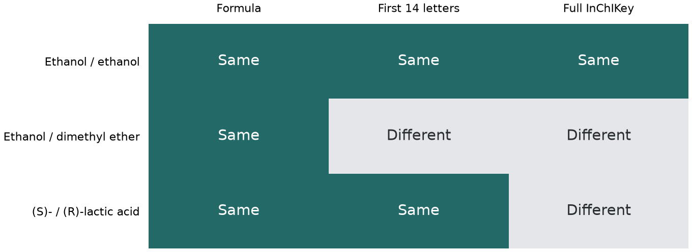

# InChI 與 InChIKey {#sec-inchi-and-inchikey}

## 兩份清單一份寫 CCO，一份寫 OCC，怎麼核對是不是同一個結構？ {#開場問題}

最直接的做法，是把兩個 SMILES 各自轉成分子，再產生**標準 InChI**（Standard InChI）。兩筆會得到同一串乙醇的識別碼，因為不管從碳端還是氧端寫起，原子之間的接法都相同。InChI 是 IUPAC 制定的**國際化學識別碼**（International Chemical Identifier），依一套共同規則把結構寫成一串文字。要在另一份清單裡找這筆資料，可以先用它的短碼 **InChIKey** 搜尋，找到候選紀錄後，再比對完整的 InChI 確認結構。[@heller2015inchi]

## 核心概念

我們把乙醇的識別碼依斜線分段來讀。開頭的 `InChI=1S` 表示採用第一版的標準格式，接著的 `C2H6O` 是分子式。光看這一層，氧可能接在碳鏈末端，也可能夾在兩個碳中間。

再往後是 `/c1-2-3`，這些數字是 InChI 自己統一編排的原子編號：乙醇的 1、2 號是碳，3 號是氧，所以這一段讀作碳接碳、碳再接氧。`/h3H,2H2,1H3` 則把氫分配回各個原子，3 號氧上有一個氫。輸入時原子的出場順序怎麼換，這套編號都一樣；但如果把氧真的移到兩個碳中間，就變成另一種分子，連接資訊也會跟著改。

InChI 是分層記錄結構的，分子有哪些資訊，才寫出對應的層。舉例來說，兩個分子的原子接法相同、立體排列不同，就要讀到後段才看得出差別。

這套標準也會把某些畫法視為同一個結構。以**互變異構物**（tautomer）來說，有些結構可以移動一個氫、同時調整相鄰的雙鍵；只要符合 InChI 處理可移動氫的規則，標準 InChI 就會相同。這個規則只涵蓋一部分的互變異構，而且 InChI 相同時，輸入圖上的氫也可能畫在不同位置。如果研究的正好是氫的位置，就要另外保留原始結構圖。[@heller2015inchi]

InChI 很長，在試算表裡比對不太方便，所以有了 InChIKey。它用**雜湊**（hash）把 InChI 壓成固定長度的代碼，連同兩個連字號共 27 個字元。雜湊可以想成一種單向的摘要：同一串 InChI 一定得到同一個碼，但碼本身看不出原本的內容。第一段 14 個字母主要對應分子組成與連接資訊；第二段是立體化學、同位素等資訊的雜湊，加上標準格式與版本標記；最後一個字母反映相對於參考結構的質子增減。

也就是說，光拿一串 InChIKey，沒辦法反推分子式或畫回結構。我們能用它在網站上查到乙醇，是因為網站已經收錄了乙醇的結構和對應的碼；網站沒有收錄的分子，即使手上的碼完全正確，也可能搜不到。[InChI Trust 技術問答](https://www.inchi-trust.org/technical-faq/)

## 動手做

[下載本節 notebook](../../notebooks/ch01/01-03-inchi-and-inchikey.ipynb){.btn .btn-sm .btn-outline-primary}　[在 Colab 開啟](ch01/01-03-inchi-and-inchikey.ipynb)

我們用三組對照，把「只是寫法不同」和「結構真的不同」分開來看。每組都呼叫下面的函式兩次，分別把左邊和右邊的 SMILES 交給 RDKit。讀入後，`MolToInchi` 依預設選項產生標準 InChI，`InchiToInchiKey` 再從這串 InChI 算出短碼。兩種輸出都留著，在短碼裡看到差異時，就能回頭看完整 InChI 是從哪一層開始不同。

```python
from rdkit import Chem
from rdkit.Chem import inchi

def identifiers(smiles):
    mol = Chem.MolFromSmiles(smiles)
    standard = inchi.MolToInchi(mol)
    key = inchi.InchiToInchiKey(standard)
    return standard, key
```

{#fig-inchi-pairs fig-alt="乙醇的兩種寫法三欄全部相同。乙醇與二甲醚只有分子式相同；兩種乳酸的分子式和短碼首段相同，完整短碼不同。"}

從 @fig-inchi-pairs 的第一列讀起。`CCO` 和 `OCC` 都得到 `LFQSCWFLJHTTHZ-UHFFFAOYSA-N`。如果直接拿原始 SMILES 當索引，試算表會把這兩列當成不同的字串；改用完整短碼查找，兩條線索就會指向同一個乙醇結構。要注意，這裡確認的只是結構相同；如果兩列各有自己的樣品編號，還是要讓兩個編號各自連回原來的紀錄。

第二列把比較對象換成二甲醚 `COC`。兩種分子都是兩個碳、六個氫和一個氧，所以圖上第一格仍然相同。讀到連接層就不一樣了：乙醇是 `/c1-2-3`，二甲醚是 `/c1-3-2`。氧夾在碳鏈中間，就沒有羥基，二甲醚的氫層也變成 `/h1-2H3`，表示兩個碳各帶三個氫。反映在短碼上，二甲醚的第一段是 `LCGLNKUTAGEVQW`；搜尋結果裡如果同時出現乙醇和二甲醚，看這一段就分得開。

第三列是一對乳酸。兩者羥基所在的碳都連著一個氫、一個甲基和一個羧基，四個基團在空間裡的排列互為鏡像，一個是 (S)-乳酸，另一個是 (R)-乳酸。沿著碳鏈看，連接順序完全一樣，短碼第一段也都是 `JVTAAEKCZFNVCJ`。

把 notebook 印出的兩行完整 InChI 並排，兩者都有描述四面體立體中心的 `/t2-`，後面的 `/m0` 與 `/m1` 才分出這一對鏡像。這裡的 0 和 1 要配合前面的立體資訊一起讀，換成別的分子，0 和 1 對應的就未必是 S 和 R。

換句話說，乳酸的差別保留在短碼的第二段。手邊有一張試劑清單、想把相關的乳酸紀錄排在一起時，可以先依第一段分組，再比較完整碼；要找特定立體組態的乳酸，就要把第二段也算進去。

雜湊碼的長度有限，理論上兩個不同的 InChI 可能剛好得到同一個短碼。所以要確認結構時，一般是先用短碼縮小範圍，再比對完整 InChI 和來源的結構。另外，兩個短碼相差幾個字母，和兩個分子像不像沒有關係。

如果這兩種乳酸來自別人給的試算表，還要多看一件事：有些表格為了縮短欄寬，只留下短碼的第一段。這樣的欄位可以拿來搜尋，但少了區分兩個**對映體**（enantiomer）的資訊，分子式也補不回來。原始檔如果還附有結構，就從結構重新算一次完整碼，再和另一份清單逐筆比較；如果只有截短的碼，查到的兩種乳酸都要留著當候選。

回頭看圖中三組比較，短碼都以 N 結尾。這個 N 只表示產生短碼時，相對於 InChI 的參考結構沒有增減質子，和「這瓶溶液是中性」是兩回事。乳酸溶在水裡後，羧基上的氫有多少會解離，要看溶液的 pH。想知道溶液中有哪些形態，得找到配製紀錄裡的溶劑與 pH，再回頭看當初登錄的是哪一種結構。

## 實驗上的考量

比較兩家供應商的乳酸試劑時，就算兩邊的結構碼都對應 (S)-乳酸，也要看各批次分析證明上的對映體純度。結構碼記錄的是登錄時指定的排列；瓶子裡實際混了多少另一種對映體，要看分析方法與量測結果。把批號和檢驗報告和結構放在一起，之後才查得到那次實驗用的是哪一瓶。

## 重點整理

- 標準 InChI 依固定規則編排原子，所以乙醇不管從哪一端寫 SMILES，InChI 都相同。
- 兩種乳酸的 InChIKey 前 14 個字母相同，要分辨立體組態，得比較完整的碼和 InChI。
- InChIKey 只能用來查找，原本畫的氫、立體標記和樣品資訊要靠來源紀錄保留。

## 小練習

一筆乳酸紀錄只寫了 `CC(O)C(=O)O`，請找出它和本節的 (S)-乳酸在完整 InChI 和短碼中從哪裡開始不同，並判斷這筆紀錄能不能標成 (S)-乳酸。

提示：把 `CC(O)C(=O)O` 交給本節的 `identifiers` 函式，比較兩個 SMILES 在羥基所在的碳上各寫了什麼，再把短碼依連字號拆開來看。

## 延伸閱讀

[Heller 等人說明 InChI 的分層、標準化與短碼設計](https://doi.org/10.1186/s13321-015-0068-4) · [RDKit 產生與讀取 InChI 的函式](https://www.rdkit.org/docs/source/rdkit.Chem.inchi.html)
