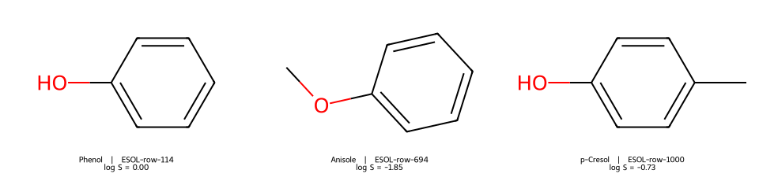

# Mol 檔與 SDF {#sec-mol-and-sdf}

## 同事要拿到能畫的分子結構，還想知道每個結構對應哪一筆量測，該交付什麼檔案？

交付 **SDF**，也就是**結構資料檔**（structure-data file）。只有一個分子、只要結構和畫圖座標的話，用 **Mol 檔**（molfile）就夠了；要一次交付好幾個分子，還要讓每筆水溶解度緊跟著自己的結構，就用 SDF。假設這次要交付苯酚、苯甲醚和對甲酚，其中苯甲醚和對甲酚都是八個重原子，光看原子數分不出來。但打開 SDF 的任何一筆紀錄，都可以沿著鍵找出氧接在哪裡，再往下讀同一筆紀錄的量測值。[@dalby1992formats]

## 核心概念

用純文字編輯器打開常見的 V2000 Mol 檔，最上面是標頭，接著是**計數列**（counts line）。如果它的前兩個數字是 7 和 7，後面就依序有七筆原子、七筆鍵。每筆原子記下元素和座標，每筆鍵寫明哪兩個原子相連、用什麼鍵相連。這些資訊合起來，就能重建 @sec-molecular-graphs 介紹的分子圖；因為鍵都明寫了，程式不必看兩個點靠得多近去猜哪裡有鍵。這裡說的欄位順序是 V2000 的寫法，另一種 V3000 格式會用不同的區塊標示原子和鍵。[CTfile 格式說明](https://www.daylight.com/meetings/mug05/Kappler/ctfile.pdf)

拿苯酚來看。檔案裡的七個原子是六個碳和一個氧；環上六條鍵，加上一條從環碳接到氧的鍵，剛好也是七條。這份檔案用隱含氫表示碳和氧上的氫，所以沒有替每個氫各寫一列。如果拿到另一份把氫全部列出的苯酚檔案，計數列就會不同，所以比較原子數之前，要先看兩份檔案怎麼處理氫。

還有一個小陷阱：V2000 鍵表裡，原子表的第一列編為 1，RDKit 程式裡的原子索引卻從 0 開始。從文字檔追到程式裡的某個氧時，差這一號很容易圈錯位置。

每筆原子都有三個座標欄，但有三欄座標，不表示做過三維計算。本節先讓 RDKit 產生適合排版的二維座標，所以等一下看到的苯環平躺在紙面上，座標第三欄都是零，標頭也標示 2D。這些座標拿來重畫結構已經足夠；要量鍵長、討論構形能量，就得知道幾何是來自實驗、建模還是最佳化。

把結構圖旋轉九十度，或改用氧當第一列，檔案的文字都會改變，分子的連接關係卻還是一樣。要確認交接前後是不是同一個結構，可以用同一版軟體把兩者轉成統一的寫法再比較；如果還要保留原本的構形或畫法，就要另外比較座標。

## 動手做

[下載本節 notebook](../../notebooks/ch01/01-04-mol-and-sdf.ipynb){.btn .btn-sm .btn-outline-primary}　[在 Colab 開啟](ch01/01-04-mol-and-sdf.ipynb)

我們從 ESOL 的實測水溶解度欄位取出三筆資料：苯酚的 log S 為 0.00，苯甲醚為 −1.85，對甲酚為 −0.73。這裡的 S 以 mol/L 表示，再取以十為底的對數。苯酚那一格的零是有意義的數值，如果當成空白刪掉，收到檔案的人會以為苯酚沒有量測紀錄。

程式另外給每筆紀錄一個識別碼，例如第一筆苯酚的 `ESOL-row-114`，表示它在本例載入的資料表中是第 114 列（從第一筆資料開始算）。這個編號只用來回查這一次匯出的檔案，換到別的資料庫就沒有意義了。[@delaney2004esol]

```python
sdf = as_sdf(molecules)
restored = read_sdf(sdf)
```

第一行呼叫本節整理好的寫檔步驟，把三個分子依序交給 RDKit 的 `SDWriter` 寫成 SDF；第二行再用 `ForwardSDMolSupplier` 從頭讀回來。為了讓你看清楚檔案裡到底存了什麼，notebook 把 SDF 留在記憶體裡，並印出第一筆的原文。

從苯酚的鍵表往下找，會看到 `M  END`，這是結構區塊的結尾。接下來標著 `<RecordID>` 的欄位是資料列編號，`<logS>` 底下是數字，`<Endpoint>` 則說明量測的意義和濃度基準。要讀到獨占一行的 `$$$$`，才是這一整筆紀錄的結尾。如果讀到第一個 `M  END` 就停下來，苯酚還畫得出來，溶解度卻沒有跟著讀進來。

如果這是第一次讀 Mol 檔，可以在苯酚的原文裡追一條實際的鍵。從計數列往下數，第七筆原子是 O。跳到鍵的部分，找到開頭三個數字是 `6 7 1` 的那一行：前兩個數字指第六和第七個原子，第三個數字 1 表示單鍵。回頭看，第六筆原子是 C，所以這一行記的就是伸出苯環外的碳氧鍵。

另一行 `6 1 2` 則把第六個原子連回第一個碳，記為雙鍵。鍵的兩端靠編號接起來，所以閉環時不用在第一個碳的位置再寫一次座標。這份 Mol 檔用交替的單、雙鍵寫苯環，SMILES 則可以用小寫的芳香碳；寫法不同，描述的是同一個苯環。

再回到量測值。試著把結構名稱蓋住，只留列號和數字：我們看得出哪一筆 log S 比較大，卻說不出這兩個分子的氧接在哪裡。反過來，只留原子表和鍵表，苯甲醚和對甲酚都畫得出來，但哪一個比較好溶，還是要回去查實測紀錄。這就是把結構和量測值寫在同一筆紀錄裡的好處：之後就算調換三筆的順序，每個數值仍然跟著自己的結構。

{#fig-sdf-roundtrip fig-alt="由左到右是苯酚、苯甲醚和對甲酚。中圖的甲基接在氧上；右圖的甲基與羥基分別接在苯環的對位。每張圖下方都印出對應的 ESOL 列號與 log S。"}

看 @fig-sdf-roundtrip 中間和右邊的結構。苯甲醚的氧夾在甲基和苯環中間；對甲酚的氧帶著氫，甲基直接接在環上。兩筆紀錄都有八個重原子、八條鍵，量測值卻各不相同。如果先把結構依名稱排序，再把原本順序的數字整欄貼回去，貼錯的數字看起來仍然像合理的溶解度，很難發現。

比較可靠的做法，是匯出前先留一份「列編號、結構、量測值」的對照表，讀回時依識別碼逐項比較這三欄。少了一筆，或同一個編號出現兩次，也都在這一步查清楚。

SDF 的欄位名稱和單位由寫檔的人自己決定。另一個實驗室也有一欄叫 `Solubility`，裡面存的可能是 mg/L，也可能是以 mol/L 為基準的 log S。所以把兩個檔案接在一起之前，除了欄名，還要問清楚測定條件和數值的尺度。

如果同一個結構在兩個溫度下各量了一次，保留兩個紀錄編號，同事日後才能分開追查；只依結構去除重複，就會丟掉其中一筆。最後要記得，檔案能順利讀入、每個欄位都有值，只說明資料讀得出來；一筆量測當初有沒有貼錯樣品，還要回到實驗紀錄才能確認。

## 重點整理

- Mol 檔用原子表記元素與座標、用鍵表記連接關係；座標從哪裡來，決定了它能拿來做什麼。
- SDF 讓每個結構帶著自己的資料欄，要讀到 `$$$$` 才算讀完一筆紀錄。
- 交付前先讀回一次，用紀錄編號確認結構、數值與單位都對得上。

## 小練習

從讀回的三個分子中挑出 log S 小於零的紀錄，寫成新的 SDF 再讀回，列出這兩筆的列編號與 log S。也想一想：要怎麼從結構分辨這兩筆？苯酚為什麼沒有入選？

提示：SDF 的欄位讀進來是文字，要先用 `float(mol.GetProp("logS"))` 轉成數值再比較；讀回後取出 `RecordID`，和結構圖對照。

## 延伸閱讀

[RDKit 讀寫 Mol 與 SDF 的範例](https://www.rdkit.org/docs/GettingStartedInPython.html#reading-sets-of-molecules) · [Dalby 等人對結構檔格式的原始說明](https://doi.org/10.1021/ci00007a012)
