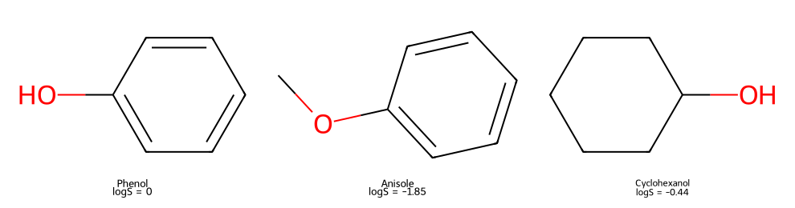

# 讀寫與畫出分子 {#sec-read-write-draw}

## 把酚的結構存成檔案，溶解度也會一起留下來嗎？ {#開場問題}

要看我們存的是什麼格式。SMILES 只記下酚的結構，資料表裡的溶解度不會跟著走。想把結構和量測值一起交給另一個程式，可以把溶解度設成分子的屬性，再寫進 SDF。讀回來時，結構和量測值要分開檢查，才知道這筆資料是完整的。另外把分子畫出來，就能看清楚羥基接在哪裡，不會把酚和苯甲醚的資料看反。

## 核心概念

RDKit 的**分子物件**（`Mol` object）是程式執行時手上拿著的結構資料。把 SMILES 交給 `Chem.MolFromSmiles()`，讀取成功就會得到這個物件；字串無法解析或沒通過預設的結構檢查時，則會得到 `None`。我們可以從物件裡取出原子和化學鍵，也可以替它加上名稱或量測值。

分子物件和硬碟上的 Molfile 是兩回事：物件只在程式執行期間存在，檔案則讓我們關掉程式後還能再讀。變數取名為 `mol`，也只是個名字，還沒有存成 `.mol` 檔。畫圖或計算之前，先確認分子有讀進來，萬一出錯，就知道問題出在原始結構，而不是後面的計算。

選輸出格式時，先想想接收的人需要什麼。只是把酚的連接方式放進表格，SMILES 最方便；要傳遞單一分子的結構和畫圖座標，可以用 Molfile；要保存一批分子、讓每個分子帶著溶解度等欄位，就用 SDF。這些格式在前一章已經介紹過，這一節把它們用在一次實際的資料交接上。

另外，結構圖和結構資料也要分清楚。PNG 圖方便人看羥基、苯環和取代位置，但交接資料時要以 SDF 為準。圖上的線長和角度是排版決定的，和實際的鍵長、鍵角無關。

## 動手做

[下載本節 notebook](../../notebooks/ch02/02-01-read-write-draw.ipynb){.btn .btn-sm .btn-outline-primary}　[在 Colab 開啟](ch02/02-01-read-write-draw.ipynb)

我們從 DeepChem 的 ESOL 水溶解度資料集讀入 1,128 筆紀錄，再挑出酚（phenol）、苯甲醚（anisole）與環己醇（cyclohexanol）。三者都含氧、都有六員環，放在同一張圖上很好比較。載入時設定 `transformers=[]`，讓 `y` 維持原本的 $\log_{10}(S/\mathrm{mol\,L^{-1}})$，不做平均值與標準差的標準化。這一節不訓練模型，所以 DeepChem 分好的幾份資料會全部讀進來一起用。[@delaney2004esol; @wu2018moleculenet]

下面是 notebook 寫入 SDF 的關鍵部分。`selected` 裡的每一筆都有名稱、分子物件與原始溶解度。`SetProp()` 替分子加上一個欄位，量測值要先轉成文字才能存，讀回來後再轉回數值。欄名 `logS_mol_L` 是本例自己取的，用意是提醒接收的人：這是以 mol/L 為基準的十進位對數，單位不是 g/L。

```python
with Chem.SDWriter(str(sdf_path)) as writer:
    for name, mol, value in selected:
        mol.SetProp("_Name", name)
        mol.SetProp("logS_mol_L", str(value))
        rdDepictor.Compute2DCoords(mol)
        writer.write(mol)
restored = list(Chem.SDMolSupplier(str(sdf_path)))
```

用白話說，這段程式打開一個 SDF 檔，對每個分子依序寫上名稱和 logS、算好畫圖用的二維座標，再寫進檔案；最後一行把整個檔案重新讀回，放進 `restored`。

{#fig-read-write-draw fig-alt="三欄依序為酚、苯甲醚和環己醇，logS 分別為 0、負 1.85 和負 0.44。酚與環己醇標出 OH，苯甲醚的氧連著甲基與苯環。"}

@fig-read-write-draw 畫的是讀回來的分子。左邊的酚有一個接在苯環上的 OH；中間的苯甲醚，氧的另一端接著甲基；右邊的環己醇也有 OH，但它的六員環沒有芳香性。如果圖下只寫「含氧分子」，這三者最容易辨認的差別就看不到了。把名稱、結構與數值放在一起，是為了讓我們能逐筆對照。

這次讀回的 logS 依序是 0、−1.85 與 −0.44。酚的 0 表示溶解度是 $10^0=1$ mol/L，而不是「溶解度為零」；負值則表示溶解度小於 1 mol/L。這些數字都是 ESOL 原本的實測值，在這一節只用來確認檔案交接時沒有漏掉欄位、也沒有對錯分子。之後若要討論結構與溶解度的關係，還要再查量測條件和資料來源。

程式的檢查分成兩部分。結構方面，把原本的物件和讀回的物件都轉成 canonical SMILES，再比較字串，三個分子都一致。數值方面，讀回 `logS_mol_L`，轉成浮點數後和寫入前的值比較，也都相同。

要注意，這裡確認的是資料在寫入和讀回之間有沒有改變。canonical SMILES 方便我們比較結構，但兩份實驗紀錄能不能合併，還要看量測溫度、pH 或樣品形式是否相同。

資料筆數也要一起看。notebook 會檢查寫出三筆、讀回三筆，並確認每一筆都不是 `None`。實務上如果 SDF 有一筆讀取失敗，直接刪掉再接回原表格，後面的量測值就可能對到錯的分子。比較穩妥的做法，是保留原紀錄的位置或識別碼，把失敗的紀錄另外列出來查原因。本例只要有一筆失敗就停下來，等結構確認了再繼續畫圖。

notebook 另外把酚存成單獨的 `.mol` 檔，再讀回來確認結構。這種檔案適合交給只需要單一結構的工具，溶解度這類欄位還是要靠 SDF 保存。範例的檔案都放在暫存資料夾，跑完就刪掉，所以重跑也不會蓋掉你原有的實驗資料。如果想把輸出留給別人使用，可以改成指定的資料夾，並另外寫下每個欄位的定義與來源。

::: {.callout-tip}
## 結構擠在一起時，先調整排版

冠醚這類大環結構，二維排版有時會擠成一團。可以對分子的副本使用 `rdCoordGen.AddCoords(mol)` 重新產生二維座標，看看取代基是否變清楚；這一步只調整畫圖位置，算出來的仍然是二維座標。如果要在大量結構中篩選、查看自訂欄位，可以參考 [mols2grid 官方文件](https://github.com/cbouy/mols2grid)。本節用 RDKit 的靜態網格圖，方便輸出的圖和書稿直接對照。
:::

讀圖時還可以順便做個簡單的檢查：酚和環己醇都有 OH，苯甲醚則在氧的另一側多接一個碳。如果圖下的名稱和這個特徵對不上，要先回頭看名稱是怎麼配到分子上的，而不是去改繪圖設定。名稱只是我們寫進去的文字，RDKit 不會替它鑑定化學身分；數值欄位取名叫溶解度，填錯的數字也一樣是錯的。換句話說，檔案讀寫只能確認資料有保留下來，資料本身合不合理，還是要回到來源紀錄判斷。

把結構與數值綁在同一筆紀錄裡，還有一個好處：排序後也不會對錯。假如只把三個名稱依字母排序、數值卻維持原本的順序，表格照樣顯示得出來，化學意義卻已經錯了。所以本例用同一個迴圈寫入名稱、結構與數值，讀回時也逐筆比較，而不是分開整理之後再依位置拼回去。

## 重點整理

- 分子物件、結構檔案和結構圖各有用途，畫得出圖，不表示量測值也存好了。
- 用 SDF 保存一批結構和屬性時，讀回後要分別確認結構、欄位和筆數。
- 二維座標只是畫圖用的排版，線長和角度和實際的分子幾何無關。

## 小練習

同事寄來酚的 SMILES `Oc1ccccc1`，說「溶解度就在這個字串裡」。請把 ESOL 中酚的 logS 寫進 SDF 再讀回，用輸出說明這句話少了什麼，並把 logS = 0 換算成 mol/L。

提示：分別印出結構的 SMILES 和 `GetProp("logS_mol_L")` 讀到的欄位，看看溶解度存在哪裡。換算濃度時用 10 的次方。

## 延伸閱讀

[RDKit：讀取、繪圖與寫出分子](https://www.rdkit.org/docs/GettingStartedInPython.html) · [RDKit 檔案格式 API](https://www.rdkit.org/docs/source/rdkit.Chem.rdmolfiles.html) · [CoordGen 二維座標](https://www.rdkit.org/docs/source/rdkit.Chem.rdCoordGen.html)
