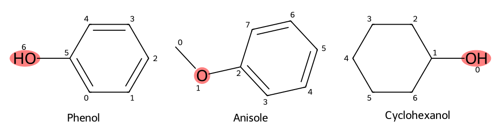

# 取得原子、鍵、環的資訊 {#sec-atoms-bonds-rings}

## 酚和環己醇都有 OH，程式要看哪裡才分得出來？ {#開場問題}

要看 OH 接著的那個碳。酚的氧直接接在芳香環的碳上，環己醇的氧則接在飽和六員環的碳上。兩者的氧都帶一個氫、都以單鍵接著一個碳，所以只看氧本身分不出來。用 RDKit，我們可以從氧找到相鄰的原子，再查那個碳有沒有芳香性，把結構式上看得到的差異一項一項查出來。

## 核心概念

單一原子的資訊，要放回它的成鍵環境裡讀才有化學意義。這一節再加入苯甲醚來比較：它的氧也連著芳香碳，但另一端接著甲基，氧上沒有氫。所以要分辨這三種結構，光問「有沒有氧」或「有沒有六員環」是不夠的，我們要依序看氧帶幾個氫、直接連著哪些原子，以及相鄰的碳屬於哪一種結構。

這裡說的氫數，是原子身上帶的氫，和氫鍵無關；鄰居則是沿化學鍵走一步就到的原子，雙鍵也只算一個鄰居。這個讀法和我們平常判斷官能基一樣，只是把眼睛在結構式上移動的過程寫成程式。

環的資訊能幫我們判讀氧的周圍，但「在環裡」和「有芳香性」是兩個不同的條件。酚、苯甲醚與環己醇都有六員碳環，前兩者是芳香環，環己醇不是。三者的氧都接在環外，所以氧的 `IsInRing()` 都是 `False`。

原子旁邊的索引從 0 開始，只用來對照這次讀入的分子，和化學命名的位置編號無關。SMILES 換個寫法，氧的索引就可能改變，所以我們用元素符號找氧，再沿著它的鍵查下去，而不是把某個固定的編號當成「氧的位置」。

## 動手做

[下載本節 notebook](../../notebooks/ch02/02-02-atoms-bonds-rings.ipynb){.btn .btn-sm .btn-outline-primary}　[在 Colab 開啟](ch02/02-02-atoms-bonds-rings.ipynb)

notebook 用 DeepChem 載入 ESOL 的 1,128 筆紀錄，再依結構挑出這三個分子。載入時沿用 DeepChem 依骨架分好的幾份資料（scaffold 切分），這一節只看結構，所以全部讀進來一起用。`transformers=[]` 表示量測值沒有做標準化，不過這一節也用不到溶解度。程式裡的三個查詢字串只是用來指定要找哪三個分子，分析和畫圖用的都是從資料裡讀出來的分子。[@delaney2004esol; @wu2018moleculenet]

下面的函式先找到氧，再把它的氫數、鄰居和鍵的種類一起傳回。每個鄰居會記三項：原子索引、元素符號和芳香性。這個函式是為本例三個只有一個氧的分子寫的；分子裡有好幾個氧時，要一個一個分析，因為 `next()` 只會找出第一個。

```python
def oxygen_environment(mol):
    oxygen = next(a for a in mol.GetAtoms() if a.GetSymbol() == "O")
    neighbors = [(a.GetIdx(), a.GetSymbol(), a.GetIsAromatic())
                 for a in oxygen.GetNeighbors()]
    bonds = [str(b.GetBondType()) for b in oxygen.GetBonds()]
    return oxygen.GetTotalNumHs(), neighbors, bonds
```

`neighbors` 那一行的意思是：對氧的每一個鄰居，取出它的索引、元素和芳香性，收成一個清單；`bonds` 那一行則把氧身上每條鍵的種類收成另一個清單。

{#fig-atoms-bonds-rings fig-alt="酚、苯甲醚與環己醇的編號結構圖。酚和環己醇都帶 OH；苯甲醚的氧在甲基與芳香環之間。三個氧皆位於六員環外。"}

酚的輸出是 `(1, [(5, 'C', True)], ['SINGLE'])`。第一個 1 表示氧帶一個氫；鄰居清單只有一筆，說明氧連著索引 5 的碳，而且這個碳有芳香性（`True`）。最後的 `SINGLE` 就是圖上的碳氧單鍵。這些資訊合起來，才讀成「羥基直接接在芳香碳上」。也要注意，氧本身不在苯環裡，碳氧鍵接到苯環上，仍然是單鍵。

苯甲醚的氫數是 0，鄰居有兩個碳：一個芳香性為 `False`，另一個為 `True`，兩條碳氧鍵都是單鍵。對照 @fig-atoms-bonds-rings，前者是甲基的碳，後者是苯環上的碳。氧的兩邊都接著碳，就沒有酚的 O–H 了。這正是酚與苯甲醚在官能基上的差別：兩者都含氧、都有苯環，但只有酚帶著羥基。

環己醇的氧帶一個氫、只有一個碳鄰居、一條碳氧單鍵，看起來和酚很像，差別在於那個碳的芳香性是 `False`。notebook 接著計算整個分子的芳香原子數與芳香鍵數：酚和苯甲醚都是六個、六條，環己醇都是零。這和圖上的六員環相符，也說明了畫成六角形的環不一定有芳香性。環己醇畫成平的六角形只是二維排版，實際的分子並不是平面的。

環的大小可以從 `mol.GetRingInfo().AtomRings()` 取得。本例三個分子都回傳一組含六個原子索引的環，取它的長度就得到 `[6]`。清單裡裝的是組成這個環的原子索引，而不是元素的原子序。拿這些索引回到圖上一個一個找，就能確認 OH 或 OCH₃ 的氧不在環裡。換句話說，「分子有一個六員環」和「這個氧在六員環內」是兩個要分開回答的問題。

這種查環的方法用在本例很直觀，遇到稠環或橋環時就要留意「環」的定義。RDKit 保存的環集合，以及 `GetSymmSSSR()` 給出的對稱化最小環集合，都只是挑出一組代表性的環，並沒有列出所有能沿著鍵繞回起點的路徑。只想知道某個原子在不在環內，直接查 `IsInRing()` 就好；要比較環的數目，就要說明用的是哪一種計數方法，否則兩套軟體給出不同數字時，很容易誤以為其中一套讀錯了結構。

數原子時，也要說清楚氫是怎麼表示的。本例酚與環己醇的 `GetNumAtoms()` 都是 7，苯甲醚是 8，因為讀進來的物件沒有把氫一個個列成獨立的原子。這些數目和圖上的重原子數相符，但不是分子式裡所有原子的總數。氧帶的氫要用 `GetTotalNumHs()` 讀；如果之後用 `Chem.AddHs()` 把氫加進分子物件，讀鄰居和數氫的方法也要跟著調整。所以比較兩次計算結果之前，先確認物件裡有沒有獨立的氫原子。

最後談談這套判讀方法能用到哪裡。氧的氫數和芳香碳鄰居，足以解釋這三個已知分子的差異；但要當成通用的醇、酚、醚分類規則，還得多查一些條件。遇到羧酸、酯或帶電的氧，就要再看相鄰碳的其他鍵和**形式電荷**（formal charge）。notebook 也印出了三個氧的形式電荷，這次都是 0。先用少量結構弄清楚規則在查什麼，下一節再把條件寫成子結構搜尋，會比一開始就背一堆函式更容易看懂結果。

把查詢結果整理成表格時，欄名也要寫清楚。舉例來說，「氧上的氫數」和「分子的總氫數」是不同的量，「芳香原子數」和「環大小」也是。先把結果讀成一句化學敘述，再回頭替欄位命名，可以幫我們確認程式查到的，正是原本想問的問題。

## 重點整理

- 判讀官能基要看原子周圍的成鍵環境，酚與環己醇的差別就在 OH 接著的碳。
- 在環裡的原子不一定有芳香性，接到芳香碳的鍵也可能只是單鍵。
- 原子索引、氫的表示方式和環的計數方法都會影響輸出，讀結果時要對照目前的分子物件。

## 小練習

有人用「分子含氧，而且有六個芳香碳」來判斷有沒有酚羥基。請用酚和苯甲醚的輸出，找出這個條件會判錯哪個分子，並說明要再補查什麼。補上之後，這個條件還有哪些分子會判不準？

提示：把兩個分子的 `oxygen_environment` 輸出並排，找出不一樣的那一項；再想想羧酸這類分子套用同一個條件會怎樣。

## 延伸閱讀

[RDKit 的 Atom、Bond 與 RingInfo](https://www.rdkit.org/docs/source/rdkit.Chem.rdchem.html) · [RDKit 的芳香性規則](https://www.rdkit.org/docs/RDKit_Book.html#aromaticity) · [RDKit 入門：原子、鍵與環](https://www.rdkit.org/docs/GettingStartedInPython.html)
