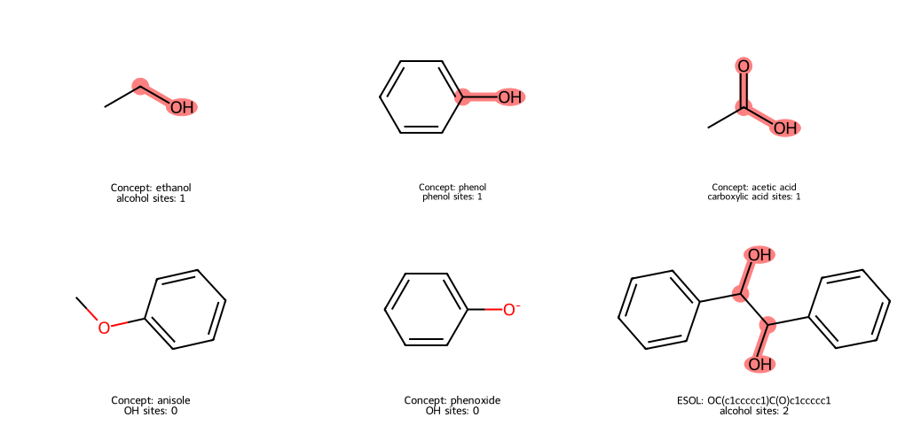

# 子結構搜尋與 SMARTS {#sec-substructure-smarts}

## 想找含醇羥基的分子，搜尋一個 O 就夠了嗎？ {#開場問題}

不夠。乙醇、苯酚、乙酸和苯甲醚都有氧，但氧所處的化學環境各不相同。**子結構搜尋**（substructure search）是在分子圖中找出符合條件的原子與鍵，**SMARTS** 則是用來描述這些條件的查詢語言。只寫一個 `O`，條件就只有「非芳香的氧」，氧上有沒有氫、接在哪種碳上都沒有限制。要找醇羥基，我們先把它定義成「中性的氧帶一個氫，以單鍵連到飽和碳」，再把這句化學描述寫成查詢。

## 核心概念

我們從氧往外看。`[OX2H1+0]` 要求同一個原子同時滿足四個條件：非芳香的氧、總連接數為二、帶一個氫、形式電荷為零。`X2` 的連接數有把氫算進去，所以這裡的「二」是一個重原子加一個氫。這樣就能排除苯甲醚裡不帶氫的氧，以及已經失去質子的苯氧負離子。

不過，乙醇、苯酚與乙酸的羥基還是會全部命中。要把它們分開，得再描述氧旁邊的碳：`[CX4]` 是總連接數為四的非芳香碳，`c` 是芳香碳，`[CX3](=O)` 是總連接數為三、並以雙鍵連著氧的非芳香碳。把它們各自接在羥基後面，就得到下表的三種查詢。這些條件是為本節的問題寫的，只用來分辨這三種羥基。

SMARTS 和 SMILES 長得很像，用途卻不同：`Chem.MolFromSmiles` 建立要被搜尋的分子，`Chem.MolFromSmarts` 建立帶條件的查詢。拿分子去問 `HasSubstructMatch`，會回答有沒有符合的地方；`GetSubstructMatch` 取出一組命中的位置，`GetSubstructMatches` 則取出所有組。

回傳的是被搜尋分子的原子索引，順序和查詢裡原子的順序一致。舉例來說，醇查詢先寫氧再寫碳，結果中的第一個索引就是氧，第二個才是碳。這些索引從零開始，和有機命名的位置編號無關。詳細用法可以參考 [RDKit 的子結構搜尋範例](https://www.rdkit.org/docs/GettingStartedInPython.html#substructure-searching)。

| 想找的局部環境 | 本節使用的 SMARTS | 要分辨的差別 |
|---|---|---|
| 中性的含氫氧 | `[OX2H1+0]` | 尚未區分醇、酚、羧酸 |
| 醇羥基 | `[OX2H1+0]-[CX4]` | 羥基連到飽和碳 |
| 酚羥基 | `[OX2H1+0]-c` | 羥基直接連到芳香碳 |
| 中性羧酸 | `[OX2H1+0]-[CX3](=O)` | 同一個碳同時接羥基氧與羰基氧 |

## 動手做

[下載本節 notebook](../../notebooks/ch02/02-03-substructure-smarts.ipynb){.btn .btn-sm .btn-outline-primary}　[在 Colab 開啟](ch02/02-03-substructure-smarts.ipynb)

Notebook 先用五個示範分子測試條件：乙醇、苯酚、乙酸、苯甲醚和苯氧負離子。你可以先猜猜看，哪幾個會符合 `O`？加上氫數和電荷條件後又剩下誰？這一步是在確認查詢真的符合我們的化學定義。

接著用 `dc.molnet.load_delaney()` 載入 ESOL 資料，搜尋全部 1,128 筆結構。載入時沿用 `splitter="scaffold"` 分成三組，搜尋時再合併起來；這一節不訓練模型，所以合併沒有問題。`transformers=[]` 表示溶解度沒有做標準化，不過判斷命中時也用不到溶解度。[@delaney2004esol]

下面是 notebook 中搜尋醇的關鍵片段。`mols` 是從 ESOL 的 SMILES 逐筆讀入的分子，已經確認全部讀取成功；`queries` 存著上表的查詢。每個命中的項目都同時記下資料列位置 `i` 和命中的原子索引，之後可以回到原本那一列查看。

```python
query = queries["alcohol"]
hits = [(i, mol.GetSubstructMatches(query)) for i, mol in enumerate(mols)
        if mol.HasSubstructMatch(query)]
print("alcohol rows:", len(hits))
print("alcohol sites:", sum(len(matches) for _, matches in hits))
```

第二行比較長，它的意思是：逐一檢查每個分子，只要有符合醇查詢的地方，就把「第幾列」和「所有命中位置」存進 `hits`。最後兩行分別印出命中的分子有幾筆，以及醇羥基的位置總共有幾個。

這次執行得到 154 筆命中的紀錄、274 個醇羥基位置。兩個數字算的東西不同：前者每筆紀錄最多算一次，後者會把同一個分子裡的多個位置分別算進去。例如 @fig-smarts-groups 右下格的 ESOL 分子，兩個相鄰的飽和碳各接一個羥基，這筆紀錄只算一筆命中，卻有兩個位置。這個分子是 Notebook 依重原子數、canonical SMILES 和資料列位置排序後，從剛好有兩個醇位置的紀錄中選出的第一筆，和它的溶解度高低無關。

{#fig-smarts-groups fig-alt="六格分子圖。乙醇、苯酚和乙酸分別標出相應的含氧官能基；苯甲醚與苯氧負離子沒有色塊。右下 ESOL 分子有兩個相鄰碳，各連一個羥基和一個苯環，兩組碳氧位置都被標出。"}

對完整資料逐一套用不同的查詢，`O` 命中 722 筆，中性含氫氧命中 242 筆；加上相鄰碳的條件後，醇有 154 筆，酚有 91 筆，中性羧酸是零筆。154 和 91 相加，會比含羥基的分子數還多，因為同一個結構可以同時帶有醇與酚。

羧酸是零筆，也不一定是查詢寫錯了：上排的乙酸已經順利命中，所以這只表示 ESOL 這 1,128 筆結構裡剛好沒有符合的分子。也就是說，讀取失敗、查詢沒有命中、查詢命中多個位置，是三種要分開處理的情況。

再看下排兩個反例。苯甲醚的氧一樣以單鍵連在芳香碳上，但另一端接著甲基，氧上沒有氫；如果只寫 `O-c`，它也會被找出來。苯氧負離子少了羥基上的質子，形式電荷也變了，所以不符合 `[OX2H1+0]`。

如果研究問題要把中性的酚和它去質子化的形式一起找出來，就要另外寫查詢，或事先規定好前處理的方式。直接拿掉電荷與氫數條件，反而會把更多不想要的含氧結構一起放進來。另外，查詢結果描述的是資料裡登錄的結構，溶液中各種質子化形式各占多少，還要看實際的 pH 和量測。

計數時也要看查詢長什麼樣子。本節的醇查詢只有一個氧和它相連的碳，所以命中幾組就是有幾個醇位置。如果改用比較大、又有對稱性的查詢，同一個官能基可能有好幾種對應方式，命中組數就會比官能基數多。另外，`GetSubstructMatches` 預設會去掉重複的命中，回傳的數量也有上限，遇到大分子或寬鬆的查詢時要另外檢查。這些選項的細節可以看 [RDKit Mol API](https://www.rdkit.org/docs/source/rdkit.Chem.rdchem.html#rdkit.Chem.rdchem.Mol.GetSubstructMatches)。

子結構查詢的一個實際應用是 **PAINS**（pan-assay interference compounds）結構警示。Baell 與 Holloway 把篩選實驗中反覆出現、容易造成假陽性的局部結構整理成一組過濾條件，這就是把化學觀察寫成可以批次搜尋的規則。一個分子命中警示，表示它的結構符合某條規則，至於某次活性訊號是不是干擾造成的，還要靠實驗確認。所以本書的做法是保留資料、記下命中的規則，再安排和原本檢測方法不同的確認實驗。[@baell2010pains]

## 重點整理

- 先想清楚氧上的氫、電荷和相鄰原子，再把化學條件寫成 SMARTS；單獨一個 `O` 只代表非芳香的氧。
- 命中的紀錄數和命中的位置數是兩個不同的數字，畫回結構才看得到找到了哪裡。
- 先用正例和反例測試查詢；資料集沒有命中，只表示這批結構裡沒有符合條件的分子。

## 小練習

在 ESOL 中找出同時含有醇羥基與酚羥基的紀錄，算出有幾筆，再畫出依 canonical SMILES 排序後的第一筆。列出兩種查詢各自命中的原子索引，說明怎麼從圖上分辨這兩種羥基。

提示：仿照上面的程式，把條件改成對每個分子呼叫兩次 `HasSubstructMatch`（一次用醇查詢、一次用酚查詢），中間用 `and` 連起來。

## 延伸閱讀

[Daylight 的 SMARTS 原子、鍵與邏輯條件](https://www.daylight.com/dayhtml/doc/theory/theory.smarts.html) · [RDKit 子結構搜尋](https://www.rdkit.org/docs/GettingStartedInPython.html#substructure-searching) · [DeepChem MoleculeNet 載入介面](https://deepchem.readthedocs.io/en/latest/api_reference/moleculenet.html) · [Baell 與 Holloway 的 PAINS 原始論文](https://doi.org/10.1021/jm901137j)
