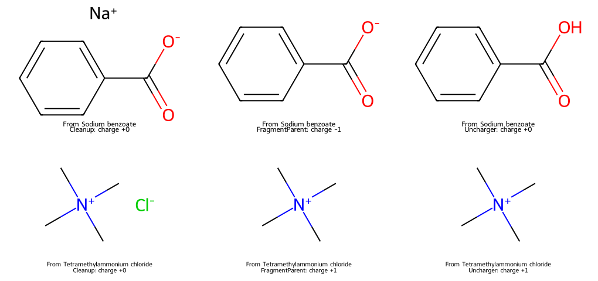

# 分子標準化與去鹽 {#sec-standardization-and-salts}

## 苯甲酸鈉的結構裡有苯甲酸根和鈉離子，計算分子性質前該保留哪些部分？

要先看想計算什麼。如果要核對苯甲酸鈉的組成或式量，鈉離子就是資料的一部分；如果要比較不同鹽類中的有機部分，可以另存一份只含苯甲酸根的結構，用來做後續分析。這時留下的苯甲酸根仍帶負電。若計算方法要求中性結構，還需要評估是否適合在羧酸根的氧上補氫，將它轉成苯甲酸。這三種結構代表不同的計算對象，不能只因為都來自同一筆紀錄，就當成可以互換。

依指定規則整理結構資料，稱為**分子標準化**（molecular standardization）。本節把它拆成三個操作來看：`Cleanup` 整理結構寫法，`FragmentParent` 選出要保留的片段，`Uncharger` 則在規則允許時調整氫與電荷。移除鈉離子是這個例子的**去鹽**步驟，與把苯甲酸根轉成中性苯甲酸是兩件事。處理後的結構另外保存，原始結構與量測紀錄也保留，才能知道每項計算使用的是哪個結構，以及實驗當時量測的是什麼樣品。

## 核心概念

### 為什麼需要分子標準化？

把不同來源的結構資料放在一起時，同一種化合物可能有不同的表示方式。例如，二甲基亞碸可以寫成 `CS(C)=O`，也可以寫成帶電荷的形式 `C[S+](C)[O-]`。前者把硫氧連接寫成雙鍵，後者寫成單鍵，並在硫和氧上分別標出正、負電荷。若直接比較這兩串文字，就會把它們當成不同的紀錄；有些依鍵與電荷計算的特徵，也可能因此不同。

**分子標準化的目的，是先約定一套結構處理規則，再一致地套用到整批資料，讓後續的搜尋、比對與計算使用可比較的結構表示。** 以上述兩種寫法為例，本節使用的 RDKit `Cleanup` 會把它們都整理成 `C[S+](C)[O-]`。這是在統一同一化合物的表示方式，不是把兩種不同的試劑變成同一種。

但標準化還可能包含其他選擇，例如是否移除對離子、是否調整質子化形式，以及是否把互變異構物歸到同一個代表結構。這些選擇會影響我們如何判定兩筆紀錄「相同」，不能不分用途全部套用。若研究鹽型對溶解度的影響，原來的鹽型就是重要資訊；若只是依有機部分整理候選清單，才可能另外建立去鹽後的結構，作為分組依據。

因此，開始前要先寫清楚分析目的與處理規則，接著保留原始紀錄，產生處理後的結構，最後檢查哪些紀錄被改動。標準化後得到相同結構，只能說它們在這套規則下相同，不代表兩筆實驗的樣品形式、量測條件與性質值也相同。

### 本節如何安排標準化流程？

本節用三個操作示範一套可逐步檢查的流程：先用 `Cleanup` 統一部分結構寫法，再用 `FragmentParent` 選出一個片段，最後用 `Uncharger` 嘗試調整可消除的電荷。每一步的結果都分開保存。這是為了比較各步驟的影響；實際分析可以只採用其中適合的步驟，不必一律把最後一步的輸出當成正式分析資料。


以苯甲酸鈉的 SMILES `O=C([O-])c1ccccc1.[Na+]` 為例，句點左邊是苯甲酸根，右邊是鈉離子。兩者在這個結構表示中沒有用化學鍵連在一起，因此各稱為一個**片段**（fragment）。「片段」在這裡不是把分子切斷後得到的碎片；一個完整的離子，也可以是一個片段。

苯甲酸根帶 −1 電荷，鈉離子帶 +1 電荷，整筆紀錄的總電荷是 0。以下三個操作分別處理結構寫法、保留哪些片段，以及是否調整電荷。

### Cleanup：依規則整理結構的表示方式

`Cleanup(mol)` 先整理輸入的結構，例如統一某些官能基的寫法、處理部分金屬與其他原子之間的連接，也可能調整酸鹼基團上的氫與電荷分布。這裡的「整理」是改動電腦中的結構表示，不是純化樣品，也不是自動刪掉所有鹽類。

對本例的苯甲酸鈉執行 `Cleanup` 後，仍然有苯甲酸根和鈉離子，兩者的電荷也沒有改變。因此，「完成 Cleanup」不代表已經去掉鈉離子，更不代表已經得到中性的苯甲酸。

### FragmentParent：從多個片段中選出一個保留

`FragmentParent(mol)` 預設會先做結構整理，再依片段大小等規則選出一個片段，將其餘片段從輸出結構中移除。對苯甲酸鈉來說，留下的是較大的苯甲酸根，鈉離子則不再包含在輸出中。**這一步只選片段，並沒有替苯甲酸根補上氫，所以留下的結構仍帶 −1 電荷。**

函式名稱中的 *parent* 指的是「選出來、供後續分析使用的結構」。本節直接稱它為「保留的片段」。它不保證是中性分子，也不表示程式已經辨認出實驗中的有效成分。

例如，一份紀錄若含兩種有機成分，程式仍會依規則只留下其中一個；另一種成分即使對實驗很重要，也可能被移除。所以使用前要先確認紀錄代表鹽、溶劑化物、共晶還是混合物，再判斷只留一個片段是否符合分析目的。

### Uncharger：在規則允許時，調整氫與形式電荷

選出片段後，可以再用 `Uncharger().uncharge(mol)` 嘗試減少可消除的形式電荷。以單獨的苯甲酸根為例，程式會在帶負電的氧上補一個氫，將這個氧的形式電荷改為 0，得到中性的苯甲酸。這是在修改結構資料，不是對樣品實際加入酸或進行反應。

有些電荷無法用這種方式消除。四甲基銨離子的氮連著四個甲基，沒有可移除的氫；執行 `Uncharger` 後，氮仍保留 +1 電荷。這是符合結構的結果，不應為了讓總電荷變成 0，就手動刪掉正號。

這三步都沒有計算指定 pH 下的酸鹼平衡。因此，即使輸出得到中性苯甲酸，也不能據此判定實驗溶液中主要存在的就是中性形式，仍須考慮實際的 pH 等條件。


### 互變異構物是另一項處理

還有一類差異來自**互變異構物**（tautomer）：氫的位置和單、雙鍵的配置會一起改變。RDKit 的 `TautomerEnumerator().Canonicalize(mol)` 可以依規則選出一個代表結構，有助於找出因互變異構寫法不同而重複登錄的紀錄；但這個代表結構只是規則選出來的，和特定溶劑、溫度下最穩定的形式是兩回事。本節只比較整理、選片段與電荷處理三步，沒有再加上互變異構物的合併。每多加一條規則，都要重新確認原本分開的紀錄該不該歸成同一組。

<!-- concept-ch00-05:start -->
以苯甲酸鈉為例，處理後的結構可能包含不同的離子或分子，不能只看它們是否出自同一筆紀錄。

| 處理階段 | 輸出中有哪些結構？ | 總形式電荷 |
|---|---|---|
| 原始紀錄 | 苯甲酸根與鈉離子 | 兩片段為 −1、+1，合計 0 |
| `Cleanup` 後 | 苯甲酸根與鈉離子都保留 | −1 與 +1 相加，仍為 0 |
| `FragmentParent` 後 | 只保留苯甲酸根，移除鈉離子 | −1 |
| 再做 `Uncharger` | 在羧酸根的氧上補氫，得到苯甲酸 | 0 |

從第二列到第三列，總電荷由 0 變成 −1，是因為移除了鈉離子；不能把這個變化當成程式出錯。

<!-- concept-ch00-05:end -->

## 動手做

[下載本節 notebook](../../notebooks/ch02/02-04-standardization-and-salts.ipynb){.btn .btn-sm .btn-outline-primary}　[在 Colab 開啟](ch02/02-04-standardization-and-salts.ipynb)

這次實作分成兩部分。第一部分用苯甲酸鈉和四甲基氯化銨，觀察選片段與調整電荷會改變哪些結構資訊。第二部分把同一套流程套用到 ESOL，找出實際因結構寫法統一而改動的紀錄。前者幫助理解去鹽與電荷處理，後者則示範如何檢查整批資料的標準化結果。

本例的處理規則是「整理寫法 → 選出一個片段 → 嘗試調整電荷」，不合併互變異構物，也不刪除原始紀錄或改寫量測值。notebook 將原始結構和每一步的輸出分開保存，讓我們可以選擇合適的結果供後續分析。因為已經先呼叫過 `Cleanup`，所以傳 `skipStandardize=True` 給 `FragmentParent`，讓它不要再整理一次。下面這個函式在兩個示範例子和之後的 ESOL 檢查中都會用到；它產生的是拿來比較的候選結構，要不要採用，看完結果再決定。

```python
def stages(mol):
    cleaned = std.Cleanup(mol)
    parent = std.FragmentParent(cleaned, skipStandardize=True)
    candidate = uncharger.uncharge(parent)
    return cleaned, parent, candidate
```

`cleaned` 保存整理後、尚未選片段的結構；`parent` 保存選出的片段；`candidate` 保存接著調整電荷後的結果。三份結果分開保留，才能逐步比較哪一步移除了離子、哪一步改變了氫與電荷。

{#fig-standardization-stages fig-alt="上列苯甲酸鈉保留兩個離子，選片段後只剩帶負電的羧酸根，電荷處理後變成苯甲酸。下列四甲基氯化銨移去氯離子後，四甲基銨在最後一步仍帶正電。各格標出整個結構的淨形式電荷。"}

在 @fig-standardization-stages 上列，由左往右追蹤羧基的氧。第一格有帶負電的氧和鈉離子；第二格的負電氧還在，只有鈉不見了；第三格才出現羧酸的 OH。下列則追蹤氮：移去氯離子後，氮仍然連著四個甲基，右下角的正號也還在。圖中第一欄的淨電荷都是零，裡面卻都有帶電的原子，所以只看整筆資料的電荷加總，會看不出這是一個鹽。

接著把同樣的函式用在公開的 ESOL 資料上。notebook 用 `dc.molnet.load_delaney()` 載入 1,128 筆紀錄；這次只檢查結構、不訓練模型，所以不分訓練集與測試集。`transformers=[]` 讓作為預測目標的量測值保持原始的 log S，也就是以 mol/L 為基準的十進位對數。每一列都存著原始 SMILES、量測值、資料集提供的權重、列編號和三個處理階段的結構，列號從 1 開始，方便回查。[@delaney2004esol]

要判斷結構有沒有被改動，我們先把原始結構也轉成同一版 RDKit 的 canonical SMILES，再和每一步的輸出比較。這樣只是換了起始原子的寫法，就不會被誤算成結構改變。

這裡的檢查重點是：哪些紀錄只是統一了表示方式，哪些紀錄失去了片段，又有哪些改變了電荷。從結果來看（RDKit 2026.09.1），1,128 筆都能讀入，原始結構裡沒有多片段的紀錄；`Cleanup` 改動了 4 筆，之後的選片段與電荷處理各再改動 0 筆。後兩個零同樣是以全部 1,128 筆為分母，各自和前一步比較。也就是說，這個版本的 ESOL 裡沒有鹽，去鹽的效果要看前面的示範圖。

這正是本次資料中的分子標準化實例：沒有執行去鹽的必要，仍有結構寫法需要統一。這四筆改動出現在第 512、519、749、849 列，都是把含硫官能基裡的 `S=O` 改寫成電荷分離的 `[S+][O-]`。這只是依規則換了一種寫法，量測值完全沒變。以第 849 列為例，原始實測 log S 是 −0.83；檢查表保留了這個數值和原始 SMILES，新的寫法另外放在 `cleanup_key` 欄。後面的 `Uncharger` 也沒有把這組正、負電荷抹掉。從圖中的季銨離子到這裡的含硫結構都可以看出，標準化之後仍然可能有帶電的原子，這是正常的。

之後如果要依選出的片段將資料分組，同一組裡的每筆量測仍要保有自己的識別碼，也就是可用來找回原始紀錄的編號。兩種鹽經過處理後得到相同的結構，只表示它們在這套規則下被歸在一起；兩筆溶解度都要留著，也不宜平均後當成處理後結構的實測性質。本節程式最後會確認資料列數、原始 SMILES 和量測值都沒有改變，避免整理時把數值和結構配錯；至於原始紀錄本身對不對，還是要回到資料來源確認。

## 實驗上的考量

苯甲酸鈉在圖中經過兩步才變成苯甲酸，但改寫 SMILES 並不會把瓶子裡的試劑換掉。要比較兩者的水溶解度，得先確認鹽型、量測時的 pH 和溫度，以及濃度的計算是以整個鹽的質量為基準，還是已經換算成不含對離子的成分。缺少這些條件的資料，就保留原始紀錄並標註「資訊不足」，比直接把兩個值當成可以互換來得穩妥。

## 重點整理

- 分子標準化是依分析目的選定規則，再一致地整理整批結構資料；去鹽與調整電荷只是可能採用的步驟。
- `Cleanup` 整理結構寫法；`FragmentParent` 選出一個片段；`Uncharger` 則在規則允許時調整氫與電荷。這三種操作不能互相替代。
- 要不要選最大片段、要不要中和，都要看資料的用途；永久帶電的基團就保留原本的電荷。
- 標準化後的結構另存一欄，和原始結構、量測值和識別碼放在一起。

## 小練習

從 notebook 的 `audit` 表找出所有被 `Cleanup` 改過的紀錄，列出列編號、原始 log S，以及整理前後的淨形式電荷。再挑一筆，指出結構改在哪裡，並說明為什麼淨電荷沒變，寫法卻變了。

提示：先用 `cleanup_changed` 欄篩出改過的列，再用 `Chem.MolFromSmiles()` 分別讀入 `original_key` 與 `cleanup_key`，交給 `Chem.GetFormalCharge()` 計算淨電荷。

## 延伸閱讀

[RDKit MolStandardize API](https://www.rdkit.org/docs/source/rdkit.Chem.MolStandardize.rdMolStandardize.html) · [RDKit 標準化實作](https://github.com/rdkit/rdkit/blob/master/Code/GraphMol/MolStandardize/MolStandardize.cpp) · [Delaney 的 ESOL 論文](https://doi.org/10.1021/ci034243x)
