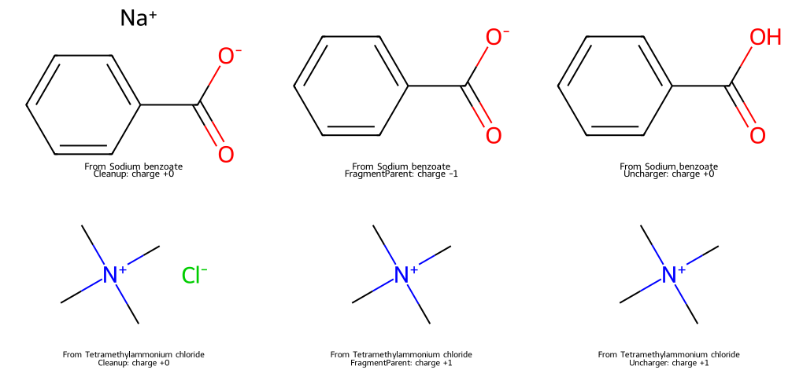

# 分子標準化與去鹽 {#sec-standardization-and-salts}

## 苯甲酸鈉去掉鈉離子後，就能當成苯甲酸的量測資料嗎？

不行。從結構裡刪掉鈉離子，得到的是帶負電的苯甲酸根；再替羧酸根補上一個氫，才得到中性的苯甲酸。這兩步改的只是我們拿來計算的結構，那筆溶解度量的仍然是苯甲酸鈉。**分子標準化**（molecular standardization）是依照指定的規則整理結構的寫法，**去鹽**是其中一種處理。要不要去鹽、要不要轉成中性形式，要看資料拿來做什麼，而且原始結構和量測紀錄都要留著。

## 核心概念

先看苯甲酸鈉的 SMILES：羧酸根和 `[Na+]` 中間用句點隔開，表示兩個沒有用鍵相連的**片段**（fragment）。整筆紀錄的形式電荷加起來是零，但兩個片段分別帶負電和正電。RDKit 的 `Cleanup` 會依規則整理官能基的寫法、處理部分金屬的連接，並重新安排可離子化的位置；小片段和原子上的電荷，它都會照原樣留著。所以在本節的例子裡，這一步之後鈉離子還在。[RDKit 原始實作](https://github.com/rdkit/rdkit/blob/master/Code/GraphMol/MolStandardize/MolStandardize.cpp)

如果想依有機母體整理候選化合物，可以另外產生**片段母體**（fragment parent）。`FragmentParent` 預設會先整理結構，再依規則留下比較大的片段。本例留下的是苯甲酸根，所以輸出反而帶 −1 電荷。

要注意，程式只依結構和規則做選擇，它不知道哪個片段才是實驗者關心的主成分。共晶中的另一個有機成分、配方裡的第二種活性成分，都可能在這一步被丟掉。所以看到 SMILES 裡的句點時，要先確認樣品是鹽、溶劑化物還是混合物，再決定要留下哪個片段。

`Uncharger().uncharge()` 會在規則允許時調整氫與形式電荷。單獨的苯甲酸根經過這一步，就變成中性的苯甲酸。四甲基銨離子則不同：氮已經連著四個碳，沒有氫可以移走，所以這個永久陽離子會保留 +1 電荷。換句話說，輸出還帶電荷不一定是失敗，這時也要保留氮上的正電荷，不要手動把它改成零。這些處理都沒有指定溶液的 pH，也沒有計算酸鹼平衡，所以量測時哪一種離子形式最多，要另外從實驗條件判斷。[MolStandardize API 文件](https://www.rdkit.org/docs/source/rdkit.Chem.MolStandardize.rdMolStandardize.html)

還有一類差異來自**互變異構物**（tautomer）：氫的位置和單、雙鍵的配置會一起改變。RDKit 的 `TautomerEnumerator().Canonicalize(mol)` 可以依規則選出一個代表結構，對某些查重工作很有幫助；但這個代表結構只是規則選出來的，和特定溶劑、溫度下最穩定的形式是兩回事。本節只比較整理、選片段與電荷處理三步，沒有再加上互變異構物的合併。每多加一條規則，都要重新確認原本分開的紀錄該不該歸成同一組。

## 動手做

[下載本節 notebook](../../notebooks/ch02/02-04-standardization-and-salts.ipynb){.btn .btn-sm .btn-outline-primary}　[在 Colab 開啟](ch02/02-04-standardization-and-salts.ipynb)

我們先用苯甲酸鈉和四甲基氯化銨這兩個化合物示範每一步做了什麼。notebook 會把三步的輸出依序存下來，哪一步改了結構，一看就知道。因為已經先呼叫過 `Cleanup`，所以傳 `skipStandardize=True` 給 `FragmentParent`，讓它不要再整理一次。下面這個函式在兩個示範例子和之後的 ESOL 檢查中都會用到；它產生的是拿來比較的候選結構，要不要採用，看完結果再決定。

```python
def stages(mol):
    cleaned = std.Cleanup(mol)
    parent = std.FragmentParent(cleaned, skipStandardize=True)
    candidate = uncharger.uncharge(parent)
    return cleaned, parent, candidate
```

{#fig-standardization-stages fig-alt="上列苯甲酸鈉保留兩個離子，選片段後只剩帶負電的羧酸根，電荷處理後變成苯甲酸。下列四甲基氯化銨移去氯離子後，四甲基銨在最後一步仍帶正電。各格標出整個結構的淨形式電荷。"}

在 @fig-standardization-stages 上列，由左往右追蹤羧基的氧。第一格有帶負電的氧和鈉離子；第二格的負電氧還在，只有鈉不見了；第三格才出現羧酸的 OH。下列則追蹤氮：移去氯離子後，氮仍然連著四個甲基，右下角的正號也還在。圖中第一欄的淨電荷都是零，裡面卻都有帶電的原子，所以只看整筆資料的電荷加總，會看不出這是一個鹽。

接著把同樣的函式用在公開的 ESOL 資料上。notebook 用 `dc.molnet.load_delaney()` 載入 1,128 筆紀錄；這次只檢查結構、不訓練模型，所以不分訓練集與測試集。`transformers=[]` 讓標籤保持原始的 log S，也就是以 mol/L 為基準的十進位對數。每一列都存著原始 SMILES、量測值、權重、列編號和三個候選結構，列號從 1 開始，方便回查。[@delaney2004esol]

要判斷結構有沒有被改動，我們先把原始結構也轉成同一版 RDKit 的 canonical SMILES，再和每一步的輸出比較。這樣只是換了起始原子的寫法，就不會被誤算成結構改變。

從結果來看（RDKit 2026.09.1），1,128 筆都能讀入，原始結構裡沒有多片段的紀錄；`Cleanup` 改動了 4 筆，之後的選片段與電荷處理各再改動 0 筆。後兩個零同樣是以全部 1,128 筆為分母，各自和前一步比較。也就是說，這個版本的 ESOL 裡沒有鹽，去鹽的效果要看前面的示範圖。

這四筆改動出現在第 512、519、749、849 列，都是把含硫官能基裡的 `S=O` 改寫成電荷分離的 `[S+][O-]`。這只是依規則換了一種寫法，量測值完全沒變。以第 849 列為例，原始實測 log S 是 −0.83；檢查表保留了這個數值和原始 SMILES，新的寫法另外放在 `cleanup_key` 欄。後面的 `Uncharger` 也沒有把這組正、負電荷抹掉。從圖中的季銨離子到這裡的含硫結構都可以看出，標準化之後仍然可能有帶電的原子，這是正常的。

之後如果要用候選母體分組，同一組裡的每筆量測仍要保有自己的識別碼。兩種鹽得到相同的母體，只表示它們在這套規則下被歸在一起；兩筆溶解度都要留著，也不宜平均後當成母體本身的性質。本節程式最後會確認資料列數、原始 SMILES 和量測值都沒有改變，避免整理時把數值和結構配錯；至於原始紀錄本身對不對，還是要回到資料來源確認。

## 實驗上的考量

苯甲酸鈉在圖中經過兩步才變成苯甲酸，但改寫 SMILES 並不會把瓶子裡的試劑換掉。要比較兩者的水溶解度，得先確認鹽型、量測時的 pH 和溫度，以及濃度是用鹽還是母體來計算。缺少這些條件的資料，就保留原始紀錄並標註「資訊不足」，比直接把兩個值當成可以互換來得穩妥。

## 重點整理

- `Cleanup`、`FragmentParent` 與 `Uncharger` 各自處理不同的問題，去掉反離子之後，結構仍可能帶電。
- 要不要選最大片段、要不要中和，都要看資料的用途；永久帶電的基團就保留原本的電荷。
- 標準化後的結構另存一欄，和原始結構、量測值和識別碼放在一起。

## 小練習

從 notebook 的 `audit` 表找出所有被 `Cleanup` 改過的紀錄，列出列編號、原始 log S，以及整理前後的淨形式電荷。再挑一筆，指出結構改在哪裡，並說明為什麼淨電荷沒變，寫法卻變了。

提示：先用 `cleanup_changed` 欄篩出改過的列，再用 `Chem.MolFromSmiles()` 分別讀入 `original_key` 與 `cleanup_key`，交給 `Chem.GetFormalCharge()` 計算淨電荷。

## 延伸閱讀

[RDKit MolStandardize API](https://www.rdkit.org/docs/source/rdkit.Chem.MolStandardize.rdMolStandardize.html) · [RDKit 標準化實作](https://github.com/rdkit/rdkit/blob/master/Code/GraphMol/MolStandardize/MolStandardize.cpp) · [Delaney 的 ESOL 論文](https://doi.org/10.1021/ci034243x)
