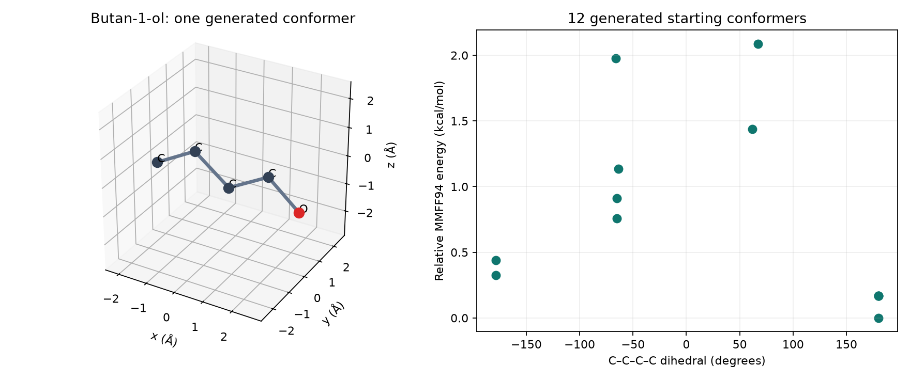
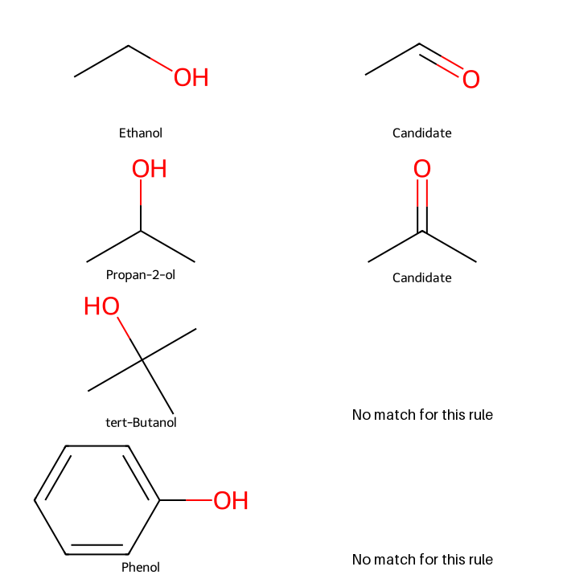

# 產生 3D 構形與化學反應 {#sec-conformers-and-reactions}

## 畫出三維分子、列出反應產物，就代表實驗中真的會得到它嗎？ {#開場問題}

還不行。三維構形是程式依結構和幾何限制算出來的原子座標，反應規則則是依我們指定的方式改動化學鍵。前者可以拿來做後續計算，後者可以列出值得評估的候選產物；實驗中分子實際長什麼樣子、反應實際得到什麼，還是要靠實驗確認。這一節先用正丁醇練習產生構形，再看不同的醇套用同一條氧化規則時，程式會留下哪些候選。

## 核心概念

**構形**（conformation）描述的是分子在空間中的排列。正丁醇的原子連接方式不變，但碳碳單鍵可以旋轉，讓碳鏈伸直或彎曲，所以把結構圖轉成三維座標時，答案通常不只一個。RDKit 的 ETKDG 方法結合距離幾何和已知的扭轉角偏好，產生符合結構限制的起始構形。我們明確指定 `ETKDGv3()` 這個版本，方便在全書固定的環境下重現結果。要記得，這些構形是計算出來的，和晶體結構或溶液中的主要構形是兩回事。[@riniker2015etkdg]

產生座標之後，可以用**分子力場**（molecular force field）調整原子的位置。這裡用的是 MMFF94，讓每個起始構形各自做能量最小化。程式會回報每個構形是否收斂和它的能量，兩者要一起看，沒有收斂的結果要和收斂的分開。

即使收斂了，也只表示這次最佳化達到了停止條件。產生十二個構形，只是取樣了其中一部分，本批能量最低的那個，未必就是全域最低。所以本節比較能量時，只比同一個分子、同一個力場和同一套計算設定的結果。

**反應 SMARTS**（reaction SMARTS）記錄的則是反應前後的局部結構改變。以一級或二級醇氧化成醛或酮為例，可以指定帶氫的飽和碳和羥基氧，把碳氧單鍵改成雙鍵。這和旋轉單鍵產生構形不同，反應前後的化學結構已經改變了。規則裡的**原子映射編號**（atom map number）用來對應反應前後的同一個原子，和分子物件裡從零開始的索引是兩套編號。這種局部規則沒有寫出試劑、副產物、反應條件或競爭反應，所以產生的結果只能稱為候選結構。

## 動手做

[下載本節 notebook](../../notebooks/ch02/02-05-conformers-and-reactions.ipynb){.btn .btn-sm .btn-outline-primary}　[在 Colab 開啟](ch02/02-05-conformers-and-reactions.ipynb)

notebook 從 ESOL 的原始 SMILES 找出正丁醇，並記下它在資料中的列編號；這裡只借用 ESOL 的結構，溶解度用不到。讀入分子後，先把氫加成獨立的原子，再產生十二組座標。**隨機種子**（random seed）固定為 42，並只用單一執行緒，這樣在相同的套件版本下重跑，會得到一樣的結果。

```python
mol = Chem.AddHs(base)
params = AllChem.ETKDGv3()
params.randomSeed = 42
params.numThreads = 1
ids = list(AllChem.EmbedMultipleConfs(mol, numConfs=12, params=params))
assert ids and AllChem.MMFFHasAllMoleculeParams(mol)
results = AllChem.MMFFOptimizeMoleculeConfs(
    mol, numThreads=1, maxIters=1000, mmffVariant="MMFF94"
)
```

這段程式依序做了四件事：加上氫、設定 ETKDG 的參數、產生十二個構形，最後用 MMFF94 把每個構形各自最佳化，最多迭代 1000 次。中間的 `assert` 會在沒有產生任何構形、或 MMFF 缺少這個分子的參數時讓程式停下來。

加上氫，是為了讓幾何生成和力場計算用的是完整的結構。二維結構式常把氫省略，但到了三維計算，氫占的空間和作用力都會影響結果。`ids` 是成功產生的構形編號，數量可能比要求的少，所以程式先確認有產生結果，再檢查 MMFF 有沒有這個分子需要的參數。如果缺少參數，就要改用其他適合的方法，算到一半的結果不能當成有效的能量。

{#fig-conformers-and-reactions fig-alt="左側為正丁醇重原子的三維位置，氧以紅色標示，座標單位為埃；右側橫軸為四個連續碳的二面角，縱軸為相對 MMFF94 能量。"}

這次十二個起始構形都成功產生，也都在設定的迭代次數內收斂。@fig-conformers-and-reactions 右圖以本批最低的能量為零點，所以縱軸是每個構形比它高出多少 kcal/mol；橫軸則只取碳鏈上四個連續碳的二面角。兩個點的二面角即使很接近，其他鍵的扭轉也可能不同，能量就會不一樣。換句話說，只看一個角度，還判斷不了兩個三維結構是否相同。

這張圖顯示的是計算取樣的結果，和構形在溶液中出現的頻率是兩回事。每個點來自一次起始座標的生成與最佳化，好幾個點落在同一個低能量區域，可能只是取樣和最佳化的過程造成的。要討論某個溫度下各構形的比例，還需要統計力學的處理和對環境的假設。這張圖的用途，是讓我們看到同一個分子可以有好幾種幾何排列，並練習確認計算有沒有完成。

接著回到醇的成鍵環境。notebook 用四個小分子測試反應規則：一級醇乙醇、二級醇異丙醇、三級醇第三丁醇，以及苯酚。規則寫成 `[C;X4;H1,H2;+0:1]-[O;X2;H1;+0:2]>>[C:1]=[O:2]`。箭頭左邊要求羥基接著的脂肪族碳帶一個或兩個氫；右邊保留編號 1 的碳和編號 2 的氧，把兩者之間改成雙鍵。因為有這個限制，三級醇和苯酚都不會符合。

{#fig-reaction-candidates fig-alt="四列反應規則對照。乙醇對應乙醛，異丙醇對應丙酮，第三丁醇與苯酚右側留白並註明規則沒有匹配。"}

`RunReactants()` 的輸出是好幾組產物，每一組裡又可能有好幾個產物，所以每一個都要看，不能只取第一組的第一個。notebook 逐一檢查候選：先呼叫 `Chem.SanitizeMol(product)` 檢查結構，再依 canonical SMILES 去掉重複的。這裡有個常見的陷阱：`SanitizeMol()` 回傳的是檢查狀態，分子本身還是原本的 `product`；如果把回傳值當成分子存起來，後面畫圖時就拿不到真正的產物了。

這個檢查可以抓出部分價數和芳香性寫法的問題，反應實際上可不可行則超出它的範圍。@fig-reaction-candidates 裡沒有匹配的兩個分子，只是不符合這條規則，在別的條件下仍然可能被氧化。同樣地，有候選產物，也還不知道反應會不會停在這一步、選擇性和產率如何。

最後，notebook 對 ESOL 的全部結構逐列套用同一條規則，保留原始列編號、SMILES 和去重後的候選，示範怎麼把小分子的測試延伸到實際資料。輸出的表格只記錄「哪個輸入結構產生了哪些候選」；候選是新的結構，沒有自己的量測值，也不會沿用反應物的水溶解度。[@delaney2004esol; @wu2018moleculenet]

## 重點整理

- 構形生成改變的是三維座標，反應規則改變的是局部的成鍵關係。
- 讀構形能量時，要連同方法、收斂狀態和取樣範圍一起看。
- 候選產物通過了結構檢查，反應可不可行、產率多少，仍然要靠實驗回答。

## 小練習

把本節的氧化規則套用到甘油 `OCC(O)CO`，比較去重前的產物組數和去重後的候選結構數，並說明為什麼端點羥基和中央羥基會得到不同的官能基。最後想一想：這份輸出能告訴我們實驗中哪種產物比較多嗎？

提示：把 notebook 裡反應物的 SMILES 換成甘油，逐一檢查 `RunReactants()` 的產物，用 canonical SMILES 去重，再想想甘油兩端的對稱關係。

## 延伸閱讀

[RDKit 的構形生成與力場操作](https://www.rdkit.org/docs/GettingStartedInPython.html#working-with-3d-molecules) · [反應物與產物的 API](https://www.rdkit.org/docs/source/rdkit.Chem.rdChemReactions.html) · [ETKDG 原始論文](https://doi.org/10.1021/acs.jcim.5b00654)
