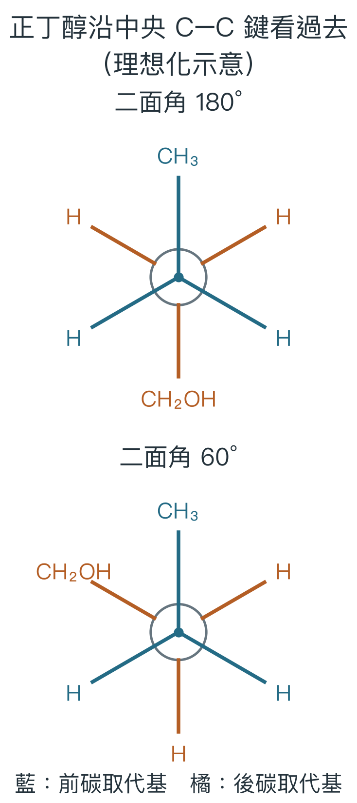
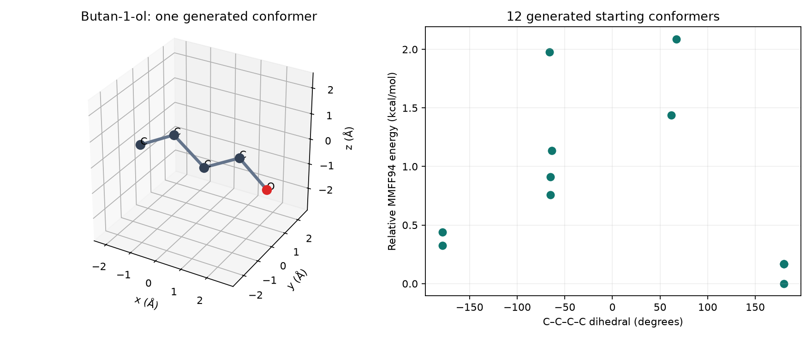

# 產生與比較三維構形 {#sec-conformers}

## 同一個正丁醇分子，為什麼可以算出多種三維形狀？ {#開場問題}

正丁醇的碳碳單鍵可以旋轉，使碳鏈呈現不同的空間排列，而原子之間的連接方式不變。因此，一串 SMILES 並不只對應一組三維座標。本節先產生多個起始構形，再調整原子位置、比較計算能量，看看哪些結果可以比較，以及這些結果能告訴我們什麼。

## 核心概念

**構形**（conformation）描述的是分子在空間中的排列。正丁醇的原子連接方式不變，但碳碳單鍵可以旋轉，讓碳鏈伸直或彎曲，所以把結構圖轉成三維座標時，答案通常不只一個。RDKit 的 ETKDG 方法會根據原子之間的距離限制，以及已知結構中常見的鍵旋轉角度，產生可供後續計算使用的起始構形。我們明確指定 `ETKDGv3()` 這個版本，方便在全書固定的環境下重現結果。要記得，這些構形是計算出來的，和晶體結構或溶液中的主要構形是兩回事。[@riniker2015etkdg]

產生座標之後，可以用**分子力場**（molecular force field）調整原子的位置。分子力場用一組計算規則估算分子的能量。本節使用 MMFF94，反覆小幅調整每個構形的原子位置，尋找能量較低的排列，這個過程稱為能量最小化。程式會回報能量與是否「收斂」；收斂表示計算已達到預先設定的停止條件，未收斂的結果要另外標示。

即使收斂了，也只表示這次最佳化達到了停止條件。產生十二個構形，只是取樣了其中一部分，其中能量最低的構形，未必是這個分子所有可能構形中能量最低的一個。所以本節比較能量時，只比同一個分子、同一個力場和同一套計算設定的結果。

<!-- concept-ch00-05:start -->
{#fig-concept-02-05 fig-alt="沿正丁醇中央碳碳鍵觀看，前方藍色甲基與後方橘色羥甲基在上圖相隔180度，下圖相隔60度。"}

視線沿中央 C–C 鍵，圓心代表前碳，圓圈代表後碳。這四個連續碳可以定義一個**二面角**：前三個碳形成一個平面，後三個碳形成另一個平面，二面角描述兩個平面繞中央 C–C 鍵的相對轉角。上圖兩端基團相對，下圖相隔 60°，連接方式始終相同。這是角度示意，不是下方十二個最佳化構形中的指定結果，也沒有比較能量。

本圖由本書原創繪製，採 [CC BY 4.0](https://creativecommons.org/licenses/by/4.0/) 授權。

本節產生十二組起始座標，固定亂數起始設定以便重現；程式中的 `randomSeed` 決定抽樣起點，構形數則由另一個參數指定。
<!-- concept-ch00-05:end -->

## 動手做

[下載本節 notebook](../../notebooks/ch02/02-05-conformers.ipynb){.btn .btn-sm .btn-outline-primary}　[在 Colab 開啟](ch02/02-05-conformers.ipynb)

notebook 從 ESOL 的原始 SMILES 找出正丁醇，並記下它在資料中的列編號；這裡只借用 ESOL 的結構，溶解度用不到。讀入分子後，先把氫加成獨立的原子，再產生十二組座標。我們固定產生這十二組起始座標的亂數設定，並只用單一執行緒，讓相同套件版本下的重跑結果可以比較；程式中的 `randomSeed` 是亂數起始設定，不是構形數。

```python
mol = Chem.AddHs(base)
params = AllChem.ETKDGv3()
params.randomSeed = 42
params.numThreads = 1
ids = list(AllChem.EmbedMultipleConfs(mol, numConfs=12, params=params))
assert ids and AllChem.MMFFHasAllMoleculeParams(mol)
results = AllChem.MMFFOptimizeMoleculeConfs(
    mol, numThreads=1, maxIters=1000, mmffVariant="MMFF94"
)
```

這段程式依序做了四件事：加上氫、設定 ETKDG 的參數、產生十二個構形，最後用 MMFF94 把每個構形各自最佳化，最多迭代 1000 次。中間的 `assert` 會在沒有產生任何構形、或 MMFF 缺少這個分子的參數時讓程式停下來。

加上氫，是為了讓幾何生成和力場計算用的是完整的結構。二維結構式常把氫省略，但到了三維計算，氫占的空間和作用力都會影響結果。`ids` 是成功產生的構形編號，數量可能比要求的少，所以程式先確認有產生結果，再檢查 MMFF 有沒有這個分子需要的參數。如果缺少參數，就要改用其他適合的方法，算到一半的結果不能當成有效的能量。

{#fig-conformers fig-alt="左側為正丁醇重原子的三維位置，氧以紅色標示，座標單位為埃；右側橫軸為四個連續碳的二面角，縱軸為相對 MMFF94 能量。"}

這次十二個起始構形都成功產生，也都在設定的迭代次數內收斂。@fig-conformers 右圖以本批最低的能量為零點，所以縱軸是每個構形比它高出多少 kcal/mol；橫軸則只取碳鏈上四個連續碳的二面角。兩個點的二面角即使很接近，其他鍵的扭轉也可能不同，能量就會不一樣。換句話說，只看一個角度，還判斷不了兩個三維結構是否相同。

這張圖顯示的是計算取樣的結果，和構形在溶液中出現的頻率是兩回事。每個點來自一次起始座標的生成與最佳化，好幾個點落在同一個低能量區域，可能只是取樣和最佳化的過程造成的。要討論某個溫度下各構形的比例，還需要統計力學的處理和對環境的假設。這張圖的用途，是讓我們看到同一個分子可以有好幾種幾何排列，並練習確認計算有沒有完成。

notebook 會將每個構形的編號、收斂狀態、MMFF94 能量、相對能量和碳鏈二面角整理成 `conformer_table`，另存為 `conformers.csv`。未收斂的構形仍保留在表中，但不列入相對能量與圖中的比較。

## 重點整理

- 同一個分子可以有不同的三維構形，原子連接方式與鍵的種類保持不變。
- 能量要在相同分子、力場與計算設定下比較；先確認收斂，再比較相對能量。
- 本批最低能量不一定是所有可能構形的最低能量，取樣點數也不能直接當成溶液中的構形比例。

## 小練習

從本節產生的 `conformer_table` 找出能量最低與最高的已收斂構形，列出兩者的編號、碳鏈二面角，以及相對能量（kcal/mol），並計算能量差。最低能量構形是否就一定是室溫水溶液中最常見的構形？請說明還缺少哪些資訊。

提示：先用 `conformer_table["converged"]` 篩出已收斂的結果，再按 `relative_energy_kcal_mol` 排序。表格記錄的是這次力場計算的結果，沒有計算溶液中的構形比例。

## 延伸閱讀

[RDKit 的構形生成與力場操作](https://www.rdkit.org/docs/GettingStartedInPython.html#working-with-3d-molecules) · [ETKDG 原始論文](https://doi.org/10.1021/acs.jcim.5b00654)
