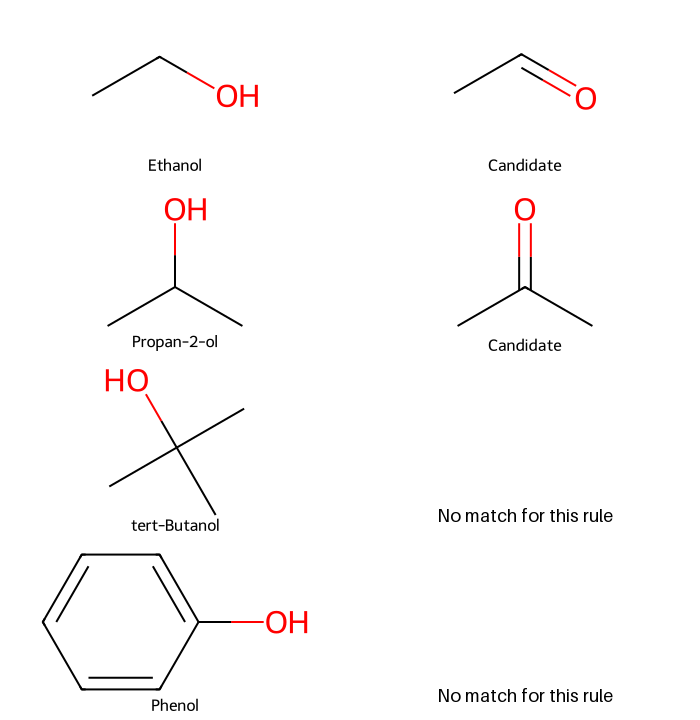

# 用反應規則產生候選產物 {#sec-reaction-rules}

## 同一條醇氧化規則，為什麼能用在乙醇，卻找不到第三丁醇的產物？ {#開場問題}

要看規則要求的是哪種成鍵環境。本節的規則要求羥基相連的碳帶一個或兩個氫，才把碳氧單鍵改成雙鍵。乙醇符合這個條件，第三丁醇則不符合。程式會依規則列出候選結構，但不會據此判斷實際反應的產率或可行性。

[上一節](02-05-conformers.qmd)改變的是原子的空間位置；這一節則會改變化學鍵。先把這兩種操作分清楚：

<!-- concept-ch00-05:start -->
座標變化和反應轉換可以用同一組問題來區分。

| 比較項目 | 旋轉正丁醇單鍵 | 把醇轉成羰基候選 |
|---|---|---|
| 原子如何相連 | 保留原有連接 | C–O 鍵級改變 |
| 三維座標 | 可產生不同構形 | 若要做三維計算，須另外產生候選產物的座標 |
| 可沿用的量測 | 仍要看量測對象與條件 | 不可把反應物 logS 當產物值 |
| 本節輸出代表什麼 | 起始構形及力場最佳化結果 | 符合局部規則的候選結構 |

比較上表可見：產生構形時，原子連接方式與鍵的種類不變；套用本節的反應規則時，碳氧單鍵會改成雙鍵。兩者都不能直接當成實驗已觀察到的結果。
<!-- concept-ch00-05:end -->

## 核心概念

**反應 SMARTS**（reaction SMARTS）記錄的則是反應前後的局部結構改變。以一級或二級醇氧化成醛或酮為例，可以指定帶氫的飽和碳和羥基氧，把碳氧單鍵改成雙鍵。這和旋轉單鍵產生構形不同，反應前後的化學結構已經改變了。規則裡的**原子映射編號**（atom map number）用來對應反應前後的同一個原子，和分子物件裡從零開始的索引是兩套編號。這種局部規則沒有寫出試劑、副產物、反應條件或競爭反應，所以產生的結果只能稱為候選結構。

### 先讀反應前後，再加入原子的條件

在 [2.3 節](02-03-substructure-smarts.qmd)，SMARTS 用來找出符合條件的局部結構。反應 SMARTS 進一步用 `>>` 分隔反應前後：左邊描述要找到的結構，右邊描述如何改寫。

先看規則中的局部變化：`[C:1]-[O:2]` 改成 `[C:1]=[O:2]`。碳仍是編號 1，氧仍是編號 2，改變的是兩者之間的單鍵變成雙鍵。這段只用來說明改鍵方式，尚未限制哪些碳氧鍵適合套用。完整規則還要加入以下條件：

| 規則中的寫法 | 本節的意思 |
|---|---|
| `C;X4;H1,H2;+0` | 非芳香碳、總連接數為四、帶一個或兩個氫，且形式電荷為零 |
| `O;X2;H1;+0` | 非芳香氧、總連接數為二、帶一個氫，且形式電荷為零 |
| `;` 與 `,` | 分號連接必須同時滿足的條件；本例的 `H1,H2` 表示氫數為一或二 |
| `:1` 與 `:2` | 在反應前後對應同一個碳與氧的標記，不是電荷或原子索引 |
| `>>` | 左側是反應物要符合的結構，右側是產物的改寫方式 |

這些限制讓乙醇與異丙醇符合規則。第三丁醇帶羥基的碳沒有氫，苯酚的羥基則連著芳香碳，因此都不符合。本節只示範這一條局部規則，沒有建立可預測所有氧化反應的模型。

## 動手做

[下載本節 notebook](../../notebooks/ch02/02-06-reaction-rules.ipynb){.btn .btn-sm .btn-outline-primary}　[在 Colab 開啟](ch02/02-06-reaction-rules.ipynb)

這份 notebook 可以獨立執行，不需要上一節的三維座標。先載入 ESOL 的 1,128 筆結構，再用四個簡單分子檢查規則是否符合預期。以下是建立規則並列出候選結構的關鍵程式：

```python
reaction_smarts = "[C;X4;H1,H2;+0:1]-[O;X2;H1;+0:2]>>[C:1]=[O:2]"
rxn = AllChem.ReactionFromSmarts(reaction_smarts)

def products_for(mol):
    products = {}
    for bundle in rxn.RunReactants((mol,)):
        for product in bundle:
            Chem.SanitizeMol(product)
            smiles = Chem.MolToSmiles(product)
            products[smiles] = product
    return products
```

`products` 用產物的 canonical SMILES 作為字典的鍵；再次得到相同字串時，就只保留一份結構。函式對每一組產物逐一檢查，最後回傳通過結構檢查且已去除重複的候選。

notebook 用四個小分子測試反應規則：一級醇乙醇、二級醇異丙醇、三級醇第三丁醇，以及苯酚。規則寫成 `[C;X4;H1,H2;+0:1]-[O;X2;H1;+0:2]>>[C:1]=[O:2]`。箭頭左邊要求羥基接著的脂肪族碳帶一個或兩個氫；右邊保留編號 1 的碳和編號 2 的氧，把兩者之間改成雙鍵。因為有這個限制，三級醇和苯酚都不會符合。

{#fig-reaction-candidates fig-alt="四列反應規則對照。乙醇對應乙醛，異丙醇對應丙酮，第三丁醇與苯酚右側留白並註明規則沒有匹配。"}

`RunReactants()` 的輸出是好幾組產物，每一組裡又可能有好幾個產物，所以每一個都要看，不能只取第一組的第一個。notebook 逐一檢查候選：先呼叫 `Chem.SanitizeMol(product)` 檢查結構，再把候選轉成 canonical SMILES，比較字串並只保留一份相同的結構。這裡有個常見的陷阱：`SanitizeMol()` 回傳的是檢查狀態，分子本身還是原本的 `product`；如果把回傳值當成分子存起來，後面畫圖時就拿不到真正的產物了。

這個檢查可以抓出部分價數和芳香性寫法的問題，反應實際上可不可行則超出它的範圍。@fig-reaction-candidates 裡沒有匹配的兩個分子，只是不符合這條規則，在別的條件下仍然可能被氧化。同樣地，有候選產物，也還不知道反應會不會停在這一步、選擇性和產率如何。

最後，notebook 對 ESOL 的全部結構逐列套用同一條規則，保留原始列編號、SMILES 和去重後的候選，示範怎麼把小分子的測試延伸到實際資料。輸出的表格只記錄「哪個輸入結構產生了哪些候選」；候選是新的結構，沒有自己的量測值，也不會沿用反應物的水溶解度。[@delaney2004esol; @wu2018moleculenet]

本次共有 124 筆來源紀錄符合規則，合計列出 212 筆候選產物紀錄。結果另存為 `reaction_candidates.csv`：每列保留來源紀錄編號、原始 SMILES 與一個候選產物的 SMILES。同一個反應物若有不同候選，就會出現在多列，因此表格列數不等於命中的反應物紀錄數。

## 重點整理

- 反應 SMARTS 描述局部結構如何改變；原子映射編號用來對應反應前後的原子。
- 逐一檢查產物結構，再依 canonical SMILES 去除重複結果。
- 符合規則的候選不等於實測產物，不能從候選數量推論產率或沿用反應物的性質值。

## 小練習

把本節的氧化規則套用到甘油 `OCC(O)CO`，先計算程式回傳了幾組產物，再移除重複結構，計算剩下幾種候選產物，並說明為什麼端點羥基和中央羥基會得到不同的官能基。最後想一想：這份輸出能告訴我們實驗中哪種產物比較多嗎？

提示：把 notebook 裡反應物的 SMILES 換成甘油，逐一檢查 `RunReactants()` 的產物，用 canonical SMILES 去重，再想想甘油兩端的對稱關係。

## 延伸閱讀

[RDKit 的反應 SMARTS](https://www.rdkit.org/docs/RDKit_Book.html#reaction-smarts) · [反應物與產物的 API](https://www.rdkit.org/docs/source/rdkit.Chem.rdChemReactions.html)
