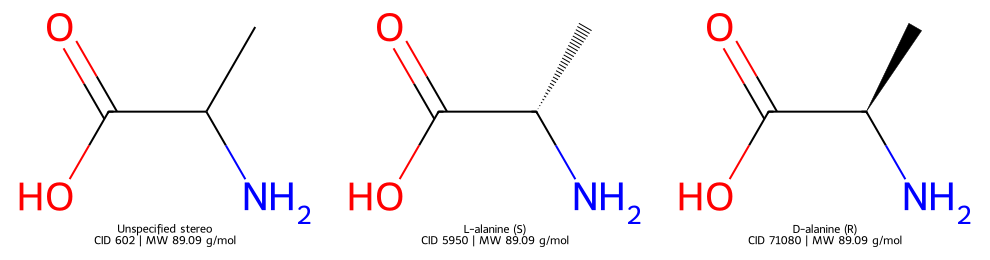

# PubChem 與 PubChemPy {#sec-pubchem}

## 查到 alanine，就能認定是手上的那瓶丙胺酸嗎？ {#開場問題}

還要再確認立體結構和樣品形式。PubChem 的名稱查詢能幫我們找到候選紀錄，但「alanine」這個字沒有說明瓶子裡是 L-丙胺酸、D-丙胺酸，還是兩者的混合物。這一節從丙胺酸出發，用 PubChemPy 取得結構與性質，再用 CID 記下查到的是哪一筆紀錄。也就是說，名稱適合拿來找資料；把資料接回實驗表之前，要先確認它代表哪一個化學結構。

## 核心概念

PubChem 分成 Compound、Substance 與 BioAssay 三個部分，各自回答不同的問題。Compound 依標準化後的化學結構整理紀錄，識別碼是 **CID**（Compound ID）；Substance 保存各個提供者提交的物質描述，識別碼是 **SID**（Substance ID）；BioAssay 則保存生物試驗的描述與結果。同一個結構可以連到好幾筆提供者的紀錄，所以 SID 和 CID 是兩套編號，不能混用。想確認結構時先看 Compound；想知道資料是誰提供的、測了什麼，就要沿著來源和試驗紀錄往下查。[PubChem 資料組織說明](https://pubchem.ncbi.nlm.nih.gov/docs/about)

找到 CID 之後，也要看它把結構描述到多細。CID 5950 的丙胺酸指定了 S 構型，CID 71080 指定了 R 構型，CID 602 則沒有指定這個立體中心。「沒有指定」只是資訊缺了，和「一比一的外消旋混合物」是兩件事。這三筆紀錄的分子式和分子量都一樣，所以光看這兩項也分不出來。如果實驗要比較酵素對兩種構型的辨識，忽略這個差別，就會把不同的受測樣品混在一起。

查到的性質也不全是實驗值。這裡的分子量是依結構和原子量算出來的，XLogP 則是計算出來的辛醇／水分配係數對數，兩者都和實測的水溶解度不同。如果要建立溶解度模型，還得找到實際的量測值、單位、溫度、pH 和原始出處。`get_properties()` 擅長取得指定的結構性質，文獻中的實驗條件則要另外整理。[PubChem 性質欄位說明](https://pubchem.ncbi.nlm.nih.gov/docs/pug-rest)

## 動手做

[下載本節 notebook](../../notebooks/ch03/03-01-pubchem.ipynb){.btn .btn-sm .btn-outline-primary}　[在 Colab 開啟](ch03/03-01-pubchem.ipynb)

notebook 裡附了一份 2026-11-04 從 PubChem 實際查到的三筆資料，我們稱為**快照**（snapshot），就像替當天的查詢結果拍一張照片存起來。快照裡還記下了查詢網址，以及原始回應的 SHA-256。SHA-256 可以想成檔案的指紋：內容只要改了一個字，指紋就會不同，所以可以用來確認資料沒有被動過。

notebook 預設用這份快照畫圖，下載後不必再連到 PubChem，不過第一格的套件安裝還是要執行。把第三格改成 `LIVE = True`，就會重新向 PubChem 查詢。兩種模式都會印出資料來自哪裡；連線失敗時程式會直接停下來，不會偷偷改用快照。如果重新查到的資料已經更新，就以新的輸出為準，並記下新的查詢日期。

我們先用 `get_cids("alanine", "name")` 查名稱，這次回傳的是 `[5950]`。同一個名稱在不同時間查詢，回傳的候選數量可能不同，因為資料庫會持續更新，所以查詢日期和結果都要一起記下來。為了比較立體資訊，下面的程式直接指定三個事先確認過的 CID，其中兩筆並不在這次名稱查詢的結果裡。最後的 `"cid"` 告訴程式，輸入的是 Compound 的識別碼。

```python
properties = ["MolecularFormula", "MolecularWeight", "ConnectivitySMILES",
              "SMILES", "IUPACName", "XLogP"]
rows = pcp.get_properties(properties, [602, 5950, 71080], "cid")
by_cid = {row["CID"]: row for row in rows}
if len(by_cid) != len(rows) or set(by_cid) != {602, 5950, 71080}:
    raise ValueError("CID 有重複或缺漏，停止對接資料")
table = pd.DataFrame([by_cid[cid] for cid in [602, 5950, 71080]])
table["MolecularWeight"] = pd.to_numeric(table["MolecularWeight"], errors="raise")
```

這段程式一次向 PubChem 要三筆 CID 的六種性質，再用 `by_cid` 把每筆結果依 CID 收好。中間的 `if` 在檢查：回來的 CID 有沒有重複、是不是剛好就是我們要的三筆，不對就停下來。最後依指定順序排成表格，並把分子量轉成數字。

一次傳入一串 CID，就是**批次查詢**，不必每個性質各連線一次。我們用 CID 對齊結果、再排成指定順序，所以就算 PubChem 回傳的順序變了，D-丙胺酸的資料也不會接到 L-丙胺酸那一列。分子量在這次回傳的資料裡是字串 `"89.09"`，要轉成數值才能拿來比較或計算。如果某一筆缺了需要的欄位，完整程式會指出來並停止，而不是自動補成零。

{#fig-pubchem fig-alt="三個丙胺酸結構並排，標示 CID 602、5950、71080；後兩個結構的立體化學鍵方向不同，分子量相同。"}

圖中三者的連接方式相同，差別在於立體中心有沒有指定、指定的是哪一種構型。對照表格，三筆的 `ConnectivitySMILES` 都是 `CC(C(=O)O)N`，`SMILES` 則保留了後兩筆的立體標記。如果只用前一欄去除重複，本來要比較的兩個對映異構物就會被合成一筆。第 1 章提過，`@` 和 `@@` 的意思要看字串中鄰居的順序，所以判斷 R 或 S 時，要連同完整結構和 IUPAC 名稱一起看。

PubChemPy 1.0.5 把舊的 `canonical_smiles` 與 `isomeric_smiles` 屬性，分別改名為 `connectivity_smiles` 與 `smiles`。批次查詢性質時用上面那種大寫的欄位名稱；如果拿到的是 `Compound` 物件，就用小寫屬性，例如 `compound.smiles`。ConnectivitySMILES 只有連接資訊，不含立體化學和同位素；SMILES 欄位保留了這些資訊，但來源原本就沒指定的構型，字串裡也不會有。[PubChemPy API 文件](https://docs.pubchempy.org/en/latest/api.html)

完整程式也示範了怎麼重試。遇到暫時性的服務或連線錯誤，程式會等一下再試，最多三次；如果是參數寫錯，就直接回報，因為同一個錯誤的查詢送幾次都一樣。名稱查詢回傳空清單時，要記成「未找到」，而不是「這個化合物不存在」。本例固定查三筆，少了任何一個 CID 就停止。換成大量資料時，還要分批查詢、記下每一批成功或失敗，並遵守 PubChem 的流量限制，這樣重跑時只要處理還沒成功的部分。

實際整理試劑清單時，建議把原本的名稱留在一欄、查到的 CID 放在另一欄，再另外記下查詢日期。實驗者寫下的試劑名稱要保留原樣，因為裡面可能帶著鹽類、水合物或批次的資訊，用 PubChem 的 IUPAC 名稱蓋掉就找不回來了。如果瓶身寫的是某種鹽，查回來的結構卻是中性母體，就要回頭確認是不是查到了不同的形式。這也會影響配溶液時要用的分子量：秤量時要用瓶中那個形式的分子量，資料庫上的數字未必就是它。

名稱查詢的第一筆，也不一定就是正確答案。本例只查到一筆，我們還是檢查了它的結構；換一個名稱、語言或供應商代號，候選就可能不同。如果原始實驗根本沒記下構型，即使查詢剛好只回傳 L-形式，那也只是資料庫對這個名稱的對應，當時用的是哪一種樣品，仍然不知道。把「找到了什麼」和「確認了什麼」分成兩欄記錄，之後要修正配對時，就不必重新猜整張表。

## 實驗上的考量

這三筆丙胺酸的 XLogP 都是 −3，但三種樣品在酵素試驗中的表現仍可能不同。要比較 L 與 D 形式，先確認試劑的構型和純度，並記下試驗條件和批號。如果只知道「alanine」、沒有構型資訊，就先標成「待確認」，等查到實驗紀錄再補上。

## 重點整理

- 名稱用來找候選，CID 用來記下確定的結構，立體化學和樣品形式要另外確認。
- 批次查詢的結果要依 CID 對齊，缺漏、資料型別和查詢錯誤都要明確處理。
- 從結構算出的性質和實驗量測是兩回事，建模前要確認性質的定義、單位和來源。

## 小練習

同事想比較 L-與 D-丙胺酸對同一種酵素的作用，打算把三筆紀錄依 `ConnectivitySMILES` 去重，再把 XLogP 當成「活性」。請用快照算出依 `ConnectivitySMILES` 和依 `SMILES` 去重各剩幾筆，說明這樣整理會丟掉什麼，以及要比較酵素作用還缺哪一種資料。

提示：對 `table` 的兩個欄位分別呼叫 `nunique()`，再回頭看三筆的 IUPAC 名稱。

## 延伸閱讀

[PubChem 資料組織](https://pubchem.ncbi.nlm.nih.gov/docs/about) · [PubChemPy：取得指定性質](https://docs.pubchempy.org/en/latest/guide/properties.html) · [PubChemPy API 與例外類別](https://docs.pubchempy.org/en/latest/api.html) · [PUG REST 與流量限制](https://pubchem.ncbi.nlm.nih.gov/docs/pug-rest)
