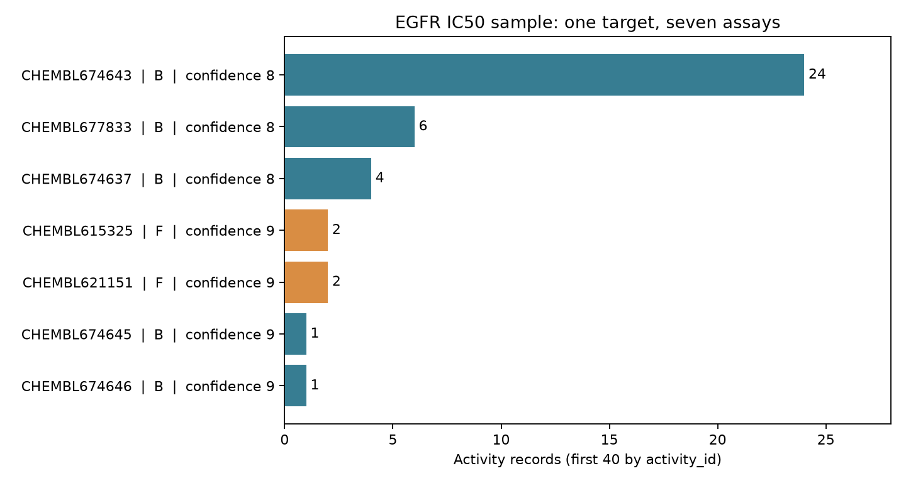

# ChEMBL 與活性資料 {#sec-chembl}

## 查到同一分子的三個 IC50，能直接取平均嗎？ {#開場問題}

要先看這三個 IC50 是在哪些測試中量的。ChEMBL 的一筆活性紀錄同時連到化合物、**測試**（assay）與**靶點**（target），數值要連同測試方法一起解讀。舉例來說，本節查到的化合物 `CHEMBL68920` 在三個測試中的 IC50 分別是 41、300 與 7,820 nM，三個測試分別量的是激酶磷酸化、細胞內受體的自體磷酸化，以及細胞增殖抑制。數值都叫 IC50，量的卻是三件不同的事；把它們平均，反而會抹掉最需要解釋的實驗差別。

## 核心概念

ChEMBL 收錄化合物和它們的生物活性資料。查詢時，`molecule_chembl_id` 指向化合物，`assay_chembl_id` 指向測試，`target_chembl_id` 指向這個測試被指派的靶點，`activity_id` 則代表一筆活性紀錄。另外還要留下 `document_chembl_id`，才找得到資料出自哪一份文件。

同一個化合物可以出現在好幾個測試裡，同一個測試也可以測很多化合物，所以一張 40 列的活性表，不一定有 40 個不同的分子。換句話說，這些編號各管一件事，只有 `molecule_chembl_id` 是分子的編號。[官方資料服務](https://chembl.gitbook.io/chembl-interface-documentation/web-services/chembl-data-web-services)也把它們分成不同的查詢端點，正好對應這幾種實體。

本節的靶點是**表皮生長因子受體**（epidermal growth factor receptor, EGFR），編號 `CHEMBL203`。ChEMBL 記載它的物種是人類、類型是單一蛋白質，不過同一個靶點編號底下，仍然可能有好幾種不同的實驗系統。

Assay 的 `assay_type` 欄位中，B 代表 binding（結合），F 代表 functional（功能）。這只是資料庫的粗略分類，詳細的操作方法還要看測試說明。`confidence_score` 則表示 ChEMBL 對「這個測試確實是針對這個靶點」有多大的把握，和 IC50 的誤差或論文品質無關：9 表示直接指派到單一蛋白質，8 表示指派到同源的單一蛋白質。這個分數只是起點，測試是否符合研究問題，還要讀 assay 說明和原文才知道。分類與分數的定義列在 [ChEMBL 的 assay 說明](https://chembl.gitbook.io/chembl-interface-documentation/frequently-asked-questions/chembl-data-questions)。

IC50 是在特定實驗條件下，達到一半抑制所需的濃度。讀資料時，至少要把 `standard_type`、`standard_relation`、`standard_value` 與 `standard_units` 四欄放在一起看。舉例來說，`IC50 = 41 nM` 是一個確定的值；`IC50 > 1,250,000 nM` 則只告訴我們下限，也就是測到最高濃度都還沒達到一半抑制。如果把大於號丟掉，就把一個範圍誤當成了精確的數字。

原始的 `type`、`relation`、`value`、`units` 欄位也要保留，方便和 ChEMBL 標準化後的欄位對照。另外，資料庫幫我們統一了單位，但各列能不能放進同一個迴歸模型，還要看它們量的是不是同一件事。

## 動手做

[下載本節 notebook](../../notebooks/ch03/03-02-chembl.ipynb){.btn .btn-sm .btn-outline-primary}　[在 Colab 開啟](ch03/03-02-chembl.ipynb)

我們直接透過 ChEMBL 的 **API**（讓程式向資料庫要資料的網址介面）查詢 `target_chembl_id=CHEMBL203`、`standard_type=IC50`，依 `activity_id` 排序，每頁取 20 筆，只讀兩頁。為了教學，我們刻意只取前 40 筆，所以它既不是完整的資料，也不是隨機抽樣。

API 回應裡的 `page_meta.total_count` 是符合條件的總筆數，`limit` 則是每頁的筆數，兩者意思不同。Notebook 記下每頁的網址、offset、next 和 total_count，沿著第一頁給的 next 讀第二頁，最後確認兩頁的 offset 是 0 和 20，activity ID 也沒有重複。

下面是 notebook 重新連線查詢時的核心程式。`get_json` 會讀取網址並把回傳的 JSON 轉成 Python 的資料；網路出錯時直接報錯。伺服器每頁回傳的筆數有上限，所以要沿著 next 一頁一頁讀，而不是把 `limit` 調大就以為拿到全部。

```python
pages = []
for _ in range(2):
    page = get_json(url)
    pages.append({"url": url, "page_meta": page["page_meta"],
                  "activities": page["activities"]})
    next_url = page["page_meta"]["next"]
    if not next_url:
        break
    url = urllib.parse.urljoin("https://www.ebi.ac.uk", next_url)
```

這個迴圈最多跑兩次：每次讀一頁、把網址和內容存進 `pages`，再找出下一頁的網址；如果沒有下一頁，就提早結束。

預設執行時，notebook 使用內嵌的一份快照，也就是事先從 API 查好、存在 notebook 裡的資料，不需要另外找 CSV。這份資料在 2026-11-04 下載，當時的資料庫版本是 ChEMBL_37。為了讓檔案精簡，快照只留下本節和資料清理需要的欄位，數值都是原本查到的。

設定 `CH03_LIVE=1` 可以重跑同樣的查詢，重新取得 assay 和版本資訊；如果資料庫已經修訂，數字可能會不同。排序只能固定「取哪幾筆」的規則，遠端資料本身仍可能更新，所以要把下載日期和版本一起記下來。

這份快照有 40 筆 activity、36 個化合物和 7 個 assay。@fig-chembl-assays 的每一條橫條代表一個 assay 有幾筆紀錄，標籤同時列出測試類型和靶點指派信心。最大的一組 `CHEMBL674643` 占了 24 筆，另外兩組 F 類測試各占 2 筆。這張圖的用途，是看出這次查回來的資料由哪些測試組成；它只反映這 40 筆，和各 assay 的準確度或整個 EGFR 文獻的測試比例無關。

{#fig-chembl-assays fig-alt="七條橫條依記錄數排序，CHEMBL674643有24筆，其餘各1至6筆；標籤顯示同一EGFR查詢包含B與F類，以及8和9兩種信心分數。"}

回頭追查開場的三筆資料：activity `32260` 對應 `CHEMBL674637`，紀錄為 41 nM；`32263` 對應 `CHEMBL621151`，紀錄為 300 nM；`32265` 對應 `CHEMBL615325`，紀錄為 7,820 nM。第一個 assay 是 B 類、信心分數 8，後兩個是 F 類、分數 9。就算只保留分數 9 的紀錄，剩下的兩筆量的仍是不同的細胞終點。所以要建立 EGFR 生化抑制模型，應該先定義需要哪一種測試系統，再逐一查 assay 的方法、物種、蛋白質變異和來源文件，信心分數只能幫我們做第一輪篩選。

我們可以把這次查詢想成在整理實驗室的測試清單。如果研究問題是「哪些分子會抑制這個蛋白質的酵素活性」，細胞增殖的結果可以當作參考，但要和酵素抑制的數值分開放；如果問題換成「哪些分子會抑制細胞生長」，只看生化測試就不夠了。所以查詢之前，先用一句話寫下要預測的是什麼，才知道該留下哪些 assay；表格越大，越需要這一步。

每筆測試要從兩個層次來看。在資料庫層次，可以用編號、分類和說明，快速排除明顯不合的紀錄；在實驗層次，則要讀方法，確認蛋白質構築、細胞來源和量測設計。舉例來說，說明裡寫「表達人類受體的細胞」，細胞本身可能來自其他物種，量的也可能是細胞內的反應，而不是純化蛋白質與配體的結合。所以靶點的物種、測試材料的物種和細胞背景，要各自查清楚；資料庫沒寫到的條件，就標成「未確認」，而不是用靶點名稱去推測。

對剛開始整理活性資料的人來說，保留文件編號往往比多下載一個數值更有用。兩筆結果差很多時，我們需要知道它們是同一份研究裡的不同實驗，還是不同來源的重複量測，也要確認文中用的是不是同一種化合物形式。另存 SMILES 方便之後畫圖和檢查結構，但結構相同，測試條件仍可能不同。這也是本節保留每一筆 activity，而沒有先整理成「一個分子一列」的原因。

下載完成、也確認過分頁之後，就可以回到化學問題：這 40 筆涵蓋幾種測試？哪些符合原本的用途？拿掉某一類測試後，還剩多少個不同的化合物？這些答案會決定下一步能不能建模。如果某個 assay 只剩兩筆資料，那它就只有兩筆，整張表的 40 列量的並不是同一個終點。描述樣本範圍時，圖說、表格和分析結論要說的是同一件事。

## 實驗上的考量

同一個化合物的 41 nM 和 7,820 nM，差距多半來自測試本身的不同，而不是單純的量測誤差。細胞增殖測試牽涉到化合物進入細胞和後續的細胞反應，和激酶磷酸化測試量的是不同的東西。要判斷差距從哪裡來，可以沿著 assay 和文件編號查出細胞種類、處理時間和濃度範圍，再安排相同條件下的對照或重複實驗。

## 重點整理

- 一筆活性紀錄同時連到化合物、assay、靶點與文件，所以表格的列數和分子數是兩回事。
- Assay 類型和信心分數可以幫忙篩選，但要合併不同的 IC50，得先讀過測試方法。
- 記下查詢條件、版本、日期和分頁資訊，才說得清楚下載的是哪一批資料。

## 小練習

從 notebook 的快照中找出 `CHEMBL69960` 的所有活性紀錄，列出 activity ID、assay ID、IC50、單位、assay 類型與信心分數，再根據 assay 說明判斷這些數值適不適合直接取平均。

提示：先用 `molecule_chembl_id` 篩出這個化合物的紀錄，再拿每筆的 `assay_chembl_id` 去 `SNAPSHOT["assays"]` 找測試說明。

## 延伸閱讀

[ChEMBL Data Web Services](https://chembl.gitbook.io/chembl-interface-documentation/web-services/chembl-data-web-services)說明各端點、篩選與分頁；[Assay and Activity Questions](https://chembl.gitbook.io/chembl-interface-documentation/frequently-asked-questions/chembl-data-questions)說明測試分類、靶點信心及活性欄位。
