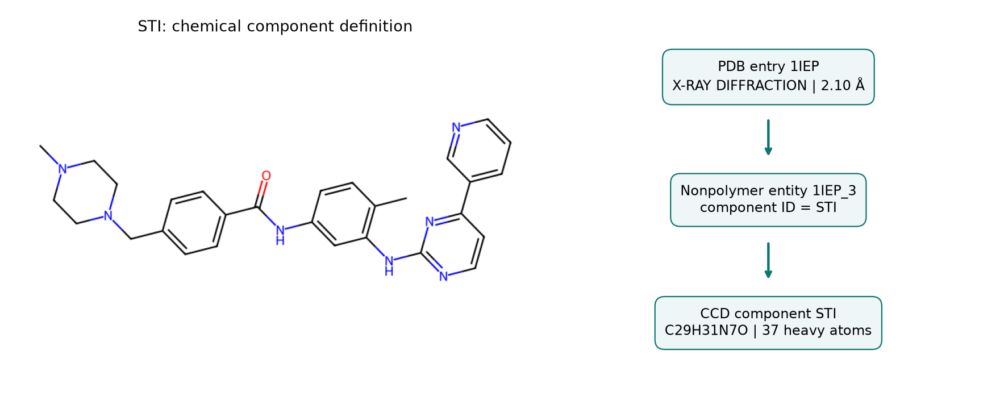

# 其他常用資料庫 {#sec-other-chemical-databases}

## 已經找到化合物的名稱，為什麼還要查不同的資料庫？ {#開場問題}

因為名稱只幫我們找到對象，每個資料庫回答的問題卻不一樣。想查已知的生物活性，可以查 ChEMBL；想找能向供應商買到、用來篩選的候選化合物，可以查 ZINC；想知道一個分子屬於哪一種化學類別，可以查 ChEBI；想看它在某個蛋白質複合體裡的位置，可以查 PDB；想找熱化學數據或參考光譜，可以查 NIST Chemistry WebBook。這些資料庫記錄的對象和證據各不相同，同一個分子在不同資料庫裡的紀錄，說的往往是不同的事。

## 核心概念

[ChEMBL](https://www.ebi.ac.uk/chembl/) 與 [ZINC](https://cartblanche.docking.org/) 常出現在同一個研究流程裡，回答的問題卻不同。ChEMBL 把化合物和生物活性測試連在一起，適合查已知的活性、比較結構與活性的關係，用法見 @sec-chembl。ZINC 則幫研究者從供應商的化合物目錄中挑選虛擬篩選的候選分子，並查詢結構和供應商資訊。

ZINC-22 收錄的主要是**按需合成**（make-on-demand）的化合物，也就是接到訂單才合成，列在目錄上的分子大多還沒有真的做出來。挑選時要分清楚現貨和按需合成，並向供應商確認能不能交貨、交期、純度和供應的化學形式。另外，ZINC 收錄的結構大多沒有活性資料；拿它們當模型的預測對象時，「查不到活性」要記成「未測」，而不是「無活性」。

選資料庫之前，先把化學問題寫成一句具體的話。例如「這個官能基讓分子被歸到哪一類？」和「這個分子在某個晶體複合體裡怎麼排列？」需要的是不同的資料。ChEBI 除了保存化學實體，也用**本體**（ontology）描述類別與角色之間的關係。有些條目代表的是一整群化合物，所以讀取時要先看它是具體的分子、化學類別，還是角色描述；只有具體分子才能畫成固定的結構。[ChEBI 資料說明](https://www.ebi.ac.uk/chebi/about)

另一類問題，是分子在生物大分子中的空間位置。**蛋白質資料庫**（Protein Data Bank，PDB）的結構條目，連結了生物大分子的三維模型、實驗資訊和來源文獻，RCSB PDB 則提供網頁查詢與程式存取的介面。一個結構條目裡可能同時有蛋白質、配體、離子和水，所以條目編號代表的是整個複合體；小分子的化學成分定義另外收在 **Chemical Component Dictionary**（CCD）。也就是說，查配體時要從結構條目、條目中的分子實體，一路追到成分代碼。[RCSB API 資料層級](https://www.rcsb.org/docs/programmatic-access/web-apis-overview)

NIST Chemistry WebBook 收錄熱化學、熱物性和多種光譜資料，適合用來查「這個數字或訊號是在什麼條件下得到的」。找到同名的化合物只是第一步，還要確認相態、溫度、壓力、量測方法和原始文獻。舉例來說，氣相的數據要和溶液中的量測分開看，光譜的峰位置也要連同實驗條件一起讀。這一節只介紹怎麼挑選資料來源，不會從網站擷取光譜，也不會把不同條件的數據合併成一個代表值。[NIST WebBook](https://webbook.nist.gov/chemistry/)

| 手上的化學問題 | 優先查看的來源 | 還要確認的內容 |
|---|---|---|
| 已知的生物活性、測試與靶點 | ChEMBL（見 3.2） | 測試方法、物種、端點、單位與不等號 |
| 可取得的候選化合物與虛擬篩選分子庫 | ZINC | 供應商、現貨或按需合成、結構形式與查詢日期；多數結構沒有活性資料 |
| 化學類別、角色與實體間的關係 | ChEBI | 條目是具體結構還是類別，關係的定義與來源 |
| 蛋白質複合體及配體的空間位置 | PDB／RCSB PDB | 蛋白質來源、實驗方法、結構品質與配體實體 |
| 熱化學數據、物性或參考光譜 | NIST Chemistry WebBook | 相態、條件、單位、量測方法與文獻 |

## 動手做

[下載本節 notebook](../../notebooks/ch03/03-03-chemical-databases.ipynb){.btn .btn-sm .btn-outline-primary}　[在 Colab 開啟](ch03/03-03-chemical-databases.ipynb)

我們用 PDB 結構 `1IEP` 練習一層一層往下追。它是 c-Abl 激酶結構域與 STI-571 的複合體紀錄，配體的 CCD 代碼是 `STI`。Notebook 裡存了一份快照，內容是這次從 RCSB 官方 API 查到的必要欄位、查詢網址和查詢時間，預設就用這份資料重現書中的結果。設定 `BOOK_CH03_LIVE=1` 會重新連線查詢，並印出「即時模式」和查詢時間；連線失敗時會直接報錯，不會偷偷改用舊的快照。[@pdb1iep]

程式會讀取五個端點：結構條目、兩個非聚合物實體、蛋白質實體，以及 STI 的成分定義。我們先查 `1IEP` 裡有哪些非聚合物實體，再逐一確認它們的 `comp_id`，用資料確認 `STI` 真的在這個結構裡。下面的片段找出對應的實體，並確認它和成分紀錄連得起來。

```python
link = next(item for item in nonpolymers
            if item["pdbx_entity_nonpoly"]["comp_id"] == "STI")
assert link["pdbx_entity_nonpoly"]["entity_id"] in (
    entry["rcsb_entry_container_identifiers"]["non_polymer_entity_ids"]
)
assert link["pdbx_entity_nonpoly"]["comp_id"] == ligand["chem_comp"]["id"]
```

第一行在所有非聚合物實體裡，找出成分代碼是 `STI` 的那一個。兩個 `assert` 則各自確認一件事：這個實體確實列在 `1IEP` 條目底下，而且它的成分代碼和 CCD 那筆紀錄一致；只要有一項不成立，程式就會停下來。

{#fig-database-levels fig-alt="左側為 STI 的二維分子圖；右側依序列出 PDB 1IEP、非聚合物實體 1IEP_3 與 CCD STI，並分別標示 X 光繞射與 2.10 埃解析度，以及 C29H31N7O 和 37 個重原子。"}

@fig-database-levels 的三個編號各有用途：`1IEP` 指向整筆結構條目，`1IEP_3` 指向其中一個非聚合物實體，`STI` 則指向化學成分定義。這份資料裡的另一個非聚合物成分是氯離子 `CL`。兩者雖然都列在非聚合物欄位，在實驗中扮演的角色卻不同，哪一個才是研究的配體，要讀結構說明和文獻才能判斷。

左圖的 SMILES 來自 CCD，RDKit 只負責把它畫出來。程式另外從結構算出分子式 `C29H31N7O` 與 37 個重原子，確認和成分欄位記載的一致，用來檢查資料連結和結構讀取有沒有出錯。圖中的鍵長和相對位置只是二維排版；要研究配體和蛋白質殘基之間的接觸或氫鍵，需要取得這個結構中這個配體的三維座標，並說明用什麼方法判定。

右上格的 `X-RAY DIFFRACTION` 與 2.10 Å 是結構實驗的資訊。**解析度**（resolution）描述的是繞射資料能看清多細的結構，和 STI 的分子大小、鍵長誤差或結合強度都無關。如果要把這個數字放進化合物表格，欄名至少要寫出它屬於哪個 PDB 條目、量的是什麼、單位是什麼，後續分析才不會誤用。

我們也讀取了蛋白質實體的來源物種，結果是 `Mus musculus`（小鼠）。這正是合併資料前要確認的事：看到熟悉的激酶名稱，很容易以為是人類蛋白質。如果要和另一份活性表比較，還要確認物種、蛋白質構築體、突變和測試方式。同一個配體出現在兩筆複合體裡，只能先把兩筆在配體這一層連起來，兩次實驗的背景仍要各自確認。

假如要替一個激酶挑選下一批實驗化合物，可以先用 ChEMBL 查已知的測試，再用 ZINC 找買得到的候選結構。兩份表格各自保留活性紀錄編號和供應商貨號，跨資料庫比對時則要確認鹽型、電荷和立體化學。即使結構對得上，ChEMBL 的 IC50 說的是文獻裡那次測試的結果，買來的那一批商品仍然要自己做活性測試。

這種一層一層查證的做法，也適用於其他來源。從 ChEBI 取得化學類別時，要保留類別編號和關係；從 NIST 取得一項熱化學數據時，要保留它的條件和文獻。跨資料庫對應能幫我們找到更多資料，但不同來源的欄位要各自標明出處，不宜全部合成一欄「這個分子的性質」。同一個名稱可能對應不同的鹽型、電荷或立體化學，不同資料庫的結構標準化方式也可能不一樣。

保存快照，是為了日後能回答「當時到底查到了什麼」。快照只存了這次用到的欄位，資料庫本身仍會持續更新。如果即時查詢得到不同的內容，先去看資料的修訂紀錄和欄位定義，再判斷是不是程式出了問題。需要大量取用資料時，請改用官方提供的批次介面或下載檔案，並遵守使用條款。本節的五次查詢，只是示範怎麼建立一條能回到來源的資料連結。

## 重點整理

- 先想清楚要問什麼，再選資料庫：查活性用 ChEMBL，找買得到的候選用 ZINC，分類、複合體和物性各有適合的來源。
- PDB 條目、分子實體與 CCD 成分是三個不同的層級，合併資料前要一層一層確認。
- 每個數字都要記下它描述的對象、條件與單位，例如解析度描述的是晶體結構，而不是小分子。

## 小練習

同事想用 `STI` 當對應的欄位，把 `1IEP` 的 2.10 Å 填進化合物表的「分子尺寸」欄。請從 notebook 的回傳資料列出 PDB 條目、配體實體、成分代碼、實驗方法、解析度與蛋白質來源物種，指出這樣合併錯在哪裡。如果另一個複合體也有 STI，哪些欄位要分開保留？

提示：分別印出 `entry`、`link` 與 `records["protein"]`，先說清楚每個數字描述的是哪個對象，再決定表格要有哪些欄位。

## 延伸閱讀

[ChEMBL 查詢介面說明](https://www.ebi.ac.uk/training/online/courses/chembl-quick-tour/accessing-chembl-data/searching-using-the-web-interface/) · [ZINC-22／CartBlanche](https://cartblanche.docking.org/) · [ChEBI 的實體、分類與角色](https://www.ebi.ac.uk/chebi/about) · [RCSB Data API](https://data.rcsb.org/) · [PDB 1IEP 紀錄](https://www.rcsb.org/structure/1IEP) · [NIST Chemistry WebBook](https://webbook.nist.gov/chemistry/)
