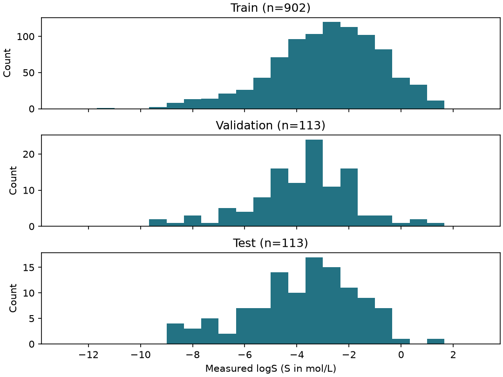

# MoleculeNet 與 DeepChem：機器學習用的標準資料集 {#sec-moleculenet}

## 同事說他用 ESOL 訓練模型，我們也下載 ESOL，就能把兩個分數放在一起比較嗎？

先別急著比分數。兩個人都用 ESOL，預測的可能是不同的量，因為這份資料同時列出了由結構估算的水溶解度和實測的水溶解度。要知道兩人的結果能不能比，得先問三件事：哪一欄是要預測的答案？模型拿到的是什麼樣的分子特徵？最後用哪些分子評分？這一節我們用 DeepChem 讀取 ESOL，從一筆實際的紀錄看起。

## 核心概念

**MoleculeNet** 彙整了多種分子資料集和評估方法，讓研究者能在同一項任務上比較模型；**DeepChem** 則是讀取這些資料的 Python 工具。[@wu2018moleculenet] 在 Colab 上示範建模時，DeepChem 可以一口氣下載資料、算好指紋，再交給模型，省下自己整理 CSV 的工夫。不過，要用哪個標籤、拿哪些分子測試模型，還是要自己決定。

以 ESOL 為例，DeepChem 的載入函式叫作 `load_delaney()`，名稱來自 Delaney 的研究。拿到資料時，要對照論文和原始檔弄清楚每一欄的意思，再確認函式讀的是哪一欄。[@delaney2004esol]

載入函式會傳回三樣東西：`tasks` 告訴我們要預測哪些性質、依什麼順序排列；`datasets` 裝著分子資料；`transformers` 則記錄標籤有沒有被換過尺度。本節採用**骨架切分**（scaffold split），也就是依分子的核心骨架分組，得到訓練、驗證和測試三組。如果關掉切分，有些載入函式只會傳回一組，程式也要跟著改。保存結果時，把載入的參數一起記下來，下次才知道當初怎麼表示分子、怎麼分組，以及模型看到的標籤是什麼尺度。

打開訓練集，每一列是一筆分子紀錄。`ids` 告訴我們這個分子是誰，本例存的是 SMILES；`X` 是模型用來預測的特徵，`y` 是要預測的值，`w` 是這筆資料在各項任務中的權重。

讀標籤時，`y` 和 `w` 要一起看。以毒理實驗為例，「做過試驗、結果是陰性」和「根本沒做這項試驗」是兩回事，權重為零的格子就代表沒有量測。有些任務還會調整權重來平衡類別，所以解讀 `w` 之前，也要先確認任務和載入時做過的轉換。如果把沒測的都當成陰性，模型學到的可能只是實驗室習慣挑哪些分子去測。

## 動手做

[下載本節 notebook](../../notebooks/ch03/03-04-moleculenet.ipynb){.btn .btn-sm .btn-outline-primary}　[在 Colab 開啟](ch03/03-04-moleculenet.ipynb)

先執行 notebook 的安裝格，再用 MACCS keys 算指紋，並依骨架把分子分組。因為我們要直接讀原始的水溶解度，所以把轉換清單留空；預設的轉換會把標籤置中、縮放，印出來的值就不再是原本的單位了。這裡讀到的 logS，是溶解度以 mol/L 表示後取常用對數的結果。數字是負的，只表示溶解度小於 1 mol/L，做迴歸時也不用再取一次對數。

```python
tasks, parts, transforms = dc.molnet.load_delaney(**options)
train, valid, test = parts
for name, data in zip(("train", "valid", "test"), parts):
    assert len(data.ids) == data.X.shape[0] == data.y.shape[0]
    assert data.w.shape == data.y.shape
    print(name, data.X.shape, data.y.shape, np.count_nonzero(data.w[:, 0]))
```

`load_delaney(**options)` 的 `**options` 是把事先準備好的參數（指紋種類、切分方式、轉換清單）一次傳進去。迴圈對三組資料各檢查一次：兩個 `assert` 確認 `ids`、`X`、`y` 的筆數一致，`w` 和 `y` 的形狀相同，再印出特徵和標籤的形狀，以及權重不為零的筆數。

程式印出的訓練特徵矩陣是 (902, 167)。橫著讀一列，是同一個分子的 167 個指紋位元；直著讀一欄，則是不同分子的同一個特徵。訓練標籤的形狀是 (902, 1)，因為每筆只對應一項水溶解度。驗證集和測試集各有 113 筆。

保留這種列、欄結構，換到多任務資料時也很好查：先依列找到分子，再依任務名稱找到那一欄的量測值。如果把表格攤平成一串數字，哪個分子對應哪個終點就看不出來了。

{fig-alt="三排直方圖分別呈現訓練、驗證、測試資料，橫軸使用相同的 logS 分箱，各排標示該組樣本數。"}

三排直方圖的橫軸刻度相同。挑一段感興趣的 logS 範圍，沿著同一個位置往下看，就知道三組是不是都有這個範圍的樣品。訓練分子比較多，柱子本來就比較高，所以比較三組時，要看的是分布的範圍和形狀，而不是誰的柱子最高。直方圖只畫出量測值，三組的骨架有沒有重疊，要回到結構才查得到。等到後面真正開始建模，才會用驗證集比較方法、調整參數，測試集則留到最後評分。

現在來讀第一筆訓練紀錄。`CC(C)=CCCC(C)=CC(=O)` 記下原子怎麼相連，MACCS 指紋把同一個結構編成數值，−2.06 則是實測的 logS。假如明天收到一個還沒測過的新分子，有了結構就能算出指紋，溶解度卻正是我們要預測的答案。所以，如果有人提議把原表裡的溶解度估計值也當作描述符，先問問看：每個新分子都能用同樣的方法算出那一欄嗎？實測溶解度更要單獨放在標籤欄，否則模型在訓練時就已經偷看到答案了。

挑下一個資料集之前，先把想問的化學問題寫成一句話。舉例來說，想知道分子在 pH 7.4 時的親脂性，可以看 Lipophilicity 的實測 logD。想找 BACE-1 抑制劑時，在意效力差多少，就用連續的 pIC₅₀ 做迴歸；只要分出有沒有活性，則可以用資料提供的分類標籤。Tox21 又不一樣，一個分子可能做過好幾種毒理試驗，也可能只做了其中幾種。這些資料都能用 DeepChem 讀，但要先講清楚是哪一項實驗、結果用什麼單位或類別記錄，兩個分數才有比較的基礎。

同一套讀表方法，也能用在 MoleculeNet 以外的資料。本書模型篇的 Ames 致突變性試驗，用的是 Maom Lab 放在網路上的 MutagenLou2023 資料副本。每筆有 SMILES、分子量和識別號，試驗結果放在 Y 欄，1 代表陽性，0 代表陰性。這份資料要另外下載，notebook 第一段分析程式列出了版本和校驗碼；校驗碼和前面提到的 SHA-256 一樣，是用來確認下載的檔案沒有被改過。

這份資料已經分好訓練檔和測試檔。我們從訓練檔裡再留一組資料來挑選模型，最後才用測試檔評分；如果把兩個檔案混在一起重新抽樣，即使筆數一樣，結果也沒辦法和原本的切分比較。同一個結構如果有互相矛盾的標籤，本書會把它排除，並記下最後留下幾筆。解讀結果時，要記得我們回答的問題是「這個分子在 Ames 試驗中是否呈陽性」，人體暴露的風險還需要其他證據。[@lou2023mutagen] [資料卡與版本](https://huggingface.co/datasets/maomlab/MutagenLou2023/tree/a9780a60774eb522b78bd92b83c30d8deae00ff5)

## 重點整理

- 資料集名稱只告訴我們來源，真正的預測目標要看任務名稱、單位和轉換設定。
- 特徵、標籤、權重和識別資料要在同一列對齊，多任務資料還要保留標籤的欄位順序。
- 比較兩個模型之前，先確認它們用的分子表示和切分規則相同。

## 小練習

取出 ESOL 訓練集的第一個分子，算算看它的 MACCS 指紋有幾個位元是 1，並說明這個數字來自 `X`、`y`、`w`、`ids` 中的哪一個，實測 logS 又要去哪裡查。

提示：用同一個列索引（例如 0）分別讀取 `train.X`、`train.y` 和 `train.w`，再用 `tasks` 確認任務名稱。

## 延伸閱讀

MoleculeNet 原始研究說明不同任務及基準測試的設計；DeepChem 的文件則列出實際可用的載入函式和參數。[MoleculeNet 論文](https://doi.org/10.1039/C7SC02664A) · [DeepChem 資料集文件](https://deepchem.readthedocs.io/en/latest/api_reference/moleculenet.html) · [DeepChem Dataset 介面](https://deepchem.readthedocs.io/en/latest/api_reference/data.html)
