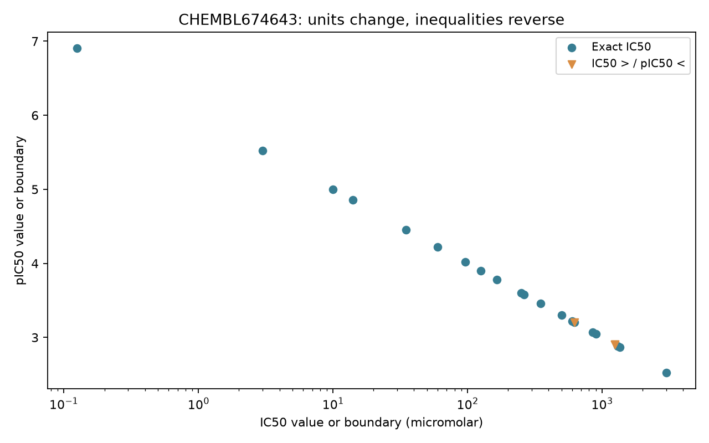

# 資料清理常見陷阱（單位、重複、IC50 轉 pIC50） {#sec-data-cleaning}

## IC50 換成 pIC50 之前，要先檢查什麼？ {#開場問題}

要先確認量測終點、單位、關係符號和數值是否有效，再檢查資料列有沒有重複。pIC50 是把 IC50 換成 mol/L 之後，取以十為底的負對數。舉例來說，本節一筆紀錄的 0.041 μM 等於 41 nM，換算成 pIC50 約為 7.387；如果直接對 41 取負對數，會得到約 −1.613，足足差了九個單位。就算公式算對了，把大於號當成等號，或把同一個分子在不同測試中的結果刪成一筆，整理出來的表一樣會回答錯誤的化學問題。

## 核心概念

我們沿用 @sec-chembl 的 40 筆 EGFR IC50 快照。每一列同時保留原始的 `value`、`units`、`relation`，以及 ChEMBL 整理過的 `standard_value`、`standard_units`、`standard_relation`。這批資料的原始單位都是 `uM`（也就是 μM），ChEMBL 標準化後的濃度則用 nM。

直覺上，pIC50 就是把濃度換成「越大越強」的尺度。以紀錄 `32260` 為例，0.041 μM 換成 mol/L 是 $4.1\times10^{-8}$，所以 $\mathrm{pIC}_{50}=-\log_{10}(4.1\times10^{-8})\approx7.387$。如果數值是 nM，可以寫成 $9-\log_{10}(\mathrm{IC}_{50}[\mathrm{nM}])$；是 μM 則是 $6-\log_{10}(\mathrm{IC}_{50}[\mu\mathrm{M}])$。因為取了負對數，大小順序會反過來：在相同的終點和條件下，IC50 越小，pIC50 越大。

不等號也要跟著反過來。紀錄 `34045` 是 IC50 > 1,250 μM，換成 mol/L 是 > 0.00125，所以 pIC50 < 2.903。這裡的 2.903 是上限，而不是量到的數值。這種只知道範圍的資料稱為**設限資料**（censored data）。把它留下來，就不會弄丟「測過了、但在測試範圍內沒達到一半抑制」的化合物；如果後續方法只能接受精確的數值，就把它另外存起來，並寫明排除的規則，而不是把符號刪掉繼續訓練。

另外，ChEMBL 的 `pchembl_value` 只有部分 IC50 紀錄才有，這一欄空白，不代表化合物沒有活性。[官方活性欄位說明](https://chembl.gitbook.io/chembl-interface-documentation/frequently-asked-questions/chembl-data-questions)列出了 pChEMBL 適用的終點與條件；本節自己計算的只有 IC50 的負對數和界限，不把其他終點混進來。

缺值和零值要分開處理。這份快照有兩筆沒有數值，程式保留它們的 activity ID 和原始註記，把清理狀態標成「缺值」，不計算對數。零或負的濃度也沒辦法取對數；本批資料沒有這種數值，程式裡的防護條件只是預先準備好。如果遇到零，要先查是儀器輸出、匯入代碼還是抄寫的問題；自己補上一個很小的數字，等於替這個化合物指定了極強的活性。單位不明、終點不支援或關係符號不明的紀錄，也一樣先標記起來等待檢查，不要預設成 nM 或等號。

## 動手做

[下載本節 notebook](../../notebooks/ch03/03-05-data-cleaning.ipynb){.btn .btn-sm .btn-outline-primary}　[在 Colab 開啟](ch03/03-05-data-cleaning.ipynb)

Notebook 裡內嵌的快照，是 2026-11-04 從 ChEMBL_37 查到的資料，只保留本節需要的欄位。查詢條件是 EGFR `CHEMBL203`、標準終點 IC50，依 activity ID 取前兩頁、每頁 20 筆。這是為了教學取的小樣本，只能代表這 40 筆，不能代表所有 EGFR 活性資料。預設不需要外部 CSV；設定 `CH03_LIVE=1` 可以直接重新查詢，但線上的內容可能已經更新。程式另外建立一張 `cleaned` 表，在原欄位旁邊新增 mol/L 濃度、pIC50 界限、轉換後的關係符號和清理狀態，原始值保持不變。

下面是換算函式的核心。在執行到這一段之前，完整的函式已經確認過：終點是 IC50、單位是支援的、數值是大於零的有效數字，關係符號也在對照表裡。

```python
factors = {"M": 1.0, "mM": 1e-3, "uM": 1e-6,
           "µM": 1e-6, "nM": 1e-9, "pM": 1e-12}
reverse = {"=": "=", ">": "<", "<": ">", ">=": "<=", "<=": ">="}
molar = value * factors[row["units"]]
out.update(ic50_molar=molar,
           pic50_boundary=-math.log10(molar),
           pic50_relation=reverse[row["relation"]],
           cleaning_status="exact" if row["relation"] == "=" else "censored")
```

`factors` 是單位換算表，記下每種單位要乘多少才變成 mol/L；`reverse` 是不等號的對照表，記下取負對數後符號要怎麼反過來。後面幾行依序算出 mol/L 濃度、pIC50 和新的關係符號，最後依原本是不是等號，把這筆標成 `exact`（精確值）或 `censored`（設限值）。

從結果來看，40 筆中有 34 筆精確值、4 筆設限值、2 筆缺少數值。這只是檢查數字和欄位的結果：「精確值」的意思是原紀錄用了等號，它仍然有實驗誤差，也還沒經過建模所需的品質篩選。程式也把可以換算的原始 μM 轉成 nM，逐筆和 ChEMBL 的 `standard_value` 比較，確認這批數值一致；`data_validity_comment` 或 `potential_duplicate` 欄位有內容的紀錄也全部留著，等之後人工審查。實際建模時，還要另外訂出 assay 和資料品質的條件。

@fig-cleaning-conversion 只畫 `CHEMBL674643` 這個 assay 的紀錄，避免把七個 assay 的 IC50 混在一起。橫軸是原始的 μM 數值或界限，用對數刻度；縱軸是換算後的 pIC50 或它的界限。濃度越往右，pIC50 越低，這正是負對數造成的反向關係。橙色三角形的位置只標出界限，實際的活性落在界限的哪一側才是它的意思，讀圖時要和藍色圓點分開看。

{#fig-cleaning-conversion fig-alt="橫軸是對數刻度的微莫耳濃度，縱軸是pIC50。藍色圓點隨濃度增加而下降，右下方橙色三角形代表設限界限，並非精確測量值。"}

資料列重複則是另一個問題。這 40 筆有 40 個不同的 activity ID，所以沒有同一筆紀錄被下載兩次；但只有 36 個 molecule ID，比列數少了 4 個。這 4 個差額，並不表示有 4 筆該刪掉。以 `CHEMBL68920` 為例，它的三筆資料分屬不同的測試；如果執行 `drop_duplicates("molecule_chembl_id")`，就只會依表格順序隨便留下一筆。

就算同一個分子在同一個 assay 裡出現好幾次，也要回去查文件、量測條件、註記和原始表格，才能判斷那是技術重複、不同批次，還是被重複收錄。不同的 activity ID，只說明資料庫裡有不同的紀錄，實驗是否彼此獨立，還要另外確認。

如果確定要合併可以比較的重複量測，分組前要先寫清楚條件，並留下所有來源 ID、筆數和數值的分散程度。要注意，先把濃度做算術平均再轉成 pIC50，和先轉 pIC50 再平均，結果通常不同；後者相當於取濃度的幾何平均。該用哪一種，要看量測的尺度和用途。本節不合併任何量測，好讓每一步都能追溯到原始紀錄，也把結構標準化和實驗紀錄去重當成兩件事分開處理。

清理狀態也要存進輸出的表格，而不是只印在螢幕上。假如之後有人發現某個單位寫錯了，我們得重新計算那一列，也要知道受影響的是哪個化合物、哪個 assay、哪一份文件；只留 SMILES 和 pIC50 兩欄，這些問題就很難回答。本節另外建立新的欄位，就是為了讓原始數字、換算規則和結果可以逐列對照；收到更新版的資料時，也能分辨是原始紀錄變了，還是清理規則變了。

檢查極端值時，也先別急著依數字刪列。這批紀錄裡有很高的 IC50，值得回頭查一查，但數值大本身並不代表輸入錯誤。如果原文真的記載了高濃度下的弱抑制，刪掉它，資料就只剩下活性較強的化合物。反過來，一個非常小的 IC50 也可能要確認單位和測試範圍。比較好的做法是記下檢查的理由、找到的證據和處理決定；證據不夠時，就把疑慮和資料一起留下。換句話說，資料清理是為了讓每個數字的意思更清楚，而不是讓圖看起來更整齊。

## 實驗上的考量

`34045` 的下界很高，但光憑這筆資料，還說不上化合物完全沒有作用。要回到原文查最高測試濃度、化合物的溶解度，以及曲線是否落在可以判讀的範圍。如果要拿它和另一個化合物比較，就要在相同的 assay 和可用的濃度範圍內重新測；本節換算出的上限只是一個界限，拿來相減算差值並不精確。

## 重點整理

- IC50 要先換成 mol/L 再取負對數，不等號的方向也要跟著反轉。
- 缺值、零或負值和設限值的意思各不相同，要記下狀態和來源，而不是自己補一個數字。
- 同一筆紀錄重複下載和同一個分子被測了好幾次是兩回事，所以去重時要看 activity ID，而不是分子編號。

## 小練習

從快照取出 activity `32267` 與 `34047`，把原始值換成 nM，再算出 pIC50 的值或界限，並寫上正確的不等號。接著說明：為什麼不能直接把這兩筆的 pIC50 相減，就說其中一個化合物強多少？

提示：除了關係符號，也比較兩筆的 assay ID；換算後的 nM 可以和 ChEMBL 的 `standard_value` 對照，確認沒有算錯。

## 延伸閱讀

[ChEMBL Assay and Activity Questions](https://chembl.gitbook.io/chembl-interface-documentation/frequently-asked-questions/chembl-data-questions)說明標準化單位、pChEMBL 與活性註記；[ChEMBL Data checks](https://chembl.blogspot.com/2020/10/data-checks.html)整理資料有效性檢查與重複資料標記的用途。
