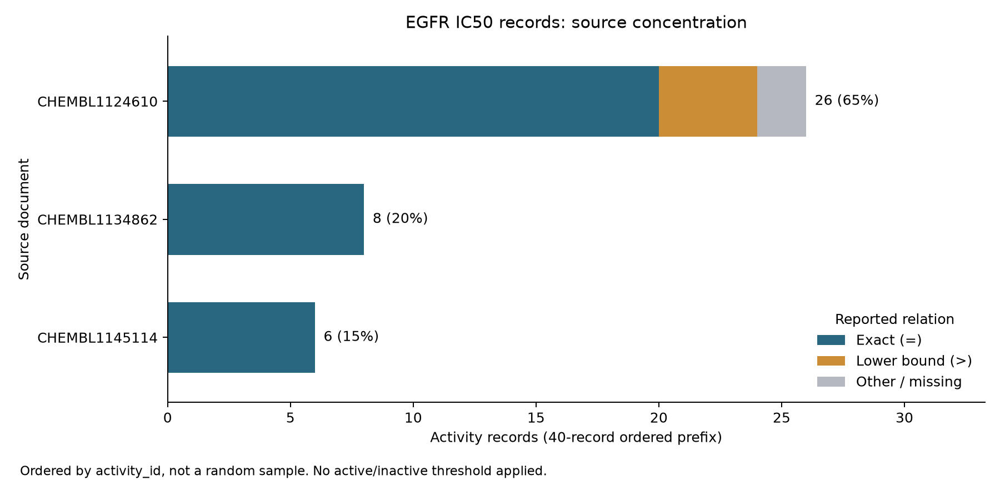

# 公開資料的偏差：為什麼只看得到成功的結果 {#sec-public-data-bias}

## 資料庫找不到某個分子的活性，就能把它標成不活性嗎？

不行。查不到紀錄，只表示這次查詢沒有找到符合條件的資料：這個分子可能沒被測過、測過但沒有公開，也可能用別的終點或結構形式收錄。**已量測的不活性**則是一個實驗結果，要連同試驗條件和判定標準來理解，例如「在指定濃度範圍內沒有達到抑制門檻」。把查不到的分子填成 0，等於把「不知道」改寫成了實驗結論。另外，公開資料裡也有不活性的結果；本節標題說的「只看得到成功的結果」，是一個值得追查的風險，各資料庫的實際情況要個別檢查。

## 核心概念

假設我們想找表皮生長因子受體（EGFR）的抑制劑。研究者選了哪些骨架來合成、哪些化合物送去試驗、哪些結果寫進文章，以及資料庫收錄了哪些終點，都會影響我們最後下載到的分子。**選擇偏差**（selection bias）是指觀察到的樣本受到挑選方式的影響，不一定能代表我們想推論的對象；**發表偏差**（publication bias）則是指研究結果的好壞，會影響它被公開的機會。

要判斷有沒有這兩種偏差，光看活性分布偏向某一端是不夠的。藥物設計本來就會集中測試有希望的類似物，查詢條件也可能事先排除了其他紀錄。

把資料整理成「分子 × 試驗」的表格時，空格要維持「未知」。同一個分子在某個試驗有結果，在另一個試驗可能根本沒測過；一個靶點的量測，也代替不了另一個靶點的標籤。如果程式需要一個完整的矩陣，就另外記下哪些格子有觀察值，而不是為了計算方便，把空格補成負例。

「沒有量到精確的 IC50」又是另一回事。如果紀錄寫的是 `IC50 > 10000 nM`，我們知道它有一個下限；如果 `pchembl_value` 是空的，就要查查看是不是關係符號、單位或資料品質不符合計算規則。ChEMBL 官方文件規定，計算 pChEMBL 的紀錄必須是等號、nM 單位、正數等，所以這一欄空白時，實驗仍可能做過，也還說不上不活性。反過來，一筆有數字的 IC50 是否達到某個篩選計畫的活性門檻，也要看試驗的目的而定。[ChEMBL 活性資料說明](https://chembl.gitbook.io/chembl-interface-documentation/frequently-asked-questions/chembl-data-questions)

沒有達到預期的實驗，也可能帶著有用的化學資訊。Raccuglia 等人利用實驗筆記裡包含合成失敗的紀錄，研究模板化釩亞硒酸鹽的生成條件，示範了失敗紀錄怎麼幫助材料探索。這篇研究說明了保留完整實驗過程的價值；至於各個化學資料庫漏掉了多少失敗，它並沒有給出通用的比例。另外，合成失敗和生物活性試驗的不活性是兩回事：前者可能根本沒有得到待測物，後者則要先確認樣品和試驗都有效。[@raccuglia2016failed]

## 動手做

[下載本節 notebook](../../notebooks/ch03/03-06-public-data-bias.ipynb){.btn .btn-sm .btn-outline-primary}　[在 Colab 開啟](ch03/03-06-public-data-bias.ipynb)

我們先問一個公開資料確實答得出來的問題：下載到的紀錄，有多少集中在同一份文獻？notebook 透過 ChEMBL 官方 API 查詢 `target_chembl_id=CHEMBL203`、`standard_type=IC50`，依 `activity_id` 由小到大取前 40 筆，每頁 20 筆。為了方便逐列檢查，這是筆數很少的教學查詢，既不是隨機抽樣，也不是完整的 EGFR 資料。同一批整理進資料庫的紀錄，編號可能排在一起，所以「只取最前面幾筆」這個做法本身，就會影響樣本的組成。

notebook 裡存了這次查到的兩頁資料、查詢網址、查詢時間和檔案的雜湊值（用來確認內容沒被改動的指紋），預設不必連線就能重現圖表。把 `REFRESH_LIVE` 改成 `True` 才會重新查詢；如果資料庫已經更新，新的結果就當作另一個版本，數字和本書不同是正常的。分析時保留原始的 `activity_id`，依 `document_chembl_id` 分組；同一個分子在不同試驗的結果各自保留，缺值也維持空白。

```python
df = pd.DataFrame(records)
summary = df.groupby("document_chembl_id").agg(
    activity_rows=("activity_id", "size"),
    molecules=("molecule_chembl_id", "nunique"),
    assays=("assay_chembl_id", "nunique"),
).sort_values("activity_rows", ascending=False)
summary["row_share"] = summary["activity_rows"] / len(df)
print(summary)
```

`groupby` 依文獻把紀錄分組，`agg` 再替每份文獻算三個數字：有幾筆紀錄、幾個不同的分子、幾個不同的試驗。接著依紀錄數由多到少排序，最後一行之前的 `row_share` 是每份文獻占全部紀錄的比例。

{#fig-public-data-bias fig-alt="各文獻的堆疊橫條顯示前40筆EGFR IC50紀錄的來源集中情形。圖旁標示紀錄數占40筆的百分比；非等號紀錄另外著色，沒有改成精確量測值。"}

這份 ChEMBL 37 快照在 2026 年 11 月 4 日取得，40 筆紀錄來自 3 份文獻、7 個試驗，涵蓋 36 個不同的分子。最多的來源 `CHEMBL1124610` 貢獻了 26 筆，占這次查詢的 65%；另外兩份文獻各有 8 筆和 6 筆。要注意，這個 65% 的分母是 40 筆活性紀錄，而不是 36 個分子，更不是所有做過 EGFR 試驗的化合物。同一個分子可能出現在好幾份文獻裡，所以把各文獻的分子數加起來，會比實際的分子數多。

@fig-public-data-bias 的顏色只區分關係符號，和活性高低無關。`=` 表示報告的是一個確定的數值，`>` 表示只知道下限；圖中把後者也畫出來，是為了提醒我們這些實驗確實做過。本節沒有套用活性門檻，也沒有比較各篇文獻的**命中率**（hit rate）。要計算命中率，分母至少得是同一個試驗中實際測過、而且結果可以判定的所有化合物，而這 40 筆並沒有提供這份完整的名單。

從結果來看，這張圖能說明的是「這次的資料大多來自少數幾個來源」；至於研究者是不是只發表成功的實驗，它回答不了。就算把所有頁面都抓下來，沒公開的實驗還是看不到，也無法從已收錄的資料反推漏掉了多少失敗。要研究發表偏差，需要額外的比較基準，例如一個有完整試驗清單的計畫，再追蹤哪些結果最後出現在論文或公開登錄中。沒有這種基準時，結論就停在我們觀察到的來源分布。

來源集中，也會影響後面的模型評估。如果同一份文獻裡的類似物被隨機分到訓練集和測試集，模型等於在非常接近的骨架和試驗條件上接受考試，分數容易偏高。依文獻分組檢查，可以提醒我們另外測試模型在不同來源之間的表現；不過不同文獻之間，化學骨架也可能很相似。所以要保留文獻、試驗和分子的識別碼，之後切分資料時，才能同時檢查來源和結構有沒有重疊。

## 實驗上的考量

圖中的下界紀錄提醒我們，重新量測時要先查清楚原試驗的最高濃度、溶解度和讀值範圍；下界只是一個界限，拿它當精確的 IC50 來比對並不合適。替新一批 EGFR 候選物做實驗時，要保留實際的送測清單、有效和無效的試驗、沒達到門檻的結果，以及判定規則。如果樣品沉澱或對照組異常，就先標成「試驗無法判定」，而不是直接填成不活性。

## 重點整理

- 查不到紀錄、沒有精確數值、量過但沒達到活性門檻，是三種不同的情況。
- 資料列數、分子數和來源數的分母各不相同，少數幾份文獻就可能貢獻大部分的資料列。
- 公開資料能描述來源的分布；要估計發表偏差，還需要完整的實驗紀錄當作比較基準。

## 小練習

從 notebook 的 `df` 找出貢獻最多紀錄的文獻（如果有並列，就全部算進去），把它們排除後，重新計算剩下的紀錄數、不同分子數和不同試驗數。再用一句話說明：為什麼這個比較沒辦法估計未發表實驗的比例？

提示：用 `groupby().size()` 找出紀錄最多的文獻，再用 `isin()` 篩掉它們。不同分子數和不同試驗數要對剩下的資料重新用 `nunique()` 計算，因為同一個分子可能出現在好幾份文獻裡，直接相減會算錯。

## 延伸閱讀

[ChEMBL REST API](https://www.ebi.ac.uk/chembl/api/data/docs) · [ChEMBL 活性、pChEMBL 與資料品質說明](https://chembl.gitbook.io/chembl-interface-documentation/frequently-asked-questions/chembl-data-questions) · [Raccuglia 等人的失敗實驗研究](https://doi.org/10.1038/nature17439)
