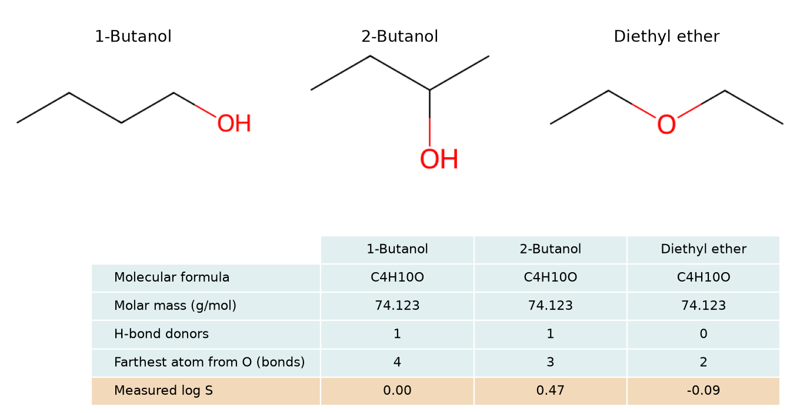

# 什麼是描述符 {#sec-molecular-descriptors}

## 分子式都是 C₄H₁₀O，電腦要看哪個數字才能分出兩種丁醇和乙醚？ {#開場問題}

光看分子量分不出來，三者完全一樣；要再加上氫鍵供體數，以及氧在碳鏈上的位置。數一數氫鍵供體，就能挑出乙醚，因為乙醚的氧上沒有氫。剩下的兩種丁醇，可以從氧沿著鍵走到最遠的碳：1-丁醇比 2-丁醇多走一步。這三種算法求的都是**分子描述符**（molecular descriptor），也就是先決定要辨認哪種結構差異，再訂一條規則，把這項特徵寫成數字。

## 核心概念

同一個 1-丁醇，從碳鏈末端開始寫 SMILES 是 `CCCCO`，從氧開始寫則是 `OCCCC`。假如程式只檢查第一個字元是不是 O，同一瓶試劑就會得到兩個答案。RDKit 的做法是先從 SMILES 重建分子圖，再按原子怎麼相連來計算。所以不論從哪一端開始寫，氧到最遠碳原子之間的鍵數都一樣。

描述符常分成 0D、1D、2D、3D，差別在於需要多少結構資訊。分子量只要知道各元素有幾個原子就能算，屬於 0D。要數醇羥基，就得知道氧和哪些原子相連，這種局部片段的計數常歸在 1D。若要從氧一路走到碳鏈另一端，得沿著整張分子圖找路徑，這是 2D 拓撲描述符。

各套軟體的分類略有不同，也有軟體把片段計數歸在 2D。所以與其背分類，不如直接問：要算這個描述符，手上只有分子式就夠了，還是得知道原子之間怎麼接？

如果問的是氧和末端碳在空間中相距幾個埃，就要有三維座標。想像 1-丁醇繞著碳碳單鍵轉動，碳鏈彎了起來：從氧沿鍵走到末端碳，步數還是一樣，但兩個原子間的直線距離已經變了。因此報告 3D 描述符時，要說明選的是哪個**構形**（conformer）。下面 RDKit 畫出的鋸齒狀碳鏈只表示連接方式，不能從圖上量出真實的原子間距。

## 動手做

[下載本節 notebook](../../notebooks/ch04/04-01-molecular-descriptors.ipynb){.btn .btn-sm .btn-outline-primary}　[在 Colab 開啟](ch04/04-01-molecular-descriptors.ipynb)

我們用 DeepChem 的 `load_delaney` 載入 ESOL 水溶解度資料，從 1,128 筆紀錄找出 1-丁醇、2-丁醇與乙醚，每筆保留原來的 SMILES 和實測溶解度。載入時設 `transformers=[]`，讓實測欄維持原始的 log S，也就是溶解度以 mol/L 表示後取常用對數。三個分子都含有四個碳、一個氧和十個氫，是分子式相同、連接方式不同的同分異構物。換句話說，元素組成固定了，我們就能專心看連接位置改變後，哪些描述符跟著變。[@delaney2004esol]

在 1-丁醇的結構上，從氧走到碳鏈另一端，要經過四個碳。羥基移到第二個碳以後，從氧往兩個鏈端走，一邊只要兩步，另一邊要三步。要讓數字反映羥基的位置，可以從分子中唯一的氧出發，數出它到每個非氫原子的最短路徑有幾個鍵，再取其中最大的數字。這樣不必先替碳編號，也不用管 SMILES 是從哪一端寫起。

```python
def oxygen_reach(mol):
    oxygen, = [a.GetIdx() for a in mol.GetAtoms() if a.GetAtomicNum() == 8]
    distances = Chem.GetDistanceMatrix(mol)
    return int(distances[oxygen].max())
```

這個函式做了三件事：第一行從所有原子中挑出原子序為 8 的那一個（也就是氧），記下它的編號；第二行算出原子兩兩之間隔了幾個鍵；第三行取氧那一列的最大值。

`GetDistanceMatrix` 預設回傳**拓撲距離矩陣**（topological distance matrix），每列、每欄各對應一個原子，格子裡記的是兩個原子之間最少隔幾個鍵。原子到自己的距離是零，相鄰原子則是一。讀入這三個 SMILES 時，RDKit 沒有把氫列成獨立的原子，所以氧那一列的最大值，就是氧到最遠非氫原子的鍵數。

程式裡 `oxygen,` 這個逗號，要求剛好找到一個氧。遇到二醇就得另訂規則，例如兩個氧各算一次再取平均。遇到沒有氧的分子，連起點都找不到；這時如果隨手填零，就和「距離真的是零」的情況混在一起了。

{#fig-molecular-descriptors fig-alt="1-丁醇的羥基接在鏈端，2-丁醇的羥基接在第二個碳，乙醚的氧連著兩個乙基。三者莫耳質量相同，氫鍵供體數依序為 1、1、0，氧到最遠非氫原子的鍵數則為 4、3、2。"}

@fig-molecular-descriptors 中的三個分子，以一般的同位素組成計算，莫耳質量都是 74.123 g/mol。**氫鍵供體**（hydrogen-bond donor）數則分成兩種：兩種丁醇都有一個 O–H，可以提供氫鍵；乙醚的氧兩側都接乙基，供體數為零。不過乙醚的氧上仍有孤電子對，可以接受水分子提供的氫鍵，所以它還是能和水形成氫鍵。

再看氧到最遠非氫原子的鍵數：乙醚的氧往兩側各走兩個鍵就到鏈端；兩種丁醇的羥基位置不同，離它最遠的碳也就差了一個鍵。用「分子量、供體數、最遠鍵數」這三個數字表示結構，就是一種**編碼**（encoding）。資料表通常每列放一個分子，這張圖則把分子橫著排，讓數值對齊上方的結構。無論怎麼排，每項描述符的算法都要一致；如果這一批從氧開始數，下一批改從帶羥基的碳開始數，兩批的鍵數就沒辦法放在一起比較。

橘色那列是實測值。1-丁醇的 log S 為 0.00，換回濃度約為 1 mol/L；2-丁醇為 0.47，水溶解度約是 1-丁醇的三倍。如果只用分子量和氫鍵供體數來預測溶解度，這兩個丁醇給模型的輸入完全相同，模型只能給出相同的預測，也就不可能同時答對兩筆量測。換再複雜的演算法也一樣，因為這兩欄本身就看不出羥基的位置。

加入最遠鍵數以後，三個分子分得開了，但還是排不出水溶解度的高低：按鍵數從小到大排列，實測 log S 依序是 −0.09、0.47、0.00，先升後降。要找出描述符和性質之間的關係，就需要**定量結構與性質關係**（quantitative structure–property relationship, QSPR）模型：收集許多分子的描述符和實測性質，用訓練資料估計兩者的關係，再用另外保留的資料檢查預測誤差。圖中灰藍色的描述符，只要有結構就算得出來；橘色的實測值，則要等實驗量過才能填。

## 重點整理

- 分子量只需要分子式；辨認羥基、比較氧的位置、量空間距離，則分別需要局部片段、分子圖和三維構形。
- 描述符會省略資訊：兩種丁醇的分子量和供體數都相同，要靠氧到最遠原子的鍵數才分得出來。
- 編碼決定模型看得到哪些結構特徵，這些特徵能不能預測性質，要配上實測資料來驗證。

## 小練習

設計一個能區分 ESOL 中鄰、間、對二氯苯的描述符，算出三個分子的數值，並說明它如何反映兩個氯在環上的相對位置。

提示：三者的 SMILES 分別是 `Clc1ccccc1Cl`、`Clc1cccc(Cl)c1` 和 `Clc1ccc(Cl)cc1`。從 notebook 的 `records` 取出結構，在距離矩陣裡找到兩個氯對應的列與欄；繞環可以走兩個方向，距離矩陣記的是較短的那一條。

## 延伸閱讀

- [RDKit 的 GetDistanceMatrix 文件](https://www.rdkit.org/docs/source/rdkit.Chem.rdmolops.html#rdkit.Chem.rdmolops.GetDistanceMatrix)列出鍵級和原子權重等參數，可以確認預設距離是怎麼定義的。
- [DeepChem 的 ESOL 資料集說明](https://deepchem.readthedocs.io/en/latest/api_reference/moleculenet.html#delaney-datasets)與 [Delaney 的原始論文](https://doi.org/10.1021/ci034243x)分別說明資料載入方式與水溶解度估算方法。
