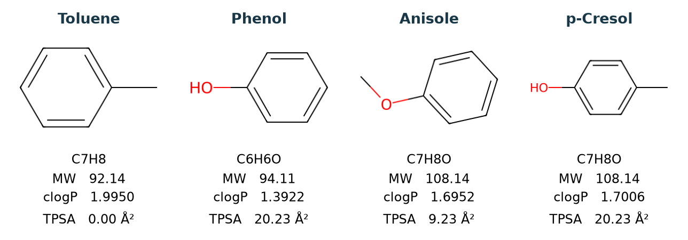

# 常用物化描述符（分子量、logP、TPSA） {#sec-physicochemical-descriptors}

## 分子量同樣是 108.14，哪個描述符看得出氧接在哪裡？ {#開場問題}

答案是拓撲極性表面積（TPSA）。苯甲醚和對甲酚都是 C₇H₈O，差別就在氧旁邊：苯甲醚的氧連著兩個碳，對甲酚的氧則是一端接碳、一端接氫。兩者的分子量完全相同，算出的 logP 也很接近，但 RDKit 會根據氧的成鍵方式給它不同的面積貢獻。因此，苯甲醚的**拓撲極性表面積**（topological polar surface area，TPSA）為 9.23 Ų，對甲酚則是 20.23 Ų。這個差別只要看結構式就算得出來，用不到三維座標。

## 核心概念

在天平上秤試藥時，用的是莫耳質量，也就是一莫耳物質有多重，單位是 g/mol。資料表寫的「**分子量**」（molecular weight，MW）則是相對分子質量，也就是分子質量和原子質量單位的比值，本身沒有單位。在本節的精度下，分子量為 108.14，莫耳質量就可以寫成 108.14 g/mol。

未指定同位素時，RDKit 的 `MolWt` 會加總各元素的平均原子量，連結構式中省略的氫也會算進去。如果要拿這個數字去對質譜峰，就得另外算指定同位素組成的精確質量；平均值印到再多位，也還是平均值。

**logP** 描述的是中性分子在正辛醇和水之間達到平衡時怎麼分配：拿正辛醇相的濃度除以水相濃度，再取以十為底的對數。兩相的濃度單位相消，所以 logP 也沒有單位。RDKit 的 `Crippen.MolLogP` 使用 Wildman 與 Crippen 的方法，先按每個原子周圍的成鍵環境分類，再把各類對應的經驗數值加總。這種從結構估算出來的值常記為 clogP，字首的 c 表示「計算所得」。[@wildman1999prediction]

實驗上如果量的是某個 pH 下，化合物在兩相的總濃度比，就要把不同解離形態都算進去，取對數後記為 **logD**。舉例來說，酸性分子在水中的解離比例會隨 pH 改變。程式只收到中性結構，並不知道水相的 pH，也不會推算各種解離形態的比例；所以 clogP 估的是中性分子的分配。

換到 TPSA，要問的是極性原子對面積貢獻多少。Ertl 等人按成鍵方式替這些原子分類，每類片段各有一個面積，加起來就是整個分子的估計值，單位為平方埃。RDKit 預設只計氮、氧，要納入硫、磷得另外指定。它和 logP 一樣用到片段貢獻的想法，但兩者的分類規則、參數和單位各不相同。試著在腦中轉動一條單鍵：原本朝向溶劑的部分可能被遮住，TPSA 卻不會變，因為它只讀成鍵方式，沒有用到三維座標。[@ertl2000tpsa]

## 動手做

[下載本節 notebook](../../notebooks/ch04/04-02-physicochemical-descriptors.ipynb){.btn .btn-sm .btn-outline-primary}　[在 Colab 開啟](ch04/04-02-physicochemical-descriptors.ipynb)

我們從 MoleculeNet 的 ESOL 資料集挑出四個都有苯環的分子：以甲苯為起點，再放進苯酚、苯甲醚和對甲酚。這樣可以直接比較兩組差異：有氧和無氧，以及羥基和醚基。Notebook 用 DeepChem 的 `load_delaney` 載入 1,128 筆紀錄，保留 SMILES 和原始的實測水溶解度，先用 SMILES 找到資料列，再交給 RDKit 轉成分子物件。如此一來，從第一張結構圖到最後的實測值，都能對回同一筆資料。[@delaney2004esol]

下面的函式一次傳回三個描述符，對應圖中的三列數值，完整程式在 notebook 裡。分子量顯示到小數點後兩位，logP 則多留兩位，因為有兩個分子看起來都是 1.70，多印兩位才看得出計算值略有不同。要注意的是，多印的位數只是方便比較計算結果，並不代表方法本身有這麼準。

```python
from rdkit.Chem import Crippen, Descriptors, rdMolDescriptors

def describe(mol):
    return Descriptors.MolWt(mol), Crippen.MolLogP(mol), rdMolDescriptors.CalcTPSA(mol)
```

{#fig-physicochemical-descriptors fig-alt="由左至右為甲苯、苯酚、苯甲醚與對甲酚。後兩者的分子式同為 C7H8O。苯甲醚的氧接甲基，對甲酚的氧帶氫，TPSA 分別為 9.23、20.23 平方埃。"}

@fig-physicochemical-descriptors 最左邊的甲苯，是苯環接上一個甲基。結構圖中沒有標元素的線段末端代表碳，碳上的氫省略不畫。按分子式 C₇H₈ 加總七個碳和八個氫的平均原子量，得到約 92.14。甲苯的 TPSA 是零，因為它不含 RDKit 預設計入的極性原子。如果想知道甲苯有多少表面可以接觸溶劑，就得另外指定構形、原子半徑和溶劑探針，改算三維的表面積。

苯酚環上的一個氫換成甲基，就成了對甲酚。分子多了一個碳、兩個氫，分子量約多 14，從 94.11 增加到 108.14。羥基上的氧仍屬於同一類酚氧，所以兩者的 TPSA 都是 20.23 Ų。平方埃是面積的單位；如果想知道極性部分占整個分子表面的百分之幾，還得用相同定義算出總面積來當分母。

苯酚變成苯甲醚，增加的質量和上一組相同，但這次換掉的是羥基上的氫。接上甲基以後，氧還有孤電子對，仍能接受氫鍵，卻已經沒有氫可以提供，於是 TPSA 從 20.23 降到 9.23 Ų。也就是說，光從分子式數出一個氧，分不出它是酚氧還是醚氧，也就決定不了該加上哪一項面積貢獻。

甲苯的計算 logP 約為 2.00，苯酚約為 1.39。換回正辛醇與水的濃度比，甲苯大約是一百比一，苯酚約二十五比一，兩者都比較偏向正辛醇。兩個分子的 logP 相減，就能換算分配比相差幾倍。這些數字描述的是溶質在兩相之間怎麼分配，並沒有告訴我們最多能溶多少在水裡。整理實驗資料時也要分清 logP 和 logD：如果一筆實測 logD 註明「pH 7.4」，合併資料時就要把這個條件一起保留，別把定義不同的數值放進同一欄。

苯甲醚和對甲酚的計算 logP 分別是 1.6952 和 1.7006，取到小數點後兩位都是 1.70。兩者在 ESOL 的實測 logS 卻分別是 −1.85 和 −0.73。logS 是水溶解度以 mol/L 表示後的常用對數，兩者相差 1.12，換回濃度就是對甲酚約為苯甲醚的十三倍。

為什麼 logP 幾乎一樣，溶解度卻差這麼多？溶質要先離開原本的純物質，再被水分子包圍，才算溶進水裡；logP 描述的則是溶質已經溶解之後，在正辛醇和水之間怎麼分配。這兩個分子足以看出兩種性質的差別，但只有兩筆量測，還無法斷定溶解度的差距全部來自氧的成鍵方式。

## 重點整理

- 分子量反映原子組成，同分子式的苯甲醚和對甲酚，分子量和莫耳質量都相同。
- Crippen logP 是依原子環境估計的親脂性，拿實測值比較前，要確認資料記的是 logP 還是指定 pH 的 logD。
- TPSA 依極性原子片段估計面積，同樣只有一個氧，醚氧和酚氧給出的面積也不同。

## 小練習

計算 ESOL 中鄰氯甲苯（`Cc1ccccc1Cl`）和對氯甲苯（`Cc1ccc(Cl)cc1`）的三個描述符，和兩者的實測 logS 並排比較。如果只把這三欄交給同一個確定性的迴歸模型，它能重現兩者實測值的差異嗎？從結構圖指出模型還需要辨認哪一處差別。

提示：沿用 notebook 中的 `observed` 查實測值，用合理的小數位數比較三欄，再沿著苯環數一數甲基和氯之間隔了幾個鍵。

## 延伸閱讀

- 分子量與分配比的用語可查 IUPAC Gold Book。[相對分子質量](https://goldbook.iupac.org/terms/view/R05271)、[液液分配中的分布比](https://goldbook.iupac.org/terms/view/D01817)。
- Wildman 與 Crippen 的原子分型法，以及 RDKit 對應的函式。[原始論文](https://doi.org/10.1021/ci990307l)、[RDKit Crippen 模組](https://www.rdkit.org/docs/source/rdkit.Chem.Crippen.html)。
- Ertl 等人的片段面積法與 RDKit 對硫、磷的預設處理。[原始論文](https://doi.org/10.1021/jm000942e)、[RDKit Book 的 TPSA 說明](https://www.rdkit.org/docs/RDKit_Book.html#implementation-of-the-tpsa-descriptor)。
