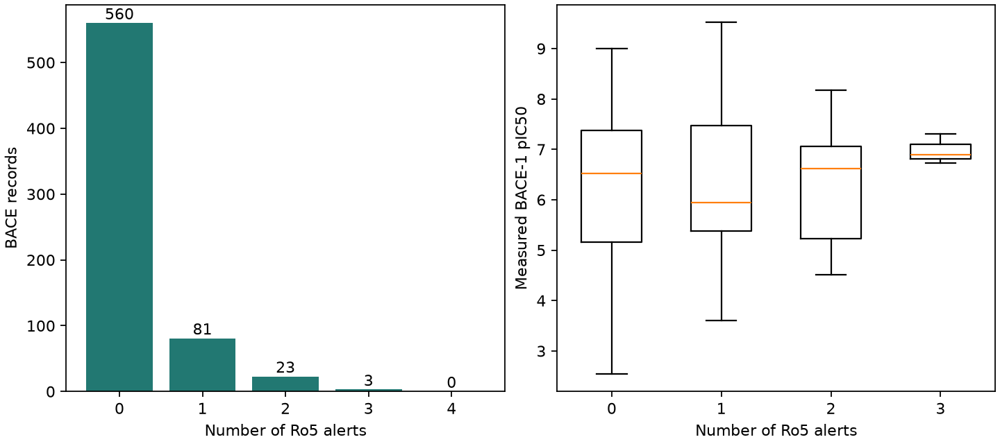

# 類藥性與 Lipinski 規則 {#sec-lipinski-rules}

## 一個分子的抑制活性很好，為什麼還要檢查分子量和親脂性？

因為活性好，不保證做成口服藥後吸收得進去。酵素試驗裡表現很好的抑制劑，做成口服候選藥物時，可能連第一關都過不了：它在消化道的液體裡能溶多少？溶解以後，又能不能穿過腸道屏障？**Lipinski 五法則**（rule of five，Ro5）用四項可以從結構估算的描述符，提醒研究者哪些分子可能在溶解或吸收上遇到困難。舉例來說，手上若有一個效力很好但難溶於水的分子，接下來最值得補的資料，就是它在腸道相關條件下的溶解度。

## 核心概念

Lipinski 等人整理藥物研發中與溶解度和通透性有關的經驗，提出四項警示。本節採用以下界線：平均分子量超過 500、計算的 logP 超過 5、**氫鍵供體數**（hydrogen-bond donors，HBD）超過 5，或**氫鍵受體數**（hydrogen-bond acceptors，HBA）超過 10。名稱中的「五」來自這些容易記的門檻，實際要看的是四欄；剛好等於門檻時不算超標。[@lipinski1997experimental]

我們用 RDKit 的 Wildman–Crippen 方法估算 logP，並用 RDKit 的供受體定義來計數。如果另一個團隊用不同的方法估親脂性，邊界附近的分子可能得到不同的判定，所以報告時要寫明用了哪種算法。

為什麼要分開保留四個欄位？因為它們各自代表不同的化學意義。分子量告訴我們結構有多重；logP 描述中性分子在辛醇與水之間的分配傾向；供體與受體則是從結構辨認出能提供或接受氫鍵的位置。例如醯胺羰基的氧可以接受氫鍵，醯胺氮的孤電子對則參與共振，不能只因為看見一個氮就算進受體。

也要記得，這些計數是按規則辨認出來的「位置」。它們在水中或進入蛋白質結合口袋後是否真的形成氫鍵，還要看周圍有沒有合適的對象。@sec-physicochemical-descriptors 算過的 TPSA 也是極性的線索，但它不在這四個門檻之內。

實際整理資料時，可以另外開四欄，逐項標記是否超標，再加總每個分子有幾項警示。總數相同的分子，下一步也可能不同：logP 偏高，可以量指定 pH 下的分配係數或溶解度；分子量和氫鍵數超標，則要考慮分子進入膜環境後可能採取的構形。原始數值也要留著，因為剛越過門檻和遠超過門檻的分子，在警示欄裡看起來完全一樣。換句話說，警示數可以幫我們決定先做哪項實驗，但算不出口服生體可用率。

## 動手做

[下載本節 notebook](../../notebooks/ch04/04-03-lipinski-rules.ipynb){.btn .btn-sm .btn-outline-primary}　[在 Colab 開啟](ch04/04-03-lipinski-rules.ipynb)

我們用 MoleculeNet 的 BACE 迴歸資料來看警示和活性的關係。資料表有 1,513 筆人類 β 分泌酶 1（BACE-1）抑制劑紀錄，標籤是實測 pIC₅₀：把 IC₅₀ 以 mol/L 表示，再取負的常用對數。pIC₅₀ 越大，達到半數抑制所需的濃度越低，抑制劑也就越強。這個資料集適合回答「警示多的分子還看不看得到抑制活性」，但裡面沒有口服後血中濃度的資料。[BACE 資料來源](https://doi.org/10.1021/acs.jcim.6b00290)

1,513 筆紀錄中，有 667 筆符合本例的條件：結構可以讀入、量測值有效、分子只有一個片段，而且每個原子的形式電荷都是零。之所以要檢查每個原子，是因為淨電荷為零的分子，也可能一端帶正電、另一端帶負電。這裡只是挑出原始結構沒有標電荷的紀錄，沒有替其他分子去鹽或中和，也沒有推算哪種形態在腸道 pH 下最多。圖中的比例都以這 667 筆為分母；若改用另一種電荷態畫結構，描述符也要重算。

每筆紀錄都保留原始列號和正規 SMILES，方便回頭查。判斷是否超標時，平均分子量和計算 logP 用的是沒有四捨五入的原始數值，供體與受體則用整數計數；只有顯示在表格裡的數字才取到指定位數。

```python
limits = pd.Series({"MW": 500.0, "cLogP": 5.0, "HBD": 5, "HBA": 10})
flags = table[limits.index].gt(limits, axis="columns")
table["alerts"] = flags.sum(axis=1)
```

這三行先列出四項門檻，再逐欄比較每個分子是否大於門檻（`gt` 是 greater than），得到一張真假值的表，最後把每列的真值加總，就是該分子的警示項數。

{#fig-bace-ro5 fig-alt="左圖按零至四項警示分組計數，以沒有警示的紀錄最多，沒有任何一筆達四項。右圖比較各組的實測 pIC₅₀，活性範圍彼此重疊。"}

@fig-bace-ro5 左圖每個分子只算一次：560 筆沒有警示，81 筆有一項，23 筆有兩項，3 筆有三項。如果想知道哪一項最常超標，就要改成按欄位計數：分子量有 70 筆超標，logP 有 57 筆，供體有 5 筆，受體有 4 筆。一個又重又親脂的分子，會同時出現在分子量和 logP 兩欄；但如果實驗室要估計有幾瓶樣品要處理，它仍然只算一瓶。

右圖比較各組的體外抑制活性。光是沒有任何警示的分子，實測 pIC₅₀ 就從 2.545 到 9.000，效力相差好幾個數量級；有兩項警示的分子中，也有 pIC₅₀ 超過 8 的紀錄。這些量測只反映對 BACE-1 的抑制效果，看不出哪一組在人體腸道吸收得比較好。三項警示組尤其要小心解讀：只有三筆紀錄，雖然算得出中位數，下一個有三項警示的分子卻未必落在這個狹窄的範圍。

我們拿原始列號 0 的分子來看一個實例。它的平均分子量為 431.580，有 2 個氫鍵供體、4 個受體，這三項都在門檻內；唯一超標的是 logP，數值為 5.045。這個分子也很適合用來檢查程式有沒有過早四捨五入：如果先取整數再判斷，它就會少一項警示。它的實測 pIC₅₀ 達 9.155，活性值得追蹤。把「5.045，Wildman–Crippen 估算」一起交給合成同事，對方就知道數值只略高於門檻，可以先補做溶解度或通透性量測，再討論要改哪一段結構。

如果目標是改善既有的抑制劑系列，可以從表裡挑一對結構相近的分子，把取代基、四個描述符和抑制效力並排比較，再決定下一次先改哪個位置。若拿零警示組中效力最高的分子，和兩項警示組中效力最低的分子相比，兩者可能連骨架都不同，效力差距就很難歸到某一個取代基上。即使挑到結構相近的分子，也要確認兩筆量測的實驗條件相同。

## 重點整理

- 四項警示各有化學意義，除了總數，也要留下哪一欄超標、原始數值和用了哪種算法。
- 選用哪一種結構和電荷態，會影響哪些分子進入比較，以及它們的描述符數值。
- 體外抑制活性和口服吸收是兩個不同的實驗問題，需要各自的量測來評估。

## 小練習

如果團隊暫緩送測有兩項以上警示的 BACE 分子，算算看 667 筆紀錄中，有幾個活性分子（實測 pIC₅₀ ≥ 7）會被暫緩，並找出其中效力最高的那個，說明你會優先回頭看哪些描述符。

提示：分別找出達到活性門檻的紀錄，以及至少兩項超標的紀錄，再取交集。若有兩筆效力同為最高，取原始列號較小者。最後根據超標的欄位，說明接著想補哪一類量測。

## 延伸閱讀

[Lipinski 等人的溶解度與通透性研究](https://doi.org/10.1016/S0169-409X(96)00423-1) · [RDKit 氫鍵供受體計數](https://www.rdkit.org/docs/source/rdkit.Chem.Lipinski.html) · [RDKit Wildman–Crippen 方法](https://www.rdkit.org/docs/source/rdkit.Chem.Crippen.html)
