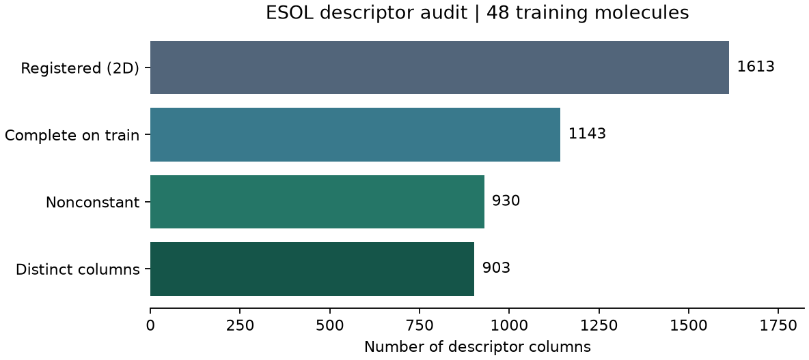

# 大量描述符的計算（Mordred）與取捨 {#sec-mordred}

## Mordred 算出上千個描述符，我們該留下哪些？ {#開場問題}

先留下在手上這批分子裡「每筆都算得出來、而且有變化」的欄位。以 48 筆 ESOL 訓練結構為例，Mordred 算出一張有 1,613 欄的表。我們先挑出每筆都有值的欄位，再刪掉每個分子都得到同一個數字的欄；如果兩欄在這批分子上的結果逐筆相同，就只留一欄。這樣還剩 903 欄。至於多算這些欄值不值得，下一步要用同一批驗證分子，比較它們和少數幾個物化描述符，各能把水溶解度預測到什麼程度。

## 核心概念

氧原子有幾個？芳香鍵有幾條？分子裡有哪些原子對正好相隔八個鍵？這些都可以交給 **Mordred** 來算。光是最後一題，把八個鍵改成七個，或把「依原子質量加權」改成依其他原子性質加權，就又是另一欄。所以看到上千個描述符，不必逐一背欄名。先挑一欄，弄清楚它數的是哪些原子、怎麼加權、什麼情況下算不出來，往往比多列幾百欄更有幫助。[@moriwaki2018mordred]

原始論文報告了超過 1,800 個描述符，涵蓋二維與三維。這裡用的是社群維護的 `mordredcommunity` 2.0.7，在 Python 裡仍然寫 `from mordred import Calculator, descriptors`。設定 `ignore_3D=True`，計算器就只登錄不需要三維座標的項目。

為什麼要先排除三維描述符？以丁烷為例，它繞中央單鍵旋轉時，原子的連接順序沒有變，看鍵數的描述符也不會變。但如果要比較丁烷兩端的空間距離，就得先提供**構形**（conformer），並記錄座標怎麼產生、選了哪個構形，或怎麼彙整多個構形的結果。只把參數改成 `False`，程式並不會自己生出座標。

缺值也要分清楚意思。例如一個分子沒有氧，氧原子數就該填零；但有些看起來空白的格子，意思完全不同。`AATS8m` 要在含氫的分子圖裡，找出最短路徑恰好跨八個鍵的原子對，把每對原子的質量相乘，再求這些乘積的平均。如果分子太小，連一對都找不到，平均值的分母就是零，結果沒有定義。這時若把格子填成零，它反而會排在所有有值的分子前面，因為真正算得到的質量乘積都是正數。

## 動手做

[下載本節 notebook](../../notebooks/ch04/04-04-mordred.ipynb){.btn .btn-sm .btn-outline-primary}　[在 Colab 開啟](ch04/04-04-mordred.ipynb)

本例用 DeepChem 的 `load_delaney` 取得 ESOL 的 1,128 筆結構與實測水溶解度，按分子骨架分成訓練、驗證和測試集。固定亂數種子後，從訓練集抽 48 筆、從驗證集抽 12 筆。計算描述符只需要 SMILES，不用讀溶解度，載入時設 `transformers=[]`。[@delaney2004esol]

先抽幾十筆的好處是筆電就跑得完，遇到缺值也可以一筆一筆追查。想多算一些時，先看 notebook 印出的訓練批次耗時。多加十個簡單的小分子，和多加十個較大、連接方式複雜的分子，花的時間可能差很多。

`calc.pandas` 回傳的表格中，有些格子記的不是數字，而是計算失敗的原因。如果只讓 pandas 選取數值型的欄位，一個錯誤訊息就可能讓同欄其餘 47 個數字也被略過。所以 notebook 保留原表 `raw_train`，另外建一張數值表 `X`：用 `pd.to_numeric` 逐欄轉成數字，無法轉換的值記為 `NaN`，無窮大也當成缺值。要查原因時，仍可以用同一個 SMILES 和欄名回到原表。下面三步都只根據訓練樣本選欄。

```python
complete = X.dropna(axis="columns")
varying = complete.loc[:, complete.nunique() > 1]
unique = varying.T.drop_duplicates().T
```

這三行依序做三件事：刪掉含有缺值的欄、只留至少有兩種不同數值的欄，最後刪掉內容逐筆重複的欄。

{#fig-mordred fig-alt="四根橫條依序縮短。共登錄 1613 欄，其中 1143 欄在每筆訓練樣本都有值。去掉常數後剩 930 欄，再合併數值逐筆相同的欄位，剩下 903 欄。"}

@fig-mordred 中前兩根橫條相差 470 欄。這些欄位都至少缺一筆，但不一定整欄都算不出來。例如 `AATS8m` 在 48 筆訓練分子中，有 20 筆缺值、28 筆有值，第一個缺值出現在硝基苯：就算從苯環對側的氫走到硝基上的氧，最短路徑也不到八個鍵。這是結構本身的限制，重跑幾次都不會多出一對相隔八鍵的原子。如果缺的是三維描述符，原因可能不同，例如輸入少了座標，這時就要先確認有沒有準備合適的構形。

「只留每筆都有值的欄位」這個規則很簡單，但連只缺一格的欄也會刪掉。如果研究關心的是長碳鏈，這 470 欄就值得再看一遍：可以按分子大小分組，找出哪些組別缺值最多，再看分子裡有沒有夠長的鍵結路徑。

本例的做法是刪欄位、保留所有抽到的分子。反過來，如果只留算得出八鍵平均值的分子，許多短小的分子就會一起被排除，訓練出的溶解度模型也就很少見過這類結構。團隊若改按缺值比例決定要不要留欄，也要記下門檻和刪掉的欄名，日後加入新化合物時，才查得出表格為什麼變了。

第二行程式刪掉 213 個常數欄。只要 48 筆的值都相同，即使是非零值也會刪除。第三行先把表格轉置，讓程式能逐欄比對整欄數值；若兩欄逐筆相同，就保留排在前面的那一欄，再把表格轉回每列一個分子。這一步刪掉 27 欄，例如 `nAromBond` 和 `nBondsA` 在這批分子中算出的芳香鍵數完全相同。要注意，兩欄在這批樣本中碰巧一致，換一批分子仍可能不同；反過來，數值只要差一點點，就不會在這一步被刪掉。

算好 12 個驗證分子的描述符後，依訓練表的欄名和順序取出同樣的 903 欄。這次驗證表沒有缺值，但下一批分子未必如此。遇到缺值時，notebook 會先記下缺了幾格，再用各欄在**訓練集**的中位數填入。這個中位數只是讓模型有數字可用，原分子的描述符其實還是沒有算出來。某類分子如果常常需要補值，就值得另外看看這一類的預測誤差。改做交叉驗證時，也要在每一折的訓練資料裡重新選欄、重算中位數。

回到水溶解度的問題，48 筆訓練資料仍然對應到 903 欄。要決定值不值得把整個資料集都算一遍，可以先用分子量、估算的 logP 等少數幾欄訓練一個基準模型，再和加入 Mordred 欄位的模型放在相同的骨架切分上，比較驗證誤差，同時記下計算新分子要花多久。如果最後只留下幾項描述符，下一批結構就可以只算這幾項。測試集則要等欄位、補值方式和模型都選定以後才用。

## 重點整理

- 登錄的欄數取決於版本和是否使用三維座標，每欄實際算得出幾筆，還要看輸入的分子。
- 分子沒有某種元素可以記為零，分母為零的平均值則要記為缺值，並保留原始的錯誤訊息。
- 用訓練資料決定保留哪些欄和補值參數，再原樣套用到驗證資料，欄數變少後仍要評估預測表現。

## 小練習

同事看到流程刪掉了碘原子數 `nI`，就推斷 ESOL 裡沒有含碘化合物。請只用訓練集檢驗這個說法：列出抽樣的 48 筆裡 `nI` 有哪些取值，再從其餘訓練結構找出含碘的例子，附上 SMILES 和碘原子數，最後說明刪掉這一欄對模型有什麼影響。

提示：用 RDKit 的 `atom.GetAtomicNum()` 查原子序，找出含有原子序 53 的結構。在 `train.ids` 裡搜尋時，可以根據 `X.index` 跳過已經抽到的分子。

## 延伸閱讀

原始論文以實例說明各個描述符如何處理氫及缺值。要查本節所用版本的參數與自相關公式，可以分別看計算器介面和 `AATS` 的定義。[Mordred 原始論文](https://doi.org/10.1186/s13321-018-0258-y)　[社群版 API](https://jacksonburns.github.io/mordred-community/mordred.html)　[自相關描述符原始碼](https://jacksonburns.github.io/mordred-community/_modules/mordred/Autocorrelation.html)
