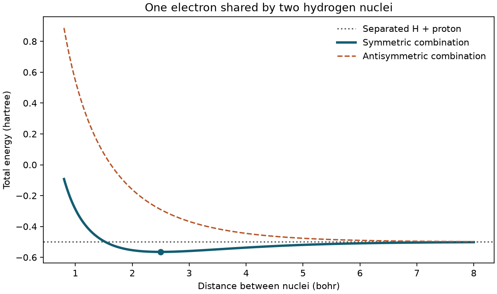

# 為什麼化學資訊學需要量子化學 {#sec-why-quantum-chemistry}

## 同樣是兩個氫核和一個電子，把兩個核慢慢拉開，能量會一路升高嗎？ {#開場問題}

不會。把兩個靠得很近的氫核拉開，基態總能量起初會下降，過了最低點才回升；兩核相距夠遠時，總能量逐漸接近一個氫原子和一個質子分開時的能量。整個過程中，分子式始終是 $\mathrm{H_2^+}$。如果資料表只存分子式，這些能量不同的狀態看起來就是同一筆資料；多記一欄核間距離，才分得出來。至於曲線為什麼先降後升，就要靠**量子化學**（quantum chemistry）：根據原子的位置和電子的數目，算出電子怎麼分布、能量是多少。

## 核心概念

**氫分子離子**（hydrogen molecular ion）比中性氫分子少一個電子。兩個氫核都帶正電，彼此排斥，卻又都吸引著唯一的那個電子。電子比原子核輕得多、動得也快得多，所以我們可以先把核當成不動，只求電子的狀態，這個做法稱為**玻恩–奧本海默近似**（Born–Oppenheimer approximation）。

具體來說，先把兩個核固定在某個距離，求出電子狀態，再把核之間的排斥能加進總能量；換一個距離，就照新的核位置再求一次。所以曲線上的每一點各代表一個幾何結構，相鄰兩點的能量差，可以用來估算把鍵拉長需要多少能量。不過這條曲線沒有時間的資訊，算不出分子在溶液中移動得多快。

要描述電子，可以在兩個氫核上各放一個氫原子的 $1s$ 函數，再把兩個函數組合起來。同號相加時，兩個函數在兩核之間互相增強；把其中一個變號再相加，兩者就會在正中央相消。波函數的正負號代表相位，取絕對值再平方才是電子出現的機率密度。

在相同的核間距離下，這兩種組合雖然都只有一個電子，能量卻不同。也就是說，單看結構式或資料表裡的「電荷為 +1」，判斷不出電子處在哪個狀態。之後看到軌域圖時，也要先看圖例，分清楚顏色代表的是相位，還是電荷大小。

用來描述電子的這一組函數，稱為**基組**（basis set）。可以把它想成一盒積木：電子的分布要用這些函數組合出來，積木越多、形狀越多樣，能拼出的分布就越細緻，但計算也越慢。本例每個核上只有一個函數，大小和形狀都固定，好處是只要幾行 Python 就能畫出整條曲線，每個數值都能一一檢查；代價是兩核靠近時，這組函數能表達的電子分布變化很有限，多保留幾位小數也改善不了。

所以使用量子化學套件時，除了結果，也要記下分子座標、總電荷、自旋狀態、計算方法和基組。日後要和實驗值比較，才有依據。

## 動手做

在 notebook 裡，我們用同一個函數逐一計算不同核間距離的總能量：距離從 0.8 到 8.0 bohr，每隔 0.02 bohr 取一點。距離單位**波耳**（bohr）和能量單位**哈特里**（hartree）都是量子化學常用的原子單位。圖上的水平虛線是分離極限，也就是一個氫原子和一個質子相距無窮遠時的能量 −0.5 hartree。縱軸上的數值大多是負的，所以要判斷把兩核拉開是吸收還是釋放能量，就看曲線上的點比這條參考線高還是低。

```python
distance = np.linspace(0.8, 8.0, 361)
bonding = total_energy(distance)
minimum = np.argmin(bonding)
print(f"Grid minimum: R = {distance[minimum]:.2f} bohr; E = {bonding[minimum]:.5f} hartree")
```

第一行在 0.8 到 8.0 bohr 之間均勻取 361 個距離，第二行算出每個距離的總能量，第三行找出能量最低的那一點，最後印出它的距離和能量。

{fig-alt="同號組合的曲線在 2.50 bohr 附近最低，低於分離極限。異號組合的曲線從上方逐漸接近分離極限。"}

沿著代表同號組合的實線讀圖：核間距離為 1.0 bohr 時，能量是 −0.28837 hartree，比兩個粒子分開時還高。距離拉到 2.0 和 3.0 bohr，能量分別為 −0.55377 和 −0.55908 hartree。這三點中 3.0 bohr 最低，但在 2.0 與 3.0 bohr 之間細看，曲線還有更低的地方：程式找到的最低值是 2.50 bohr 處的 −0.56483 hartree。報告這個位置時，要附上搜尋範圍和取樣間隔，讓讀者知道這是網格上的最低點，而不是幾何最佳化求出的鍵長。

從谷底再拉開或壓近兩核，都得供應能量。以分離極限 −0.5 hartree 為起點，兩核結合到谷底 −0.56483 hartree，能量降低約 0.06483 hartree；反過來從谷底拉到無窮遠，能量差就是正值。如果直接拿曲線最右端來算，答案會略有出入，因為那裡的核間距離只有 8.0 bohr。可以試著把橫軸延長到四十個波耳，看看兩條曲線各自離參考線多遠，再決定要保留幾位有效數字。一般來說，比較反應能或構形能時，都要先弄清楚相減的是哪兩個狀態。

異號組合的虛線，為什麼也會接近同一條水平線？兩個函數在兩核正中央相消，形成電子機率密度為零的**節面**（node）。當兩核相距很遠，函數幾乎不再重疊，相加或相減對總能量的影響也越來越小。

如果想單獨看組合方式的影響，就比較同一距離上的實線和虛線，這兩點的電子數和基組都相同。若把基組、距離和電子數一起換掉，就很難說清能量差是從哪裡來的。用套件比較兩組計算時也一樣：針對想問的問題，一次只改一個條件。

建表前，要先想清楚一列資料代表什麼。這裡每一列對應一個特定的幾何結構和電子狀態，可以分欄記下核間距離、總電荷、基組和能量。如果只按分子式刪除重複紀錄，整條曲線最後只會剩下一點。用這種幾何掃描資料建模時，也要留意測的是哪一種預測能力：把相鄰的點隨機分到訓練集和測試集，測到的只是模型對鄰近幾何結構的預測能力，看不出它對新分子的表現。

[下載本節 notebook](../../notebooks/ch05/05-01-why-quantum-chemistry.ipynb){.btn .btn-sm .btn-outline-primary}　[在 Colab 開啟](ch05/05-01-why-quantum-chemistry.ipynb)

## 重點整理

- 幾何結構和電子狀態都會影響總能量，同一個分子式可以對應許多不同的計算結果。
- 平衡位置可以從能量曲線的谷底估計，報告時要一起寫出模型、距離單位和取樣間隔。
- 計算值能不能和實驗值比較，要看電子狀態、參考能量和計算條件是否一致。

## 小練習

只取 1、2、3、4、5、6 bohr 這六個距離，找出最低點落在哪裡，並對照原圖說明它為什麼和 2.50 bohr 不同。

提示：總能量函數不用改，只要改 `distance` 那一行；想一想「模型本身的最低點」和「程式實際檢查了哪些距離」是兩回事。

## 延伸閱讀

想追蹤程式中兩個函數重疊的項目，可以對照氫分子離子的兩中心變分推導。若要確認程式如何從能量陣列選出最低點，NumPy 文件說明了索引的意義，以及多個點同值時的回傳規則。[McCullagh Lab 單電子分子講義](https://mccullaghlab.github.io/physical_chemistry/quantum_mechanics/Single_Electron_Molecule_Variational_Approach.html) · [NumPy argmin 文件](https://numpy.org/doc/stable/reference/generated/numpy.argmin.html)
