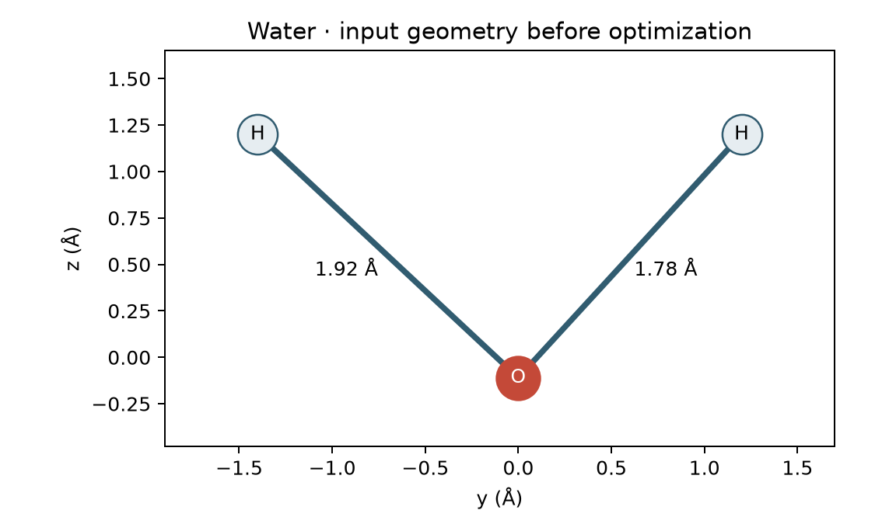

# 在 Colab 上用 Psi4 做第一個計算 {#sec-psi4-first-calculation}

## 把水分子的三個原子交給 Psi4，算出的能量究竟屬於哪一個形狀的水？ {#開場問題}

就是我們輸入的那個形狀。把原子核固定在輸入的座標上算出的總能量，稱為**單點能**（single-point energy）；就算一開始把水分子畫歪了，計算照樣可能完成，得到的就是那個歪斜結構的能量。如果想知道原子放鬆之後會停在哪裡，就要做**幾何最佳化**（geometry optimization）：程式從輸入的結構出發，依照能量隨原子位置變化的斜率（梯度）一步步移動原子，往能量較低的方向走，直到符合收斂條件為止。所以報告「水的能量」時，一定要交代用的是哪個幾何結構。

## 核心概念

Psi4 需要哪些輸入？除了計算方法和基組，還要指定原子核的位置、總電荷和自旋多重度。水的一個氧核和兩個氫核共有十個單位正電荷，所以中性水分子有十個電子。它的基態是閉殼層單重態（電子全部成對），因此分子定義的第一行寫 `0 1`，分別代表電荷 0 和多重度 1。接下來三行各寫一個元素和三個直角座標，並用 `units angstrom` 指定長度單位為 Å。

只要原子之間的相對位置相同，整個分子怎麼平移或旋轉，都是同一個氣相幾何結構。所以兩組座標看起來不一樣時，不妨先比較鍵長和鍵角。

本例用**密度泛函理論**（density functional theory, DFT）計算。DFT 的想法是用電子密度，也就是電子在空間中的分布，來求分子的能量，比直接處理每個電子的波函數省事得多，所以是目前最常用的量子化學方法之一。不過其中電子之間交互作用的部分（交換與相關能）沒有精確的公式，要靠近似的**泛函**（functional）來估計。本例選用 B3LYP 這個常見的混合泛函，搭配 6-31G(d) 基組。

泛函和基組各管一件事：泛函決定怎麼近似電子之間的交互作用，基組則決定用哪些函數來組合出分子軌域，記錄時兩者缺一不可。基組名稱裡的 d 表示在重原子上加了極化函數，讓電子分布在不同方向上有更多變化的空間。

Psi4 回傳的總能量以 Hartree（$E_h$）為單位，已經包含這個幾何結構的核間排斥能。這個計算沒有納入振動零點能、熱修正和溶劑效應，所以要和量熱實驗的自由能比較，還需要另外補上這些項目。

最佳化過程中會看到兩種收斂訊息。每次移動原子前，程式會先固定核的位置，反覆調整電子分布，直到前後兩次的結果幾乎一樣，這稱為**自洽場**（self-consistent field, SCF）計算；電子密度和能量的變化夠小，就表示這個幾何結構的電子計算收斂了。接著程式還要確認原子受的力和位移夠小。等到終止訊息顯示幾何最佳化也收斂了，最後的座標才能存成最佳化結果。

## 動手做

[下載本節 notebook](../../notebooks/ch05/05-02-psi4-first-calculation.ipynb){.btn .btn-sm .btn-outline-primary}　[在 Colab 開啟](ch05/05-02-psi4-first-calculation.ipynb)

在 Colab 選用 CPU 執行階段，執行 notebook 第一格。這一格會用 micromamba（一個套件安裝工具）在目前的工作階段裝好 Python 和 Psi4，後面的程式都用這個環境的 Python 執行，套件版本可以從第一格的輸出看到。下一格指定兩個 CPU 執行緒和一 GB 記憶體。這些設定只決定程式能用多少電腦資源，不會改變要算的物理問題。

作者的起始幾何結構中，氧在 $(0,0,-0.11)$，兩個氫分別在 $(0,-1.4,1.2)$ 和 $(0,1.2,1.2)$，座標單位都是 Å。第一個氫的座標減去氧的座標，得到向量 $(0,-1.4,1.31)$，它的長度就是第一條 O–H 鍵的鍵長。另一條鍵也可以這樣算，再和圖上的標示比較。

接下來要做哪一種計算，取決於想問什麼。想知道兩條鍵被拉到這麼長時的能量，就保留座標做單點計算；想找氣相水在這個計算層級下的平衡結構，就從這組座標出發做幾何最佳化。

```python
level = "B3LYP/6-31G(d)"
initial = psi4.energy(level, molecule=water)
relaxed = psi4.optimize(level, molecule=water)
print(f"Input: {initial:.8f} Eh; optimized: {relaxed:.8f} Eh")
print(water.save_string_xyz_file())
```

這段程式先指定計算層級，接著對起始結構做一次單點計算，再做幾何最佳化，最後印出兩個能量和最佳化後的座標。

{fig-alt="氧在下方，兩個氫分居左上與右上。左側 O–H 鍵長 1.92 Å，右側為 1.78 Å。"}

順序很重要。程式直接對 `water` 物件做最佳化，成功之後，它寫出的 XYZ 就已經是終點座標了。如果把兩次單點計算都排在最佳化之後，程式雖然照常執行，算到的卻都是終點。所以本例先把起點能量存成 `initial`，再做最佳化，把終點能量存成 `relaxed`。原作者在相同起始條件下算得的最佳化能量，四捨五入後為 $-76.4090\ E_h$，可以先拿來比對。

用 Psi4 1.11 和本節的固定輸入重算，起點能量為 $-76.10587316\ E_h$，終點為 $-76.40895530\ E_h$。終點減起點約為 $-0.30308\ E_h$，也就是說，在相同設定下，被拉長的水分子放鬆之後，位能降低了。起點和終點都是同樣三個原子組成的水分子，沒有任何一步把它拆成氫和羥基，所以這個差值和水的解離能是兩回事。相減前先寫清楚誰是起點、誰是終點，才不會因為順序顛倒，誤以為放鬆需要吸收能量。

打開最後的 XYZ，跳過第一行的原子數和第二行的註解，用後面三行的座標重算兩條 O–H 鍵長。程式可能會重新調整分子的朝向，所以只看某個氫的 $y$ 座標變了多少，很難判斷鍵縮短了多少。比較鍵長，既能看出兩條拉長的鍵是否回到相近的長度，也容易發現把 Å 誤當成 Bohr 這類錯誤。

如果還要比較鍵角，就把兩個由氧指向氫的向量取內積，除以兩個向量長度的乘積，再取反餘弦。有了兩個鍵長和一個鍵角這三個內部座標，即使兩張圖的朝向不同，也能比較水分子的形狀。

假設同學用較小的基組重算，可以怎麼比較？如果共用同一份最佳化後的 XYZ，各自做單點計算，原子位置相同，差異就只來自電子計算的設定。如果共用起始座標、各做一次最佳化，最後連幾何結構都可能不同。原作者比較 Hartree–Fock、密度泛函方法和不同基組時，每種組合都重新做了最佳化。至於哪種方法比較準，要拿同一個物理量的外部參考值來比，單看誰的總能量比較負是判斷不了的。

繳交紀錄時，附上起始和收斂後的 XYZ，列出計算層級、電荷與多重度，並在兩欄能量註明單位。這次只有一筆水分子資料，用名稱就找得到。但分子如果有多個可旋轉的鍵，同一個名稱就可能對應不同的起始構形，最佳化也可能停在不同的局部極小值，所以要保留座標，才能重做比較。若要進一步確認找到的是能量極小值，可以在相同條件下計算振動頻率，看看內部振動模式有沒有出現有物理意義的虛頻。

## 重點整理

- 單點能對應輸入的原子座標，幾何最佳化會改變座標，所以起點和終點要分開保存。
- 比較鍵長和鍵角，可以避開分子平移、旋轉造成的座標差異。
- 比較能量時，要一起註明方法、基組、幾何結構、電荷、多重度和單位。

## 小練習

把最佳化後的 XYZ 當成新的輸入，用相同設定再做一次單點計算，並說明結果應該和先前哪一欄能量一致。

提示：先寫下兩次單點計算各自用的是哪一組原子座標，並保留足夠的小數位數。

## 延伸閱讀

Psi4 的文件分別說明單點計算的回傳值，以及最佳化的梯度、收斂條件與傳回的能量。[單點能](https://psicode.org/psi4manual/master/energy.html) · [幾何最佳化](https://psicode.org/psi4manual/master/opt.html)
