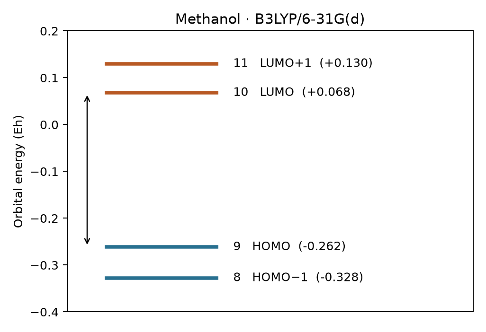
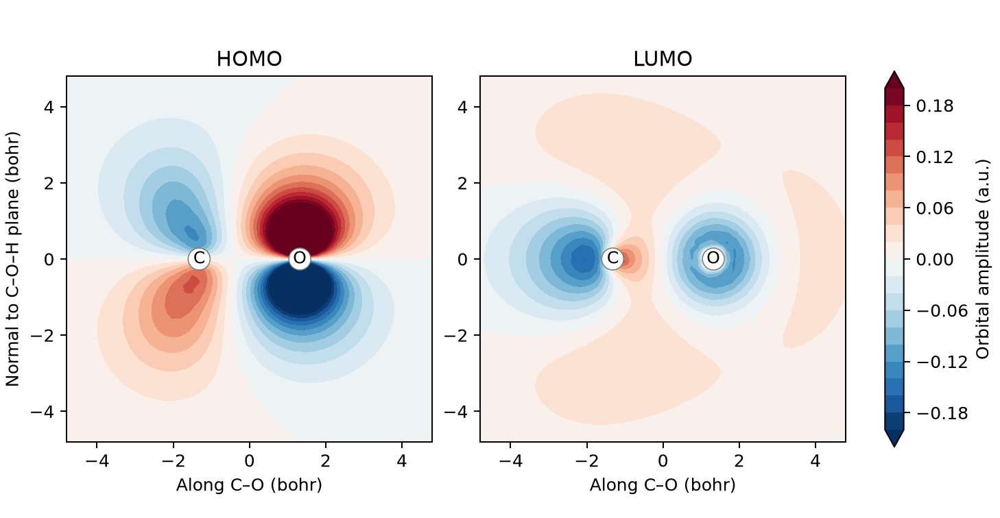

# HOMO、LUMO 與軌域視覺化 {#sec-frontier-orbitals}

## Psi4 說甲醇有九個 α 電子，我們該用 Python 陣列中的哪兩格來算 HOMO–LUMO 能隙？ {#開場問題}

要讀第八號和第九號這兩格。**最高占據分子軌域**（highest occupied molecular orbital, HOMO）是基態中有電子、能量最高的分子軌域；**最低未占據分子軌域**（lowest unoccupied molecular orbital, LUMO）則是空軌域中能量最低的一個。中性甲醇有十八個電子，在這種閉殼層計算中兩兩配對、自旋相反，一共占據九個軌域。依能量由低到高數，第九個軌域是 HOMO，第十個是 LUMO；Python 的索引從零開始算，所以要讀的是第八號和第九號元素。

## 核心概念

HOMO 和 LUMO 合稱**前線軌域**（frontier orbitals）。想知道一個分子可能從哪個部位提供電子，可以先看 HOMO 的空間分布；要找另一個分子可能從哪裡接受電子，則看它的 LUMO。能階表告訴我們兩個軌域的能量差多少；至於它們在空間中有沒有機會重疊，就得轉動立體圖，看各自主要分布在哪些原子附近。

兩條前線軌域的能量差是 $\Delta\epsilon=\epsilon_{\mathrm{LUMO}}-\epsilon_{\mathrm{HOMO}}$，常稱為 HOMO–LUMO 能隙。軌域能量和分子總能量都可以用 Hartree 表示，但兩者的意思不同：軌域能量是在所選模型下，描述單一電子的能量；分子總能量則屬於所有原子核和電子組成的整個系統。所以把占據軌域的能量逐一相加，並不會得到程式列出的總能量。

用能隙比較不同分子時，要記下方法、基組、電荷狀態和原子座標。這些條件一致，不同分子的能隙才能放在一起比較。

## 動手做

[下載本節 notebook](../../notebooks/ch05/05-03-frontier-orbitals.ipynb){.btn .btn-sm .btn-outline-primary}　[在 Colab 開啟](ch05/05-03-frontier-orbitals.ipynb)

作者示範螢光素時，先用 Psi4 算電子結構，再用 Avogadro 畫軌域。這裡也用這兩套工具，但改算作者另一份 notebook 裡的甲醇：分子小，重算比較快，也方便一個個確認哪些軌域有電子。我們直接用原始輸出記下的六列原子座標做氣相單點計算，依序是碳、氧、三個接在碳上的氫，以及羥基的氫。沿用這些座標，就不用擔心自己隨機產生的三維構形和作者的不一樣。

打開 notebook，先看分子定義。輸入指定中性單重態，並採用 C1 對稱，也就是不使用分子對稱性，讓所有軌域列在同一個區塊裡。計算能量時加上 `return_wfn=True`，除了總能量，還會拿到一個**波函數物件**，裡面記錄了電子數、軌域係數和軌域能量等資料。總能量只是一個數字，畫軌域則需要這些空間資訊。下面的程式直接從波函數物件讀出 α 軌域能量，再把同一份波函數匯出成檔案來畫圖。

```python
energy, wfn = psi4.energy("B3LYP/6-31G(d)", molecule=methanol, return_wfn=True)
eps = wfn.epsilon_a_subset("AO", "ALL").np
n = wfn.nalpha()
assert n == wfn.nbeta() == 9
homo, lumo = eps[n - 1], eps[n]
print(f"HOMO {homo:.6f} Eh; LUMO {lumo:.6f} Eh; gap {lumo-homo:.6f} Eh")
psi4.fchk(wfn, "methanol.fchk")
```

這段程式先做計算並取得波函數，接著讀出所有 α 軌域的能量和 α 電子數 `n`，並確認 α、β 電子都是 9 個。`eps[n - 1]` 是最後一個有電子的軌域（HOMO），`eps[n]` 是第一個空軌域（LUMO）。最後一行把波函數存成 `methanol.fchk`，供 Avogadro 畫圖。

{fig-alt="能量沿縱軸升高。藍線是第八、第九個已占據軌域，橘線是第十、第十一個空軌域。箭頭跨過第九與第十個能階之間的間距。"}

圖中的四條能階取自作者的甲醇計算。第九條約為 $-0.261540\ E_h$，第十條約為 $+0.067874\ E_h$，兩者相差約 $0.329414\ E_h$。對照輸出檔時，「Doubly Occupied」欄的最後一個值和「Virtual」欄的第一個值，應該就是這兩個數字。要小心的是，就算索引錯取成九和十，算出來的差值一樣是正數，因為那是前兩個空軌域之間的能量差，程式不會報錯。所以資料表最好連同 HOMO、LUMO 的數值一起存，只存 gap 的話，以後很難查出當初取的是哪兩個軌域。

接著從 Colab 的檔案面板下載 `methanol.fchk`，用 Avogadro 開啟，叫出分子軌域視窗。先依能量和占據標記選出 HOMO，產生**等值面**（isosurface），也就是把軌域數值達到某個大小的點連成一張曲面，再轉動分子，看它在氧和鄰近原子周圍怎麼分布。保持相同的視角和等值設定，切到 LUMO 再看一次，並排比較，才看得出兩者在哪些位置不同。如果開的是 XYZ 檔，通常只看得到分子骨架，因為檔案裡只有原子種類和位置，沒有畫軌域所需的係數。

只有瀏覽器也能看軌域。Psi4 產生的 cube 檔，記錄了三維網格上各點的軌域數值（振幅），notebook 可以直接從這次的波函數畫出兩張剖面圖。下圖選的剖面包含 C–O 鍵軸，另一個方向則垂直於 C–O–H 平面。用顏色表示剖面上各點的振幅，就能看出振幅在鍵軸上下兩側怎麼變化。在氧的兩側，如果看到兩種顏色相接，就可以沿著振幅接近零的地方找節面。剖面以外的分布，則要轉動三維等值面來看。

{fig-alt="兩圖都標出碳和氧的位置，以紅、藍兩色區分正負振幅。沿著鍵軸上下對照，可見 HOMO 和 LUMO 的分布不同。"}

等值面上的兩種顏色，分別標出軌域函數達到指定正值和負值的位置；兩瓣顏色不同，表示相位相反。把整個軌域函數乘上負一，兩種顏色就會對調，但振幅平方的分布完全一樣。所以兩個程式把氧旁邊的同一瓣畫成不同顏色，畫的仍可能是同一個軌域。比較時要看的是各瓣之間的相對相位、函數為零的節面，以及振幅主要集中在哪些原子附近。

等值設定也會影響軌域看起來的大小。把顯示的數值調低，離核較遠、振幅較小的區域也會顯現；調高的話，原本相連的瓣可能分開，有些甚至消失。這只是畫法改變，同一次計算的能階和占據數都沒有變。保存圖像時，可以在圖說附上軌域編號、計算方法和等值大小，並讓兩張圖中的 C–O 鍵朝同一個方向，讀者才分得清哪些差異屬於分子、哪些來自畫面設定。

換成螢光素這類染料，情況就複雜了：光看名稱，無法知道計算用的是溶液中哪一種質子化狀態、互變異構物或開環形式。例如一位同學保留中性結構，另一位去掉酸性的氫，兩人的程式都可能順利執行，算的卻是兩種不同的化學物種。在紀錄裡附上標明電荷的結構，讀者比較數字之前就能看出這個差別。另外，如果電子數是奇數，就要分開考慮 α 和 β 電子的占據情形；本例「九對電子」的索引規則，不能直接套用到自由基上。

那麼，能隙能拿來解釋分子的顏色嗎？要解釋肉眼看到的顏色，還得知道哪些激發可以發生、吸收強度多大，以及環境怎麼影響激發態。這次算的是基態的軌域能隙，把它換算成波長在數學上做得到，但不足以指出吸收峰的位置，也推論不出毒性或反應速率。要和實驗光譜比較，還需要激發能和振子強度，計算方式見 @sec-absorption-spectra。

## 重點整理

- 甲醇這個閉殼層計算有九個 α 電子，HOMO 與 LUMO 的 Python 索引分別是八和九。
- 等值面的顏色代表軌域的相位，比較兩張圖時要保持相同的視角和等值設定。
- 能隙描述的是基態軌域，要和實驗吸收峰比較，還需要激發態的計算。

## 小練習

有位同學把第十和第十一個軌域的能量差當成能隙，請只用原始輸出的占據表，指出他取錯了哪裡。

提示：找出最後一條雙占據軌域的編號，再寫出陣列索引和輸出編號差了多少。

## 延伸閱讀

可從波函數物件查詢電子數與軌域能量，再用格式化檢查點檔案匯出資訊。[Psi4 Wavefunction](https://psicode.org/psi4manual/master/api/psi4.core.Wavefunction.html) · [Psi4 FCHK](https://psicode.org/psi4manual/master/fchk.html) · [Avogadro 軌域視窗](https://avogadro.cc/docs/menus/analyze-menu.html)
