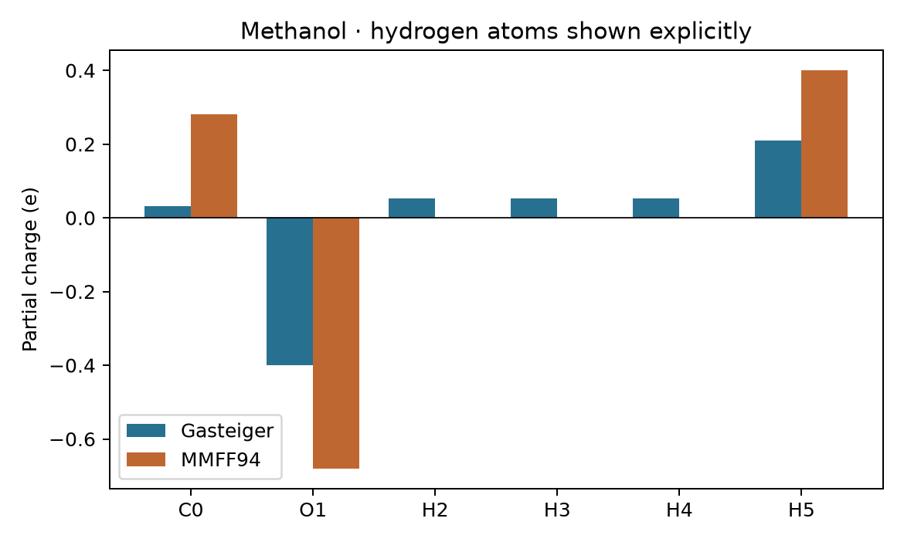

# 原子電荷 {#sec-atomic-charges}

## 同一個中性甲醇分子，為什麼兩套程式會把不同數量的負電荷分給同一顆氧？ {#開場問題}

因為它們用的分配規則不同。**部分電荷**（partial charge）是依照某一套規則，把分子中的電荷分配到各個原子上得到的數值。中性甲醇六個原子的部分電荷加起來一定是零，但這個總和並沒有規定氧該分到多少。舉例來說，氧在路易斯結構上的**形式電荷**（formal charge）是零，部分電荷卻可能是負的：前者是根據價電子和成鍵規則記帳，後者反映所選模型怎麼描述鍵結中的電子分布。換句話說，同一個結構用不同規則分配，個別原子的電荷可以不同，總和卻一樣。

## 核心概念

原作者用 RDKit 比較了 Gasteiger 和 MMFF 兩種方法。Gasteiger 法根據每個原子和它鄰近的鍵結，反覆調整原子的有效電負度和部分電荷。**Merck 分子力場**（Merck Molecular Force Field, MMFF94）則先判斷每個原子和鍵屬於哪一類，再依力場的參數表分配電荷。這兩種方法只要有分子圖（也就是原子怎麼連接）就能算，不需要做量子化學計算。如果接著要做力場模擬，還要確認力場的其他參數是搭配哪一種電荷模型設計的。

另一條路，是像 @sec-psi4-first-calculation 那樣，先給定原子核的位置，用量子化學算出電子密度，再做**布居分析**（population analysis），把電子分給各個原子。Mulliken 法把兩個原子的基函數重疊部分的電子平分給相關的原子；Löwdin 法則先把基函數做對稱正交化，讓函數之間不再重疊，再按原子加總。對一般的全電子計算，原子核電荷減掉分到該原子的電子數，就是它的部分電荷。

實作上只要算一次能量、留下波函數，就能做這兩種分析。這樣電子密度是固定的，我們就能單獨比較「分配方式」對原子電荷的影響。

## 動手做

[下載本節 notebook](../../notebooks/ch05/05-04-atomic-charges.ipynb){.btn .btn-sm .btn-outline-primary}　[在 Colab 開啟](ch05/05-04-atomic-charges.ipynb)

為了在同一張圖上一個一個比較原子，我們把原作的螢光素換成只有六個原子的甲醇。把氫明確加進分子圖以後，各原子依序標成 C0、O1、H2、H3、H4、H5：前三個氫接在碳上，最後一個接在氧上。這個順序也和 notebook 交給 Psi4 的座標一致。對照原子順序時，除了元素符號，也要看原子接在哪裡，因為羥基氫和甲基氫就算對調了，元素欄看起來還是都是 H。

```python
mol = Chem.AddHs(Chem.MolFromSmiles("CO"))
labels = [f"{a.GetSymbol()}{a.GetIdx()}" for a in mol.GetAtoms()]
rdPartialCharges.ComputeGasteigerCharges(mol, throwOnParamFailure=True)
gasteiger = [a.GetDoubleProp("_GasteigerCharge") for a in mol.GetAtoms()]
props = AllChem.MMFFGetMoleculeProperties(mol)
if props is None:
    raise ValueError("MMFF94 無法指派所有原子參數")
mmff = [props.GetMMFFPartialCharge(i) for i in range(mol.GetNumAtoms())]
```

這段程式先從 SMILES 建立甲醇並補上氫，替每個原子做一個「元素加編號」的標籤，例如 `O1`。接著算出 Gasteiger 電荷並逐一取出；再取得 MMFF94 的參數，如果有原子找不到參數就停下來報錯，最後逐一讀出每個原子的 MMFF94 電荷。

{fig-alt="兩種方法算出的氧都帶負電，羥基氫都帶正電。三個甲基氫的 MMFF94 電荷都是零，Gasteiger 電荷則是三個相同的小正值。"}

從圖上找 O1：Gasteiger 約為 $-0.400\,e$，MMFF94 為 $-0.680\,e$，其中 $e$ 是基本電荷的大小。MMFF94 分給氧的電荷比較負，那整個甲醇分子是不是也比較負？往右看羥基氫，兩種方法給的電荷分別約為 $+0.210\,e$ 和 $+0.400\,e$；往左看，碳的電荷也不一樣。要確認甲醇仍是中性，可以把六列沒有四捨五入的電荷加起來，看是否接近零，再來討論單一原子的差異。

也可以按基團加總電荷：把 C0 和 H2、H3、H4 歸在甲基一欄，O1 和 H5 歸在羥基一欄。按圖中的原始計算值，Gasteiger 的羥基淨電荷約為 $-0.190\,e$，MMFF94 則是 $-0.280\,e$，兩者都由甲基的正值抵銷。從結果來看，兩種方法的氧電荷相差約 $0.28\,e$，但把羥基氫也算進來，差距就縮小到約 $0.09\,e$。

所以如果要比較整個羥基和附近帶電基團的作用，基團淨電荷比單一個氧的電荷更能代表羥基整體的帶電情形。不過距離很近時，羥基氫朝向哪一側仍會影響作用，這種空間上的差異，基團淨電荷就看不出來了。

接在碳上的三個氫，也可以用來檢查原子編號有沒有對錯：在同一套規則下，它們的電荷應該相同。MMFF94 給它們的三個零，是參數算出的正常數值。但換成缺少參數的元素時，有些程式介面可能回傳空物件或無效的數字，所以範例要求 Gasteiger 在參數指派失敗時直接報錯，並檢查 MMFF 物件是否存在。如果把缺失值隨手填成零，「缺少參數」就會和甲基氫的正常零電荷混在一起。

接著，notebook 用 Psi4 在固定的甲醇幾何結構上做 B3LYP/6-31G(d) 單點計算，再呼叫兩次 `psi4.oeprop`，分別做 Mulliken 和 Löwdin 分析。每做完一種分析，要立刻複製 `wfn.atomic_point_charges().np`，因為下一次呼叫會更新電荷，原來的結果可能跟著被蓋掉。兩種分析各占表中一欄，都沿用同一個原子順序。

讀這張表時，先看兩種方法給氧和羥基氫的電荷符號，再逐欄加總。兩欄用的是同一份電子密度，所以個別原子電荷的差異，完全來自布居分配的定義。如果連基組、幾何結構也一起換掉，就沒辦法只憑這張表判斷是哪個因素造成的改變。

在這個固定的幾何結構上，用 Psi4 1.11 重算，氧的 Mulliken 電荷約為 $-0.596\,e$，Löwdin 電荷約為 $-0.464\,e$；羥基氫則分別約為 $+0.387\,e$ 與 $+0.333\,e$。碳的 Mulliken 電荷約為 $-0.198\,e$，符號和兩種經驗方法相反。也就是說，如果用「碳帶正電」來篩選可能的反應中心，光是換一種電荷定義，挑出來的原子就可能不同。所以選電荷模型之前，要先想清楚想解釋的是什麼：分子周圍的電場、力場中兩個位點之間的作用，還是某類已知反應發生在哪個位置。

官能基一多，光看表格就不容易分辨每個數字屬於哪個原子。原作者的做法是把電荷直接標在二維結構上。以螢光素為例，可以先複製一份分子並保留原子編號，在副本上排好二維座標，再按編號標上電荷。圖中即使省略了氫，加總電荷時仍要算進去；如果圖上只標重原子，要說明標的是重原子本身的電荷，還是已經把相連的氫加進來。比較兩張用連續色階上色的圖時，也要固定同一個顏色範圍，否則兩個大小不同的負值，可能在各自的圖上都被畫成最深的顏色。

如果希望原子電荷能重現分子周圍的**靜電勢**（electrostatic potential, ESP），做法又不一樣：先在分子外選一些取樣點，用量子化學算出每一點的電勢，再反過來擬合每個原子的電荷。**受限靜電勢法**（restrained electrostatic potential, RESP）在擬合時加入限制條件，讓結果比較穩定。這和前面「把電子布居分給原子」的目標並不相同。原文用的兩階段 RESP 範例，還會對特定原子加上「電荷相等」或「電荷固定」的條件；換分子時，要依新的結構重新判斷哪些位置可以共用參數。如果連原子編號都照抄，限制條件可能就加到別的官能基上了。

## 重點整理

- 單一原子的部分電荷取決於分配方法，加總時要包含所有的氫，才能確認分子的總電荷。
- Gasteiger 和 MMFF94 只用分子圖和參數，Mulliken 和 Löwdin 則要先做量子化學計算再分配電子。
- 比較或畫圖前要保留原子編號和它接在哪個官能基上，元素符號相同的氫尤其容易搞混。

## 小練習

同學只把甲醇的碳、氧兩列電荷相加，發現總和不是零，請用同一份資料找出原因。

提示：先確認他用的是哪一欄方法，再依鍵結關係，把甲基氫和羥基氫分別加回所屬的基團。

## 延伸閱讀

RDKit 文件列出 Gasteiger 電荷的儲存位置與參數處理，Psi4 則整理了可由同一個波函數求得的布居與靜電性質。[RDKit 部分電荷](https://www.rdkit.org/docs/source/rdkit.Chem.rdPartialCharges.html) · [RDKit 力場工具](https://www.rdkit.org/docs/source/rdkit.Chem.rdForceFieldHelpers.html) · [Psi4 單電子性質](https://psicode.org/psi4manual/master/oeprop.html) · [RESP 外掛](https://github.com/cdsgroup/resp)
