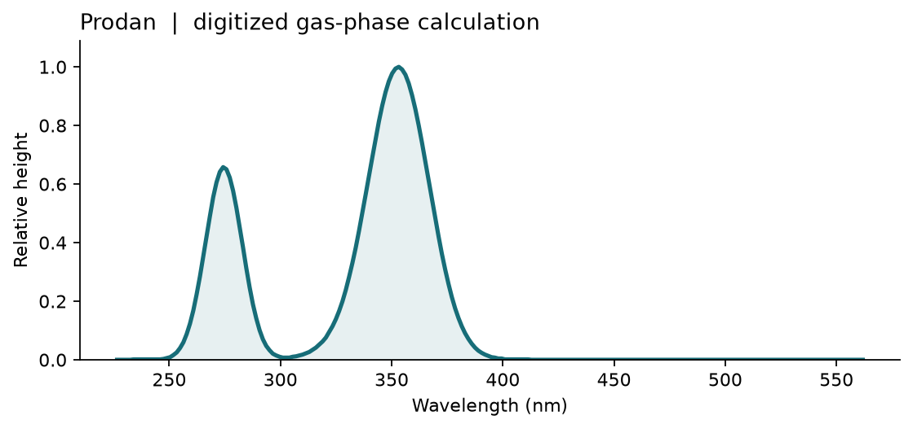

# 吸收光譜 {#sec-absorption-spectra}

## 拿到一個螢光染料的 HOMO 和 LUMO，能直接用兩者的能量差算出它吸收最強的波長嗎？ {#開場問題}

不能，還要知道分子有哪些激發態，以及每個激發態吸收光的強度。**吸收光譜**（absorption spectrum）記錄的是樣品吸收光的程度怎麼隨波長變化。某個波長要出現吸收，光子的能量必須和基態到某個激發態的能量差相符；這條吸收強不強、實驗中看不看得到，還取決於分子和光的電場之間的交互作用。軌域圖上的兩條橫線只標出軌域能量，即使某個激發態主要來自 HOMO 到 LUMO 的躍遷，光憑這兩個軌域，也讀不出光譜裡最高的峰在哪裡。

## 核心概念

要算激發態，常用的方法是**含時密度泛函理論**（time-dependent density functional theory，TDDFT）。前面幾節的 DFT 處理的是基態；TDDFT 則把它延伸到激發態，觀察分子受到微弱的光（外加電場）擾動時，電子密度怎麼回應，從中求出各個激發態的能量。它的計算量比 DFT 多一些，但仍然算得動中型的有機分子，所以常用來模擬吸收光譜。

本節先用基態 DFT 找出平衡幾何結構，再固定所有原子核，計算激發態和基態的能量差。這樣得到的是**垂直激發**能量，對應分子吸光的瞬間，原子核還來不及移動的情況。

程式也會給出每個激發態的**躍遷偶極矩**（transition dipole moment）。它是一個向量，而樣品裡的分子朝向各個方向都有，所以判斷吸收強弱時，要把三個分量都算進去。**振子強度**（oscillator strength）則是由激發能和躍遷偶極矩算出的無因次量，數值越大，這個躍遷吸收得越強；接近零的稱為暗態，幾乎不吸光。

程式列出的是一筆筆分開的躍遷，實驗量到的卻常是連續的吸收帶。要看哪些躍遷會合成同一個吸收帶，可以在每個躍遷的位置畫一條高斯曲線，再把所有曲線相加。高斯曲線的寬度是畫圖時自己指定的參數，不是計算出來的。所以兩個相鄰的激發態可能合成一個峰，振子強度接近零的態則可能看不出峰。另外，如果只報告激發能最低的態，得到的是這次計算中波長最長的躍遷，它可能離光譜的最高峰很遠。

## 動手做

原作選用的螢光探針 Prodan，在萘環上接了二甲胺基和丙醯基。用這個分子讀光譜，可以同時考慮共軛結構和探針周圍環境的影響。流程是：先用 RDKit 讀入原文的 SMILES，補上氫並產生三維結構，用力場稍微調整，再用 Psi4 做 B3LYP/6-31G(d) 幾何最佳化，找出這個方法下的一個局部低能結構。把 SMILES 中的原子次序固定，並在產生三維結構時指定亂數種子，日後就能從同一個起點，找出差異出在哪一步。

接著在基態結構上重算一次單點能量，並要求程式把自洽場波函數一起傳回；單點計算只更新電子，不移動原子。原示範的激發態計算還要再用到建構庫侖與交換矩陣的資訊，所以沿用 `save_jk=True`。Prodan 是中性的閉殼層分子，計算時指定單重態。在忽略自旋軌道耦合的電偶極近似下，從單重基態到三重態的躍遷不會貢獻一般的強吸收帶，所以這裡不算三重態。程式這次只求八個根，也就是八個激發態；後面讀光譜時，要先看這八個態涵蓋了哪些能量。

```python
states = tdscf_excitations(wfn, states=8, triplets="none")
poles = [state["EXCITATION ENERGY"] for state in states]
moments = [np.linalg.norm(state["ELECTRIC DIPOLE TRANSITION MOMENT (LEN)"])
           for state in states]
curve = spectrum(poles=poles, residues=moments, gamma=0.01, out_units="nm")
```

第一行求出八個單重激發態；第二行把每個態的激發能取出來排成一串；第三、四行取出每個態的躍遷偶極矩，並用 `np.linalg.norm` 算出向量的大小；最後一行把這兩串數字交給 `spectrum`，加上展寬後畫成以奈米為橫軸的光譜。

[下載本節 notebook](../../notebooks/ch05/05-05-absorption-spectra.ipynb){.btn .btn-sm .btn-outline-primary}　[在 Colab 開啟](ch05/05-05-absorption-spectra.ipynb)

傳進函數的激發能仍用原子單位，最後的 `nm` 只決定輸出的橫軸。如果先把能量換成電子伏特，再交給預期原子單位的函數，雖然還是畫得出曲線，波段位置卻會錯。另一個輸入要用長度形式的躍遷偶極矩，只取向量大小就好：Psi4 的單光子吸收函數會自己平方，如果在函數外先平方，強弱躍遷的相對比例就會失真。展寬參數 `gamma` 也是原子單位，要用能量來理解，而不是圖上的波長。

{fig-alt="橫軸是波長。從原圖藍線讀回的兩個峰約在 275 與 353 奈米，其中 353 奈米附近的峰較高。"}

這張圖是按作者保存的計算曲線重建的：我們依原圖刻度讀取彩色線條，把基線移到零、最高點設為一。左峰約在 275 nm，右峰約在 353 nm，精度受原圖的像素限制。從這兩個峰還原不出八個激發態各自的位置和強度，所以圖中只保留讀得回來的曲線。要用前面的偶極矩定義重新算出光譜，請執行 notebook 後半段；如果兩張圖的峰高不一樣，要回到各自的躍遷清單去比較。

和文獻比較時，先看量的是哪一種光譜。吸收實驗比較的是入射光和透射光；**螢光激發光譜**（excitation spectrum）則是固定偵測某個放光波長，掃描入射光，記錄能引發多少螢光；**放射光譜**（emission spectrum）則反過來，固定激發波長，掃描放射波長。吸收和激發光譜可能出現相近的波帶，但如果有一部分探針所處的環境讓它更容易放光，這些分子在兩種量測中所占的訊號比例就可能不同。

Krasnowska 等人研究的是 Prodan 在水與磷脂相之間的分布，用激發和放射訊號辨認探針所處的環境。[@krasnowska1998prodan] 把原作提到的約 300–400 nm 激發區域和這裡的氣相計算放在一起，只能討論兩者的波段是否接近。

同一支探針從氣相移到膜表面，周圍的極性和分子排列都會改變；樣品裡也可能同時有還留在水中的分子。如果兩條曲線都把最高點設成一，光看曲線很難分辨差異來自樣品環境，還是畫圖時選的線寬。所以並列兩張圖時，實驗圖旁要註明樣品環境、量測種類和偵測波長，計算圖旁則列出幾何結構、泛函、基組、激發態數和線寬。這樣即使只比較波帶位置，讀者也知道兩邊各自代表什麼。

畫光譜前，可以先建立一張三欄的躍遷表，依序填入激發能、換算後的波長和振子強度。光子能量和波長成反比，所以按能量由低到高排在第一列的躍遷，改按波長由短到長排序時，會排到最後一列。排序時一定要整列一起移動；如果各欄分開排序再配對，就可能把暗態的強度配給亮態。比較兩種幾何結構時，也要保留各自的態編號；遇到能量很接近的兩個態，先看它們主要由哪些軌域組成，再判斷順序有沒有改變。

如果要找出某個波段內所有明顯的吸收，先用表中最高的激發能確認計算涵蓋的範圍。如果最後一個態剛好落在目標波段的邊緣，附近的曲線可能少算了下一條躍遷的貢獻；這時把橫軸畫得再寬也補不回來。正確的做法是其他設定不變，增加根數重算，再看目標波段的曲線還會不會變。

## 重點整理

- 激發能決定躍遷的位置，躍遷偶極矩決定強度，兩者都要有才認得出亮態。
- 線寬會改變峰高和相鄰峰能不能分開，要和激發態清單一起記錄。
- 比較 Prodan 的光譜時，先確認實驗掃描的是入射光還是放射光，再看探針處在什麼環境。

## 小練習

用同一份 Prodan 躍遷清單，把展寬減半再畫一次，找出在原圖中最難分開的一對相鄰躍遷。

提示：改的是 `spectrum` 那一行的 `gamma`。先依能量排序，在表中找出能量接近、強度都不小的兩個態，再比較改動線寬前後的曲線。

## 延伸閱讀

Psi4 手冊分別說明如何求激發態，以及如何將能量與偶極矩組成光譜。[TDSCF 手冊](https://psicode.org/psi4manual/master/tdscf.html)、[spectrum 函數與單位](https://psicode.org/psi4manual/master/api/psi4.driver.p4util.spectrum.html)。實驗條件可與 [Prodan 在水與磷脂中的研究](https://doi.org/10.1016/S0006-3495%2898%2977905-6) 對讀。
