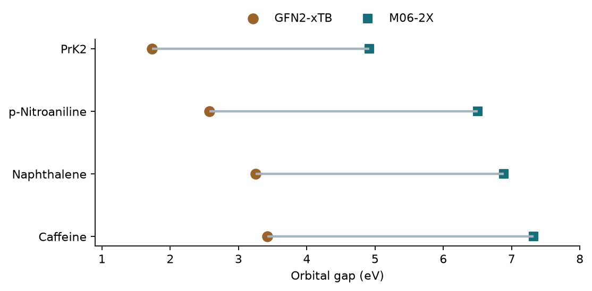

# 速度與精度的取捨：GFN2-xTB {#sec-gfn2-xtb}

## 如果計算資源只夠替兩個分子做 DFT，能不能先用成本較低的方法，挑出能隙可能較小的候選分子？ {#開場問題}

可以，GFN2-xTB 就是常用來做這種預篩的方法。它屬於**半經驗法**（semiempirical method），更精確地說是半經驗緊束縛法（semiempirical tight binding）。半經驗法同樣是在解電子結構，但把計算中最花時間的部分，換成事先用大量資料調好的參數，所以速度比 DFT 快上許多，代價是精度較低。GFN2-xTB 使用較小的基組，並納入多極靜電與色散作用；開發時特別著重分子的幾何結構、振動頻率和非共價作用。[@bannwarth2019gfn2]

給定原子座標後，GFN2-xTB 可以只算單點能量，也可以依能量梯度調整座標，找附近的穩定結構。用它先比較多種幾何結構或取代基，就能把成本較高的 DFT 計算，留給比較有希望的候選分子。

## 核心概念

要判斷方法準不準，得先決定比較哪個量。這裡比較的是 HOMO 和 LUMO 的能量差，單位是電子伏特；參考值是另一種 DFT 方法 M06-2X/6-31+G(d,p) 算出的**軌域能隙**（orbital gap）。同一個分子的兩個能隙差多少，衡量的是兩種理論方法彼此有多一致。

如果要和其他性質比較，需要的資料就不一樣了：要比實驗的吸收峰位置，還得知道激發態和躍遷強度；要比氧化還原電位，還需要指定溶劑、參考電極和不同的電荷狀態。這兩組軌域能隙的差值，沒辦法替那些性質估出誤差範圍。

再來要看預篩的目的是什麼。如果只能選兩個分子，就看排名前兩名是誰，特別留意能隙相近的分子會不會交換名次。如果要選的是所有低於某個門檻的分子，光看排名就不夠：就算順序一樣，整批數值偏低，也會改變入選名單。換句話說，一個方法即使數值有明顯偏差，只要排序保留得住，仍然可以用來安排計算的先後；但要直接套用實驗或 DFT 的門檻，就需要同條件、同類分子的配對資料來支持。

## 動手做

我們先算作者三份安裝筆記都用過的乙炔。起始結構把氫、碳、碳、氫依序排成一直線，中央的碳碳距離設為 1 Å，再讓程式調整鍵長，直到結構收斂。直接給定起始座標，就省去另外產生三維結構的步驟，也不必擔心每次從 SMILES 產生的結構不一樣。先用乙炔試算，可以在送出大分子之前，確認程式版本、輸出單位，以及最佳化是否順利完成。

```python
result = subprocess.run(
    [*xtb, "ethyne.xyz", "--gfn", "2", "--opt"],
    cwd=run_dir, capture_output=True, text=True, check=True,
)
if "GEOMETRY OPTIMIZATION CONVERGED" not in result.stdout:
    raise RuntimeError("乙炔幾何尚未收斂，請查看計算紀錄")
```

這段程式從 Python 呼叫 xtb 程式，把輸出的文字收集到 `result` 裡；接著在輸出中找「GEOMETRY OPTIMIZATION CONVERGED」這行字，找不到就表示最佳化沒有收斂，程式會停下來報錯。

[下載本節 notebook](../../notebooks/ch05/05-06-gfn2-xtb.ipynb){.btn .btn-sm .btn-outline-primary}　[在 Colab 開啟](ch05/05-06-gfn2-xtb.ipynb)

`--gfn 2` 指定使用 GFN2-xTB，`--opt` 則啟動幾何最佳化。每次執行前都建一個新的工作資料夾，以免把上一個分子留下的 `xtbopt.xyz` 誤當成這次收斂的結果。記下最後收斂的結構，再在這組座標上做一次單點計算讀出能隙，數值和結構檔就能一一對上。

原作者在 Miniconda 環境下算得的乙炔能隙約為 7.29 eV。重跑時可以先用它確認數量級；如果有差異，再比較初始鍵長、方法版本、收斂條件和有沒有加溶劑。寫入表格時，「沒有完成」也要另外標記，如果填零，失敗的分子就會被排在最前面。

接著比較作者保存的四組配對結果。每個點的數值都取自對應分子 JSON 檔中 GFN2-xTB 或 PySCF 的 `homo_lumo_gap_ev`。同一列是同一個分子，兩點之間的水平距離，就是兩種方法算出的能隙差；想比較分子的名次，則固定一種顏色由上往下看。

{fig-alt="能隙由小到大依序為 PrK2、對硝基苯胺、萘和咖啡因。每個分子的 xTB 能隙都較小，點落在 M06-2X 左側。"}

從 xTB 換到 DFT，PrK2 的能隙由 1.74 eV 變成 4.92 eV，對硝基苯胺由 2.57 變成 6.50，萘由 3.25 變成 6.88，咖啡因由 3.42 變成 7.32。這裡保留兩位小數是為了方便讀圖，notebook 用的是原始精度。兩欄都是 PrK2 排第一、對硝基苯胺排第二，所以這次就算先用 xTB 挑兩個分子，也能挑到這批分子中 DFT 能隙最小的兩個。但如果改用 4 eV 當門檻，xTB 的四個能隙全都低於門檻，DFT 的四個卻全都高於門檻。

從結果來看，四個分子的 xTB 能隙都比 DFT 小，差了約 3.18–3.93 eV。皮爾森相關係數衡量的是兩欄數值之間的線性關係；相關係數再高，也只表示兩者一起升降，兩種方法的數值仍然不能互換。

另外，萘和咖啡因的 xTB 能隙只差約 0.17 eV；如果換成別的帶電形式、選到其他低能結構或換了環境，這兩個分子的名次還保不保得住，需要另外計算。只看這四個例子，也估不出換成一千個分子時會漏掉多少。要知道預篩可能錯過誰，可以從接近淘汰界線的候選中抽幾個做精算。

比較計算時間之前，先分清楚每筆紀錄做了哪些計算。依作者的基準資料，含四十七個原子的 PrK2 在既有結構上用 xTB 做單點計算不到一秒，同一個分子用 PySCF 約 196 秒。讀這組秒數時要留意，換掉的不只是方法，連執行環境也不同。

如果改做幾何最佳化，一個分子就要反覆計算很多次能量和梯度；如果有多個起始結構，估算總時間時，每個結構都要算進去。原作者另有一張幾何最佳化的配對表：以甲醇（SMILES 為 CO）為例，Psi4 用了 3.24 秒、xTB 用了 0.13 秒；換成 Prodan，兩者分別是 288.73 秒和 3.29 秒。也就是說，在這次的最佳化條件下，兩種方法的耗時在甲醇上相差約 25 倍，在 Prodan 上相差約 88 倍。

要估計一批候選需要多少時間，可以先挑幾個大小和電荷分布都接近目標的分子，分開記錄單點、最佳化和失敗重試的耗時。用自己這批分子的時間來估算，會比拿一個小分子的時間直接乘上一千可靠得多。

讀入 XYZ 檔時，要另外確認電荷和自旋。XYZ 第一行是原子總數，第二行是註解，後面列出元素和座標，裡面沒有欄位記錄分子的總電荷或未成對電子數。這次的乙炔是中性閉殼層分子，剛好符合預設值；換成鹽類、自由基或帶電染料，電荷和自旋就要另外指定。兩個 XYZ 檔即使每個座標都相同，也可能因為電荷設定不同而算出不同的能隙。所以除了檔名，也要把電荷和自旋寫進計算紀錄，方便日後回頭查。

替不同候選建立比較表時，要先用分子識別碼和結構編號把兩種方法的結果配對，再計算差值。如果照檔名順序逐列相減，只要其中一種方法少算一個分子，缺口之後的資料就會全部配錯。這種錯誤從個別能隙的大小很難看出來，卻會同時改變相關係數和預篩名單。

## 重點整理

- 先想清楚目標是排序、絕對門檻還是實驗性質，再決定用什麼指標比較兩種方法。
- 這四個分子的排序一致，但 GFN2-xTB 的軌域能隙比參考 DFT 小約 3.18–3.93 eV。
- 記下分子形式、幾何結構、方法、收斂狀態和耗時，才知道哪一批預篩結果可以沿用。

## 小練習

如果要保留參考 DFT 能隙小於 7.0 eV 的分子，而 xTB 也用 7.0 eV 當門檻，找出四個候選中會被 xTB 多選進來的分子。

提示：把兩欄各自和 7.0 比較，列出兩份入選名單，再看兩份名單差在哪裡。

## 延伸閱讀

GFN2-xTB 的參數化目標與能量項見 [原始論文](https://doi.org/10.1021/acs.jctc.8b01176)。乙炔的起始座標、最佳化輸出與收斂等級可對照 [xTB 幾何最佳化手冊](https://xtb-docs.readthedocs.io/en/latest/optimization.html)。
