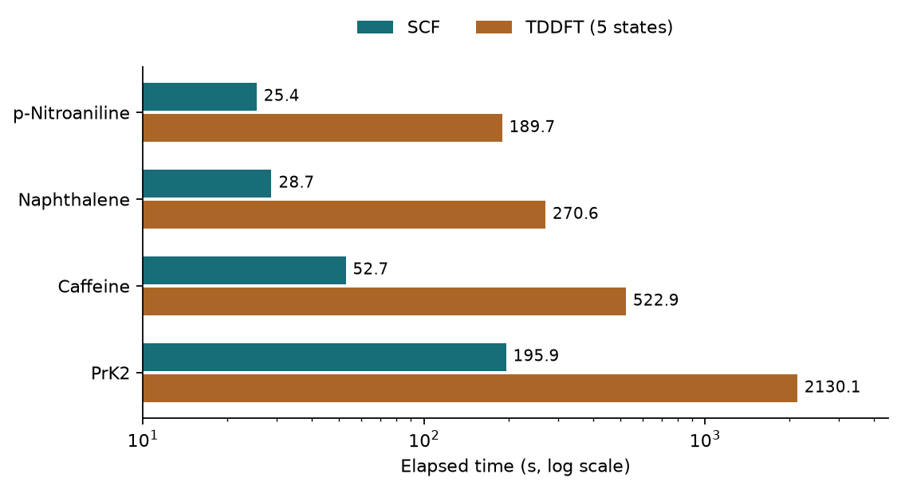

# 用 GPU 加速 DFT：pySCF 與 GPU4PySCF {#sec-gpu-accelerated-dft}

## 同一個分子在 GPU 上算得比較快時，要記下哪些計算條件，才能判斷省下的時間來自哪裡？ {#開場問題}

要記下座標、泛函、基組、積分格點和收斂條件，確定 CPU 和 GPU 解的是同一個問題。**GPU4PySCF** 是 PySCF 的**圖形處理器**（graphics processing unit，GPU）擴充套件，可以把支援的電子結構運算交給 NVIDIA 顯示卡來算。以中性閉殼層分子為例，我們先固定座標、泛函和基組，再分別用 CPU 和 GPU 執行**受限 Kohn–Sham 方法**（restricted Kohn–Sham，RKS），也就是電子全部成對時的標準 DFT 計算，反覆更新電子密度，直到自洽場（SCF）收斂。條件相同時，兩邊的結果應該在設定和數值精度容許的範圍內接近；至於畫面上印到小數點後第幾位，則和兩者是否吻合無關。

## 核心概念

GPU 擅長同時處理大量的數值運算，但準備資料、建立格點和搬移資料都要花時間。分子很小時，時間可能大半花在準備上；等到分子變大、基組裡的函數變多，能交給 GPU 同時處理的運算才會跟著增加。

演算法的選擇也會影響耗時。例如**密度擬合**（density fitting）用一組輔助基組來近似部分積分，會同時改變運算量和近似程度。如果 CPU 用直接積分，只有 GPU 用了密度擬合，就無法單從耗時判斷顯示卡的貢獻。所以比較裝置時，兩邊要同時開啟或同時關閉密度擬合，並記下用的是哪個輔助基組。

估算時間前，要先分清楚要算什麼。固定座標求基態能量，只要做一次單點計算；幾何最佳化每移動一次原子，就要在新座標上重新求能量和梯度；如果要求激發態，還要在基態收斂後再做 TDDFT 計算。所以只計時到基態收斂，估不出算完整個吸收光譜要多久。另外，分子的結構或電荷也會影響收斂的難易，即使原子數相近，也要比較實際的迭代次數。

## 動手做

notebook 沿用作者基準測試中咖啡因 XYZ 檔的元素和座標，讓 CPU 和 GPU 計算同一個幾何結構。如果兩邊各自從 SMILES 產生起始座標，得到的結構可能不一樣。程式把電荷和自旋參數都設為零，用 M06-2X 泛函和 6-31+G(d,p) 基組做閉殼層單點計算。輸入時要註明座標單位是 Å；如果其中一邊把同一串數字當成 bohr，兩次計算都會順利結束，比較的卻是兩個不同的結構。

```python
mf = dft.RKS(mol)
mf.xc = "m06-2x"
mf.grids.atom_grid = (99, 590)
mf.grids.prune = None
mf.conv_tol = 1e-9
if use_gpu:
    mf = mf.to_gpu()
```

這段程式建立一個 RKS 求解器，指定 M06-2X 泛函、積分格點的密度（並保留所有格點）和收斂門檻；如果要用 GPU，最後一行就把同一個求解器轉到 GPU 上。

[下載本節 notebook](../../notebooks/ch05/05-07-gpu-accelerated-dft.ipynb){.btn .btn-sm .btn-outline-primary}　[在 Colab 開啟](ch05/05-07-gpu-accelerated-dft.ipynb)

CPU 和 GPU 各自建立新的求解器，避免第二次計算直接從第一次收斂的結果出發。兩邊都用直接計算，並沿用作者單點計算腳本的格點數。執行 `kernel()` 後，先看 `mf.converged` 確認收斂，再讀取總能量或軌域能量。

本例是閉殼層分子，每個軌域的占據數都是整數。在占據數大於零的軌域中，能量最高的是 HOMO；在占據數為零的軌域中，能量最低的是 LUMO。用 LUMO 能量減去 HOMO 能量，再把單位從 Hartree 換成 eV，就能和本章其他能隙圖比較。如果遇到分數占據、α 和 β 電子分開處理，或計算的是金屬系統，就要重新定義怎麼判定 HOMO 和 LUMO。

本例只計算求解器從呼叫到完成的時間。用 GPU 時，開始和停止計時之前都要各做一次同步，否則 Python 可能已經把指令送出去、計時也停了，GPU 卻還在算。這段時間不含安裝套件和讀取 XYZ，但可能包含第一次呼叫時的初始化。如果關心的是整批工作要等多久，就要把格式轉換、資料搬移和輸出都算進去。報告時寫清楚計時的起點和終點，CPU 和 GPU 用同一套標準。

{fig-alt="橫軸以秒為單位，採對數刻度。四個分子的五態 TDDFT 耗時都比基態 SCF 長，兩項計算都是 PrK2 最久。"}

圖中的數據取自作者保留的四份 PySCF 結果檔。每份檔案的 `scf_time_s` 記錄基態單點計算的耗時，`tddft.tddft_time_s` 記錄求五個激發態的耗時。對硝基苯胺的兩段計算分別用了 25.4 秒和 189.7 秒，萘用了 28.7 秒和 270.6 秒，咖啡因用了 52.7 秒和 522.9 秒，PrK2 則用了 195.9 秒和 2130.1 秒。

讀圖時要注意，橫軸是對數刻度，等長的線段代表相同的倍數；想知道兩段工作差了幾秒，要看橫條旁標的數字。另外，這四份紀錄都是 GPU 的結果，要比較裝置效能，還需要同一批分子在相同設定下的 CPU 耗時。

以咖啡因為例，求基態不到一分鐘，再求五個激發態卻要多等將近九分鐘。這九分鐘值不值得，要看想求的是什麼性質：如果只是要建立基態軌域能隙的描述符，算到基態就夠了；如果要找特定波段的強吸收，就得算激發能和強度，並確認算出的態涵蓋整個目標波段。PrK2 的結果檔另外還有一組三態計算，比較時如果混用了不同態數的耗時，就可能把「少算幾個態」省下的時間，誤當成硬體的功勞。

原作者也測過 Prodan 在 B3LYP/6-31G(d) 下做幾何最佳化的時間：Psi4 用 CPU 約需 289 秒，PySCF 搭配 T4 約需 241 秒、A100 約 53 秒、H100 約 39 秒。Psi4 CPU 的耗時除以 A100 的耗時，比值約為 5.4。要小心的是，53 秒和圖中的 52.7 秒雖然很接近，前者是 Prodan 的幾何最佳化，後者是咖啡因的單點能，兩者是不同的工作。

如果想在自己的工作站重做這個比較，先固定分子、初始 XYZ 和幾何最佳化程式，再確認泛函、基組、積分格點，以及電子和原子座標各自的收斂條件都相同。比較耗時的同時，也要看最終鍵長、能量和最佳化步數；如果其中一邊多走了十步，耗時的差異就不能只歸因於顯示卡型號。

在另一個環境執行 notebook 時，可以把硬體型號、CPU 執行緒數、軟體版本和兩組計算結果一起存下來。如果 CPU 和 GPU 算出的總能量差太多，已經超過研究想分辨的能量差，就先比對輸入和收斂紀錄，暫時不要解讀加速比。如果能量一致，GPU 卻沒有比較快，可以檢查分子是不是太小、計時是否包含第一次的初始化，以及兩邊的執行緒和記憶體設定是否相近。這些紀錄可以當作下次安排計算的參考，但只測一次，還不足以訂出「多少個重原子以上才用 GPU」這種通用門檻。

報告效能時，可以再建立一個新的求解器重做一次，分別記下第一次和第二次的耗時。如果兩次的總能量和能隙一致，第二次卻快很多，就先看是不是初始化和快取造成的。如果連收斂所需的迭代次數都不同，兩次的迭代紀錄也要留下來比較。

## 重點整理

- 座標、積分設定和收斂條件都相同，才適合比較 CPU 與 GPU 的數值差異。
- 基態、幾何最佳化和激發態的耗時要分開記錄，並寫下激發態數和收斂紀錄。
- 計時結果要附上硬體、軟體和計時範圍，這四份 GPU 結果檔可以用來比較各階段的耗時。

## 小練習

四個分子都已經算完基態，如果接下來只能挑三個做五態 TDDFT，依照圖中的紀錄，找出總等待時間最短的組合。

提示：只加總還沒做的 TDDFT 耗時，而且要用秒數相加，不要看圖上橫條的長度。

## 延伸閱讀

哪些方法支援 GPU，以及如何在 CPU 與 GPU 物件之間轉換，可查 [PySCF GPU 使用手冊](https://pyscf.org/user/gpu.html)。不同 CUDA 版本的安裝選項、相依套件與支援功能則列在 [GPU4PySCF 專案文件](https://github.com/pyscf/gpu4pyscf)。
