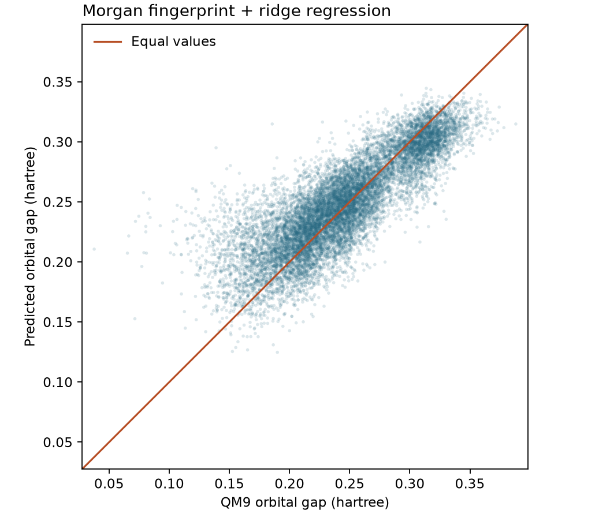

# 把量子化學結果當描述符（HOMO-LUMO gap 的 QSPR） {#sec-quantum-descriptors}

## 手上只有分子結構，能先估計哪些候選分子的 HOMO–LUMO 能隙較小，再決定哪些值得花時間做量子化學計算嗎？ {#開場問題}

可以。做法是拿一批已經算好能隙的分子，建立**定量結構與性質關係**（quantitative structure–property relationship，QSPR）模型：輸入分子結構，預測算出來的軌域能隙。這裡的**能隙**（orbital gap）是 LUMO 的能量減去 HOMO 的能量。要從能階圖直接讀出能隙，得先知道哪些軌域有電子，再找出相鄰的 HOMO 和 LUMO；QSPR 則是用這批已知的結構和能隙，學出兩者之間的關係。遇到新分子時，只要有結構，就能先估計能隙，作為安排計算順序的依據。

## 核心概念

同一張試算表可以同時列出分子結構、HOMO 能量、LUMO 能量、能隙和實驗測得的性質。哪些欄位是**描述符**（descriptor），哪一欄是**預測目標**（target），要看研究問題而定。舉例來說，如果要預測一系列分子的實驗氧化電位，可以用同一種方法算出各分子的 HOMO 能量，看看把它加進結構描述符後，預測有沒有變好。如果要從結構估計能隙，能隙就是預測目標。

這時要特別小心輸入了什麼。新的候選分子剛畫好結構式時，已經可以算指紋，但還不知道兩個軌域的能量。如果訓練時把 HOMO、LUMO 能量也當成輸入，模型只要把兩者相減就有答案。這種情況稱為**目標洩漏**（target leakage）：就算訓練集和測試集沒有共用任何分子，也避免不了。

本例用 QM9 的計算結果當作預測目標。原始資料有 133,885 個有機小分子，每個分子最多含九個重原子（氫不算在內），元素只有碳、氮、氧和氟。研究團隊用 B3LYP/6-31G(2df,p) 計算了這些分子的結構和性質。原始論文的表三把能隙列為 $\varepsilon_{\mathrm{LUMO}}-\varepsilon_{\mathrm{HOMO}}$，單位是 hartree。以甲烷為例，HOMO 能量是 −0.3877，LUMO 能量是 0.1171，相減得到能隙 0.5048 hartree。[@ramakrishnan2014qm9]

也就是說，這裡評估的是模型能不能重現「某個指定方法算出的能隙」。如果問題換成預測吸收光譜，就要用激發態資料或實驗吸收波長另外訂標籤，因為軌域能隙本身並不是光譜的量測值。

我們沿用原案例的 **Morgan 分子指紋**（Morgan fingerprint）來表示結構：從每個原子出發，往外最多看兩個鍵，把看到的局部環境編進一個長度 1,024 的位元向量。某個位元是一，表示至少有一種原子環境對應到這個位置；不同的環境也可能對應到同一個位元。第 6 章會再詳細介紹它。線性模型從訓練資料學出每個位元的權重，再用這些權重估計能隙。

這樣我們就能檢驗：只靠原子怎麼成鍵，能把能隙估得多準？限制也來自同一個地方：同一個分子的兩種構形如果只差在扭轉角，指紋完全一樣，模型給出的預測也會一樣。

## 動手做

[下載本節 notebook](../../notebooks/ch05/05-08-quantum-descriptors.ipynb){.btn .btn-sm .btn-outline-primary}　[在 Colab 開啟](ch05/05-08-quantum-descriptors.ipynb)

打開 notebook，先確認 Colab 的執行階段是 2026.07。第一次執行時，DeepChem 會下載 QM9，讀取分子結構檔、計算指紋，再把分組結果存起來，下次就不用重算。原始檔把氫原子明確列出，一般的 SMILES 卻常省略氫；為了讓兩種來源的結構產生一致的指紋，程式會先把可以省略的氫移除，再算指紋。

載入時的化學合理性檢查會略過一部分原始紀錄，所以 notebook 列出的三組分子數加起來，會比論文的總數少。要和其他實作比較，先確認雙方載入的版本和分組方式相同。

載入資料時，我們指定**骨架切分**（scaffold split）：Bemis–Murcko 骨架相同的分子，會一起被分到訓練、驗證或測試集，用來檢驗模型能不能預測訓練時沒看過的骨架。這種分法有個容易忽略的地方：許多無環分子的骨架都是空的，按規則必須分在同一組，即使三組的分布因此不平均，也不能隨意拆開。原案例用的是隨機分組，所以兩邊拿來測試的分子並不相同。

程式也關閉了預設的標籤標準化，讓圖的兩軸都維持相同的能量單位。QM9 有好幾個性質欄位，要按名稱找出能隙所在的那一欄；如果把整個標籤矩陣攤平，不同分子的不同物理量就會混在一起。

```python
gap = tasks.index("gap")
X_train = csr_matrix(train.X)
y_train = train.y[:, gap]
# 預先固定模型與超參數，驗證集保留給練習。
model = Ridge(alpha=1.0, solver="lsqr", tol=1e-6)
model.fit(X_train, y_train)
y_test = test.y[:, gap]
y_pred = model.predict(csr_matrix(test.X))
mae = mean_absolute_error(y_test, y_pred)
```

這段程式先找出能隙在第幾欄，取出訓練集的指紋和能隙，用脊迴歸訓練模型；接著對測試集做預測，最後算出預測值和計算值之間的平均絕對誤差。

本例用的是**脊迴歸**（ridge regression）。指紋中許多局部結構會同時出現，例如從環上兩個相鄰的原子往外看，看到的環境往往重疊。脊迴歸會對過大的係數加上懲罰，讓權重分散到這些彼此相關的輸入上。如果某個位元的係數特別大，先查有哪些原子環境對應到它，再看它常和哪些位元一起出現，才知道這個係數可能反映哪一種化學差異。

我們也用訓練集能隙的中位數當作比較基準，也就是每個測試分子都猜同一個值。如果脊迴歸的預測連這個基準都比不上，就很難說模型從結構中學到了有用的規律。

{#fig-qm9-gap fig-alt="每個藍點代表一個測試分子。橫軸是 QM9 的計算能隙，縱軸是脊迴歸預測值，兩軸單位都是 hartree。橘色對角線上的預測值恰好等於計算值。"}

這次分組得到 105,757 個訓練分子、13,220 個驗證分子和 13,220 個測試分子。只用訓練集的中位數來預測，測試集的**平均絕對誤差**（mean absolute error，MAE）是 0.04113 hartree；改用結構指紋和脊迴歸後，降到 0.02059 hartree，大約減少了一半。MAE 的算法是把每個分子的預測誤差取絕對值再平均，所以它仍然帶有能量單位，可以直接拿來和候選分子之間的能隙差比較。

在 @fig-qm9-gap 中，橫軸是計算出的能隙，縱軸是預測值。點落在對角線上方表示高估，落在下方表示低估；每個點的縱座標減去橫座標，就是這個分子的預測誤差。原案例之所以還畫散佈圖，是因為誤差一樣大，對篩選的影響也可能不同。如果目標是找小能隙的分子，要特別看圖左邊、遠高於對角線的點：這些分子的計算能隙很小，卻因為預測值偏高，可能在重算名單上被排到後面。

## 重點整理

- 要從結構預估能隙，訓練時只能給模型新候選分子也拿得到的資訊，算好的 HOMO、LUMO 能量留著檢查答案。
- QM9 的 `gap` 有指定的計算方法、正負號和單位，保留原始單位，就能直接讀出每個分子被高估或低估多少。
- 評估篩選工具時，先和簡單的基準比較，再從散佈圖看目標能隙範圍內的預測好不好。

## 小練習

假設只能挑驗證集裡一成的分子重算，按模型的預測能隙由小到大挑，算算看能選中多少個計算能隙真的落在最低一成的分子。

提示：用訓練好的模型替 `valid.X` 預測並排序，取預測值最低的一成；再從 `valid.y[:, gap]` 取同樣數量的分子，比較兩組索引有多少重疊。如果切點上有能隙相同的分子，先決定好怎麼依原索引排序。

## 延伸閱讀

QM9 的原始論文列出各欄位的計算方法和單位，可以對照表三確認軌域能量的定義。[Ramakrishnan 等人，Scientific Data](https://doi.org/10.1038/sdata.2014.22)

DeepChem 的文件說明 QM9 檔案的來源、化學合理性檢查，以及特徵、分組和標準化參數。[MoleculeNet 的 QM9 載入說明](https://deepchem.readthedocs.io/en/latest/api_reference/moleculenet.html#qm9-datasets)
