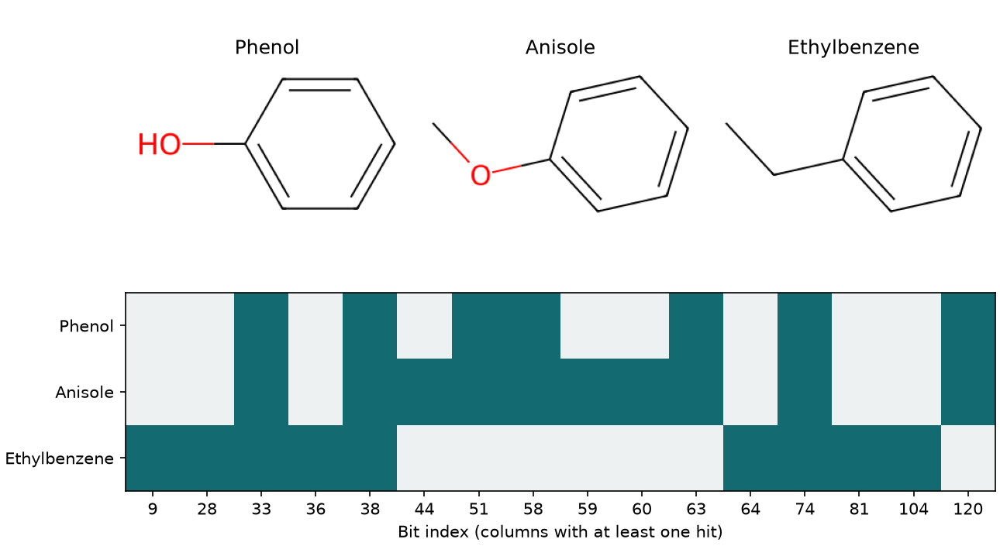

# 什麼是分子指紋 {#sec-molecular-fingerprints}

## 把苯酚的結構畫成一排 0 和 1，還看得出什麼？ {#開場問題}

看得出它含有哪些結構片段，也能和其他分子比較共同的片段。舉例來說，苯酚和苯甲醚的原子數不同，但在結構圖上很容易看出共同點：兩者都有苯環，環上也都直接接了一個氧。**分子指紋**（molecular fingerprint）就是用一套固定的規則，把這類結構特徵編成數字。以常見的**位元指紋**（bit fingerprint）為例，某個位置記錄的特徵只要出現，那一格就寫 1，否則寫 0。把兩個分子的指紋並排，看哪些位置一起亮起來，就有了比較的依據。

## 核心概念

為什麼不直接用原子編號來比？因為同一個苯酚，SMILES 可以從氧開始寫，也可以從苯環上的碳開始寫，兩種寫法的第零個原子就不一樣。指紋則是先讀出哪些原子相連，再用同一套規則填進欄位，所以一列放一個分子，同一欄就能逐列比較。只要是同一張分子圖，從哪個原子開始寫 SMILES，本例的指紋都一樣。

反過來卻不一定成立：如果指紋剛好沒記到兩個分子之間的差別，不同的結構也可能得到一模一樣的兩列。

每一欄記了什麼，取決於指紋怎麼設計。一種做法是**結構鍵**（structural keys）：先列出一組判斷條件，例如分子是否含有某類原子或某段連接方式，再逐項檢查。這種做法可以查表解釋每個位元，但條件表沒問到的差異就看不出來。

另一種做法是從分子圖列舉出所有片段，再用**雜湊**（hash）把每個片段換成一個號碼，對應到有限的欄位上。雜湊可以想成一種固定的「編號規則」：同樣的片段永遠得到同樣的號碼，但欄位有限，兩個不同的片段也可能被分到同一欄。所以看到某一欄是 1，只知道至少有一個片段命中，光憑欄號說不出它是哪一個官能基。

就算都用雜湊，收集的結構片段也可能完全不同。**RDKit 拓撲指紋**（RDKit fingerprint）會找出指定鍵數範圍內彼此相連的片段，也可以包含分支；Morgan 指紋則從每個原子出發，一圈一圈把周圍的環境納進來。兩種指紋都可以存成 2,048 欄，但同一個欄號記的東西不一樣。如果把兩批用不同指紋算出的資料直接上下合併，模型就會把兩種不同的結構特徵當成同一欄來讀。

## 動手做

[下載本節 notebook](../../notebooks/ch06/06-01-molecular-fingerprints.ipynb){.btn .btn-sm .btn-outline-primary}　[在 Colab 開啟](ch06/06-01-molecular-fingerprints.ipynb)

我們用 DeepChem 的 `load_delaney` 載入 ESOL 資料集，從 1,128 筆結構中挑出苯酚（phenol）、苯甲醚（anisole）和乙苯（ethylbenzene）。資料沿用骨架切分，我們把三組合起來，從整份結構清單中找這三個分子。這裡要看的是同一個苯環接上不同取代基時，哪些位元會改變，所以不用溶解度標籤，也沒有對標籤做標準化。[@delaney2004esol]

我們讓 RDKit 收集含一到三個鍵的相連片段，每個片段只對應一個位置。向量長度固定為 128 位元，位置從 0 編到 127。`GetOnBits()` 會傳回值為 1 的位置；把結果轉成集合（set），後面就可以用交集找出兩個分子共同的位置，用差集找出某個分子獨有的位置。

```python
generator = rdFingerprintGenerator.GetRDKitFPGenerator(
    minPath=1, maxPath=3, fpSize=128, numBitsPerFeature=1)
bits = {name: set(generator.GetFingerprint(mol).GetOnBits())
        for name, mol in mols.items()}
for name, active in bits.items():
    print(name, len(active), sorted(active))
```

第一段程式建立指紋產生器，設定片段長度和向量長度。第二段對 `mols` 裡的每個分子算出指紋，把亮起的位置存成集合，再以分子名稱為鍵放進字典 `bits`。最後的迴圈逐一印出每個分子的名稱、亮位元的數目和位置。

{#fig-molecular-fingerprints fig-alt="上排由左至右是苯酚、苯甲醚和乙苯，下方三列依相同順序排列，深色格代表 1。苯酚的深色格在苯甲醚那一列全部亮起，在乙苯那一列只亮了三格。"}

@fig-molecular-fingerprints 中，苯酚在 33、38、51、58、63、74 和 120 這七格呈深色。這些數字是欄號，所以出現 120，和分子有多少原子無關。圖上省略了三個分子都是 0 的欄位，換一批分子作圖，畫出來的欄位也會跟著變。所以比較兩張圖時，要看原始欄號，兩張圖最左邊的格子不一定是同一欄。

把苯酚羥基上的氫換成甲基，就成了苯甲醚。苯酚原本的七格全都還亮著，又多了 44、59、60 三格。為什麼會這樣？結構式雖然寫作 OH，但輸入的分子圖並沒有把這個氫當成獨立的原子；芳香碳到氧的路徑仍在，多了一條氧到甲基碳的鍵之後，還能走出苯酚沒有的片段。也就是說，光看這七個位元，判斷不出分子有沒有游離的酚羥基。如果要找羥基氧還能進一步衍生化的樣品，要直接搜尋結構中有沒有芳香碳連著 O–H，再整理候選名單。

乙苯的取代基同樣有兩個非氫原子，但從環上走出去，先遇到的是碳，接著還是碳。它和苯酚共用 33、38、74 三格，亮格總數則是九個。比較兩個分子時，除了亮了幾格，還要看亮在哪裡：兩張指紋即使都只亮七格，這七個位置可能完全相同，也可能毫無交集。至於兩列中大片共同的 0，只表示這套規則在那些位置都沒有命中，不太能拿來說明兩個分子相似。

如果想知道某一格到底記錄了哪段結構，notebook 最後用 `CollectBitPaths()` 留下觸發每個位元的鍵。看位置 120，苯酚和苯甲醚各有一段「芳香碳接氧」的片段命中，乙苯沒有；再看位置 44，只有苯甲醚的「芳香碳–氧–甲基碳」命中。這兩欄合起來，就解釋了前面看到的差異。

這也示範了查原因的順序：先找出兩列之間有差別的欄，再用那兩個分子各自的鍵編號查是哪段結構。換一批分子時，同一個位置是否仍然代表這段連接，要重新確認。

位置 33 在三個分子中都只亮一格，但實際上各有六條路徑命中：沿苯環連走三個鍵，會經過四個芳香碳，六員環上共有六組這樣的路徑。位元只記錄有沒有命中，同一種路徑出現再多次，格子也不會從 1 變成 2 或 6。如果想知道某個片段在分子裡出現幾次，可以統計命中的路徑，或改用能保留次數的指紋。

拿指紋當作結構與性質關係模型的輸入時，還要分清楚資料表兩側各放了什麼。本例三列的 0 和 1 全部是從結構算出來的；實測水溶解度則是另一欄，要從資料集取得。看到乙苯少了哪些亮格，我們可以提出「碳鏈和含氧取代基是否造成溶解度差異」這個問題，但還不知道溶解度會差多少。如果目標只是在分子庫裡找出結構相近的分子，可以先留著各列的亮位元，到 @sec-tanimoto-similarity 再把重疊程度換算成分數。

## 重點整理

- 同一種指紋、同一組參數算出的結果才有共同的欄位可以比較，一個分子可以同時亮起很多欄。
- 結構鍵按預先列好的條件逐項判斷，RDKit 拓撲指紋和 Morgan 指紋則分別收集相連片段和原子周圍的環境。
- 亮位元只記錄有沒有命中，要判斷分子是否含有特定官能基，還是要回到結構上確認。

## 小練習

從同一份 ESOL 清單找出氯苯（`Clc1ccccc1`），用本節的設定計算氯苯和苯酚的指紋，比較兩者各有幾個亮位元、有幾個位置同時亮起，並說明只看亮位元總數會漏掉什麼化學差異。

提示：先確認氯苯在 notebook 的 `records` 裡，再用 `len(a & b)` 算兩組位元的交集有幾個。

## 延伸閱讀

- [RDKit Book 的拓撲指紋說明](https://www.rdkit.org/docs/RDKit_Book.html#rdkit-fingerprints)，可查哪些選項控制片段長度與分支。
- [DeepChem MoleculeNet 的 ESOL 資料說明](https://deepchem.readthedocs.io/en/latest/api_reference/moleculenet.html#delaney-datasets)，附原始資料來源與載入選項。
