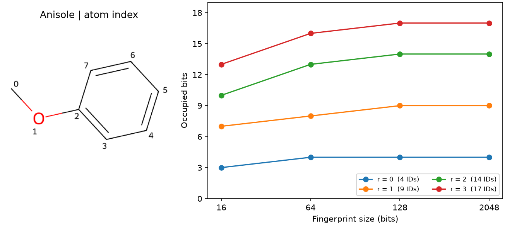

# Morgan 指紋 {#sec-morgan-fingerprints}

## 同一個苯甲醚，為什麼有時亮 10 格，有時亮 14 格？ {#開場問題}

因為指紋的格數不夠時，不同的結構特徵會擠進同一格。苯甲醚的結構沒有變，換一個設定，指紋就多亮了四格。這要分兩步來看。**Morgan 指紋**（Morgan fingerprint）從每個原子往外找：**半徑**（radius）決定沿著鍵走多遠，位元數（`fpSize`）則決定用幾格來記下找到的環境。半徑固定為二時，苯甲醚共有 14 個不同的環境編號；如果只用 16 格，有些編號會分到同一格，最後只亮 10 格。換成 128 格，這 14 個編號各自有了位置，原本擠在一起的特徵就看得見了。

## 核心概念

我們先盯著苯甲醚的醚氧看。半徑為零時，RDKit 先替這個原子本身編號，依據包括元素、接了幾個氫、形式電荷，以及它在不在環上。往外走一個鍵，兩側的鄰居就加進來了：氧的一側接甲基碳，另一側接芳香碳，這兩個原子和連接它們的鍵都會算進編號。再往外走一個鍵，還會遇到芳香碳兩旁的環碳。

這裡的「遠近」只數化學鍵，不用三維座標。把結構圖轉半圈，或繞著單鍵改變二面角，只要輸入的原子和連接方式不變，本例的指紋就不會變。

每個原子都會輪流當中心，演算法保留從半徑零到指定半徑的所有環境，並依 RDKit 的預設規則略去重複的部分。所以設定 `radius=2`，並不是只取第二圈，也不保證每個原子都會貢獻三個不同的編號。

文獻中常看到的**延伸連接指紋**（extended-connectivity fingerprint, ECFP），是用直徑來命名的。ECFP4 的「4」對應半徑二，表示環境最多從中心往兩側各延伸兩個鍵。描述 RDKit 的 Morgan 設定時，直接寫出半徑、指紋長度和是否編入手性，會比只寫 ECFP4 更容易讓別人重算。

同一種環境可以在分子裡重複出現。如果用**計數指紋**（count fingerprint），可以問這個編號出現了幾次；如果用位元指紋，就只能問對應的位置有沒有亮。指紋長度固定時，還會發生**位元碰撞**（bit collision），也就是原本不同的編號，碰巧被分到同一格。

要分清楚「重複」和「碰撞」，我們先保留還沒折疊到指定長度的原始編號，再看它們被分到哪裡。只看最後的 0 和 1，無法知道一格背後是同一種環境重複五次，還是五個不同的編號擠在一起。

## 動手做

[下載本節 notebook](../../notebooks/ch06/06-02-morgan-fingerprints.ipynb){.btn .btn-sm .btn-outline-primary}　[在 Colab 開啟](ch06/06-02-morgan-fingerprints.ipynb)

我們從 ESOL 取出苯甲醚（`COc1ccccc1`），在同一個分子上比較四種半徑和四種指紋長度。Notebook 用 `load_delaney` 讀入 1,128 筆原始結構，維持骨架切分，不做標準化，也不用溶解度。這樣每一點比較的都是同一組原子、鍵和電荷，改變的只是我們用什麼規則來描述這個分子。[@delaney2004esol]

`GetSparseCountFingerprint` 會產生稀疏計數指紋，`GetNonzeroElements()` 傳回一個字典，只記錄實際出現的編號和各自出現的次數。字典的長度是不同編號的數目，所有值相加才是環境出現的總次數。

下面節錄 notebook 的內層迴圈，`size` 依序取 16、64、128 和 2,048。程式把每個原始編號除以長度取餘數，算出它的落點，再確認這些落點和 RDKit 直接輸出的位元位置相同。這個比對適用於本例使用的標準 Morgan 位元指紋（沒有開啟計數模擬）。

```python
for size in lengths:
    folded = rdFingerprintGenerator.GetMorganGenerator(radius=radius, fpSize=size)
    on = set(folded.GetFingerprint(mol).GetOnBits())
    assert on == {key % size for key in raw}
    occupied.append(len(on))
```

迴圈每一輪換一種長度：先算出這個長度的 Morgan 指紋並取出亮起的位置，再用 `assert` 確認它和「原始編號除以長度的餘數」完全一致，最後記下亮了幾格。`{key % size for key in raw}` 的意思是：把 `raw` 裡的每個編號除以 `size` 取餘數，收集成一個集合。

{#fig-morgan-fingerprints fig-alt="左圖標出苯甲醚的八個原子，甲基碳編為 0，醚氧編為 1。右圖的四條線分別對應半徑零到三。半徑二時，從 16 位元加長到 128 位元，亮格數從 10 升到 14，之後持平。"}

先固定半徑，沿著 @fig-morgan-fingerprints 右圖的一條線讀。半徑二時，23 次環境紀錄共有 14 個不同編號。折成 16 位元時占 10 格，64 位元占 13 格，128 和 2,048 位元都占 14 格。從 128 加長到 2,048 沒有多亮一格，是因為這個分子的 14 個編號在 128 格裡已經各有位置。

不過換一批分子，就可能有更多不同的編號分到同一欄。而且就算每個分子自己都沒有碰撞，一個分子的某個編號，也可能和另一個分子的其他編號占用同一個位置。

對照左圖的原子編號，就能分清楚「重複」和「碰撞」。半徑為零時，0 號甲基碳的環境編號是 `2246728737`；3 到 7 號都是帶氫的芳香碳，環境編號都是 `3218693969`。第二個編號出現五次，這是同一種環境重複出現。再看這兩個不同的編號，除以 16 的餘數都是 1，折疊後都會點亮位置 1，這才叫碰撞。

這裡有三種編號，容易搞混：原子編號告訴我們是哪一個原子，十位數的環境編號用來辨認環境，位元編號則是結果最後記在哪一格。

現在反過來，固定指紋長度，看半徑改變時會怎樣。在 2,048 位元那一欄，半徑從零增加到三，亮格數依序是 4、9、14、17。半徑為零時，演算法還沒沿著鍵往外看，分不出五個芳香碳各自離甲氧基多遠；半徑擴大到一，就能認出緊鄰取代位置的環碳和較遠處的環碳。換句話說，改變半徑是重新決定要收集哪些環境，拉長指紋則只改變原有編號落在哪一格。想弄清楚為什麼多亮了幾格，每次只換一個設定就好。

實作時，也可以從半徑零來檢查自己的理解。苯甲醚有八個非氫原子，程式印出八筆環境紀錄、四個編號：左圖的 0 號甲基碳、1 號醚氧、2 號連氧的芳香碳各有一個編號，其餘五個帶氫的芳香碳共用第四個。所以環上雖然都是碳，光看第一輪的起始條件，就已經分得出連氧的位置和帶氫的位置。如果以為起始條件只看元素種類，就只會猜出碳、氧兩類，也解釋不了圖上的四個編號從哪裡來。

圖例括號裡的數字，是各半徑在折疊前有幾個不同的環境編號，也就是亮格數的上限。例如半徑一只有九個編號，指紋再長，最多也只能亮九格。想知道同一種環境在苯環上出現幾次，要查計數字典；多給位元只能讓原本碰撞的編號分開，沒辦法從亮格數還原每個編號出現的次數。

這裡刻意保留很短的 16 位元指紋，是為了看清碰撞的影響。如果只看較長的兩組，苯甲醚都亮 14 格，很容易以為指紋長度沒有影響；其實就算亮格數相同，亮起的欄號也可能換了。所以要替舊資料加入新分子時，要查出當初產生指紋的設定，照同樣的設定計算。直接在短指紋右邊補零是沒用的，原本擠在同一格的兩個環境還是擠在一起。

## 重點整理

- 半徑以鍵數計算，決定 Morgan 指紋收集多大範圍的原子環境，半徑二也會保留半徑零和一的環境。
- 計數指紋分得出不同的環境編號和各自出現的次數，位元指紋只記錄每個位置有沒有命中。
- 指紋長度固定時，不同編號可能落在同一欄，檢查碰撞時要先固定分子和半徑，再比較折疊前後的數量。

## 小練習

從 ESOL 取出苯酚（`c1ccccc1O`），半徑固定為二，數出折疊前有幾個不同編號、折成 16 和 64 位元時各亮幾格，並和苯甲醚比較。再想一想：要知道整個分子庫的不同編號能不能在 64 位元裡各占一格，還需要查什麼資料？

提示：保留 `raw` 的鍵，比較 `len(raw)` 和對應長度的 `len(on)`。每個分子要分開計算。

## 延伸閱讀

- [RDKit 的 Morgan 指紋範例](https://www.rdkit.org/docs/GettingStartedInPython.html#morgan-fingerprints-circular-fingerprints)，比較計數指紋與位元指紋。
- [RDKit 的指紋產生器 API](https://www.rdkit.org/docs/source/rdkit.Chem.rdFingerprintGenerator.html)，可查 Morgan 參數與記錄位元來源的 `AdditionalOutput`。
