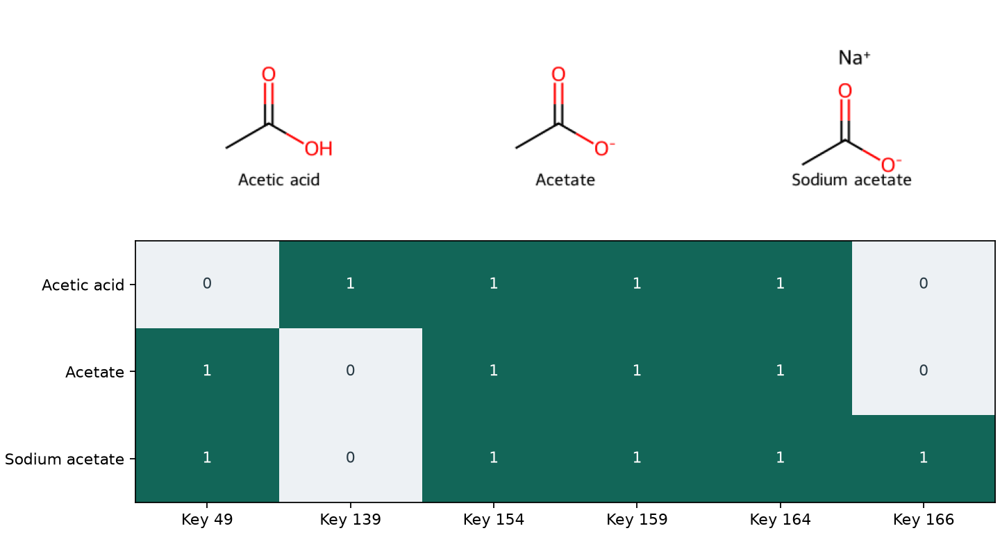

# MACCS keys {#sec-maccs-keys}

## 乙酸變成乙酸鈉，哪些指紋位元會改變？ {#開場問題}

「氧上有氫」的位元會熄掉，「原子帶電」和「有互不相連的片段」的位元會亮起。我們一步一步看：先把乙酸寫成乙酸根，羧基失去一個氫後，原本用來辨認「氧上有氫」的位元就熄了，辨認「原子帶電」的位元則亮起來。再把鈉離子寫進同一筆紀錄，RDKit 還會標出這筆結構含有互不相連的片段。這些變化之所以能逐項說明，是因為 **MACCS 結構鍵**（MACCS keys）的每個編號都對應一個事先訂好的化學條件。把乙酸、乙酸根、乙酸鈉依序排開，就能分清去質子化和加入對離子各自改了哪些位元。

## 核心概念

公開的 MACCS 結構鍵從 1 編到 166，每一欄都在回答一個是非題。例如有一欄問「分子裡有氧嗎？」，另一欄問「至少有兩個氧嗎？」乙酸兩題都答「是」；乙醇只有一個氧，只符合第一題。

因為兩個位元可能看的是同一批原子，把亮起的位元加起來，只能知道分子符合幾項條件；要知道到底有幾個氧，還是得回到結構上數。這也是它和 @sec-morgan-fingerprints 的 Morgan 指紋不同的地方：用 MACCS 時，可以先想好要問的化學問題，再去查該讀哪個編號。

RDKit 產生的向量長度是 167。為了讓 key 的編號和 Python 的索引一致，索引 0 空著不用，最後一個位置的索引是 166。所以讀 `fp[166]`，就是在問第 166 題「有沒有兩個以上互不相連的片段」。如果把指紋印成一長串 0 和 1，從左邊第一個字元開始數，很容易跟定義表錯開一格；直接用編號查，或用 `GetOnBits()` 列出值為 1 的索引，就能和定義逐一對照。另外，這套實作把定義不完整的 key 1 保留為不設定，所以不要拿它來判斷樣品有沒有標記同位素。

要讀懂一個 key，除了看它的 SMARTS 子結構查詢式，也要看它要求找到幾次。Key 164 的 `[#8]` 指原子序為 8 的氧，找到一個就符合；key 159 用同樣的查詢式，卻要找到多於一個氧（也就是至少兩個）才會亮。也有些 key 看的是整張分子圖，例如 166 只問這筆結構能不能分成幾塊互不相連的片段。片段裡有沒有鈉、帶不帶電，甚至樣品瓶上有沒有寫「鹽」，都不在它的判斷條件裡。

## 動手做

[下載本節 notebook](../../notebooks/ch06/06-03-maccs-keys.ipynb){.btn .btn-sm .btn-outline-primary}　[在 Colab 開啟](ch06/06-03-maccs-keys.ipynb)

我們保留輸入結構中的電荷和對離子。乙酸的 SMILES 寫成 `CC(=O)O`，末端單鍵氧上的氫由價數推得；改成 `CC(=O)[O-]` 就是乙酸根，再接上 `.[Na+]`，就是這裡用的乙酸鈉寫法。句點兩邊屬於同一筆輸入，但沒有任何鍵把鈉和氧連起來。下面的程式除了計算指紋，也直接從分子圖算出片段數，兩種結果可以互相對照。

```python
keys = [49, 139, 154, 159, 164, 166]
mols = [Chem.MolFromSmiles(smi) for smi in examples.values()]
fps = [MACCSkeys.GenMACCSKeys(mol) for mol in mols]
for name, mol, fp in zip(examples, mols, fps):
    print(name, fp.GetNumBits(), len(Chem.GetMolFrags(mol)), list(fp.GetOnBits()))
matrix = [[int(fp[key]) for key in keys] for fp in fps]
```

這段程式先列出要看的六個 key，再把三個 SMILES 轉成分子、算出 MACCS 指紋。迴圈逐一印出每個分子的名稱、向量長度、片段數和所有亮起的編號。最後一行做出一張小表：每個分子一列，每列依序填入那六個 key 的值（0 或 1）。

{#fig-maccs-keys fig-alt="上排依序是乙酸、乙酸根與乙酸鈉。乙酸去質子化後，key 139 熄滅，key 49 亮起。下表中只有乙酸鈉的 key 166 為一。"}

@fig-maccs-keys 的前兩列比較乙酸和乙酸根。兩者都有碳氧雙鍵，key 154 都是 1；兩者也都至少有兩個氧，所以 key 164 和 159 都亮。去質子化後，氧上少了一個氫，key 139 熄滅；結構多了形式電荷，key 49 亮起。要注意這兩個條件都沒有限定在羧基上：看到一個未知物的 49 亮起，只知道它有形式電荷，不知道是正是負，也不知道電荷在不在氧上。

比較第二和第三列，這六題中只有 key 166 改變。但如果看 notebook 列出的完整編號，乙酸鈉還多亮了 35 和 44，所以挑出來的六欄並不是全部的差異。如果直接拿第三列和第一列比，去質子化和加入鈉離子的影響就會混在一起；多留第二列，才看得出哪些變化發生在有機片段本身，哪些和加入第二個片段有關。這種一次只改一處結構的做法，也很適合用來檢查前處理程式有沒有在算指紋前，不小心把對離子刪掉。

乙酸鈉為什麼多亮了 35 和 44？依原文的定義表，35 檢查有沒有鈉、鉀等鹼金屬，44 檢查有沒有原子不在指定的常見元素清單裡，鈉剛好兩項都符合。所以加入鈉離子時，35、44 和 166 一起亮起，但前兩項辨認的是元素，最後一項辨認的是結構中有互不相連的片段。反過來說，只看到 35 是 1，也只知道有鹼金屬，不知道是哪一種。

接著換成 ESOL 的 1,128 筆結構。notebook 用 DeepChem 的 `load_delaney` 讀取 SMILES，保留原始結構，把三組骨架切分合起來計數。這一步用不到實測水溶解度，所以沒有轉換標籤，也沒有訓練模型。[@delaney2004esol]

結果有 725 筆的 key 164 亮起，458 筆的 key 159 亮起。因為「至少兩個氧」一定也符合「有氧」，第二組一定包含在第一組裡，兩者相減的 267 筆就是恰好只有一個氧的分子。但換成 key 154 和 139，就不能用相減的方式算出羧酸有幾個：一個分子可以同時有酮基和醇基，而這兩個位元並沒有要求羰基碳接的就是那個帶氫的氧。

ESOL 有 59 筆符合帶電條件，卻沒有任何一筆讓 key 166 亮起，逐筆用 `GetMolFrags` 檢查也是同樣的結果。也就是說，一個相連的分子本身就可以帶形式電荷，甚至同時帶正、負形式電荷。如果把 49 的中文欄名寫成「鹽」，讀者可能以為這 59 筆都含有對離子。所以保存指紋表時，欄名最好寫「至少一個帶形式電荷的原子」，並註明 RDKit 版本和片段的處理方式，之後回頭比對原始結構會容易得多。

把指紋交給同事做統計時，最好每一列都保留兩份 SMILES：一份是原始紀錄，一份是實際拿來計算的結構。以合併不同鹽型為例，第一步是從乙酸鈉取出有機片段，得到乙酸根；第二步才決定要不要還原成中性的乙酸。只移除鈉離子時，139 仍然是 0；把氫補回氧上，139 才會亮。表上如果只寫「已去鹽」，看不出有沒有做第二步。把計算前後的結構都留下來，就能像圖中的三列一樣，一步一步比較。

這樣回頭查，也有助於解讀模型結果。假設一個模型很依賴 key 164，我們知道它把「含氧」當成判斷依據之一，但這一欄會把醛、酮和醇全都收進來。這時可以先從資料表挑幾個符合這一欄的分子，看看氧在各個結構中的位置。相對地，ESOL 的 166 整欄都是 0，模型就算讀進這一欄，也沒辦法從這批資料學到多片段紀錄對量測值的影響。

## 重點整理

- MACCS 每一欄對應一項事先定義的條件，有些條件要求匹配次數，有些看整張分子圖的片段數。
- RDKit 空出索引 0，所以第 166 題直接讀 `fp[166]`。
- 解讀亮起的位元時，要確認各欄是否在看同一批原子，以及輸入結構有沒有保留電荷和對離子。

## 小練習

實驗紀錄把乙酸甲酯（`CC(=O)OC`）和乙酸歸為同一組，理由是兩者都有兩個氧、也都有碳氧雙鍵。請從本節的六個 key 中找出支持這個說法的欄位，再指出哪一欄會因為酯化而改變，並說明這一欄的判斷條件可以用來辨認哪些情況。

提示：先畫出酯的兩個氧和它們相鄰的原子，再對照 139、154、159 和 164 的條件。

## 延伸閱讀

RDKit 列出各個 key 的 SMARTS 與次數門檻，並註明需要特別處理的編號。若要比較不同軟體產生的結果，可以先確認各自採用的芳香性和匹配規則。[MACCS 模組說明](https://www.rdkit.org/docs/source/rdkit.Chem.MACCSkeys.html)　[RDKit 結構鍵定義](https://raw.githubusercontent.com/rdkit/rdkit/master/rdkit/Chem/MACCSkeys.py)
