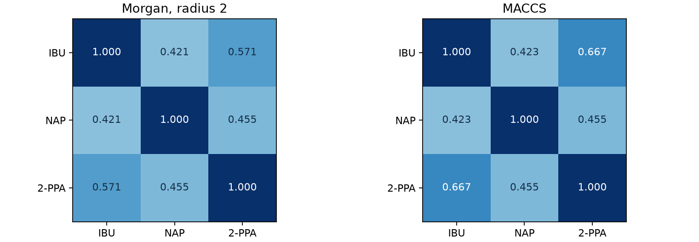

# Tanimoto 相似度 {#sec-tanimoto-similarity}

## 兩個分子的指紋有一半相同，這個「一半」要怎麼數？ {#開場問題}

用「兩邊都亮的位元數」除以「至少一邊亮的位元數」。我們把布洛芬（ibuprofen）和萘普生（naproxen）的指紋並排來看：用本節的 Morgan 設定，布洛芬亮了 25 個位元，萘普生亮了 29 個，其中有 16 個位置兩邊都亮。把所有亮過的位置只算一次，共有 38 個；兩邊共同的占了 16 個，所以 **Tanimoto 相似度**（Tanimoto similarity）是 16/38，約 0.421。要注意，這個數字算的是指紋重疊了多少，不是相同原子的比例，更不是分子有活性的機率。

## 核心概念

把分子 A、B 各自的亮位元數記為 $a$、$b$，共同亮起的數目記為 $c$。如果直接用 $a+b$ 當分母，兩邊都有的位置就多數了一次，減去 $c$ 才是聯集的大小。只要聯集不是空的，就可以用 $T_c=c/(a+b-c)$ 算出相似度。把 A 和 B 對調，交集和聯集都一樣，分數也不變。兩邊都有亮位元卻完全沒有重疊，分數是 0；亮的位置完全相同，分數就是 1。

為什麼要略過兩邊同時為零的位置？本例把 Morgan 指紋長度設成 1,024，兩個分子合起來只用了 38 個位置，剩下 986 個都是零。如果把兩邊相同的零也算成相似，會得到 $(986+16)/1024$，超過九成七。換句話說，這個數字大部分來自兩邊都沒有的特徵，說明不了兩個分子有多像。Tanimoto 的分母只算至少一邊有亮的位置，所以就算再接上一排永遠是零的欄位，原來的分數也不會變。

「亮起」代表什麼，還要看指紋是怎麼產生的。@sec-morgan-fingerprints 的 Morgan 位元記錄局部原子環境，不同的環境也可能落在同一個位元；@sec-maccs-keys 的每一欄則檢查一個預先指定的條件。兩個分子如果剛好對所有條件都給出相同答案，在 MACCS 的比較中就會得到滿分，但轉成指紋時，原子之間的連接關係或立體化學可能已經省略了一部分。所以如果目的是確認兩筆紀錄是不是同一個化學結構，還要一一比對電荷、立體標記和連接方式。

## 動手做

[下載本節 notebook](../../notebooks/ch06/06-04-tanimoto-similarity.ipynb){.btn .btn-sm .btn-outline-primary}　[在 Colab 開啟](ch06/06-04-tanimoto-similarity.ipynb)

我們輸入布洛芬和萘普生的結構，另外加上 2-苯基丙酸（2-phenylpropanoic acid），方便看芳香環上取代基的影響。三個結構都是游離酸，SMILES 沒有指定立體化學。這次 Morgan 產生器設定半徑 2、長度 1,024，關閉手性標記，每個位元只記有沒有出現。下面分別用 Python 的集合和 RDKit 的函式各算一次。先自己確認分子、分母，再看函式輸出的係數，以後遇到小數點後幾位對不上時，比較容易找出是哪一步不同。

```python
gen = rdFingerprintGenerator.GetMorganGenerator(radius=2, fpSize=1024, includeChirality=False)
fps = [gen.GetFingerprint(mol) for mol in mols]
a, b = (set(fp.GetOnBits()) for fp in fps[:2])
print(len(a), len(b), len(a & b), len(a | b))
print(DataStructs.TanimotoSimilarity(fps[0], fps[1]))
```

第一行建立 Morgan 指紋產生器，第二行替每個分子算出指紋。第三行取前兩個分子（布洛芬和萘普生），把它們亮起的位置各存成一個集合 `a` 和 `b`。第四行印出兩邊各亮幾個、交集（`a & b`）和聯集（`a | b`）各有幾個；最後一行再用 RDKit 的函式直接算出 Tanimoto 係數，兩者可以互相對照。

{#fig-tanimoto-similarity fig-alt="左、右兩張三乘三矩陣分別採用 Morgan 和 MACCS 指紋，每格標示一對分子的係數。布洛芬與 2-苯基丙酸的相似度從左圖的 0.571 升至右圖的 0.667，布洛芬與萘普生則都約為 0.42。"}

@fig-tanimoto-similarity 中，IBU、NAP、2-PPA 分別是布洛芬、萘普生和 2-苯基丙酸。從左圖第一列可以讀出，布洛芬和自己的相似度是 1，和萘普生是 0.421，和 2-苯基丙酸是 0.571。對照結構，布洛芬和 2-苯基丙酸都是一個苯環接著丙酸側鏈，只是布洛芬的環上多了異丁基；萘普生也有丙酸側鏈，接的卻是帶甲氧基的萘環。這些差別告訴我們可以去看哪些原子環境，但 16 個共有位元各是由哪些鍵觸發的，光看相似度是看不出來的。

右圖換成 MACCS，布洛芬和 2-苯基丙酸的相似度升到 0.667。2-苯基丙酸符合的 10 個條件，布洛芬全部都符合，另外還多符合 5 項，所以交集是 10、聯集是 15。即使小分子符合的條件全都出現在另一個分子上，也還不足以說明兩者的結構一樣。而且查詢分子和候選物互換，Tanimoto 分數也一樣。如果想問的是「大分子是否包含小分子的整段結構」，就要另外做子結構搜尋，確認原子之間怎麼連接。

比較兩個候選分子時，光數共有幾個特徵還不夠。萘普生和 2-苯基丙酸分別和布洛芬比較，兩對 Morgan 指紋剛好都共用 16 個位元。差別在於：萘普生有 29 個亮位元，其中 13 個布洛芬沒有；2-苯基丙酸有 19 個亮位元，只有 3 個布洛芬沒有。兩次都從布洛芬的 25 個位元算起，前者的聯集要再加 13，後者只要加 3。也就是說，左圖 0.421 和 0.571 的差距來自分母；如果只列共有位元數，這兩個候選分子會排在一起，分不出高下。

相似度矩陣也有一個簡單的自我檢查方法。每張圖雖然有九格，但對角線的三格是分子和自己比，其餘六格則是三組配對各算了兩次。從布洛芬那一列找到萘普生，再從萘普生那一列找回布洛芬，兩格應該同色、同分。如果不一樣，先檢查橫軸和縱軸的分子是不是被分開排序了。就算每個數字都算對，只要標籤放錯位置，分數就會被讀成另一對分子的結果。

接著把三個分子的小表換成真實的資料集。我們沿用作者用過的苯并噻唑（benzothiazole）當作查詢分子，從 DeepChem 的 `load_delaney` 取出 ESOL 全部 1,128 筆化合物，一一和它比較。這裡保留三組骨架切分的所有結構，只看 SMILES，不使用也不轉換水溶解度標籤。[@delaney2004esol]

兩種指紋都各找到一筆分數為 1 的紀錄。把各自的 1,128 個分數排序，Morgan 的中位數約為 0.0674，MACCS 的中位數為 0.125。從結果來看，比的明明是同一批分子，換了指紋，整個分數分布的中間位置也跟著移動了。

中位數只是把整批分數分成上下兩半，並不能告訴我們排名靠前的化合物有沒有活性。ESOL 是水溶解度資料，苯并噻唑則是我們另外選來的查詢分子。如果把這 1,128 筆換成一系列只改苯環取代位置的苯并噻唑衍生物，整批分數就可能集中在另一個區間，即使原本那些分子對之間的分數完全沒變。所以解讀中位數之前，要先知道它是哪一個查詢分子、對哪一批分子算出來的。

如果同事只傳來一句「相似度 0.42」，可以請他一起提供兩個輸入結構、電荷和片段的處理方式，以及指紋的種類和設定。就算都用 Morgan，把指紋改短，也不能只從分母扣掉幾個零了事，因為同一批原子環境會重新分配到新的位置，重疊數要重算。如果打算設一個分數門檻來找有活性的候選物，還需要知道標的和活性測定條件，才能用已經量過的化合物來評估門檻，這部分留到 @sec-virtual-screening 介紹。

## 重點整理

- 手算時先列出共同亮起和合計亮起的位元，兩邊都是零的位置不算進分母。
- Tanimoto 分數與比較的順序無關，指紋完全相同得到滿分，但仍可能是不同的化學結構。
- 要讓別人重算同一個分數，需要交代兩個輸入結構、指紋種類、長度和相關設定。

## 小練習

用 ESOL 中苯并噻唑（`c2ccc1scnc1c2`）和 2-巰基苯并噻唑（`Sc2nc1ccccc1s2`）的原始 SMILES，依本節的設定分別算出 Morgan 和 MACCS 指紋的交集、聯集與 Tanimoto 係數，並判斷哪一種指紋裡共有特徵占的比例比較高。

提示：輸入和比較函式都不變，只換產生指紋的那一行。算出交集後，和兩組中較小那一組的大小比一比。

## 延伸閱讀

RDKit 提供單對指紋與整批比較的介面，位元指紋版本列出交集、聯集的運算式。[DataStructs 文件](https://www.rdkit.org/docs/source/rdkit.DataStructs.cDataStructs.html#rdkit.DataStructs.cDataStructs.TanimotoSimilarity)　[Morgan 產生器與參數](https://www.rdkit.org/docs/source/rdkit.Chem.rdFingerprintGenerator.html#rdkit.Chem.rdFingerprintGenerator.GetMorganGenerator)
