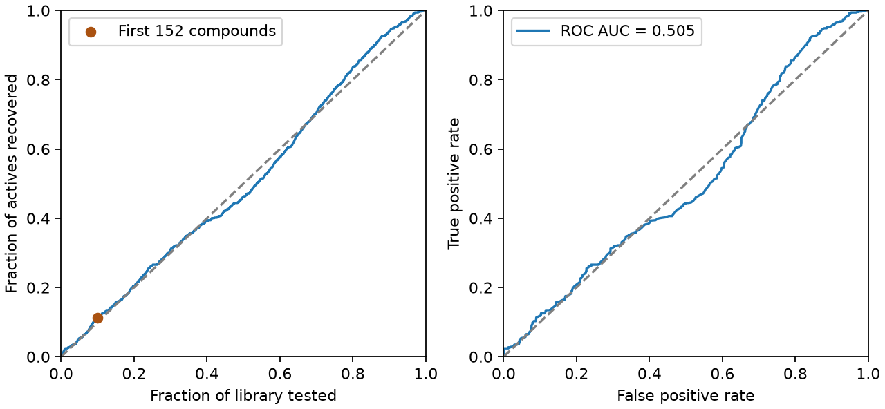

# 相似度搜尋與虛擬篩選 {#sec-virtual-screening}

## 已知一個 BACE-1 抑制劑，如果只測最像它的分子，能多找到幾個活性分子？ {#開場問題}

在本節的資料裡，只多找到幾個。BACE 資料中，如果有 152 個送測名額，隨機挑選平均約能找到 67 個達到活性門檻的分子；先挑一個已知的抑制劑，再把和它最像的 152 個分子送測，這次找回了 75 個。多出來的這幾個，就是團隊花力氣做結構排序換來的好處。換一個查詢分子、換一種指紋，或換一批庫存，命中數都要重新算。

## 核心概念

手上已經有一個已知的配體，再去其他分子裡找它的類似物，這就是**以配體為基礎的虛擬篩選**（ligand-based virtual screening）。本節把已知抑制劑當成**查詢分子**（query），拿它的 Morgan 指紋逐一和候選物比較，再按 Tanimoto 相似度由高到低排好。即使沒有標的蛋白的三維結構，也能列出這份名單。如果實驗室一次只能測十個，就先看前十名的結構。不過要記得，它們入選只是因為和查詢分子共享較多指紋特徵，能不能抑制同一種酵素，還是要看實驗。

BACE 裡的分子都已經做過實驗，所以我們可以回頭檢查排序到底有沒有幫助，這稱為**回溯評估**（retrospective evaluation）。做法是：先選定一個已知有活性的查詢分子，遮住其餘分子的活性，只看結構排出送測順序；名單固定以後，才揭開量測值。

做回溯評估時有兩點要注意。如果事先讓每個活性分子輪流當查詢分子，最後只公布命中率最高的那一次，成績就會過於樂觀。另外，名單裡還剩多少同系列的類似物也很重要：找回原系列的成員，和找到從沒見過的骨架，難度完全不同。

**富集因子**（enrichment factor，EF）比較的是兩個比例。假設資料庫有 $N$ 個候選物，其中 $A$ 個有活性，取排名前 $k$ 個送測，得到 $h$ 個活性分子，那麼 $EF=(h/k)/(A/N)$。分子 $h/k$ 是送測名單的命中率，分母 $A/N$ 則是從整個資料庫隨機挑一個的命中機會。也就是說，EF 告訴我們排序比隨機挑選好了幾倍。

如果想回答的是「所有已知的活性分子中找回了幾成」，分母就要換成 $A$，這稱為活性回收率。舉例來說，把整個庫都送測時，活性回收率會到百分之百，EF 則回到一。這兩個數字可以從同一份名單算出，但回答的是不同的實驗問題。

## 動手做

[下載本節 notebook](../../notebooks/ch06/06-05-virtual-screening.ipynb){.btn .btn-sm .btn-outline-primary}　[在 Colab 開啟](ch06/06-05-virtual-screening.ipynb)

BACE 整理了文獻中針對人類 β 分泌酶 1（BACE-1）的抑制活性量測。我們用 DeepChem 的迴歸資料載入器讀取結構和 pIC₅₀，並設定 `transformers=[]`，保留原本的數值。pIC₅₀ 是把 IC₅₀ 以 mol/L 表示、取常用對數後再加上負號；pIC₅₀ 越大，達到半數抑制所需的濃度越低。[@subramanian2016bace]

本節把 pIC₅₀ 嚴格大於 7 定為有活性，換成 IC₅₀ 就是小於 100 nM，剛好 100 nM 算未達標。如果改用 1 µM 當門檻，就要先重新標記候選物，再重算全庫的活性比例，EF 的分母才會對應新的條件。

notebook 用保留立體標記的正規 SMILES 判斷結構是否相同；如果一個結構有多筆有效量測，就先取 pIC₅₀ 的中位數。這一版資料的 1,513 筆，各自有不同的正規 SMILES。我們依原始順序，取第一個達標的分子當查詢分子，它的 pIC₅₀ 是 9.155。移除這個結構後，候選庫剩 1,512 個，其中 662 個達標。

我們刻意保留同系列的其他分子，模擬「手上有一個配體，想找它的類似物」的情境。所以這裡沒有用候選庫訓練模型，也不是在測試模型能不能找到新骨架。

指紋用的是半徑二、長度 1,024 的 Morgan 位元指紋，依預設不編入手性。`BulkTanimotoSimilarity` 會一次算出查詢分子和全庫每個候選物的相似度。我們先把 `library` 按正規 SMILES 排好，再依分數做**穩定排序**，也就是分數相同的分子維持原本的字串順序。如果最後一個名額剛好遇到同分，就由這個順序決定誰入選，但兩者的實際活性不一定相同。計算前 10% 有幾個名額時，一律把小數無條件進位。

```python
scores = np.array(DataStructs.BulkTanimotoSimilarity(fingerprint(query), fps))
order = np.argsort(-scores, kind="stable")
k = int(np.ceil(0.10 * len(library)))
hits = labels[order[:k]].sum()
ef = (hits / k) / labels.mean()
auc = roc_auc_score(labels, scores)
```

這段程式依序做了六件事：算出查詢分子和每個候選物的相似度；由高到低排出名次（`-scores` 加負號是為了讓分數高的排前面）；算出前 10% 是幾個名額；數這些名額裡有幾個活性分子；用「名單命中率 ÷ 全庫活性比例」算出 EF；最後算出 ROC AUC。

{#fig-bace-screen fig-alt="左圖標出送測前 152 個候選物的結果，662 個活性分子中找回了 75 個。右圖的 ROC 曲線有些區段在對角線上方，有些在下方，AUC 為 0.505。"}

@fig-bace-screen 左圖從左下角的零出發，沿著藍線往右，橫軸代表已經測了整個資料庫的幾成，每找到一個活性分子，曲線就往上一步。前 152 個分子中有 75 個達標，命中率是 $75/152=49.3\%$；全庫的命中率是 $662/1512=43.8\%$，兩個命中率相除，EF 約為 1.13。

橘點的高度則是用全部活性分子當分母，得到 $75/662=11.3\%$。從結果來看，測了大約十分之一的候選物，找回的活性分子只比隨機挑選多一點。如果只看前三名，三個全都達標，就很容易高估後面名單的命中率。

右圖是**受試者工作特徵曲線**（ROC），它換了一種橫軸。逐步放寬相似度門檻時，縱軸仍然是所有活性分子中有幾成入選，橫軸則是所有未達標的分子中有幾成入選。**曲線下面積**（ROC AUC）可以這樣理解：隨機各抽一個有活性和一個未達標的分子，有活性的那個排在前面的機率有多大？（同分時算半次。）

這次 AUC 是 0.505，和隨機排序的 0.5 差不多。如果關心的是整份名單的活性排序，可以看這個數字；如果只有 152 個送測名額，就要看左圖在那個位置比隨機多找回多少活性分子。

如果要拿這份結果規劃另一批實驗，還有一個分母要注意。BACE 庫裡將近四成四的分子已經達到本節的門檻，所以就算 152 個名額全部命中，EF 最多也只有 $1/(662/1512)$，約 2.28。換成活性分子很少的庫，EF 的上限會變大，但同樣的 EF 可能只代表多找到少數幾個活性分子。所以比較不同資料庫時，要保留各自的候選數、活性數和送測名額，才換算得出這個倍數對應多少樣品。實際篩選時，候選物多半還沒做過實驗，整個庫的活性比例往往也還不知道，這個分母就無法直接算出來。

把前三名的結構和查詢分子並排，可以看到相同的胺基稠合芳環和醯胺；順著醯胺氮往另一側看，環的種類和連接方式才開始不同，原始 SMILES 註明的立體資訊也不完全一樣。這些分子在指紋上很接近，效力卻不一定隨相似度增加：第一名的相似度為 0.658，pIC₅₀ 為 8.000；第二名的相似度較低（0.630），pIC₅₀ 反而較高（8.602）。光憑名次，還判斷不出是哪個取代基提高了活性。如果下一輪想測幾個不同的系列，可以用 @sec-butina-clustering 的方法分群，看看前段名單是不是幾乎都來自同一群。

## 重點整理

- 排名時只看結構，名單確定後才揭開候選物的實驗結果來算命中率。
- EF 以全庫的活性比例為基準，報告時要同時寫出送測名額和命中數，才換算得出實際多找到幾個。
- ROC AUC 評估的是整份排序，如果只做得起前段的實驗，要另外看那一段找回了幾個活性分子。

## 小練習

假設第一輪只有十個送測名額，算出依序送測會找到幾個 pIC₅₀ 大於 7 的分子；再從名單第一名往下找，記下第一個未達標分子的名次、相似度和 pIC₅₀，和查詢分子比較後，說明這個相似度分數能告訴你什麼。

提示：用 `labels[order[:10]]` 讀第一輪的標籤，從 `order` 開頭找第一筆標籤為假的紀錄，再查它的 `potency`。

## 延伸閱讀

Subramanian 等人說明 BACE-1 配體的資料來源與建模目的。DeepChem 文件列出兩種 BACE 任務與載入選項。[原始研究](https://doi.org/10.1021/acs.jcim.6b00290) · [MoleculeNet 官方文件](https://deepchem.readthedocs.io/en/latest/api_reference/moleculenet.html)

scikit-learn 的二元分類範例以連續分數計算面積，適合對照本節以相似度作為排序分數的用法。[ROC AUC 官方文件](https://scikit-learn.org/stable/modules/generated/sklearn.metrics.roc_auc_score.html)
