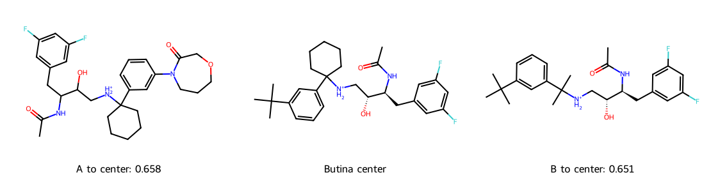

# 依相似度分群（Butina） {#sec-butina-clustering}

## 一份候選清單裡有許多近親，要怎麼挑出代表不同結構的分子？ {#開場問題}

可以先把結構相近的分子分成一群，再從每群挑一個代表。**Butina 分群**（Butina clustering）先數出每個分子有幾個「鄰居」，也就是相似度超過門檻的分子；從鄰居最多的分子開始，把它當作中心，和門檻內還沒分群的鄰居圈在一起。對剩下的分子重複這個步驟，每一群就都有一個真實存在的分子當代表。以 BACE 的 1,513 個結構為例，如果要求每個成員和中心的 Tanimoto 相似度至少 0.65，最後會得到 321 群。這 321 個中心都查得到原始結構，接下來還可以依活性或庫存決定要送測哪些。

## 核心概念

在 @sec-virtual-screening 裡，我們從一個已知配體出發，找和它最像的候選物。現在換一個問題：還沒有指定配體時，怎麼從整個庫裡挑出幾個代表？想像把每個分子畫成一個點，兩個分子夠像就連一條線。周圍連線多的點，只要挑中一次，就能代表許多近親。Butina 的方法就是根據這些指紋上的鄰居關係來分群。本節用 RDKit 的實作，每分好一群，就重新計算其他分子還剩幾個沒被分走的鄰居。[@butina1999clustering]

分群時，中心和它直接連到的鄰居會一起被圈走，已經圈走的分子不再參加下一輪。假設 A 和 B 夠像、B 和 C 也夠像，但 A 和 C 不夠像，會發生什麼事？如果 B 先當中心，三個都會入群；如果 A 先當中心，C 和 A 不夠近，就會留在外面，演算法不會再沿著 B 的連線把 C 收進來。

換句話說，「同一群」保證的是每個成員都離自己的中心夠近。所以用它來挑試劑時，同一群的兩個分子，仍然可能在不同的位置各有明顯的結構差異。

這裡的群中心就是資料表中的某個分子，有自己的 SMILES，也找得到對應的樣品。哪個分子先當中心，取決於那一輪它還剩幾個鄰居；如果鄰居數相同，輸入順序和程式處理同分的規則都可能影響結果。一個分子最後**單獨成群**（singleton），也有兩種可能：一是它本來就沒有相似的分子，二是它原本有鄰居，但那些鄰居先被其他中心挑走了。想從單成員群裡找新的系列時，這兩種情況要分開看。

## 動手做

[下載本節 notebook](../../notebooks/ch06/06-06-butina-clustering.ipynb){.btn .btn-sm .btn-outline-primary}　[在 Colab 開啟](ch06/06-06-butina-clustering.ipynb)

我們從 DeepChem 讀入 BACE 的全部結構，先依正規 SMILES 去除重複紀錄，再按字串排序，讓每個分子的索引固定下來。接著用半徑二、長度 1,024 的 Morgan 位元指紋計算 Tanimoto 相似度，整個過程都用不到抑制活性。正規 SMILES 保留了原有的立體標記，但指紋依預設不編入手性，所以兩個只差在立體排列的異構物，可能各有一筆紀錄，指紋卻分不出來。如果挑代表物是為了比較特定的立體異構物，要再回頭確認原始結構。

`Butina.ClusterData` 需要的是距離門檻，所以本節用 $d=1-T_c$ 把相似度換成距離：相似度至少 0.65，就是距離至多 0.35。距離矩陣中，A 到 B 和 B 到 A 的距離相同，對角線也都是零，所以只需要存對角線下方的值。

存放的順序很重要：固定第 $i$ 個分子後，依序算它到第零個、第一個，一直到第 $i-1$ 個分子的距離，整列接在前一列後面。如果改成一欄一欄串接，就算元素總數剛好一樣，RDKit 也會把距離配給錯的分子對。

```python
distances = []
for i, fp in enumerate(fps):
    similarities = DataStructs.BulkTanimotoSimilarity(fp, fps[:i])
    distances.extend(1 - s for s in similarities)

def group(cutoff):
    return Butina.ClusterData(distances, len(fps), distThresh=cutoff,
                              isDistData=True, reordering=True)
```

迴圈每一輪拿第 `i` 個分子，和排在它前面的所有分子（`fps[:i]`）算相似度，再把每個相似度換成距離（`1 - s`），接到 `distances` 這串數字的後面。`group` 函式則把這串距離和分子數交給 RDKit，依指定的距離門檻分群。

這 1,513 個分子共有 $1513\times1512/2=1{,}143{,}828$ 個不重複的分子對，比上一節拿一個配體搜尋 1,512 個候選物更耗記憶體。如果化合物數增加十倍，兩兩比較的次數會增加到大約一百倍。`isDistData=True` 告訴 RDKit 這串數字已經是距離。指紋固定以後，改距離門檻時可以沿用同一串距離，只要重新分群就好。

RDKit 傳回的每一群都是一串索引，第一個是中心，後面是成員。只要保留當初用的 SMILES 順序，就能從每個索引畫回結構。

| 允許的最大距離 | 對中心的最低相似度 | 群數 | 單成員群數 | 最大群的分子數 |
|---:|---:|---:|---:|---:|
| 0.25 | 0.75 | 618 | 388 | 59 |
| 0.35 | 0.65 | 321 | 161 | 103 |
| 0.45 | 0.55 | 189 | 79 | 134 |

三種門檻用的都是同一批分子。假設每群只測中心，相似度門檻從 0.75 放寬到 0.65，所需的名額就從 618 個減到 321 個，其中 161 個中心本身就是一整群。如果只能做兩百個實驗，把門檻放寬到 0.55，就能讓 189 群各有一個代表，但每個中心要代表的結構差異也可能更大。

另外要注意，換門檻時，每個分子的鄰居數會變，誰先當中心也可能跟著變。所以這三列不是一棵階層樹，不能把它們想成是把原本的群一層一層合併起來。

{#fig-bace-butina fig-alt="群中心在中間。左側成員 A 的芳環取代部分與中心不同，右側成員 B 則在帶正電的氮旁出現差異。兩者與中心的相似度都約為 0.65。"}

@fig-bace-butina 畫的是最大群裡的三個分子。這一群共有 103 個成員，中間是中心，左右的 A 和 B 則是非中心成員中彼此最不像的一對。先找三者共有的結構：帶兩個氟的苯環、帶羥基的碳鏈，以及帶正電的胺。

差異出現在不同的部位。中心另一端的芳環帶有三級丁基，A 在相應的位置換成了含氧、氮和羰基的環；B 保留了三級丁基，改的是帶正電的氮旁邊：中心的環己烷，在 B 上換成一個連著兩個甲基的碳。A 和 B 各自在不同的地方像中心，所以直接比較兩者，差異就更明顯了。

用相同的指紋和距離定義計算，A、B 對中心的相似度分別是 0.658 和 0.651，都達到 0.65；但兩者彼此相比，相似度只有 0.432。如果只想取一個群代表，可以先選中心；如果想研究取代基對活性的影響，則可以留下 A 和 B，再設計能逐項比較的衍生物。

直接比較 A 和 B 時，還要留意立體化學：A 的碳鏈不像 B 標得那麼完整。圖上少了實楔鍵或虛楔鍵，只表示紀錄沒有註明那裡的立體方向，看不出它是另一種組態，也不能斷定樣品是消旋混合物。要解釋兩者的活性差異，得先回頭查實驗紀錄，確認樣品是什麼。另外，就算測過中心，也還不知道另外兩種取代是否保有相同的效力。

## 重點整理

- Butina 挑鄰居最多的分子當中心，每個中心都是清單裡查得到的真實分子。
- 用預先算好的距離時，門檻要換成 $1-T_c$ 的尺度，並照下三角的順序存放距離。
- 同一群的成員離中心都在門檻內，但兩個非中心成員之間仍可能差很多。

## 小練習

把距離門檻固定為 0.35，依 RDKit 回傳的順序逐一檢查單成員群，找出第一個在全庫中仍有鄰居（相似度達 0.65）的分子，並用相似度說明它為什麼明明有鄰居，最後卻單獨成群。

提示：先用每一群的第一個索引，建立「成員對應到哪個中心」的對照表。在全庫中找它最像的鄰居時要排除自己，若最高分相同，取排序後索引最小的那個；再查這個鄰居屬於哪一群、中心是誰，比較兩個相似度。

## 延伸閱讀

Butina 的原始論文討論如何依分子指紋挑中心、快速劃分化合物集。[Butina 原始論文](https://doi.org/10.1021/ci9803381)

RDKit 文件列出距離陣列的格式、中心在回傳值中的位置，以及是否更新剩餘鄰居數的參數。[ClusterData 官方文件](https://www.rdkit.org/docs/source/rdkit.ML.Cluster.Butina.html)
