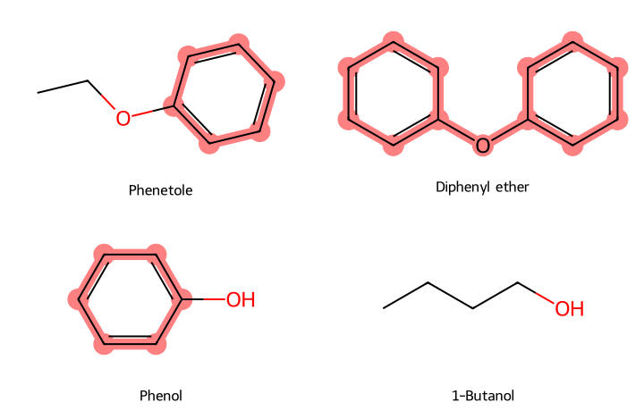

# 分子骨架（Murcko scaffold） {#sec-murcko-scaffolds}

## 苯乙醚和二苯醚都有醚氧，為什麼只有二苯醚的骨架會留下氧？

因為二苯醚的氧夾在兩個環中間，苯乙醚的氧卻在側鏈上。苯乙醚的氧一端接苯環，另一端接乙基；取**分子骨架**（Murcko scaffold）時，整個乙氧基會一起去掉，只留下苯環。二苯醚的氧連著兩個苯環，拿掉它分子就會斷成兩半，所以骨架會保留這個氧。判斷時，先在結構式上圈出環，再沿著鍵找環與環之間的路徑，就知道每個氧落在哪裡。

## 核心概念

Bemis 和 Murcko 整理藥物結構時，把環和連接環的部分合稱為**分子框架**（molecular framework），用來比較側鏈不同的分子。舉例來說，把苯酚的羥基換成乙氧基就成了苯乙醚，兩者共用同一個苯環骨架。換句話說，骨架只記得「有一個苯環」，取代基接在哪個碳、分子能不能靠羥基形成氫鍵，這些資訊都被抹掉了。所以想比較同一骨架換上不同側鏈後的性質，資料表要同時保留完整結構和骨架。[@bemis1996frameworks]

兩個環之間的連接部分稱為**連接基**（linker）。二苯醚以氧相連，二苯甲烷以亞甲基（−CH₂−）相連，聯苯的兩個苯環則直接以單鍵相接。這三種分子都有兩個苯環，RDKit 卻會算出三個不同的骨架，因為它會記下骨架上的元素種類和鍵結方式。同樣的道理，吡啶環上有一個氮，雖然環的大小和苯一樣，骨架也和苯不同。本節保留這些差異，但計算時不考慮骨架的立體化學。

如果用鉛筆遮住側鏈，再和程式的結果比較，有時會發現骨架上多留了一個原子。這是因為 RDKit 會保留以雙鍵直接接在骨架上的末端原子。所以遇到羰基時，要先看羰基碳是在環上、在兩個環之間，還是在環外的側鏈上。[RDKit 對末端雙鍵的處理](https://greglandrum.github.io/rdkit-blog/posts/2024-05-31-scaffold-splits-and-murcko-scaffolds1.html)

另一個極端是完全沒有環的分子，例如 1-丁醇，程式會傳回空字串。這時原本的碳鏈還在完整結構欄裡，分析骨架時把這筆歸為「無環」就好。

## 動手做

[下載本節 notebook](../../notebooks/ch07/07-01-murcko-scaffolds.ipynb){.btn .btn-sm .btn-outline-primary}　[在 Colab 開啟](ch07/07-01-murcko-scaffolds.ipynb)

我們想知道 ESOL 這批水溶解度資料涵蓋了哪些環骨架。ESOL 收錄 1,128 筆紀錄，我們用 DeepChem 的 `load_delaney` 載入整份資料，保留原本的實測 log S，也就是以 mol/L 表示水溶解度後取常用對數的值。接著用 RDKit 把每個分子寫成正規 SMILES（保留立體標記），同一個正規 SMILES 只算一次，有多筆 log S 時取中位數。整理完留下 1,117 個不同的結構。[@delaney2004esol]

接下來替表格加一欄骨架。下面的程式把每個分子交給 RDKit，取回它的骨架 SMILES，再數一數每種骨架出現幾次。同一個字串出現幾次，就有幾個結構屬於這一組；分組只看結構，和溶解度無關。

```python
table["scaffold"] = [
    MurckoScaffold.MurckoScaffoldSmiles(mol=mol, includeChirality=False)
    for mol in table["mol"]
]
counts = table["scaffold"].value_counts()
```

{#fig-murcko-ethers fig-alt="苯乙醚和苯酚只在苯環上有底色。二苯醚的兩個苯環與中間的氧都有底色，1-丁醇全分子無底色。"}

先看 @fig-murcko-ethers 上排的醚鍵。左邊苯乙醚的底色到苯環就停了，右邊二苯醚的底色則穿過醚氧，一直延伸到第二個環。下排左邊的苯酚去掉羥基之後，也得到 `c1ccccc1`，所以在骨架欄搜尋這個字串，會把苯酚和苯乙醚一起找出來。

這兩個分子的溶解度其實差很多。實測 log S 分別為 0.00 和 −2.33，換回 mol/L，苯酚的水溶解度約為苯乙醚的 214 倍。也就是說，如果只拿骨架欄當輸入，這兩筆資料看起來一模一樣，取代基造成的差別完全消失了。

骨架分組也很適合用來找對照組。舉例來說，ESOL 裡有鄰氯苯酚和對氯苯酚，兩者都是苯環上接一個氯和一個羥基；鄰位的氯和羥基接在相鄰的碳上，對位則隔著苯環相對。它們會落在同一個苯環組，方便我們從清單裡把它們找出來。但要分辨哪一瓶是鄰位、哪一瓶是對位，就得回頭看完整分子，因為骨架已經把取代位置抹掉了。

圖中右下角的 1-丁醇沒有底色。全表共有 316 個這樣的無環結構，所以直接印出 `value_counts()` 時，第一列的名稱會是一片空白，旁邊卻是最大的計數。這 316 個結構可能是醇、醚或其他官能基，碳鏈長度也各不相同。寫報告時，最好分開寫成「268 種含環骨架，另有 316 個無環結構」，讀者才分得出哪個是骨架的種類數、哪個是分子的個數。如果研究對象剛好是一系列直鏈醇，改依碳鏈長度和羥基位置整理，會比讓它們擠在同一個空字串底下好比較。

再看有環的分子。全表最常見的是苯環骨架，共 253 個結構，其次是聯苯的 39 個和萘的 21 個。聯苯用一條單鍵把兩個環連起來，萘則是兩個環共用一條邊。從這兩組各挑一個分子，可以比較不同的環系；想研究同一個芳香環上取代位置的影響，就在同一組裡挑，再確認兩個完整分子只差在取代位置。

那麼「哪些分子含有苯環」呢？拿苯當查詢結構，對每個分子呼叫 `mol.HasSubstructMatch(benzene)`，會找出 560 個結構。二苯醚、聯苯和萘都找得到吻合的六個碳，所以也在名單裡；改用「完整骨架等於苯」當條件，就只剩剛才的 253 個。兩個數字來自同一批 1,117 個結構，多出來的 307 個都含有苯環，只是骨架上還有別的部分。

從結果來看，兩種搜尋回答的是不同問題。條件是「至少要有這一段」時，用子結構搜尋；想依整個環系和環之間的連接方式整理化合物，就比較骨架欄。

實際挑分子時，可以先用骨架縮小名單，再看完整結構挑對照。假設要替二苯醚找一批衍生物，條件只寫「含苯環」的話，連苯酚也會入選。改成要求骨架等於二苯醚的骨架，就能保留兩個苯環中間的氧，再從符合的分子裡看環上接了哪些取代基。反過來，如果問題是「兩個苯環之間換一種連接基，性質會怎麼變」，這個條件就太嚴了，一開始就把二苯甲烷排除掉。同樣從二苯醚出發，實驗想改哪一部分，決定了該留下哪些分子。

## 重點整理

- 判讀 Murcko 骨架時，先圈出環，再找環之間的連接基；同樣是醚氧，可能在側鏈上，也可能是連接基。
- 無環分子的骨架是空字串，統計骨架種類時要把無環分子另外列出。
- 子結構搜尋找的是「含有這一段」的分子，骨架分組要求的是「整個骨架相同」。

## 小練習

ESOL 中有苯乙酮（`CC(=O)c1ccccc1`）、環己酮（`O=C1CCCCC1`）和二苯甲酮（`O=C(c1ccccc1)c1ccccc1`）。請寫出三者的 Murcko 骨架 SMILES，並從羰基碳的位置說明哪些分子的羰基氧會留在骨架上。

提示：先在紙上圈出環和連接基、標出羰基碳，寫下你的預測，再回到 notebook 用完整 SMILES 查表，看看骨架欄是否和你想的一樣。

## 延伸閱讀

- Bemis 與 Murcko 依分子框架整理藥物結構的原始研究。[The Properties of Known Drugs. 1. Molecular Frameworks](https://doi.org/10.1021/jm9602928)
- RDKit 的骨架函式說明，可對照回傳分子物件與回傳 SMILES 的兩種用法。[MurckoScaffold 官方文件](https://www.rdkit.org/docs/source/rdkit.Chem.Scaffolds.MurckoScaffold.html)
- 若要用骨架劃分訓練集與測試集，見 @sec-random-and-scaffold-splits。
