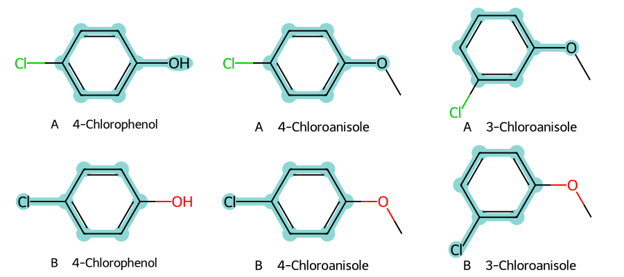

# 最大共同子結構（MCS） {#sec-maximum-common-substructure}

## 對氯苯酚和對氯苯甲醚，除了苯環還有哪些部分可以疊在一起？

除了苯環，氧和氯也都疊得上。把兩個苯環疊起來，讓連著氧的碳對齊，對位的氯也會跟著重疊，所以六個環碳、一個氧和一個氯都能在兩張結構式上找到相同的位置。

如果再加入第三個分子間氯苯甲醚，情況就不同了：讓氧對齊，氯就錯開。保留整個苯環時，我們可以讓三個氧疊在一起，也可以讓三個氯疊在一起，兩種畫法一樣大。這樣的片段稱為**最大共同子結構**（maximum common substructure，MCS），也就是依指定的比對規則，在每個分子裡都找得到的最大片段。

## 核心概念

片段的大小怎麼算？先把結構式看成一張圖，原子是點，化學鍵是連接點的線。本節從每個分子挑出一塊相連的結構，要求對應的原子是同一元素、鍵的類型也相同，再從符合條件的片段裡找鍵數最多的那一個。圖裡只畫重原子，氧上的氫不另外占一個點。

以對氯苯酚和對氯苯甲醚為例，六個環上的鍵，加上環外的 C–O 和 C–Cl，一共八個鍵。苯甲醚的氧上還接了一個甲基，這個碳在對氯苯酚裡找不到對應，片段就只能長到這裡。

@sec-murcko-scaffolds 的 Murcko 骨架只看單一分子，這兩個分子去掉環外取代基後都只剩苯環。MCS 則一定要先指定「和誰比」，只要取代基的元素和位置都對得上，搜尋就會把它們一起留下。舉例來說，如果想觀察酚羥基上的氫換成甲基後性質怎麼變，光知道兩者都有苯環還不夠，還要確認氯在同一個位置，才不會讓氯的位置也變成另一個變因。

環可以拆開來比嗎？兩個大小不同的環，沿著環走一段，還是可能找到元素和鍵型都相同的一串原子。但如果把這一段畫成兩者共用的環系，想比較完整芳香環的人很容易誤會。所以本節只讓環上的鍵對到環上的鍵，而且一個環要納入就得整個納入。這樣的結果適合回答「同一個苯環上還有哪些位置可以對齊」；如果想研究開環反應前後保留了哪些鍵，就要換一組規則。

## 動手做

[下載本節 notebook](../../notebooks/ch07/07-02-maximum-common-substructure.ipynb){.btn .btn-sm .btn-outline-primary}　[在 Colab 開啟](ch07/07-02-maximum-common-substructure.ipynb)

我們從 ESOL 的結構欄取出對氯苯酚、對氯苯甲醚和間氯苯甲醚，先比較前兩個，再用同樣的設定比較全部三個。這裡只用到結構，所以不需要切分訓練集，溶解度也不會用到。動手前，可以先在紙上畫出這三個分子，把氧都朝右，再把氯放在對位或間位，之後對照甲氧基的位置時，就不用在腦中轉苯環。[@delaney2004esol]

下面這段程式設定比對規則：以鍵數決定大小、每個分子都要含有該片段、最多搜尋十秒、保留所有並列的最大解，並要求元素相同、鍵型相同、環只對環且環要完整。

```python
p = rdFMCS.MCSParameters()
p.MaximizeBonds = True
p.Threshold = 1.0
p.Timeout = 10
p.StoreAll = True
p.AtomTyper = rdFMCS.AtomCompare.CompareElements
p.BondTyper = rdFMCS.BondCompare.CompareOrderExact
p.BondCompareParameters.RingMatchesRingOnly = True
p.BondCompareParameters.CompleteRingsOnly = True
```

接著把設定和分子清單交給 `rdFMCS.FindMCS(group, p)`。`Threshold = 1.0` 表示清單裡每個分子都得含有該片段；`StoreAll = True` 要求保留所有並列的最大解，可以從 `result.degenerateSmartsQueryMolDict` 取出各自的查詢結構。如果 `result.canceled` 是真，代表搜尋在十秒內沒跑完就停了，找到的片段可能還能再長大，這時要延長時限重跑，或在紀錄中註明它還不確定是最大。本例兩次搜尋都在時限內完成。

只比較兩個對位分子時，搜尋得到八個重原子、八個鍵；放進間氯苯甲醚後，最大值降為七個重原子、七個鍵。為什麼只差一個位置就少一個鍵？從連著氧的碳出發，沿苯環走最短路徑，到對位帶氯的碳要走三個鍵，到間位卻只要兩個。不管怎麼旋轉或翻轉苯環，這兩種距離都沒辦法同時對上。所以三者共有的苯環只能再帶一個取代基，氧和氯只能二選一。

{#fig-chloro-mcs fig-alt="由左至右是對氯苯酚、對氯苯甲醚及間氯苯甲醚。上排青色標記覆蓋三個苯環與右側的氧；下排覆蓋三個苯環與氯，最右分子的氯在間位。"}

@fig-chloro-mcs 的上排很容易讓人以為三個分子都有酚羥基。仔細看，只有左邊的氧旁寫著 H，中間和右邊的氧各有一條線伸向甲基。上排真正對到的是苯環、氧，以及環碳連到氧的那條鍵；因為我們沒有要求氧上的氫數相同，酚氧和醚氧才能配成一對。如果要挑能用羥基提供氫鍵的化合物，還是得回到原分子看氧上有沒有氫。反過來，如果關心的是氯接在哪個環碳上，下排比較容易看出三者的差異。

搜尋回傳的每個片段都能寫成 SMARTS，也就是用來描述「要找哪些原子和鍵」的查詢式。畫圖時，程式拿這個查詢式到各分子裡找對應的原子，再把片段包含的鍵上色。

這裡有兩種看起來很像的情況要分開。上、下兩排對到的元素不同，是兩個真正不同的最大解。另一方面，同一個帶氧苯環可以從氧旁的碳順時針編號，也可以逆時針編號；編號順序不同，上色的仍是同一群原子。所以討論環上哪個位置發生取代時，要連同沒上色的部分一起看。如果只抄下第一組配對的原子編號，很容易把畫圖時隨意選的方向誤當成有化學意義的差別。

## 重點整理

- MCS 會隨比較的分子和比對規則改變，本例的結果來自「完整環、相同元素和鍵型、以鍵數決定大小」這組規則。
- 加入間位異構物後，「苯環連氧」和「苯環連氯」並列最大，只畫一個解會漏掉另一種對照方式。
- 讀共同片段時要回到原結構看沒納入的原子，例如酚和醚對到同一個氧，但只有酚的氧上有氫。

## 小練習

拿掉對氯苯酚，只比較對氯苯甲醚和間氯苯甲醚，新的 MCS 保留了哪些原子和鍵？請根據最大解的大小，以及氯和氧的相對位置，說明這一對分子適合用來研究什麼。

提示：把 notebook 裡傳給 `common` 的分子改成 `mols[1:]`，其他設定不變。看沒上色的原子時，要分清楚「兩個分子都有這個元素」和「這個原子在共同片段裡的連接位置相同」是兩回事。

## 延伸閱讀

[RDKit 的最大共同子結構教學](https://www.rdkit.org/docs/GettingStartedInPython.html#maximum-common-substructure) · [rdFMCS 的搜尋參數與回傳值](https://www.rdkit.org/docs/source/rdkit.Chem.rdFMCS.html) · [ESOL 原始研究](https://doi.org/10.1021/ci034243x)
