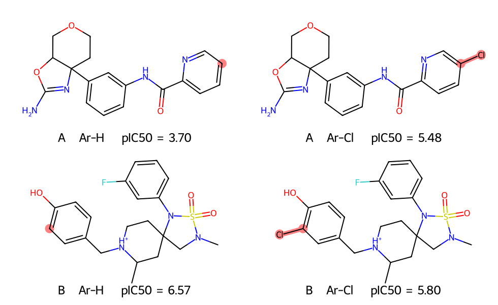

# 配對分子分析（MMP）與活性懸崖 {#sec-matched-molecular-pairs}

## 在芳香環上把一個氫換成氯，抑制 BACE-1 需要的濃度會降低嗎？ {#開場問題}

要看換在哪個位置。BACE 資料裡有一對抑制劑只在吡啶環上差一個氯，含氯分子達到一半抑制效果所需的濃度約為原來的六十分之一；另一對在酚羥基旁邊加上氯，所需的濃度反而提高到約六倍。像這樣只在一處替換原子或側鏈、其餘結構都相同的兩個分子，稱為**配對分子**（matched molecular pair，MMP）。我們可以從結構式指出兩者差在哪裡，再查實測值，看這一處改變伴隨多大的活性差異。[@hussain2010mmp; @subramanian2016bace]

## 核心概念

怎麼確定兩個分子只差這一處？以第一對為例，把含氯分子的氯拿掉、在原位補回氫，得到的整個分子要和另一筆資料完全相同。只看兩者都有吡啶環還不夠，連著環的醯胺、另一側的環系統也要一一對上。如果一個分子把氫換成氯，同時又在另一個環上多接了一個甲基，就算兩者的指紋很像，這一對數字也分不出哪些差異來自氯。

把同一種替換放到好幾對分子裡比較，藥物化學家就能接著問：換到別的位置或骨架，原來的趨勢還在嗎？這種比較稱為**配對分子分析**（matched molecular pair analysis，MMPA）。

要比較哪個分子抑制效果較強，先看資料表記的是什麼。BACE 的迴歸資料記的是 pIC₅₀，也就是把半數抑制濃度（IC₅₀）以 mol/L 表示，再取常用對數的負值，所以數值越高，需要的濃度越低。

本節一律用「含氯分子的 pIC₅₀ 減去原位置為氫的分子的 pIC₅₀」計算差值。差值為 +1 時，含氯分子只需要原來十分之一的濃度；差值為 −1 時，則需要十倍的濃度。方向一定要固定：如果有時從氫算到氯、有時反過來，兩個本來都代表活性變好的結果，會一正一負，平均時就互相抵銷了。

有些配對在結構上只差一小步，活性卻差了一大截，這稱為**活性懸崖**（activity cliff）。要從資料裡找出它們，得先訂好結構和活性兩個條件。本節把結構限在芳香碳上的 H → Cl，活性門檻則是 IC₅₀ 相差至少十倍（即 $|\Delta\mathrm{pIC}_{50}|\geq 1$）。活性落差小的兩個分子，一樣可以是 MMP。

到了 @sec-activity-cliffs，我們會換個角度：用指紋替每個測試分子找最像的訓練分子，看模型在兩者活性差很多時是否容易出錯。那種搜尋能涵蓋好幾處結構同時改變的分子，但也因此說不出該改哪個取代基。[@maggiora2006cliffs]

## 動手做

[下載本節 notebook](../../notebooks/ch07/07-03-matched-molecular-pairs.ipynb){.btn .btn-sm .btn-outline-primary}　[在 Colab 開啟](ch07/07-03-matched-molecular-pairs.ipynb)

我們用 DeepChem 的 `load_bace_regression()` 讀取 BACE-1 抑制劑的結構和量測值。這次只比較已經量過的分子，所以把 1,513 個結構放在同一張表，也關掉數值的標準化，讓兩筆數字能直接在原本的 pIC₅₀ 尺度上相減。我們以 RDKit 產生的正規 SMILES 當作每個分子的索引，再從含氯的結構找回對應的母體。這裡的「母體」指同一位置為氫的分子，和實際合成的先後無關。原資料有立體標記的就保留，沒有指定的也維持原樣。

找母體的步驟是這樣的：程式從每個氯原子往回看一個鍵，確認它只連著一個原子，而且那是芳香碳，才複製分子並拿掉這個氯。RDKit 重新檢查價數後，原本接氯的碳會自動補上一個氫。接著用產物的正規 SMILES 查表，只有結構完全吻合的那一筆才算數，同分子式的其他異構物不會被誤收。如果母體不在表裡，就少了一端的實測值，這一對無法計算。對稱位置得到同一對結構時，只算一次。

找到配對後，下面兩行計算活性差和濃度倍數。

```python
pairs["delta"] = pairs["pIC50_Cl"] - pairs["pIC50_H"]
pairs["ratio"] = 10 ** pairs["delta"]  # IC50_H / IC50_Cl
```

{#fig-bace-h-cl fig-alt="兩排各有左右兩張對齊的結構式，以紅色圈出取代位置。上排吡啶環加氯，pIC₅₀ 由 3.70 升至 5.48。下排酚環在羥基鄰位加氯，pIC₅₀ 由 6.57 降至 5.80。"}

@fig-bace-h-cl 的上排是 24 對當中 pIC₅₀ 上升最多的一對。先看左圖右端的六員環，藍色的 N 是吡啶環上的氮；沿著環找到紅點，那個碳原本接一個氫，右圖改接氯。用未四捨五入的數值相減，差值為 +1.783。換回濃度，兩個分子的 IC₅₀ 分別約為 200 µmol/L 和 3.3 µmol/L，超過本節的十倍門檻。

下排是下降最多的一對，改動的位置緊鄰酚羥基，化學環境完全不同。差值為 −0.773，換算後含氯分子的 IC₅₀ 約是母體的 5.9 倍。兩排都只換一個原子，都能用來比較取代前後的活性；但按這次訂的門檻，只有上排算是懸崖候選。

如果手上的先導化合物也有吡啶環，可以參考上排來挑加氯的位置。比較兩個吡啶環時，要看準備加氯的碳和環氮隔幾個鍵，以及環上其他取代基是不是在同一個位置。下排的結果提醒我們，光憑「芳香環加氯」這幾個字，連活性往哪個方向變都猜不準。另外，資料裡配對再多，也要留意是不是好幾個衍生物共用同一個母體；母體的量測值一旦有偏差，每一對都會跟著受影響。

結構式能幫我們找到值得追問的位置，要解釋「為什麼」則需要其他證據。舉例來說，雌二醇的 A 環帶有酚羥基，改成甲氧基後氧還在原位，卻少了能提供氫鍵的氫。受體結合實驗顯示，這個甲醚衍生物的相對親和力較低；另一項晶體結構研究則直接看到母體的酚羥基和受體口袋形成氫鍵。兩項結果合在一起，才有理由說羥基在結合中扮演重要角色。回到 BACE-1 抑制劑，只有資料表上的兩筆 IC₅₀，還判斷不了氯有沒有和特定的胺基酸殘基接觸。[@korenman1969estrogens; @brzozowski1997estrogen]

## 實驗上的考量

上排兩筆 IC₅₀ 相差約六十倍，值得先回原始文獻，確認兩筆用的是同一種酵素、相同的受質濃度和測定方法。如果要以這個位置設計下一個衍生物，可以把母體和含氯分子放在同一批條件下，各自量完整的濃度反應曲線並做重複實驗，再比較兩者的差距和量測的不確定性。

## 重點整理

- 判定配對時，把替換位置標回結構式，確認其餘的原子和鍵都相同。
- 固定從 H 算到 Cl，ΔpIC₅₀ 為正代表含氯分子的 IC₅₀ 較低，$10^{\Delta\mathrm{pIC}_{50}}$ 就是母體與含氯分子的 IC₅₀ 比值。
- 這次找到 24 對芳香碳上的 H → Cl，只有 2 對達到十倍的活性差距。

## 小練習

有一個母體的正規 SMILES 是 `COc1ccc2c(c1)C1(COC(N)=N1)c1cc(-c3ccccc3)ccc1O2`。請在 notebook 的 `pairs` 表找出它的含氯配對，比較末端苯環鄰、間、對位加氯後的 ΔpIC₅₀。如果希望用更低的濃度抑制 BACE-1，你會先選哪個位置複測？這一對有沒有達到本節的十倍門檻？

提示：用 `H` 欄篩選出這個母體，畫出 `Cl` 欄的結構，從末端苯環接回母體的那個碳開始，沿環數到接氯的碳。判斷門檻時用沒有四捨五入的差值。

## 延伸閱讀

[Hussain 與 Rea 的配對分子搜尋方法](https://doi.org/10.1021/ci900450m) · [BACE-1 資料的原始研究](https://doi.org/10.1021/acs.jcim.6b00290) · [RDKit 的分子結構編輯介面](https://www.rdkit.org/docs/source/rdkit.Chem.rdchem.html)
