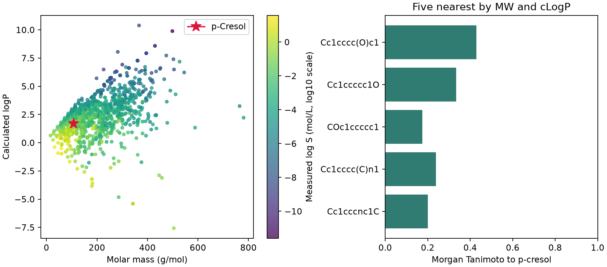

# 什麼是化學空間 {#sec-chemical-space}

## 同樣是對甲酚，為什麼換一張圖，最近的分子就不同了？ {#同一瓶對甲酚為什麼能在兩張分子地圖上找到不同的鄰居}

因為「近」的定義換了。用分子量和計算所得的 logP 畫圖時，靠近對甲酚的是大小和親脂性跟它差不多的分子；改用分子指紋找鄰居，排在前面的則是和它共享較多局部結構的分子。換句話說，在**化學空間**（chemical space）裡，兩個分子有多接近，取決於我們選了哪些特徵，以及怎麼衡量這些特徵的差異。

## 核心概念

假設樣品櫃裡有鄰甲酚、間甲酚和對甲酚三瓶樣品。三者的苯環上都接了一個甲基和一個羥基，只差在兩個取代基的相對位置。按分子量作圖的話，三個點會完全重疊；多加一個描述符，也要三者在這個描述符上的數值不同，點才會分開。反過來說，如果想在大小和親脂性相近的分子裡比較取代位置，圖上重疊的點正好是好起點，再逐一查看它們的結構就好。

讀圖時也要看分子是從哪裡來的。同樣的描述符，畫實驗室測過的樣品、試劑型錄裡買得到的化合物，或依反應規則列舉的虛擬結構，能回答的問題都不一樣。以實驗室樣品來說，圖上的點代表做過實驗的分子；某一塊空白，可能是還沒有人試過，也可能是那一類分子在篩選時就被排除了。想挑一個落在空白處的分子做實驗，要先提出具體的結構、確認買得到或合成得出來，再算出它的座標，因為圖上隨便指的一點，不一定對應得到真實的化合物。

選好特徵後，遠近要怎麼算？二元指紋可以用 @sec-tanimoto-similarity 的 Tanimoto 係數：數出兩個指紋同為 1 的位置，再除以至少一個為 1 的位置總數。

分子量和 logP 這類連續描述符，則要先處理兩軸的尺度。如果直接把兩軸的差值平方後相加，光是把分子量的單位從 g/mol 改成 kg/mol，近鄰的排序就可能改變。所以本節以這批分子在各軸的標準差當作單位來算距離。也就是說，兩軸各差一個標準差，在距離裡的分量一樣大；但它們對水溶解度的影響，未必一樣大。

## 動手做

[下載本節 notebook](../../notebooks/ch08/08-01-chemical-space.ipynb){.btn .btn-sm .btn-outline-primary}　[在 Colab 開啟](ch08/08-01-chemical-space.ipynb)

ESOL 有 1,128 筆有效的水溶解度紀錄。我們用 RDKit 產生保留立體標記的正規 SMILES，合併重複的結構後得到 1,117 個分子，這樣每個結構在近鄰名單裡只會出現一次。接著用 @sec-physicochemical-descriptors 的函式算出分子量和 logP，當作散點圖的兩個座標。點的顏色代表實測的 log S（水溶解度以 mol/L 表示後取常用對數），同一結構有多筆量測時取中位數。溶解度只用來上色，不參與座標或近鄰的計算。[@delaney2004esol]

現在來找最接近對甲酚的分子。下面的程式對每個分子算出它和對甲酚在分子量、logP 上各差多少，除以該欄的標準差，再把兩個結果平方、相加、開根號。這其實就是先標準化、再算兩點的歐氏距離，因為兩點座標相減時，各欄的平均值會互相抵銷。

這裡比較的是整份 ESOL，所以用全表的標準差就好。如果之後要看新的候選分子落在既有分子庫的哪裡，就要沿用原本的標準差；否則加入一批分子量特別大的候選物，連原有分子彼此的距離都會跟著變。

```python
axes_cols = ["MW", "cLogP"]
offset = (table[axes_cols] - table.loc[query, axes_cols]) / table[axes_cols].std(ddof=0)
table["distance"] = np.sqrt((offset ** 2).sum(axis=1))
others = table.drop(index=query)
```

{#fig-esol-two-spaces fig-alt="左圖依分子量與估計 logP 定位，以星形標出對甲酚，實測 log S 決定顏色。右圖列出兩欄標準化後最近的五筆，各橫條長度則表示該分子與對甲酚的 Morgan 指紋相似度。"}

在 @fig-esol-two-spaces 的左圖，紅星是對甲酚的位置。圖上兩軸保留原始單位（分子量以 g/mol 表示，logP 用原始數值），判斷遠近時則以標準化後的距離為準。對甲酚的分子量約為 108.14，計算 logP 約為 1.701。以圖的精度來看，鄰甲酚和間甲酚也落在紅星上。

三者的溶解度其實略有不同，要查表才看得出來：實測 log S 鄰甲酚為 −0.62，間甲酚為 −0.68，對甲酚為 −0.73。重疊的點會互相遮住，單看顏色或面積，讀不出這個位置有幾種結構、幾筆量測。

紅星附近還有苯甲醚。它和對甲酚的分子式相同，但氧接在苯環和甲基之間，沒有酚羥基的氫。兩者的標準化距離只有約 0.00294，苯甲醚的實測 log S 卻低到 −1.85。所以這三個近鄰適合做不同的對照：想保留酚羥基、比較取代位置，就挑鄰甲酚或間甲酚；想知道苯環上的氧連著氫或甲基時溶解度差多少，就把苯甲醚和對甲酚放在一起比較。

左圖中離對甲酚最近的五個分子，結構上和它有多像？右圖用半徑 2、長度 2,048 位元的 Morgan 指紋算出 Tanimoto 相似度：間甲酚為 0.429，鄰甲酚為 0.333，苯甲醚只有 0.174。

如果改用同一種指紋搜尋整個分子庫，並列第一的卻是對二甲苯和對苯二酚，相似度都是 0.615。從結構式可以看出，兩者和對甲酚一樣有一個對位雙取代的苯環，對二甲苯保留了甲基，對苯二酚保留了羥基。儘管指紋有許多共同位元，這些分子的實測 log S 仍然差很多。相似度能幫我們挑出值得比較的結構，至於哪些結構特徵對溶解度影響最大，就要另外分析。

兩份近鄰名單不同，也可能只是搜尋範圍不同。舉例來說，有人先篩出由單一片段組成的芳香族分子才搜尋，即使用同一套 Morgan 指紋，原本排名靠前的非芳香族分子也不會出現。所以要記下查詢結構、分子庫的篩選條件和指紋規格，之後排名改變時，才找得到原因。

在這張散點圖上，橫座標就是分子量，縱座標就是計算 logP。但要同時比較幾十個描述符或一整條指紋，就沒辦法讓每個特徵各占一條軸。接下來的 PCA、t-SNE 和 UMAP 會從這些特徵算出新的座標，到時點往右移多少，已經換算不回分子量；不過我們仍然可以找出圖上的近鄰，再回到原表看它們的結構和性質。

## 重點整理

- 化學空間裡誰和誰相近，取決於收錄的分子、選用的特徵和衡量遠近的方法。
- 保留原始結構和量測值，點重疊時才查得出同一個位置有哪些分子、實測值差多少。
- 比較兩張地圖時，用同一個分子查詢，再比較兩份近鄰名單上的結構。

## 小練習

把查詢分子換成甲苯（`Cc1ccccc1`），分別用物化距離和 Morgan 指紋相似度找出它最近的鄰居（並列的都要列出）。如果想找保留甲基苯環片段的對照物，你會用哪份名單？請根據分子結構說明理由。

提示：在 notebook 把 `query` 改成甲苯，並先排除甲苯本身。物化距離取最小值，指紋相似度取最大值；判斷並列時可用 $10^{-10}$ 當絕對容差，避免浮點數最後幾位的差異影響名單。

## 延伸閱讀

[ESOL 原始研究](https://doi.org/10.1021/ci034243x) · [RDKit 的指紋與相似度計算](https://www.rdkit.org/docs/GettingStartedInPython.html#morgan-fingerprints-circular-fingerprints)
