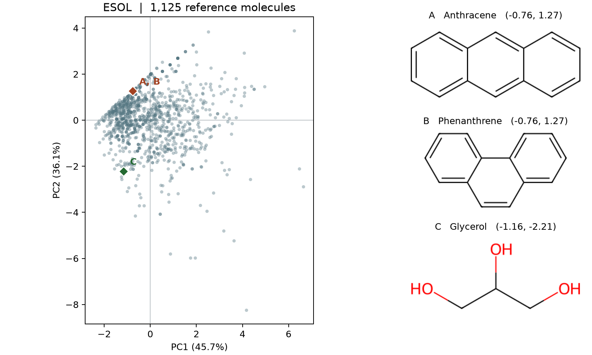

# PCA {#sec-principal-component-analysis}

## 怎麼把四欄分子描述符畫成一張圖？ {#開場問題}

把四欄混合成兩個新座標，就能畫在一張圖上。紙上只有橫、縱兩個座標，如果只挑兩欄作圖，另外兩欄的差異就看不到了。**主成分分析**（principal component analysis，PCA）的做法是四欄都用上，各用一組權重把四個數值加權相加，得到橫座標和縱座標。

第一組權重對應的方向稱為**第一主成分**（PC1），它是讓分子散得最開的方向，也就是投影後座標的變異數最大。**第二主成分**（PC2）則在所有和 PC1 垂直的方向裡，再挑一個讓分子散得最開的。這樣畫出的散布圖上，每個點代表一個分子；想知道兩點為什麼分開，就回頭看每個描述符在兩軸上占多少權重。

## 核心概念

本節用到 @sec-physicochemical-descriptors 介紹的四個描述符：分子量（MW）、計算得到的 logP（clogP，正辛醇與水分配係數的對數）、拓撲極性表面積（TPSA），以及可旋轉鍵數（RotB）。

先用直鏈烷烴建立直覺。碳鏈愈長，分子量愈大，可旋轉鍵通常也愈多，所以以分子量為橫軸、可旋轉鍵數為縱軸作圖時，這系列分子會沿著一條斜線排列。順著這排點畫一條新軸，光看分子在新軸上的位置，就看得出兩項性質一起增加的趨勢。PCA 就是把這個想法推廣到四個描述符。保留全部四條新軸時，分子只是換了一套座標；只取其中兩條作圖，才算把四維資料降成二維。

座標軸的刻度會影響 PCA 找到的方向。兩個分子的分子量可能差上百，可旋轉鍵數卻只差一兩個。scikit-learn 的 PCA 會先把每一欄減去該欄的平均值，這叫**置中**（centering）；置中只是移動原點，各欄的刻度不變。所以本節另外做**標準化**（standardization），把置中後的數值再除以該欄的標準差。換句話說，標準化後的數值代表「這個分子離平均值有幾個標準差」：分子量高出一個標準差記為 1，可旋轉鍵數也一樣，四欄就站在同一個起跑點上。

主成分的方向可以用一種矩陣分解求出來，稱為**奇異值分解**（singular value decomposition，SVD），細節交給程式處理即可。scikit-learn 把各方向的權重存在 `components_`，每一列對應一個主成分。以 PC1 為例，把一個分子的四個標準化描述符各乘上對應的權重再相加，就得到它在 PC1 上的座標，稱為**主成分分數**（score）。每個分子有自己的分數，但大家用的是同一組權重。

這組權重是一個長度為一的向量，本節把其中的係數稱為**負荷量**（loading）。有些軟體的「負荷量」指的是原始變數和主成分分數的相關係數，和別的軟體比較數值時，要先確認兩邊的定義。

## 動手做

[下載本節 notebook](../../notebooks/ch08/08-02-principal-component-analysis.ipynb){.btn .btn-sm .btn-outline-primary}　[在 Colab 開啟](ch08/08-02-principal-component-analysis.ipynb)

我們用 DeepChem 載入 ESOL 的 1,128 筆分子結構，再用 RDKit 算出四個描述符。實際工作中常見的情形是：參考圖已經畫好，手上又來了新結構，想知道它落在哪裡。為了模擬這個情形，我們先把蒽（anthracene）、菲（phenanthrene）和甘油（glycerol）放在一旁，用其餘 1,125 筆資料決定座標軸，再把這三個分子**投影**到圖上，也就是用同一套權重替它們算座標。整個過程只用到描述符矩陣 $X$，水溶解度沒有參與計算。[@delaney2004esol]

```python
scaler = StandardScaler().fit(X[reference])
pca = PCA(svd_solver="full").fit(scaler.transform(X[reference]))
scores = pca.transform(scaler.transform(X))
```

第一行用 `reference`（一串標記哪些是參考分子的真假值）選出參考分子，算出各欄的平均值和標準差。第二行用這組平均值和標準差換算參考分子的描述符，再求出主成分。最後一行用同一套換算方式替所有分子算座標，到這一步才用到蒽、菲和甘油。

為什麼不替這三個分子重新標準化？因為那樣各欄的原點會移到三者的平均值，即使投影方向相同，算出的座標也沒辦法和參考圖比較。往後要把實驗室的其他分子畫進這張圖，也要用同樣的方法算描述符、照原來的順序排列各欄，並沿用參考分子的標準化參數和主成分權重。

{#fig-esol-pca-scores fig-alt="橫軸 PC1 占 45.7%，縱軸 PC2 占 36.1%。蒽的三個環排成一直線，菲的三個環轉了彎，兩者在左上方的同一個菱形。帶三個羥基的甘油在左下方。"}

@fig-esol-pca-scores 的橫軸標了 45.7%，意思是參考分子在 PC1 方向上的散布，占四個標準化描述符總變異數的 45.7%。這個百分比稱為**解釋變異比例**（explained variance ratio）。PC2 占 36.1%，兩軸合計約 81.8%，剩下約 18.2% 落在圖上看不到的兩個方向。這些比例描述的是整批分子，個別兩個分子的差異如果主要在後兩個方向，投影到平面上還是可能靠得很近。

如果跳過標準化，直接用原始數值重做 PCA，光是 PC1 就占了 92.0%，而且分子量的權重高達 0.984。看一下原始刻度就明白：分子量的標準差約為 102.77，可旋轉鍵數只有 2.64，用原始數值算距離時，分子量的聲音大得多，PC1 幾乎就等於分子量。

原始刻度保留了各欄數值差異的實際大小，標準化則讓我們比較每個分子在各欄偏離平均多少。兩種算法的總變異數本來就不同，所以 92.0% 比 45.7% 高，不能拿來說哪一張圖比較好。

回到標準化後的散布圖。按分子量、clogP、TPSA、可旋轉鍵數的順序，PC1 的四個權重是 0.67、0.31、0.41、0.54，四個都是正的，所以 PC1 大致代表「分子整體的大小」。分子量和可旋轉鍵數都高於平均時，兩者都把點往右推；但如果一個分子量較大的分子剛好可旋轉鍵較少，兩項就會互相抵銷一部分，單看分子量判斷不了誰在右邊。

PC2 的四個權重分別是 0.07、0.74、−0.67、−0.01，clogP 為正、TPSA 為負。也就是說，脂溶性越高、極性表面積越小，分子在 PC2 上就越高。主成分軸的正負方向可以反過來選，例如 PC2 的權重和分數同時變號，整張圖會上下翻轉，但分子間的距離和描述符之間的關係都不變。

右圖畫了三個分子，左圖為什麼只看得到兩個菱形？下方標成 C 的是甘油，三個碳各帶一個羥基，TPSA 為 60.69 平方埃，clogP 約為 −1.67，PC2 分數為 −2.21，符合「極性高就往下」的讀法。

上方的菱形則疊著蒽和菲。兩者都是只含碳、氫的稠合芳香烴，TPSA 都是零，clogP 同為約 3.99，PC2 分數也都是 1.27。從右側的結構式可以看出差別：蒽的三個環排成一直線，菲的三個環則轉了個彎。但兩者分子量同為 178.23，可旋轉鍵數都是零，四欄數值完全相同，所以保留再多主成分也分不開。要分辨這對異構物，只能直接看結構式，或加入能區分環連接方式的特徵。

遇到其他靠得很近的點，也可以這樣處理：先查它們原本的四欄數值。數值有差別，就看 PC3 和 PC4，找出平面圖省略了哪些差異；四欄完全相同，就要從結構找出描述符沒抓到的特徵。至於分子沿哪個方向排列時水溶解度差最多，則要把實測溶解度也放進分析，這會在 @sec-partial-least-squares 討論。

## 重點整理

- PCA 依參考分子的散布方式決定座標軸，各欄有沒有標準化，結果會很不一樣。
- 負荷量決定軸的方向，主成分分數是分子在這條軸上的座標。
- 新分子要沿用原本的標準化參數和權重投影；描述符完全相同的分子，在圖上永遠重疊。

## 小練習

把萘（`c1ccc2ccccc2c1`）環上的一個 CH 換成 N，就得到喹啉（`c1ccc2ncccc2c1`）。沿用本節的參考座標，從萘變成喹啉時，哪一個描述符對 PC2 分數的變化貢獻最大？

提示：用 `scaler.transform` 把兩個分子的四個描述符標準化，以喹啉減去萘，再把四項差值各乘上 `pca.components_[1]` 中對應的權重。比較四個乘積的絕對值；四個乘積（含正負號）相加，應該剛好等於兩者縱座標的差。

## 延伸閱讀

scikit-learn 的 PCA 文件列出各個輸出陣列的定義，包括每個主成分的方向、變異數和解釋變異比例。想看懂 notebook 裡標準化前後的兩次計算，可以一起看 StandardScaler 的換算公式。[PCA](https://scikit-learn.org/stable/modules/generated/sklearn.decomposition.PCA.html)、[StandardScaler](https://scikit-learn.org/stable/modules/generated/sklearn.preprocessing.StandardScaler.html)

Delaney 的原始研究說明如何利用分子量、分配係數的計算值等性質估算水溶解度。本節沿用公開資料中的分子結構來練習投影。[ESOL 原始論文](https://doi.org/10.1021/ci034243x)
