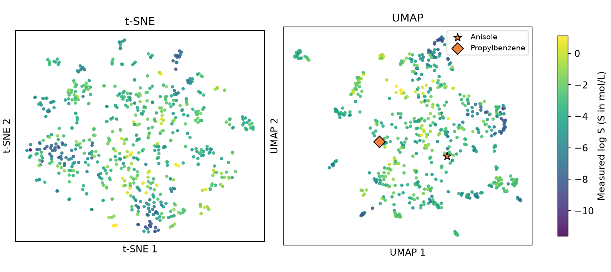
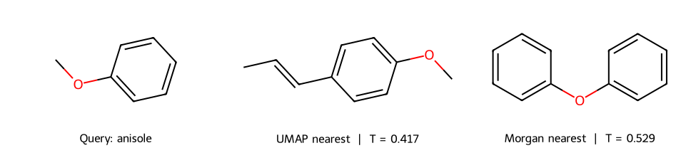

# t-SNE 與 UMAP {#sec-tsne-and-umap}

## 兩個分子在圖上靠得很近，結構到底有多像？

要回到指紋算相似度才知道，圖上的距離只能當線索。在本節的 UMAP 圖上找苯甲醚，離它最近的是另一個也帶甲氧基的分子，只是苯環上多了一條碳鏈；改用指紋在同一批分子裡搜尋，排第一的卻是二苯醚。t-SNE 和 UMAP 都要把高維的指紋資料攤在平面上，它們會盡量讓相似的分子靠在一起，但紙上兩點隔多遠，換算不回兩個分子共用多少結構特徵。

## 核心概念

先說清楚這裡的「像」怎麼算。我們沿用 @sec-morgan-fingerprints 的 Morgan 指紋，把每個原子周圍兩個鍵以內的環境編進 2,048 個位元。比較兩個分子時，先找出至少有一方亮起的位置，再看其中有多少比例是兩邊都亮的，這就是 Tanimoto 相似度；兩邊都是零的位置再多，也不會讓相似度變高。用 1 減去相似度得到 **Jaccard 距離**，下面的 t-SNE 和 UMAP 都用這個距離找近鄰，再各自把分子排到平面上。

**t 分布隨機鄰居嵌入**（t-distributed stochastic neighbor embedding，t-SNE）從每個分子出發，依距離估計其他分子是它鄰居的機率。如果原本很近的一對在平面上被拆得很遠，高維和平面上的兩套機率就會差很多，t-SNE 會反覆移動點的位置，盡量縮小這個差距。

參數 `perplexity` 控制估算機率時看多大的範圍，可以把它想成「有效鄰居數」；設成 30，每個點還是可能和超過 30 個點有關聯。讀 t-SNE 圖時，從某個分子旁邊找類似物是可行的，但兩團點之間隔著一大片空白，並不能告訴我們兩群的指紋差多少。

**均勻流形近似與投影**（Uniform Manifold Approximation and Projection，UMAP）也從近鄰出發。它先把每個分子和鄰居連起來，距離越近、連線的權重越高，再調整平面上的點，讓這些鄰近關係盡量保留下來。

UMAP 有兩個參數要分開看。`n_neighbors` 決定每個分子找幾個鄰居：調小比較看得出局部的差異，調大則會把較遠的分子也考慮進來。`min_dist` 影響鄰居在平面上擠得多緊；設為 0.15 時，有些點還是可能比 0.15 更近。團塊畫得緊或鬆會隨這個設定改變，所以團塊的大小說明不了一類化合物有多多樣。[@mcinnes2018umap]

## 動手做

[下載本節 notebook](../../notebooks/ch08/08-03-tsne-and-umap.ipynb){.btn .btn-sm .btn-outline-primary}　[在 Colab 開啟](ch08/08-03-tsne-and-umap.ipynb)

這次用 MoleculeNet 的 ESOL 水溶解度資料畫圖。我們先從 1,128 筆紀錄中挑出有實測值、只有一個片段、而且至少含一個芳香原子的分子，再用 RDKit 轉成正規 SMILES；同一結構有多筆紀錄的，整組略過。剩下 650 個結構。我們把苯甲醚和正丙苯留在一旁，當作稍後才拿到的候選物，只用其餘 648 個分子建圖，這樣找苯甲醚的鄰居時就不會找到它自己。另外，這份名單只有芳香族分子，換一個分子庫，鄰居也可能不同。[@delaney2004esol]

程式中的 `X_known` 是這 648 個分子的指紋，`X_held` 是兩個候選物的指紋。兩種方法都只用 `X_known` 決定座標，實測溶解度只在上色時用到。UMAP 建好圖後，呼叫同一個物件的 `transform`，就能把候選物放上去，原本的點都留在原位。scikit-learn 的 `TSNE` 沒有這個功能，所以左圖只畫已知分子；如果把候選物加進去重跑 t-SNE，連原本的 648 個點都會重新排列，前後兩張圖的座標差也就沒有意義了。

```python
tsne = TSNE(metric="jaccard", init="random", perplexity=30, random_state=seed)
zt = tsne.fit_transform(X_known)
mapper = UMAP(metric="jaccard", n_neighbors=15, min_dist=0.15,
              random_state=seed, transform_seed=seed, n_jobs=1)
zu = mapper.fit_transform(X_known)
zh = mapper.transform(X_held)
```

{fig-alt="左圖是 t-SNE，右圖是 UMAP。兩圖以紫至黃表示已知點的實測 log S；右圖橘色星號為苯甲醚，橘色菱形為正丙苯。"}

怎麼知道圖上的鄰居靠不靠得住？挑一個你關心的分子，記下旁邊是哪幾個結構，再換一個亂數種子或改變鄰居數重畫，看哪些分子還留在它旁邊。這和讀世界地圖有點像：把球面攤平，面積、角度和距離很難樣樣畫準。分子圖也一樣，每團裡的鄰居可能保留得很好，兩團之間的相對位置卻不太可靠，尤其是兩團幾乎沒有共同鄰居的時候。

現在看右圖的橘色星號。已知分子的顏色深淺代表實測水溶解度（log S）。我們刻意不替苯甲醚上色，模擬手上只有結構、還沒做實驗的情況。接著做兩次搜尋：一次找平面上離星號最近的點，一次拿苯甲醚的指紋和 648 個已知分子逐一算 Tanimoto 相似度。下圖把兩次找到的分子擺在苯甲醚旁邊。

{fig-alt="左側苯甲醚有一個連著甲氧基的苯環。中間的鄰居保留甲氧基，在苯環對位多一條含雙鍵的三碳鏈。右側二苯醚的氧連接兩個苯環。"}

圖中間的分子和苯甲醚都帶甲氧基，只是苯環對位多了一條含雙鍵的側鏈，兩者的 Tanimoto 相似度是 0.417。右邊的二苯醚多了整個苯環，看起來改動更大，相似度卻比較高，為 0.529。這和指紋的記錄方式有關：第二個苯環上的局部環境和第一個一樣，對應的位元早就亮了，不會因此多亮一格。

再把溶解度放回來看。苯甲醚的實測 log S 是 −1.85，中間的分子是 −3.13，二苯醚是 −3.96。也就是說，兩個參照物裡指紋比較像苯甲醚的那一個，水溶解度反而跟它差得更多。

從圖上認出取代基之後，要解釋溶解度的差異還差一步：先比較兩個分子還有哪些地方不同，再查實驗是不是在相同條件下量的。如果想評估整張圖，可以把剛才的做法推廣到每個分子：各列兩張名單，一張是指紋最像的五個，一張是圖上最近的五個，數一數有幾個名字同時出現。這比單看點群的形狀，更能說明哪些分子的鄰近關係值得相信。

## 實驗上的考量

如果拿圖上最近的分子來推估苯甲醚的溶解度，會差多少？把兩筆實測 log S（−1.85 和 −3.13）換回 mol/L，苯甲醚的水溶解度約為對方的 19 倍。指紋只記錄結構，要追查這個落差，得先看原始量測的溫度和方法；紀錄不夠時，就把兩個樣品放在相同條件下重測。

之後用這張圖討論貝氏最佳化的下一輪實驗時，也要確認候選物買得到或做得出來，並一起看模型的預測平均值、不確定性和取得函數的分數。就算好幾輪都挑到同一團裡的分子，也要看歷輪實測的最佳值是否還在進步，再決定要不要繼續。

## 重點整理

- t-SNE 和 UMAP 都會犧牲一部分鄰近關係，要知道兩個分子多像，就回到指紋算 Tanimoto 相似度。
- UMAP 可以用已知分子建圖、再把新候選放進去；t-SNE 加入候選重跑，就是另一張圖了。
- 相鄰點的顏色差很多時，先查各自的實驗紀錄，再決定能不能用這個鄰居推測性質。

## 小練習

把查詢分子換成正丙苯，找出 UMAP 圖上最近和指紋最像的分子，並比較兩份前五名名單有幾個重複。如果同事要從中挑一個參照物，你會提醒他注意什麼？

提示：呼叫 notebook 的 `neighbors(i)`，把 `i` 設成 1（`held` 中的第二個分子就是正丙苯），它會回傳兩種排序和相似度，兩份排序的索引都對應到同一份 `known`。分數相同時，按正規 SMILES 的字母順序排列。

## 延伸閱讀

- van der Maaten 與 Hinton 說明 t-SNE 怎麼把高維的鄰居機率轉成平面排列。[t-SNE 原始論文](https://jmlr.org/papers/v9/vandermaaten08a.html)；[scikit-learn 的 TSNE 介面](https://scikit-learn.org/stable/modules/generated/sklearn.manifold.TSNE.html)
- McInnes 等人的 [UMAP 套件論文](https://doi.org/10.21105/joss.00861)；官方文件分別示範[調整鄰居數及最小距離](https://umap-learn.readthedocs.io/en/latest/parameters.html)和[放入新樣本](https://umap-learn.readthedocs.io/en/latest/transform.html)。
