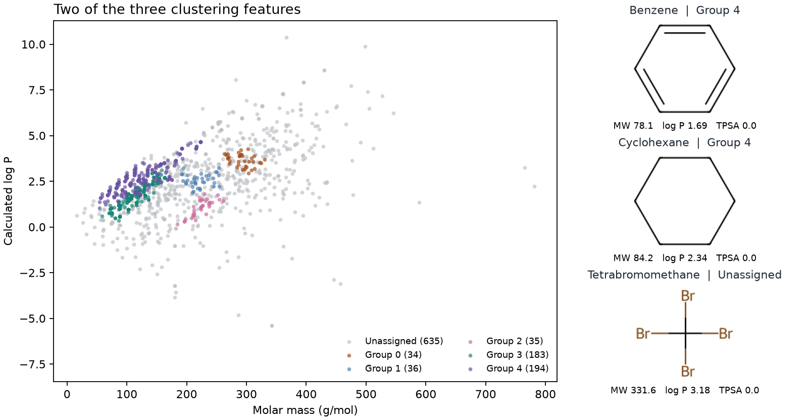

# 密度分群（HDBSCAN） {#sec-hdbscan}

## 為什麼苯和環己烷分在同一群，四溴甲烷卻沒被分進任何一群？ {#開場問題}

因為 HDBSCAN 看的是「周圍擠不擠」，苯和環己烷周圍很擠，四溴甲烷周圍很空。在 ESOL 資料集中，只比較分子量、計算所得的 log P 和極性表面積的話，苯和環己烷會落在同一個密集區。HDBSCAN 會逐步提高密度門檻，看哪些分子在一段範圍內始終聚在一起。所以一個分子分到哪一群，取決於用哪些特徵算距離，也取決於這批資料裡有多少分子和它相近。四溴甲烷的結構明確、也有溶解度紀錄，這次卻標為 `-1`，意思是它沒有歸入任何一群。

## 核心概念

把每個分子看成空間中的一個點，三個座標就是它的三個描述符。以某個點為球心，慢慢把半徑放大，直到球裡裝進指定數目的分子，這時的半徑稱為**核心距離**（core distance）。分子擠在一起的地方，核心距離短；分子稀疏的地方，要把半徑放得很大才找得到同樣多的鄰居。本節在 scikit-learn 中設定 `min_samples=6`，因為球心的分子自己也算一個，所以把其餘分子由近到遠排好，第五個分子到球心的距離就是核心距離。

兩個密集區之間，有時零星散著幾個分子。如果只看兩點之間的距離，這幾個點可能剛好一個接一個，像踏腳石一樣把兩區連起來。HDBSCAN 因此改用**相互可達距離**（mutual reachability distance）：取兩點的原始距離和兩點各自的核心距離，三者中最大的那個。也就是說，就算兩點彼此靠近，只要其中一點周圍很空，它們的相互可達距離還是很大。接著逐步縮短允許連線的距離，原本相連的一群點會慢慢分成幾支，這些分支關係可以畫成一棵樹。[@campello2013hdbscan]

樹上哪些分支會留下來？`min_cluster_size` 決定一個分支至少要有多少成員，才有資格自成一群。接著，預設的 EOM（excess of mass）方法會比較「保留整個分支」和「改留它的子分支」，看哪一種比較穩定。穩定度同時考慮成員數，以及密度門檻提高時，成員能在這個分支裡待多久。最後選出的各群可以疏密不一，也會有些點不屬於任何一群。

和 @sec-butina-clustering 的 Butina 分群比較一下：Butina 用指紋相似度門檻挑出中心，再把符合門檻的鄰居歸入同一群，附近沒有相似分子的點會自己成一群。HDBSCAN 則把這樣的孤立點標成**噪音**（noise）。

## 動手做

[下載本節 notebook](../../notebooks/ch08/08-04-hdbscan.ipynb){.btn .btn-sm .btn-outline-primary}　[在 Colab 開啟](ch08/08-04-hdbscan.ipynb)

我們用 DeepChem 的 `load_delaney` 讀取 ESOL 全部 1,128 筆紀錄，再用 RDKit 轉成正規 SMILES，合併相同的字串後，把剩下的 1,117 種結構依字串排序。先合併重複紀錄，是因為這裡要估計的是不同結構的分布密度；同一個結構出現兩次，數鄰居時就會多算一個。實測水溶解度完全不參與分群。[@delaney2004esol]

每種結構用三個描述符表示：莫耳質量（g/mol）、RDKit 估算的辛醇／水分配係數對數（MolLogP），以及拓撲極性表面積（TPSA，Ų）。如果直接用原始數值算歐氏距離，莫耳質量差 30 g/mol 的影響會遠大於 log P 差 1，所以要先標準化：每一欄減去平均值、再除以標準差，標準化後相差 1 就代表原本相差一個標準差。這裡要描述的是整個分子庫，可以用全部結構估計平均值和標準差；如果目的是預測測試集分子的性質，這兩個量就只能用訓練資料來估計。

```python
Z = StandardScaler().fit_transform(values)
def group(min_size):
    return HDBSCAN(min_cluster_size=min_size, min_samples=6, metric="euclidean",
                   algorithm="brute", copy=True).fit_predict(Z)

labels = group(20)
coarser = group(30)
```

上面的程式把分群寫成一個小函式 `group`，只要傳入每群的成員數下限，就會回傳每個分子的群標籤，接著分別用 20 和 30 各跑一次。

成員數下限設為 20 時，HDBSCAN 選出五群，各有 34、36、35、183 和 194 種結構，其餘 635 種未分群（標籤為 `-1`），約占總數的 57%。下圖用顏色標示分群結果，橫軸是莫耳質量，縱軸是計算所得的 log P，兩軸都用標準化前的數值。要注意的是，程式傳給 `fit_predict` 的 `Z` 有三個標準化後的描述符，所以圖上幾乎重疊的兩個點，還是可能因為 TPSA 差很多而分到不同群。

{#fig-hdbscan fig-alt="橫軸為莫耳質量、縱軸為計算 log P，五種顏色標示各群，灰點為未分群。右側並列第 4 群的苯和環己烷，以及未分群的四溴甲烷，附各自的三個描述符。"}

@fig-hdbscan 右側的苯和環己烷都是六碳環，但苯有芳香性，環己烷全是單鍵，比較反應性時這是很大的差別。只看這三個描述符，兩者卻幾乎一樣：TPSA 都是 0 Ų，莫耳質量只差約 6 g/mol，計算所得的 log P 分別為 1.69 和 2.34。換句話說，這三個描述符沒有一個直接記錄「有沒有芳香環」。和苯同在第 4 群的，除了環己烷，還有不含環的正辛烷，所以這一群不能叫做芳香族化合物群。

四溴甲烷的 TPSA 也是零，但它有四個溴原子，莫耳質量高達 331.6 g/mol。用標準化後的三個描述符計算，苯到第五個鄰居的距離為 0.077，環己烷為 0.059，四溴甲烷則是 0.478，可見它附近的分子確實稀少得多。不過 HDBSCAN 是看整棵樹來挑分支，0.478 並不是一條適用於所有分子的入群門檻。遇到圖上的灰點，可以回到原始資料看它的結構和近鄰；被標成噪音，並不表示這筆溶解度紀錄有問題、應該刪掉。

如果把 `min_cluster_size` 從 20 提高到 30，其他設定不變，結果會怎樣？原本五群都超過 30 個成員，照理說應該不受影響，重新計算後卻只剩四群。從 notebook 的成員表可以看到，原本第 1 群的 36 種、第 2 群的 35 種，加上原先未分群的 11 種，現在合成一群，共 82 種。也就是說，提高門檻會改變樹上有哪些分支可選，即使原本各群都已達到新的下限，分法還是可能改變。這次少了一群，未分群的結構也從 635 種減為 624 種。

比較兩次結果時，要追蹤同一批分子，而不是比群編號。以苯和環己烷所在的第 4 群為例，換成新設定後，原本的 194 種結構還在同一群，只是群編號變成 3；只看編號，會誤以為這些分子都換了群。另外，這次刻意把 `min_samples` 固定為 6。在 scikit-learn 中省略這個參數的話，算核心距離用的近鄰數會跟著成員數下限一起變，就分不清差異是哪一項設定造成的。

如果要從各群挑代表分子送測，先想想實驗需要比較哪些化學差異。以苯和環己烷所在的群為例，如果芳香性會影響實驗結果，只挑群中心的一個分子，就可能漏掉一整類結構。這時可以在成員表上註明每個分子有沒有芳香環，再分配送測名額，讓不同結構都有代表。

## 重點整理

- 核心距離是剛好裝進指定數目鄰居的半徑，解讀分群前要先知道距離用了哪些特徵、有沒有標準化。
- 未分群的分子只是落在稀疏處，可以回頭看它的結構和近鄰，噪音標籤不代表資料有錯。
- 改參數後要追蹤同一批分子，群編號只在當次結果裡有意義。

## 小練習

把每群的成員數下限從 20 降到 12（`min_samples=6` 不變），比較 1-丁醇、1-戊醇和 1-己醇在兩次分群中各落在哪一群，並從描述符說明為什麼碳鏈長度相近，也不一定總是同一群。

提示：呼叫 `group(12)` 得到新的標籤，再用 `keys.index(smiles)` 查出 `CCCCO`、`CCCCCO` 和 `CCCCCCO` 所在的列。把三個分子的原始描述符和兩次的標籤排在一起比較，別忘了 `-1` 代表未分群。

## 延伸閱讀

- Campello、Moulavi 與 Sander 說明如何從密度階層選擇穩定分支。[原始論文](https://doi.org/10.1007/978-3-642-37456-2_14)
- scikit-learn 的文件列出 `min_samples`、`min_cluster_size` 與負數標籤的定義。[HDBSCAN API](https://scikit-learn.org/stable/modules/generated/sklearn.cluster.HDBSCAN.html)
