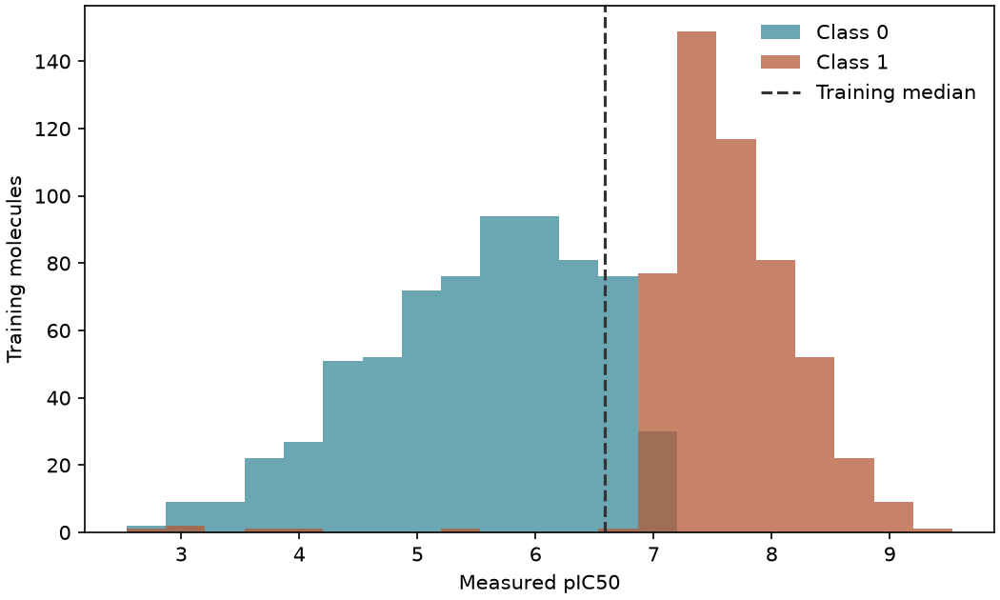

# QSAR 是什麼：分類與迴歸 {#sec-qsar-tasks}

## 同樣要挑 BACE-1 抑制劑，預測一個活性數值和判斷「有沒有活性」有何差別？

差別在於答案拿來做什麼用。想比較兩個 BACE-1 抑制劑的效力，就得知道兩者差多少，這時要預測數值；如果只是要決定哪些分子進入下一輪篩選，分成有活性和無活性兩類就夠了。**定量構效關係**（quantitative structure–activity relationship，QSAR）就是把分子結構轉成數值，用來預測實驗測得的生物活性。該預測數值還是類別，要看實驗同事打算怎麼用這份結果。

## 核心概念

把每個分子想成試算表的一列，左邊放從結構算出的描述符或指紋，右邊放實驗答案。右邊是對某個標的的生物活性時，這叫 QSAR；換成水溶解度這類物性，則叫**定量結構與性質關係**（quantitative structure–property relationship，QSPR）。右邊這一欄要預測的量，一般稱為**端點**（endpoint）。

同一種演算法可以用在不同的端點上。換句話說，「QSAR」說的是結構和哪類實驗結果有關，「**迴歸**」（regression，預測一個數值）和「**分類**」（classification，預測一個類別）說的則是模型要解哪一種數學問題。只看輸出的數字分不出是哪一種，因為分類也常用 0 和 1 代表兩個類別。

BACE 資料剛好可以練習這兩種任務，因為研究者同時記錄了 BACE-1 抑制劑的效力和活性類別。做迴歸時讀的是 pIC₅₀，也就是把 IC₅₀ 以 mol/L 表示後取負的常用對數；pIC₅₀ 愈大，達到半數抑制所需的濃度愈低，差一個單位就是十倍的濃度差。做分類時讀的是 `Class` 欄，兩個分子都標成有活性時，看不出哪個效力較強。

如果要自己訂濃度門檻來分類，記得寫清楚剛好等於門檻的樣品歸哪一邊，以及這個分法對應什麼實驗決定。本例直接用資料表提供的類別。[@subramanian2016bace]

一個實用的檢查方法是想想時間順序：新分子送測前，我們已經知道結構、可以算出特徵，但還不知道實驗結果。如果模型用到了「量過才會知道」的資訊，就叫做**資料洩漏**（data leakage），就像考試前偷看了答案。舉例來說，拿量過才知道的 pIC₅₀ 去預測活性類別，測試成績再好，送測前也沒辦法照做。本例先預測 pIC₅₀、再預測活性類別，兩次都只讓模型用從結構算出的特徵。

## 動手做

[下載本節 notebook](../../notebooks/ch09/09-01-qsar-tasks.ipynb){.btn .btn-sm .btn-outline-primary}　[在 Colab 開啟](ch09/09-01-qsar-tasks.ipynb)

我們依 @sec-moleculenet 的方法，用 DeepChem 分別載入迴歸版和分類版的 BACE 資料。兩次都用同樣的 MACCS 指紋、按骨架切分，只是一次讀 pIC₅₀，一次讀類別。程式會逐列比對 `ids` 和特徵矩陣，確認兩版的每一列都是同一個分子，兩種標籤也都齊全；只比筆數不夠，因為其中一版如果曾依活性排序，列的順序就會不同。

訓練、驗證和測試集各有 1,210、151、152 筆。這三組的分工是：**訓練集**用來讓模型學習，**驗證集**用來比較和挑選模型，**測試集**留到最後才拿來做一次總評。本節只用訓練集決定基準，再用驗證集評分，完全不碰測試集。

如果完全不看結構，只猜一個固定的答案，會錯多少？這個成績就是後面拿來比較模型的**基準**（baseline）。迴歸基準對每個分子都回答訓練集 pIC₅₀ 的中位數，因為只能選一個常數時，中位數能讓訓練資料的絕對誤差總和最小。分類基準則對每個分子都猜訓練集裡比較多的那一類。

下面的程式用 scikit-learn 的「假模型」建立這兩個基準。它們和真正的模型用一樣的介面、吃一樣的特徵矩陣，但不管分子的取代基、大小或指紋怎麼變，答案都不會變。

```python
reg = DummyRegressor(strategy="median").fit(train_r.X, train_r.y[:, 0])
clf = DummyClassifier(strategy="most_frequent").fit(train_c.X, train_c.y[:, 0])
yp = reg.predict(valid_r.X)
cp = clf.predict(valid_c.X)
```

{fig-alt="橫軸是 pIC50，直方圖依資料提供的 0 與 1 類別上色，垂直虛線標出整個訓練集的中位數。"}

先看圖上的虛線。訓練標籤的中位數約為 6.585，所以迴歸基準替 151 個驗證分子給的答案全是 6.585。把每個分子的實測值和這個數字相減、取絕對值再平均，得到約 0.563 個 pIC₅₀ 單位，這個量稱為**平均絕對誤差**（mean absolute error，MAE）。

0.563 是平均值，個別分子可能錯得更多或更少；如果驗證集剛好集中在中位數附近，連常數預測都能有不錯的成績。所以它的用途是當作參照：之後換成會讀結構的模型，在同一份驗證資料上比較，才知道多做的特徵計算值不值得。

再看圖裡兩種顏色各有多少筆。訓練集有 695 筆標為 0、515 筆標為 1，所以多數類基準全部猜 0。驗證集實際上有 67 筆是 0、84 筆是 1，這個基準只猜對 67 筆，正確率約 44.4%。

為什麼照最多的類別猜，連一半都沒猜中？因為我們挑的是訓練集裡比較多的類別，而驗證集裡的骨架剛好有不同的類別比例。如果先偷看驗證標籤再決定猜哪一類，就等於把評估用的資訊拿去做選擇了。另外，要檢查分類器會不會錯過值得合成的抑制劑，除了算對了幾個，還要把漏掉的活性分子另外數出來。

直方圖顯示的是兩類分子已知活性的分布。就算兩種顏色在橫軸上分得很開，這張圖也說不出哪些結構和活性差異有關；拿到一個只有結構的新分子，我們甚至不知道它會落在哪根柱子上。後面幾節才會用結構去找分子之間共有的規律。比較模型成績時，要先確認資料集、端點、分組和基準都相同，兩個分數才是在回答同一個實驗問題。

同樣是數字 1，換一個研究問題，意義也跟著變。本節的 1 代表 BACE 分類資料裡的活性物；後面講 k-NN 和決策樹時，MutagenLou2023 的 1 則代表 Ames 致突變陽性。篩選 BACE 抑制劑時，模型把活性候選排在前面，正是實驗同事要的；初步檢查致突變風險時，排在前面的陽性候選反而是需要多加小心的那一批。同樣叫「找出正類」，接下來的實驗行動可以完全相反。

所以交付結果時，最好把正類的定義直接寫進欄名，例如註明預測的是哪個標的或哪一種試驗，下一位同事才知道分數變大該怎麼解讀。這兩份資料的分子和量測流程也不同，本章不會拿它們的正確率比高低。

## 重點整理

- 要比較效力差距就預測數值（迴歸），只要決定送測名單就預測類別（分類）。
- 模型只能用送測前就知道的資訊，否則就是資料洩漏。
- 常數基準是不看結構的成績，用來判斷讀取結構到底帶來多少改進。

## 小練習

把常數預測從訓練集 pIC₅₀ 的中位數改成平均數，驗證集的 MAE 會差多少？

提示：把 `DummyRegressor` 的 `strategy` 改成 `"mean"`，平均數只用訓練標籤計算，評分時沿用原本的 151 筆驗證資料。

## 延伸閱讀

BACE 的原始研究說明了活性資料的來源；scikit-learn 則把常數預測和多數類預測包成和其他模型相同的介面，方便直接比較。[BACE 原始研究](https://doi.org/10.1021/acs.jcim.6b00290) · [DummyRegressor 文件](https://scikit-learn.org/stable/modules/generated/sklearn.dummy.DummyRegressor.html) · [DummyClassifier 文件](https://scikit-learn.org/stable/modules/generated/sklearn.dummy.DummyClassifier.html)
