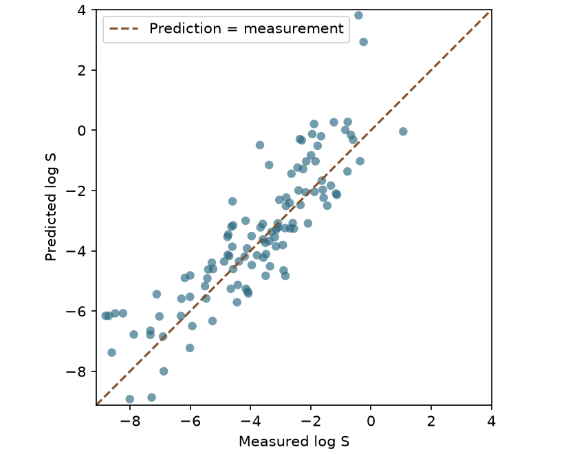

# 線性迴歸 {#sec-linear-regression}

## 知道分子量和親脂性，能估出一個分子在水中溶多少嗎？ {#開場問題}

可以，做法是從量過溶解度的分子找出一條關係式。**線性迴歸**（linear regression）替每個描述符配一個係數，把「描述符 × 係數」全部加起來，再加上一個截距，就是溶解度的預測值。舉例來說，親脂性越高的分子通常越難溶於水，模型就會給 logP 一個負的係數。這裡預測的是 log S，也就是以莫耳濃度表示的水溶解度取常用對數；log S 差一個單位，濃度就差十倍。

## 核心概念

先只看一個描述符。橫軸放計算的親脂性 logP，縱軸放實測 log S，每個分子是圖上的一個點。模型寫成 $\hat y=b+w x$：調整截距 $b$ 會把整條線上下平移，調整斜率 $w$ 則決定 logP 每增加一單位，預測的 log S 改變多少。

描述符變多時，預測式變成 $\hat y=b+\sum_j w_j x_j$，道理一樣。這時解讀某個係數，要加上「其他描述符都不變」的條件。但實際替分子換一個取代基時，親脂性和分子量常常一起變，所以要估算修飾的效果，得把新分子的每一欄都重算，再代入整條式子。

這條線的位置怎麼決定？最常用的是**普通最小平方法**（ordinary least squares，OLS）。先用某條直線預測每個訓練分子，再用實測值減去預測值，這個差叫作**殘差**（residual）。如果直接把殘差加總，一個高估一個單位、一個低估一個單位，帳面上會剛好抵銷，所以 OLS 先把殘差平方再相加，找出讓總和最小的那組係數。

平方的副作用是：一筆殘差從一個單位變成兩個單位，在總和裡的分量會變成四倍。也就是說，如果某個分子的量測值或登錄的單位出錯，它可能把整條線拉過去，連帶影響其他分子的預測。

只有兩個分子時，一定畫得出一條剛好穿過兩點的直線，兩筆殘差都是零，但這條線會不會經過第三個分子，誰也不知道。這就是**過度擬合**（overfitting）的直覺：模型把訓練資料背得太熟，連其中的雜訊和巧合也記住了，遇到新分子反而估不準，就像學生只背考古題的答案，題目一換就不會了。

用分子指紋取代單一描述符時，每個結構會變成上千個欄位。可調的係數比分子還多時，常常有好幾套係數都能完美重現訓練資料；但新分子的特徵組合方式不同，這些在訓練集上分不出好壞的式子，給出的預測可能差很遠。@sec-regularization 會回到這個例子。

## 動手做

[下載本節 notebook](../../notebooks/ch09/09-02-linear-regression.ipynb){.btn .btn-sm .btn-outline-primary}　[在 Colab 開啟](ch09/09-02-linear-regression.ipynb)

Delaney 的 ESOL 研究用少數幾個結構性質估算水溶解度。我們沿用其中的親脂性、分子量、可旋轉鍵數和芳香原子比例四類輸入，用 RDKit 計算描述符，再用自己的訓練集擬合係數。資料用 @sec-moleculenet 的 DeepChem 介面讀取。檔案裡也附有現成的溶解度估計值，但我們只取結構當輸入、實測溶解度當答案，這樣才看得出這四個描述符本身能做到什麼程度。[@delaney2004esol]

芳香原子比例的分母只算重原子，所以苯這類所有重原子都在芳香環上的分子，即使帶有氫，比例仍然是一。可旋轉鍵數依 RDKit 的定義計算。把模型交給同事時，記得附上每一欄的定義和順序：如果訓練時第二欄是分子量，預測時卻填了可旋轉鍵數，程式照樣會算出一個數字，但用的已經是錯的係數。

DeepChem 依分子骨架分組，把 1,128 筆資料分成 902 筆訓練、113 筆驗證和 113 筆測試。依骨架切分的意思是，同一骨架的分子只會出現在其中一組，測試時模型面對的是沒看過的骨架。我們也關掉標籤轉換，讓預測值留在實測的 log S 尺度。因為四欄描述符和 OLS 都是事先決定好的，只需要在訓練集上擬合一次。下面的矩陣每列是一個分子，每欄是一個描述符。

```python
X_train, X_valid, X_test = (descriptors(split) for split in (train, valid, test))
model = LinearRegression().fit(X_train, y_train)
print("intercept and coefficients:", model.intercept_, model.coef_)
```

第一行對訓練、驗證、測試三組各呼叫一次 `descriptors`，一次算出三個描述符矩陣；第二行用訓練集擬合模型；第三行印出截距和係數。

截距約為 0.357，四個係數依序為 −0.8431、−0.00569、−0.00717、−0.2384。以第一欄為例，其他三欄不變時，logP 高一單位，預測的 log S 就低約 0.84，符合「越親脂越難溶」的直覺。第二欄的係數看起來很小，但分子量動輒相差上百，所以直接比較係數的絕對值，會把單位造成的差異誤當成化學上的重要程度。截距也只是數學上的起點，現實中並沒有四個描述符都是零的分子。

{#fig-linear-regression fig-alt="橫軸為實測 log S，縱軸為預測 log S。測試分子分布在等值虛線兩側，部分難溶分子明顯落在虛線上方。"}

在 @fig-linear-regression 中，落在虛線上的分子，預測值剛好等於實測值。以測試集的第一個分子為例，它的芳香原子比例為一，也沒有可旋轉鍵；預測 log S 為 −4.898，比實測的 −6.176 大，所以點落在虛線上方，代表模型高估了它的水溶解度。點到虛線的垂直距離約 1.28，就是這個分子的絕對誤差。

把每個分子到虛線的垂直距離取平均，就是 9.1 介紹過的 MAE，單位和 log S 相同。訓練、驗證和測試集的 MAE 分別為 0.727、1.076、0.945。訓練集最小並不意外，因為係數就是用這些分子擬合的；驗證集和測試集雖然都是 113 筆，涵蓋的骨架不同，誤差也不同。

另一個常見的指標是**決定係數**（coefficient of determination）$R^2$，測試集為 0.678。它比較的是「模型的平方誤差」和「一律猜測試集平均值的平方誤差」，越接近 1 代表模型比瞎猜平均值好越多。所以它不能讀成「猜對了 67.8% 的分子」。

把預測交給實驗同事時，也可以從對數換回濃度。預測和實測的濃度分別是 $10^{\hat y}$ 和 $10^y$，兩者相除就是 $10^{\hat y-y}$。前面那個芳香分子差約 1.28 個 log S 單位，換算後預測濃度約為實測的十九倍；如果點在虛線下方同樣遠，預測就只有實測的約十九分之一。這兩種錯誤在 MAE 裡分量一樣，實驗上的後果卻可能完全不同。

如果要用倍數報告誤差，記得說明是逐筆換算倍數再平均，還是先平均對數誤差再換算，兩種順序一般會得到不同的數字。

如果打算用模型安排實驗，就回到散點圖看自己最在意的區域。舉例來說，要篩出難溶分子時，虛線上方那些「實際很難溶、卻被預測成好溶」的點，比全組的平均誤差更值得追查。回頭看這些分子的原始結構，可以找出它們有哪些共同特徵、描述符算得合不合理；至於偏差來自描述符、線性假設還是實驗紀錄，則要再進一步分析。

## 重點整理

- OLS 找出讓訓練集殘差平方和最小的係數，評估時則常用單位直觀的 MAE。
- 解讀係數時要看欄位的單位，並記得「其他描述符不變」這個前提。
- 點在虛線上方是高估、下方是低估，換回濃度後才看得出實驗上的影響。

## 小練習

只用 logP 一個描述符擬合，驗證 MAE 會比四個描述符一起擬合時高或低多少？

提示：把擬合那一行的 `X_train` 改成 `X_train[:, :1]`（只取第一欄，但仍保持矩陣的形狀），預測時驗證集也只取第一欄，再用單欄模型的 MAE 減去四欄模型的 MAE。

## 延伸閱讀

Delaney 報告了各結構性質與水溶解度的關係，也說明了芳香原子比例的定義。[ESOL 原始論文](https://doi.org/10.1021/ci034243x)

scikit-learn 的線性模型文件說明了最小平方擬合，以及欄位之間高度相關時，係數估計會遇到的問題。[普通最小平方法](https://scikit-learn.org/stable/modules/linear_model.html#ordinary-least-squares)
